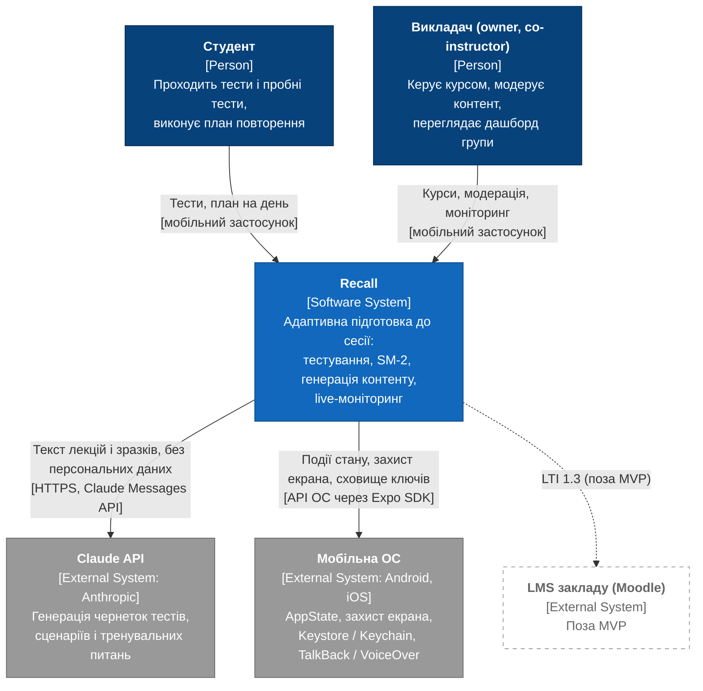
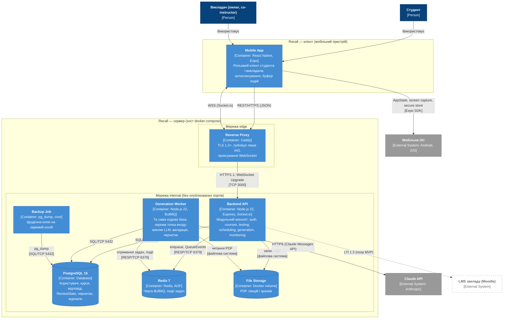

# РОЗДІЛ 2. ПРОЄКТУВАННЯ АРХІТЕКТУРИ СИСТЕМИ

## 2.1. Контекстне та контейнерне моделювання системи (C4 Model)

Архітектуру системи описано за моделлю C4 (Context, Container, Component). Діаграми виконано кодом Mermaid.js у нотації `flowchart TB`: тип кожного вузла C4 зазначено в підписі ([Person], [Software System], [Container], [External System]), протокол — у підписі зв'язку. Нотацію `flowchart` обрано замість експериментального синтаксису `C4Context` / `C4Container`, оскільки останній не підтримує пунктирних зв'язків для елементів поза MVP і при восьми і більше вузлах накладає підписи зв'язків один на одний. Базовою лінією трасування є специфікація вимог [srs.md](./srs.md); протокол архітектурного рев'ю — [17-AI Insights.md](./17-AI%20Insights.md), Запис 12.

### 2.1.1. Діаграма контексту (Level 1)

Діаграма контексту визначає межу системи Recall, її користувачів і зовнішні системи (рис. 2.1).

Рисунок 2.1 – Діаграма контексту системи Recall (C4 Level 1)

Таблиця 2.1 – Вузли діаграми контексту

| Вузол | Тип | Технологія | Відповідальність | SRS-ID |
|---|---|---|---|---|
| Студент | Person | — | Проходить тести і пробні тести, виконує план повторення | [SRS-FUN-13](./srs.md#srs-fun-13), [SRS-FUN-20](./srs.md#srs-fun-20), [SRS-FUN-34](./srs.md#srs-fun-34) |
| Викладач (owner, co-instructor) | Person | — | Створює курс і контрольні заходи, завантажує матеріали і зразки, модерує чернетки, переглядає дашборд; права co-instructor обмежено | [SRS-FUN-03](./srs.md#srs-fun-03)…[SRS-FUN-10](./srs.md#srs-fun-10), [SRS-FUN-28](./srs.md#srs-fun-28), [SRS-FUN-39](./srs.md#srs-fun-39), [SRS-FUN-47](./srs.md#srs-fun-47) |
| Recall | Software System | React Native, Node.js, PostgreSQL, Redis | Тестування, планування повторень за SM-2, асинхронна генерація контенту, пробні тести, антисписування, live-моніторинг | [SRS-FUN-01](./srs.md#srs-fun-01)…[SRS-FUN-49](./srs.md#srs-fun-49) |
| Claude API | External System | Anthropic Claude Messages API | Генерація чернеток тестів, сценаріїв і тренувальних питань | [SRS-FUN-24](./srs.md#srs-fun-24), [SRS-FUN-25](./srs.md#srs-fun-25), [SRS-FUN-31](./srs.md#srs-fun-31) |
| Мобільна ОС | External System | Android 10+, iOS 16+ | Події AppState, захист екрана, Keystore / Keychain, TalkBack / VoiceOver | [SRS-FUN-37](./srs.md#srs-fun-37), [SRS-FUN-40](./srs.md#srs-fun-40), [SRS-FUN-41](./srs.md#srs-fun-41), [SRS-NFR-SEC-04](./srs.md#srs-nfr-sec-04), [SRS-NFR-A11Y-02](./srs.md#srs-nfr-a11y-02) |
| LMS закладу (Moodle) | External System, поза MVP | LTI 1.3 | Інтеграцію не реалізовано; показано для фіксації межі системи | — |

Таблиця 2.2 – Зв'язки діаграми контексту

| Від | До | Протокол | Призначення |
|---|---|---|---|
| Студент | Recall | Мобільний застосунок | Тестування, план на день, пробні тести |
| Викладач | Recall | Мобільний застосунок | Керування курсом, модерація, моніторинг групи |
| Recall | Claude API | HTTPS (Claude Messages API, JSON) | Передача тексту лекцій і зразків тестів без персональних даних; отримання результату генерації |
| Recall | Мобільна ОС | API ОС через Expo SDK | Події стану застосунку, захист екрана, захищене сховище токенів |
| Recall | LMS закладу | LTI 1.3 (поза MVP) | Напрям розвитку |

### 2.1.2. Діаграма контейнерів (Level 2)

Система реалізована як модульний моноліт: Backend API і Generation Worker використовують одну кодову базу і одну схему PostgreSQL, але запускаються як окремі процеси з різними точками входу. Спільна база даних двох контейнерів є свідомим рішенням для модульного моноліту і не означає розділення на мікросервіси. Сервери розгортаються в docker-compose на одному хості у двох мережах: edge (Reverse Proxy і Backend API) та internal (Backend API, Generation Worker, Backup Job, PostgreSQL, Redis) без опублікованих портів. Назовні опубліковано лише порт 443. Ключ Claude API передається тільки в Generation Worker, і лише цей контейнер має вихідний доступ до api.anthropic.com. Усі контейнери пишуть журнали у форматі JSON у stdout ([SRS-NFR-OBS-01](./srs.md#srs-nfr-obs-01)). Діаграму контейнерів наведено на рис. 2.2.

Рисунок 2.2 – Діаграма контейнерів системи Recall (C4 Level 2)

Таблиця 2.3 – Вузли діаграми контейнерів

| Вузол | Тип | Технологія | Відповідальність | SRS-ID |
|---|---|---|---|---|
| Mobile App | Container | React Native, Expo | Рольовий інтерфейс студента і викладача; фіксація background-переходів, буферизація подій, блокування знімків і копіювання; дашборд за подіями WebSocket; зберігання токенів у secure store | [SRS-FUN-18](./srs.md#srs-fun-18), [SRS-FUN-37](./srs.md#srs-fun-37), [SRS-FUN-38](./srs.md#srs-fun-38), [SRS-FUN-39](./srs.md#srs-fun-39), [SRS-FUN-40](./srs.md#srs-fun-40), [SRS-FUN-41](./srs.md#srs-fun-41), [SRS-FUN-42](./srs.md#srs-fun-42), [SRS-FUN-45](./srs.md#srs-fun-45), [SRS-NFR-SEC-04](./srs.md#srs-nfr-sec-04), [SRS-NFR-COMP-01](./srs.md#srs-nfr-comp-01), [SRS-NFR-COMP-02](./srs.md#srs-nfr-comp-02), [SRS-NFR-A11Y-01](./srs.md#srs-nfr-a11y-01), [SRS-NFR-A11Y-02](./srs.md#srs-nfr-a11y-02) |
| Reverse Proxy | Container | Caddy | Термінація TLS 1.2+, проксування REST і WebSocket до Backend API, єдина точка входу на порту 443 | [SRS-NFR-SEC-06](./srs.md#srs-nfr-sec-06) |
| Backend API | Container | Node.js 22, Express, Socket.io | REST API і канал подій; модулі auth, courses, testing, scheduling, generation, monitoring; RBAC, rate limiting, постановка задач у чергу, ретрансляція подій задач викладачу | [SRS-FUN-01](./srs.md#srs-fun-01)…[SRS-FUN-17](./srs.md#srs-fun-17), [SRS-FUN-19](./srs.md#srs-fun-19)…[SRS-FUN-23](./srs.md#srs-fun-23), [SRS-FUN-28](./srs.md#srs-fun-28)…[SRS-FUN-30](./srs.md#srs-fun-30), [SRS-FUN-34](./srs.md#srs-fun-34)…[SRS-FUN-36](./srs.md#srs-fun-36), [SRS-FUN-39](./srs.md#srs-fun-39), [SRS-FUN-43](./srs.md#srs-fun-43), [SRS-FUN-44](./srs.md#srs-fun-44), [SRS-FUN-46](./srs.md#srs-fun-46)…[SRS-FUN-49](./srs.md#srs-fun-49), [SRS-NFR-PERF-01](./srs.md#srs-nfr-perf-01), [SRS-NFR-PERF-02](./srs.md#srs-nfr-perf-02), [SRS-NFR-RT-01](./srs.md#srs-nfr-rt-01), [SRS-NFR-ASYNC-01](./srs.md#srs-nfr-async-01), [SRS-NFR-SEC-01](./srs.md#srs-nfr-sec-01)…[SRS-NFR-SEC-03](./srs.md#srs-nfr-sec-03), [SRS-NFR-SEC-05](./srs.md#srs-nfr-sec-05), [SRS-NFR-SEC-07](./srs.md#srs-nfr-sec-07), [SRS-NFR-SEC-08](./srs.md#srs-nfr-sec-08), [SRS-NFR-REL-02](./srs.md#srs-nfr-rel-02), [SRS-NFR-COST-02](./srs.md#srs-nfr-cost-02), [SRS-NFR-OBS-02](./srs.md#srs-nfr-obs-02) |
| Generation Worker | Container | Node.js 22, BullMQ | Отримання задач з черги, парсинг PDF, виклик Claude API з розмежуванням даних і інструкцій, валідація за JSON-схемою, перевірка подібності, збереження чернеток, облік вартості | [SRS-FUN-24](./srs.md#srs-fun-24)…[SRS-FUN-27](./srs.md#srs-fun-27), [SRS-FUN-30](./srs.md#srs-fun-30)…[SRS-FUN-33](./srs.md#srs-fun-33), [SRS-NFR-ASYNC-02](./srs.md#srs-nfr-async-02)…[SRS-NFR-ASYNC-04](./srs.md#srs-nfr-async-04), [SRS-NFR-COST-01](./srs.md#srs-nfr-cost-01), [SRS-NFR-OBS-02](./srs.md#srs-nfr-obs-02) |
| Backup Job | Container | pg_dump, cron | Щоденний дамп PostgreSQL на окремий фізичний носій, зберігання 7 днів | [SRS-NFR-REL-03](./srs.md#srs-nfr-rel-03) |
| PostgreSQL 16 | Container (Database) | PostgreSQL 16 | Користувачі, курси, контрольні заходи, відповіді, ReviewState, чернетки, журнал дій з контентом, generation_log; ACID-транзакції | [SRS-FUN-12](./srs.md#srs-fun-12), [SRS-FUN-16](./srs.md#srs-fun-16), [SRS-FUN-19](./srs.md#srs-fun-19), [SRS-NFR-REL-01](./srs.md#srs-nfr-rel-01) |
| Redis 7 | Container (Database) | Redis 7, AOF | Брокер черги BullMQ, стан failed (dead-letter queue), події задач QueueEvents | [SRS-NFR-ASYNC-03](./srs.md#srs-nfr-async-03), [SRS-NFR-REL-02](./srs.md#srs-nfr-rel-02), [SRS-NFR-REL-04](./srs.md#srs-nfr-rel-04) |
| File Storage | Container (Storage) | Docker volume | Зберігання PDF лекцій і зразків тестів; доступ на запис — Backend API, на читання — Generation Worker; поза доступом клієнта | [SRS-FUN-09](./srs.md#srs-fun-09), [SRS-FUN-10](./srs.md#srs-fun-10), [SRS-FUN-11](./srs.md#srs-fun-11) |
| Claude API | External System | Anthropic Claude Messages API | Генерація контенту за запитом Generation Worker | [SRS-FUN-24](./srs.md#srs-fun-24), [SRS-FUN-31](./srs.md#srs-fun-31) |
| Мобільна ОС | External System | Android 10+, iOS 16+ | AppState, screen capture, Keystore / Keychain, TalkBack / VoiceOver | [SRS-FUN-37](./srs.md#srs-fun-37), [SRS-FUN-40](./srs.md#srs-fun-40), [SRS-FUN-41](./srs.md#srs-fun-41), [SRS-NFR-SEC-04](./srs.md#srs-nfr-sec-04), [SRS-NFR-A11Y-02](./srs.md#srs-nfr-a11y-02) |
| LMS закладу (Moodle) | External System, поза MVP | LTI 1.3 | Напрям розвитку | — |

Розгортання всіх серверних контейнерів у docker-compose з healthcheck і `restart: unless-stopped` реалізує [SRS-NFR-INFRA-01](./srs.md#srs-nfr-infra-01). Контур CI (GitHub Actions, npm audit, Trivy, SonarQube Cloud) не є елементом runtime і на діаграмі не показаний; він реалізує [SRS-NFR-SEC-09](./srs.md#srs-nfr-sec-09)…[SRS-NFR-SEC-11](./srs.md#srs-nfr-sec-11) і [SRS-NFR-MAINT-01](./srs.md#srs-nfr-maint-01). Поточний `docker-compose.yml` не містить Reverse Proxy, Generation Worker, Backup Job і сегментації мереж; приведення конфігурації до діаграми виконується на етапі реалізації.

Таблиця 2.4 – Зв'язки діаграми контейнерів

| Від | До | Протокол | Призначення |
|---|---|---|---|
| Студент, Викладач | Mobile App | — | Взаємодія з рольовим інтерфейсом |
| Mobile App | Мобільна ОС | Expo SDK (expo-screen-capture, AppState, expo-secure-store) | Захист екрана, події стану, зберігання токенів |
| Mobile App | Reverse Proxy | REST/HTTPS (JSON), TCP 443 | Запити REST API |
| Mobile App | Reverse Proxy | WSS (Socket.io), TCP 443 | Двонаправлений канал: події прогресу, антисписування, завершення генерації |
| Reverse Proxy | Backend API | HTTP/1.1, WebSocket Upgrade, TCP 3000 | Проксування після термінації TLS |
| Backend API | PostgreSQL 16 | SQL/TCP 5432 | Читання і запис доменних даних, транзакція «відповідь + ReviewState» |
| Backend API | Redis 7 | RESP/TCP 6379 | Постановка задач (enqueue BullMQ), підписка на QueueEvents |
| Backend API | File Storage | Файлова система (volume) | Запис завантажених PDF |
| Generation Worker | Redis 7 | RESP/TCP 6379 | Отримання задач, публікація стану задач (completed, failed) |
| Generation Worker | PostgreSQL 16 | SQL/TCP 5432 | Збереження чернеток і generation_log |
| Generation Worker | File Storage | Файлова система (volume) | Читання PDF для парсингу |
| Generation Worker | Claude API | HTTPS (Claude Messages API, JSON) | Генерація контенту |
| Backup Job | PostgreSQL 16 | SQL/TCP 5432 (pg_dump) | Щоденне резервне копіювання |
| Backend API | LMS закладу | LTI 1.3 (поза MVP) | Напрям розвитку |

## 2.2. Компонентне моделювання критичного сервісу системи

## 2.3. Документування архітектурних рішень (Architecture Decision Records)

## 2.4. Проєктування та моделювання баз даних

## 2.5. Специфікація міжсервісних контрактів (API)

## 2.6. Моделювання логіки критичних вузлів

## 2.7. Інтеграційний аудит та верифікація цілісності доменів
