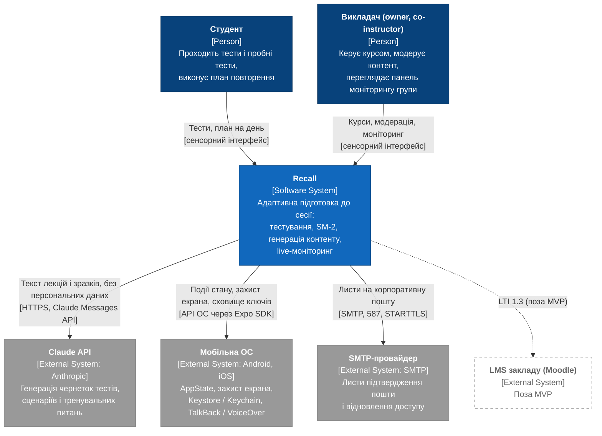
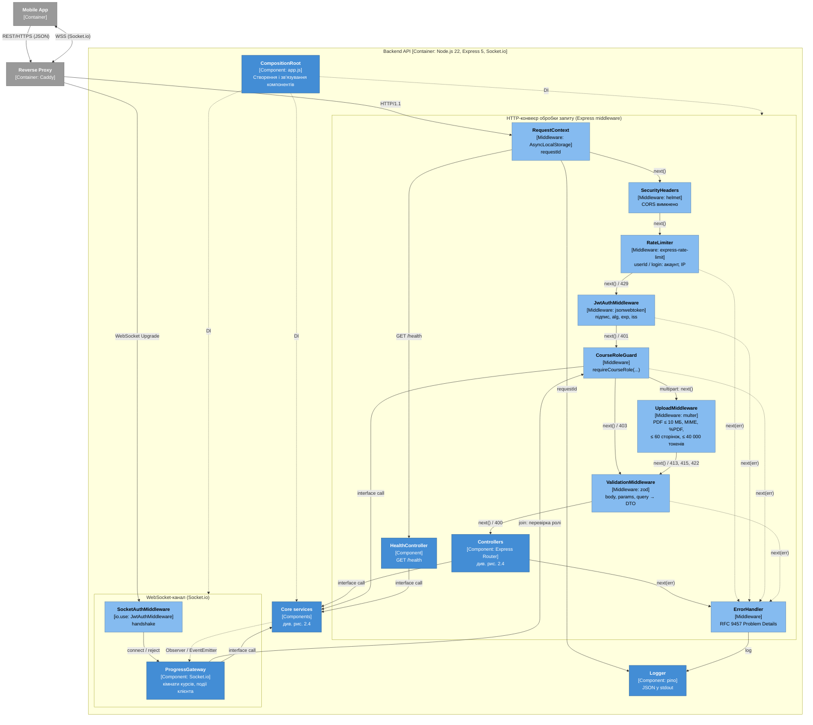
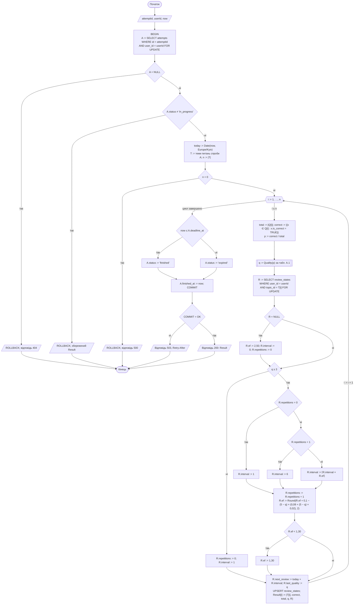
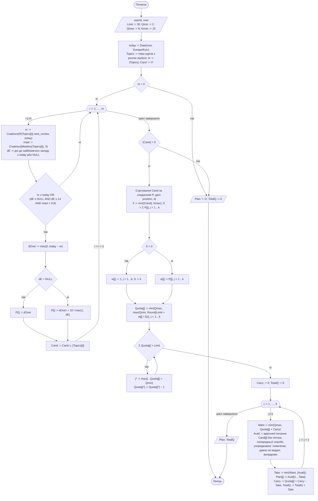
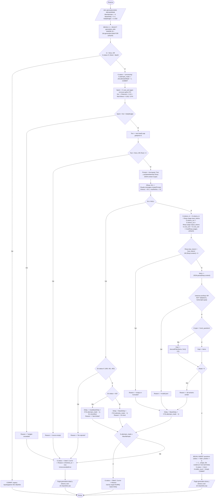

# РОЗДІЛ 2. ОБҐРУНТУВАННЯ АРХІТЕКТУРНИХ РІШЕНЬ ТА ПРОЄКТУВАННЯ СИСТЕМИ

## 2.1. Обґрунтування архітектурного стилю та патернів проєктування

### 2.1.1. ADR-001. Асинхронна обробка генерації контенту через Claude API: BullMQ на Redis

Архітектурні рішення фіксуються у форматі Architecture Decision Record (ADR) за шаблоном M. Nygard: контекст, альтернативи, рішення, наслідки, статус. Кожен ADR зберігається окремим файлом у каталозі [adr/](./adr/) і не редагується після затвердження; зміна рішення оформлюється новим ADR зі статусом Superseded для попереднього. Нижче наведено текст [ADR-001](./adr/0001-choice-of-technology.md); протокол рецензії — [17-AI Insights.md](./17-AI%20Insights.md), Запис 14.

<!-- adr-001:start -->

**Status:** Approved
**Date:** 10.11.2026; уточнення 24.11.2026 (розділ «Історія змін»)
**Автор рішення:** MarcoGr11
**Пов'язані артефакти:** [srs.md](./srs.md), підрозділи 2.2.2, 2.3

#### Context

Викладач завантажує PDF лекції або зразок тесту, після чого система генерує чернетку тесту, сценарію або тренувальних питань через Claude API ([SRS-FUN-22](./srs.md#srs-fun-22)…[SRS-FUN-27](./srs.md#srs-fun-27), [SRS-FUN-31](./srs.md#srs-fun-31)). Тривалість одного виклику Claude API для генерації тесту за лекцією оцінюється до 60 с на рівні p95 (timeout одного виклику — 60 с за [SRS-NFR-ASYNC-03](./srs.md#srs-nfr-async-03)); провайдер повертає помилки HTTP 429 (rate limit) і 5xx (перевантаження).

Вимоги, що визначають рішення, наведено в табл. 2.1.

Таблиця 2.1 – Вимоги, що визначають рішення ADR-001

| Вимога | Метрика |
|---|---|
| [SRS-NFR-ASYNC-01](./srs.md#srs-nfr-async-01) | 202 Accepted, p95 ≤ 200 мс незалежно від Latency Claude API |
| [SRS-NFR-ASYNC-02](./srs.md#srs-nfr-async-02) | Обробка задачі p95 ≤ 90 с |
| [SRS-NFR-ASYNC-03](./srs.md#srs-nfr-async-03) | 3 спроби загалом, експоненційна затримка 5 с, 10 с, dead-letter queue |
| [SRS-NFR-ASYNC-04](./srs.md#srs-nfr-async-04) | Паралелізм ≤ 2 задачі |
| [SRS-NFR-REL-02](./srs.md#srs-nfr-rel-02) | Ідемпотентність задачі за idempotency_key |
| [SRS-NFR-REL-04](./srs.md#srs-nfr-rel-04) | Втрата стану черги при перезапуску ≤ 1 с записів |
| [SRS-NFR-COST-01](./srs.md#srs-nfr-cost-01), [SRS-NFR-COST-02](./srs.md#srs-nfr-cost-02) | Облік кожного виклику; добовий ліміт вартості 2 USD |
| [SRS-FUN-30](./srs.md#srs-fun-30) | Подія WebSocket викладачу про завершення або невдачу задачі |

Обмеження проєкту: соло-розробка тривалістю 6 місяців; розгортання в docker-compose на одному хості; один потік до 100 студентів; хмарний бюджет відсутній.

За синхронного виклику p95 відповіді API не менший за Latency провайдера, тобто до 60 с проти порогу 200 мс — перевищення приблизно в 300 разів. Тому синхронний варіант не задовольняє SRS-NFR-ASYNC-01 за визначенням, а вибір відбувається між механізмами асинхронної обробки.

#### Alternatives

##### 1. Синхронний виклик Claude API в обробнику HTTP-запиту

HTTP-з'єднання утримується на весь час виклику; обрив з'єднання мобільним клієнтом при зміні мережі втрачає результат, а повторне надсилання запиту клієнтом створює повторну тарифікацію. Паралелізм на рівні системи не обмежується: кожен викладач ініціює власний виклик. Повторні спроби і dead-letter queue відсутні. **Відхилено:** порушує SRS-NFR-ASYNC-01, SRS-NFR-ASYNC-03, SRS-NFR-ASYNC-04.

##### 2. Фонова черга в процесі Backend API (in-process, p-queue)

Окремий сервіс не потрібен; паралелізм обмежується параметром черги. Стан черги зберігається в пам'яті процесу і втрачається при перезапуску контейнера; повторні спроби з затримкою і dead-letter queue реалізуються власним кодом; генерація конкурує з обробкою REST-запитів за event loop. **Відхилено:** порушує SRS-NFR-REL-04, потребує власної реалізації SRS-NFR-ASYNC-03.

##### 3. Черга на PostgreSQL (pg-boss, `SELECT … FOR UPDATE SKIP LOCKED`)

Не потребує окремого сервісу; постановка задачі може виконуватися в одній транзакції із записом GenerationJob. Отримання задач виконується опитуванням (polling) тієї самої бази, що обслуговує SRS-NFR-PERF-01 і SRS-NFR-PERF-02; вбудованого механізму подій стану задачі, еквівалентного QueueEvents, для SRS-FUN-30 немає — потрібен LISTEN / NOTIFY і власна логіка; обмеження паралелізму на рівні черги потребує окремої конфігурації. **Відхилено:** навантаження на основну БД і власна реалізація доставки подій задач.

##### 4. RabbitMQ (AMQP 0-9-1)

Окремий брокер з підтвердженнями доставки, dead-letter exchange, маршрутизацією, quorum queues і кластеризацією. Потребує окремого сервісу з власною конфігурацією (exchanges, queues, bindings, policies), клієнта amqplib без вбудованої семантики задач, власної реалізації exponential backoff (TTL + dead-letter exchange або плагін delayed message exchange) і окремого моніторингу. Переваги RabbitMQ не відповідають жодній вимозі SRS при одному типі споживача і одному хості. **Відхилено:** найбільший обсяг інфраструктури і коду на супровід при соло-розробці.

##### 5. BullMQ на Redis 7

Бібліотека черг для Node.js: `attempts`, `backoff: {type: 'exponential'}`, стан failed як dead-letter queue, `concurrency` worker-процесу і глобальний ліміт `setGlobalConcurrency`, `jobId` для дедуплікації, QueueEvents на основі Redis Streams для подій completed / failed. Потребує Redis 7 як окремого сервісу.

##### Відхилені без детального аналізу

- **Message Batches API провайдера:** знижена вартість, але час завершення пакета до 24 год несумісний із SRS-NFR-ASYNC-02 (p95 ≤ 90 с).
- **Керовані хмарні черги (Amazon SQS, Google Cloud Tasks):** несумісні з обмеженням розгортання на одному хості без хмарного бюджету.

##### Матриця оцінки

Таблиця 2.2 – Оцінка альтернатив за критеріями (+ — задовольняє засобами інструмента; ± — задовольняє власним кодом або конфігурацією; − — не задовольняє)

| Критерій | Синхронний виклик | In-process | PostgreSQL (pg-boss) | RabbitMQ | BullMQ на Redis |
|---|---|---|---|---|---|
| SRS-NFR-ASYNC-01: 202 ≤ 200 мс | − | + | + | + | + |
| SRS-NFR-ASYNC-03: retry, backoff, DLQ | − | ± | + | ± | + |
| SRS-NFR-ASYNC-04: паралелізм ≤ 2 | − | + | ± | + | + (setGlobalConcurrency) |
| SRS-NFR-REL-02: ідемпотентність за idempotency_key | − | ± | + | ± | + |
| SRS-NFR-REL-04: стан черги після перезапуску | − | − | + | + | + (AOF) |
| SRS-FUN-30: події стану задачі | — | ± | ± | ± | + (QueueEvents) |
| Транзакційна постановка задачі разом із записом GenerationJob | — | — | + | − | ± (порядок «запис → enqueue» і узгодження) |
| Додаткові сервіси на супровід | 0 | 0 | 0 | 1 (брокер) | 1 (Redis) |
| Операційна вартість | 0 | 0 | 0 | 0 | 0 |

#### Decision

Обрано **BullMQ на Redis 7** з окремим процесом Generation Worker (та сама кодова база, окрема точка входу).

1. Backend API записує GenerationJob у PostgreSQL зі статусом queued, ставить задачу в чергу з `jobId := idempotency_key := SHA-256(тип задачі, ідентифікатор джерела, версія джерела, generation_no)` і повертає 202 Accepted з ідентифікатором задачі. Номер генерації generation_no збільшується на 1 при повторній генерації за тим самим джерелом після стану dead або відхилення чернеток: BullMQ ігнорує постановку задачі з jobId, що вже зберігається в Redis (зокрема у стані failed), тому без generation_no повторна генерація була б неможливою. Перед постановкою BudgetGuard перевіряє добовий ліміт вартості; після його досягнення API повертає 429.
2. Глобальний ліміт паралелізму задається на черзі: `queue.setGlobalConcurrency(2)` — не більше 2 активних задач у системі незалежно від кількості worker-процесів; `concurrency: 2` у Generation Worker є лише локальним верхнім порогом одного процесу. Worker викликає Claude API (модель `claude-haiku-5-5`) з timeout 60 с, валідує результат за JSON-схемою і зберігає чернетку зі статусом draft, записуючи кількість токенів і вартість виклику в generation_jobs.
3. Повторні спроби виконує лише BullMQ: `attempts: 3`, `backoff: {type: 'exponential', delay: 5000}` (затримки 5 с і 10 с). Клієнт SDK Anthropic створюється з `maxRetries: 0`, оскільки за замовчуванням SDK виконує 2 власні повторні спроби для 408 / 409 / 429 / 5xx, що разом із 3 спробами BullMQ дало б до 9 HTTP-викликів на задачу. Для HTTP 429 власна стратегія backoff BullMQ встановлює затримку, що дорівнює більшому зі значень експоненційної затримки і заголовка retry-after відповіді Claude API.
4. Після третьої невдалої спроби задача залишається в стані failed з причиною збою (dead-letter queue) і автоматично не повторюється. Неповторювані помилки (HTTP 400, 401, 403, порожній текст джерела, досягнення добового ліміту вартості під час виконання) завершують задачу без повторів через UnrecoverableError BullMQ; GenerationJob отримує статус dead.
5. Backend API підписаний на QueueEvents і передає події completed / failed у ProgressPublisher, який через ProgressGateway надсилає подію викладачу (SRS-FUN-30).
6. Redis працює з `appendonly yes`, `appendfsync everysec`.

Аргументи рішення:
- вирішальний критерій — [SRS-FUN-30](./srs.md#srs-fun-30): BullMQ надає події стану задачі (QueueEvents: completed, failed) без власного коду, тоді як для pg-boss потрібні LISTEN / NOTIFY і власна логіка (табл. 2.2);
- pg-boss має перевагу, якої це рішення не отримує: постановку задачі в одній транзакції PostgreSQL із записом GenerationJob. Для BullMQ розбіжність Redis і PostgreSQL усувається порядком «запис queued → enqueue» і узгодженням при старті worker (розділ Consequences); для MVP з одним типом задач цю ціну визнано прийнятною;
- не потребує окремого брокера повідомлень: Redis 7 — єдиний додатковий сервіс інфраструктури черги;
- Generation Worker є єдиним споживачем Claude API, тому облік і обмеження вартості (SRS-NFR-COST-01, SRS-NFR-COST-02) зосереджено в одній точці, а ключ Claude API передається лише в цей контейнер.

#### Consequences

##### Позитивні

- Відповідь endpoint постановки не залежить від Latency Claude API (SRS-NFR-ASYNC-01).
- Повторні спроби з експоненційною затримкою, dead-letter queue, обмеження паралелізму і дедуплікація за jobId (idempotency_key) реалізуються конфігурацією BullMQ.
- Збій Claude API не впливає на тестування, план повторення і моніторинг: вони не залежать від черги.
- Контроль вартості і ключа Claude API зосереджено в одному контейнері.

##### Негативні

- **Redis — єдина точка відмови черги.** При недоступності Redis постановка задач неможлива: Backend API повертає 503 із заголовком Retry-After, обробка зупиняється, події QueueEvents не доставляються. Тестування, план повторення і live-моніторинг продовжують працювати. Зменшення ризику: healthcheck ([SRS-NFR-OBS-02](./srs.md#srs-nfr-obs-02)), `restart: unless-stopped`, відновлення стану з AOF. Висока доступність (Redis Sentinel) не реалізується через обмеження одного хоста.
- **Семантика доставки at-least-once.** Задача, worker якої завершився аварійно після виклику Claude API, але до підтвердження, обробляється повторно (stalled job). Наслідки: ризик дубліката чернетки і повторна тарифікація виклику. Зменшення ризику: ідемпотентність за idempotency_key і обмеження UNIQUE (generation_job_id, position) для чернеток у PostgreSQL. Повторна тарифікація при аварійному завершенні — прийнятий ризик.
- **Потреба в AOF persistence.** Без AOF перезапуск контейнера Redis втрачає задачі. З `appendfsync everysec` втрачається до 1 с записів; ціна — додатковий запис на диск і зростання файлу AOF, що потребує періодичного перезапису (`auto-aof-rewrite`).
- **Розбіжність стану Redis і PostgreSQL.** Запис GenerationJob у PostgreSQL і постановка в чергу Redis не атомарні. Порядок «запис queued → enqueue з тим самим jobId» і узгодження при старті worker (повторна постановка записів queued без задачі в Redis) усувають розбіжність без transactional outbox.
- **Ускладнення тестування.** Інтеграційні тести потребують Redis у контейнері, заглушки Claude API (nock) з керованими відмовами і очікування стану задачі; затримки backoff задаються конфігурацією, щоб тести не чекали 5 с і 10 с; час CI зростає (сценарій VER-05).
- **FinOps — вартість токенів Claude API.** Модель — Claude Haiku 5.5 (`claude-haiku-5-5`), тариф станом на 24.11.2026 за офіційною сторінкою Anthropic Pricing: 0,10 USD / 0,50 USD за 1M вхідних / вихідних токенів для запитів до 100 000 токенів (понад 100 000 — 0,50 USD / 2,50 USD). Ліміт вилученого тексту 40 000 токенів ([SRS-FUN-51](./srs.md#srs-fun-51)) разом із системними інструкціями утримує кожен запит у нижньому тарифному діапазоні. Типова задача генерації тесту за лекцією ≈ 20 000 вхідних і 4 000 вихідних токенів ≈ 0,004 USD; верхня межа одного виклику (≈ 42 000 вхідних токенів, `max_tokens` = 8 000) ≈ 0,008 USD, з урахуванням 3 спроб — не більше 0,024 USD. Добовий ліміт 2 USD відповідає ≈ 500 типовим задачам або ≈ 83 задачам у найгіршому випадку. Контроль: `max_tokens` на виклик, BudgetGuard, облік tokens_in, tokens_out, cost_usd у generation_jobs. Оцінку слід перевірити за фактичними даними після перших 20 задач (сценарій VER-06).
- **Очікування переноситься в інтерфейс.** Викладач отримує результат через 10–90 с; інтерфейс повинен показувати стан задачі, а система — доставляти подію завершення (SRS-FUN-30), що створює залежність від каналу WebSocket.
- **Додатковий процес.** Generation Worker і Redis — два додаткові контейнери в docker-compose з власними healthcheck.

##### Вибір моделі Claude

Обрано Claude Haiku 5.5 — модель класу Haiku з найнижчим тарифом серед актуальних моделей на 24.11.2026. Порівняно з Claude Haiku 4.5 (1 USD / 5 USD) вартість задачі нижча в 10 разів за тих самих обсягів токенів. Контекстне вікно (1M токенів) перевищує ліміт тексту SRS-FUN-51 з запасом; дата виведення з експлуатації — не раніше 07.10.2027, що перевищує строк апробації. Генерація тестових питань за текстом лекції не потребує моделі класу Sonnet або Opus: якість чернетки контролюється JSON-схемою (SRS-FUN-26) і обов'язковою модерацією (SRS-FUN-28). Ідентифікатор моделі задається змінною середовища worker-процесу.

##### Умови перегляду рішення

Рішення переглядається, якщо виконується хоча б одна умова:
- з'являється другий тип споживача подій або потреба маршрутизації повідомлень між сервісами;
- з'являється вимога гарантії exactly-once;
- worker потрібно масштабувати на кілька хостів або потрібна висока доступність черги;
- фактична вартість генерації за даними generation_jobs перевищує добовий ліміт більше ніж у 20 % днів апробації.

#### Історія змін

- 24.11.2026 — уточнення без зміни рішення: ключ ідемпотентності доповнено номером генерації generation_no (знахідка 10 незалежного аудиту); модель Claude Haiku 4.5 замінено на Claude Haiku 5.5 з перерахунком оцінки вартості; облік токенів і вартості перенесено з generation_log у generation_jobs; статус чернетки pending перейменовано на draft. Рішення автора — [17-AI Insights.md](./17-AI%20Insights.md), Запис 16.
- 24.11.2026 — уточнення без зміни рішення за результатами нормоконтролю алгоритмів: затримка для HTTP 429 враховує заголовок retry-after; неповторювані помилки і досягнення бюджету під час виконання переводять задачу в dead без повторів. Рішення автора — [17-AI Insights.md](./17-AI%20Insights.md), Запис 19.

<!-- adr-001:end -->

## 2.2. Контекстне та контейнерне моделювання системи

Архітектуру системи описано за моделлю C4 (Context, Container, Component). Діаграми виконано кодом Mermaid.js у нотації `flowchart TB`: тип кожного вузла C4 зазначено в підписі ([Person], [Software System], [Container], [External System]), протокол — у підписі зв'язку. Нотацію `flowchart` обрано замість експериментального синтаксису `C4Context` / `C4Container`, оскільки останній не підтримує пунктирних зв'язків для елементів поза MVP і при восьми і більше вузлах накладає підписи зв'язків один на одний. Базовою лінією трасування є специфікація вимог [srs.md](./srs.md); протокол архітектурного рев'ю — [17-AI Insights.md](./17-AI%20Insights.md), Запис 12.

### 2.2.1. Діаграма контексту (Level 1)

Діаграма контексту визначає межу системи Recall, її користувачів і зовнішні системи (рис. 2.1).



Рисунок 2.1 – Діаграма контексту системи Recall (C4 Level 1)

Таблиця 2.3 – Вузли діаграми контексту

| Вузол | Тип | Технологія | Відповідальність | SRS-ID |
|---|---|---|---|---|
| Студент | Person | — | Проходить тести і пробні тести, виконує план повторення | [SRS-FUN-13](./srs.md#srs-fun-13), [SRS-FUN-20](./srs.md#srs-fun-20), [SRS-FUN-34](./srs.md#srs-fun-34) |
| Викладач (owner, co-instructor) | Person | — | Створює курс і контрольні заходи, завантажує матеріали і зразки, модерує чернетки, переглядає панель моніторингу; права co-instructor обмежено | [SRS-FUN-03](./srs.md#srs-fun-03)…[SRS-FUN-10](./srs.md#srs-fun-10), [SRS-FUN-28](./srs.md#srs-fun-28), [SRS-FUN-39](./srs.md#srs-fun-39), [SRS-FUN-47](./srs.md#srs-fun-47) |
| Recall | Software System | React Native, Node.js, PostgreSQL, Redis | Тестування, планування повторень за SM-2, асинхронна генерація контенту, пробні тести, антисписування, live-моніторинг | [SRS-FUN-01](./srs.md#srs-fun-01)…[SRS-FUN-49](./srs.md#srs-fun-49) |
| Claude API | External System | Anthropic Claude Messages API | Генерація чернеток тестів, сценаріїв і тренувальних питань | [SRS-FUN-24](./srs.md#srs-fun-24), [SRS-FUN-25](./srs.md#srs-fun-25), [SRS-FUN-31](./srs.md#srs-fun-31) |
| Мобільна ОС | External System | Android 10+, iOS 16+ | Події AppState, захист екрана, Keystore / Keychain, TalkBack / VoiceOver | [SRS-FUN-37](./srs.md#srs-fun-37), [SRS-FUN-40](./srs.md#srs-fun-40), [SRS-FUN-41](./srs.md#srs-fun-41), [SRS-NFR-SEC-04](./srs.md#srs-nfr-sec-04), [SRS-NFR-A11Y-02](./srs.md#srs-nfr-a11y-02) |
| SMTP-провайдер | External System | SMTP (порт 587, STARTTLS) | Доставка листів підтвердження корпоративної пошти і відновлення доступу | [SRS-FUN-01](./srs.md#srs-fun-01), [SRS-FUN-55](./srs.md#srs-fun-55) |
| LMS закладу (Moodle) | External System, поза MVP | LTI 1.3 | Інтеграцію не реалізовано; показано для фіксації межі системи | — |

Таблиця 2.4 – Зв'язки діаграми контексту

| Від | До | Протокол | Призначення |
|---|---|---|---|
| Студент | Recall | Сенсорний інтерфейс мобільного застосунку | Тестування, план на день, пробні тести |
| Викладач | Recall | Сенсорний інтерфейс мобільного застосунку | Керування курсом, модерація, моніторинг групи |
| Recall | Claude API | HTTPS (Claude Messages API, JSON) | Передача тексту лекцій і зразків тестів без персональних даних; отримання результату генерації |
| Recall | Мобільна ОС | API ОС через Expo SDK | Події стану застосунку, захист екрана, захищене сховище токенів |
| Recall | SMTP-провайдер | SMTP, порт 587, STARTTLS | Листи підтвердження пошти і відновлення доступу з одноразовими посиланнями |
| Recall | LMS закладу | LTI 1.3 (поза MVP) | Напрям розвитку |

### 2.2.2. Діаграма контейнерів (Level 2)

Система реалізована як модульний моноліт: Backend API і Generation Worker використовують одну кодову базу і одну схему PostgreSQL, але запускаються як окремі процеси з різними точками входу. Спільна база даних двох контейнерів є свідомим рішенням для модульного моноліту і не означає розділення на мікросервіси. Сервери розгортаються в docker-compose на одному хості у двох мережах: edge (Reverse Proxy і Backend API) та internal (Backend API, Generation Worker, Backup Job, PostgreSQL, Redis) без опублікованих портів. Назовні опубліковано лише порт 443. Ключ Claude API передається тільки в Generation Worker, і лише цей контейнер має вихідний доступ до api.anthropic.com; Backend API має вихідний доступ лише до поштового сервера (SMTP, порт 587) для службових листів. Усі контейнери пишуть журнали у форматі JSON у stdout ([SRS-NFR-OBS-01](./srs.md#srs-nfr-obs-01)). Діаграму контейнерів наведено на рис. 2.2.


Рисунок 2.2 – Діаграма контейнерів системи Recall (C4 Level 2)

Таблиця 2.5 – Вузли діаграми контейнерів

| Вузол | Тип | Технологія | Відповідальність | SRS-ID |
|---|---|---|---|---|
| Mobile App | Container | React Native, Expo | Рольовий інтерфейс студента і викладача; фіксація background-переходів, буферизація подій, блокування знімків і копіювання; панель моніторингу за подіями WebSocket; зберігання токенів у secure store | [SRS-FUN-18](./srs.md#srs-fun-18), [SRS-FUN-37](./srs.md#srs-fun-37), [SRS-FUN-38](./srs.md#srs-fun-38), [SRS-FUN-39](./srs.md#srs-fun-39), [SRS-FUN-40](./srs.md#srs-fun-40), [SRS-FUN-41](./srs.md#srs-fun-41), [SRS-FUN-42](./srs.md#srs-fun-42), [SRS-FUN-45](./srs.md#srs-fun-45), [SRS-NFR-SEC-04](./srs.md#srs-nfr-sec-04), [SRS-NFR-COMP-01](./srs.md#srs-nfr-comp-01), [SRS-NFR-COMP-02](./srs.md#srs-nfr-comp-02), [SRS-NFR-A11Y-01](./srs.md#srs-nfr-a11y-01), [SRS-NFR-A11Y-02](./srs.md#srs-nfr-a11y-02) |
| Reverse Proxy | Container | Caddy | Термінація TLS 1.2+, проксування REST і WebSocket до Backend API, єдина точка входу на порту 443 | [SRS-NFR-SEC-06](./srs.md#srs-nfr-sec-06) |
| Backend API | Container | Node.js 22, Express, Socket.io | REST API і канал подій; модулі auth, courses, testing, scheduling, generation, monitoring; RBAC, rate limiting, постановка задач у чергу, ретрансляція подій задач викладачу | [SRS-FUN-01](./srs.md#srs-fun-01)…[SRS-FUN-17](./srs.md#srs-fun-17), [SRS-FUN-19](./srs.md#srs-fun-19)…[SRS-FUN-22](./srs.md#srs-fun-22), [SRS-FUN-50](./srs.md#srs-fun-50)…[SRS-FUN-54](./srs.md#srs-fun-54), [SRS-FUN-28](./srs.md#srs-fun-28)…[SRS-FUN-30](./srs.md#srs-fun-30), [SRS-FUN-34](./srs.md#srs-fun-34)…[SRS-FUN-36](./srs.md#srs-fun-36), [SRS-FUN-39](./srs.md#srs-fun-39), [SRS-FUN-43](./srs.md#srs-fun-43), [SRS-FUN-44](./srs.md#srs-fun-44), [SRS-FUN-46](./srs.md#srs-fun-46)…[SRS-FUN-49](./srs.md#srs-fun-49), [SRS-NFR-PERF-01](./srs.md#srs-nfr-perf-01), [SRS-NFR-PERF-02](./srs.md#srs-nfr-perf-02), [SRS-NFR-RT-01](./srs.md#srs-nfr-rt-01), [SRS-NFR-ASYNC-01](./srs.md#srs-nfr-async-01), [SRS-NFR-SEC-01](./srs.md#srs-nfr-sec-01)…[SRS-NFR-SEC-03](./srs.md#srs-nfr-sec-03), [SRS-NFR-SEC-05](./srs.md#srs-nfr-sec-05), [SRS-NFR-SEC-07](./srs.md#srs-nfr-sec-07), [SRS-NFR-SEC-08](./srs.md#srs-nfr-sec-08), [SRS-NFR-REL-02](./srs.md#srs-nfr-rel-02), [SRS-NFR-COST-02](./srs.md#srs-nfr-cost-02), [SRS-NFR-OBS-02](./srs.md#srs-nfr-obs-02) |
| Generation Worker | Container | Node.js 22, BullMQ | Отримання задач з черги, парсинг PDF, виклик Claude API з розмежуванням даних і інструкцій, валідація за JSON-схемою, перевірка подібності, збереження чернеток, облік вартості | [SRS-FUN-24](./srs.md#srs-fun-24)…[SRS-FUN-27](./srs.md#srs-fun-27), [SRS-FUN-30](./srs.md#srs-fun-30)…[SRS-FUN-33](./srs.md#srs-fun-33), [SRS-NFR-ASYNC-02](./srs.md#srs-nfr-async-02)…[SRS-NFR-ASYNC-04](./srs.md#srs-nfr-async-04), [SRS-NFR-COST-01](./srs.md#srs-nfr-cost-01), [SRS-NFR-OBS-02](./srs.md#srs-nfr-obs-02) |
| Backup Job | Container | pg_dump, cron | Щоденний дамп PostgreSQL на окремий фізичний носій, зберігання 7 днів | [SRS-NFR-REL-03](./srs.md#srs-nfr-rel-03) |
| PostgreSQL 16 | Container (Database) | PostgreSQL 16 | Користувачі, курси, контрольні заходи, відповіді, ReviewState, чернетки, журнал дій з контентом, задачі генерації з обліком токенів і вартості (generation_jobs); ACID-транзакції | [SRS-FUN-12](./srs.md#srs-fun-12), [SRS-FUN-16](./srs.md#srs-fun-16), [SRS-FUN-19](./srs.md#srs-fun-19), [SRS-NFR-REL-01](./srs.md#srs-nfr-rel-01) |
| Redis 7 | Container (Database) | Redis 7, AOF | Брокер черги BullMQ, стан failed (dead-letter queue), події задач QueueEvents | [SRS-NFR-ASYNC-03](./srs.md#srs-nfr-async-03), [SRS-NFR-REL-02](./srs.md#srs-nfr-rel-02), [SRS-NFR-REL-04](./srs.md#srs-nfr-rel-04) |
| File Storage | Container (Storage) | Docker volume | Зберігання PDF лекцій і зразків тестів; доступ на запис — Backend API, на читання — Generation Worker; поза доступом клієнта | [SRS-FUN-09](./srs.md#srs-fun-09), [SRS-FUN-10](./srs.md#srs-fun-10), [SRS-FUN-11](./srs.md#srs-fun-11) |
| Claude API | External System | Anthropic Claude Messages API | Генерація контенту за запитом Generation Worker | [SRS-FUN-24](./srs.md#srs-fun-24), [SRS-FUN-31](./srs.md#srs-fun-31) |
| Мобільна ОС | External System | Android 10+, iOS 16+ | AppState, screen capture, Keystore / Keychain, TalkBack / VoiceOver | [SRS-FUN-37](./srs.md#srs-fun-37), [SRS-FUN-40](./srs.md#srs-fun-40), [SRS-FUN-41](./srs.md#srs-fun-41), [SRS-NFR-SEC-04](./srs.md#srs-nfr-sec-04), [SRS-NFR-A11Y-02](./srs.md#srs-nfr-a11y-02) |
| SMTP-провайдер | External System | SMTP (порт 587, STARTTLS) | Доставка листів, надісланих Backend API | [SRS-FUN-01](./srs.md#srs-fun-01), [SRS-FUN-55](./srs.md#srs-fun-55) |
| LMS закладу (Moodle) | External System, поза MVP | LTI 1.3 | Напрям розвитку | — |

Розгортання всіх серверних контейнерів у docker-compose з healthcheck і `restart: unless-stopped` реалізує [SRS-NFR-INFRA-01](./srs.md#srs-nfr-infra-01). Контур CI (GitHub Actions, npm audit, Trivy, SonarQube Cloud) не є елементом runtime і на діаграмі не показаний; він реалізує [SRS-NFR-SEC-09](./srs.md#srs-nfr-sec-09)…[SRS-NFR-SEC-11](./srs.md#srs-nfr-sec-11) і [SRS-NFR-MAINT-01](./srs.md#srs-nfr-maint-01). Поточний `docker-compose.yml` не містить Reverse Proxy, Generation Worker, Backup Job і сегментації мереж, а також публікує порти 5432 і 6379, не вмикає AOF і restart policy; конвеєр CI наразі виконує лише lint і модульні тести. Приведення конфігурації до діаграми виконується на етапі реалізації.

Таблиця 2.6 – Зв'язки діаграми контейнерів

| Від | До | Протокол | Призначення |
|---|---|---|---|
| Студент, Викладач | Mobile App | Сенсорний інтерфейс | Взаємодія з рольовим інтерфейсом |
| Mobile App | Мобільна ОС | Expo SDK (expo-screen-capture, AppState, expo-secure-store) | Захист екрана, події стану, зберігання токенів |
| Mobile App | Reverse Proxy | REST/HTTPS (JSON), TCP 443 | Запити REST API |
| Mobile App | Reverse Proxy | WSS (Socket.io), TCP 443 | Двонаправлений канал: події прогресу, антисписування, завершення генерації |
| Reverse Proxy | Backend API | HTTP/1.1, WebSocket Upgrade, TCP 3000 | Проксування після термінації TLS |
| Backend API | PostgreSQL 16 | SQL/TCP 5432 | Читання і запис доменних даних, транзакція «результати спроби + ReviewState» |
| Backend API | Redis 7 | RESP/TCP 6379 | Постановка задач (enqueue BullMQ), підписка на QueueEvents |
| Backend API | File Storage | Файлова система (volume) | Запис завантажених PDF |
| Generation Worker | Redis 7 | RESP/TCP 6379 | Отримання задач, публікація стану задач (completed, failed) |
| Generation Worker | PostgreSQL 16 | SQL/TCP 5432 | Збереження чернеток, стану задачі, токенів і вартості в generation_jobs |
| Generation Worker | File Storage | Файлова система (volume) | Читання PDF для парсингу |
| Generation Worker | Claude API | HTTPS (Claude Messages API, JSON) | Генерація контенту |
| Backend API | SMTP-провайдер | SMTP, порт 587, STARTTLS | Листи підтвердження пошти і відновлення доступу |
| Backup Job | PostgreSQL 16 | SQL/TCP 5432 (pg_dump) | Щоденне резервне копіювання |
| Backend API | LMS закладу | LTI 1.3 (поза MVP) | Напрям розвитку |

## 2.3. Компонентне моделювання та опис серверного ядра

Критичним сервісом обрано контейнер Backend API: він реалізує більшість функціональних вимог, транзакцію «результати спроби + ReviewState» при завершенні спроби ([SRS-NFR-REL-01](./srs.md#srs-nfr-rel-01)), контроль доступу ([SRS-NFR-SEC-05](./srs.md#srs-nfr-sec-05)) і доставку подій у реальному часі ([SRS-NFR-RT-01](./srs.md#srs-nfr-rt-01)). Компоненти організовано за Clean Architecture з чотирма шарами:
- **Inbound** — адаптери введення: контролери Express, шлюз Socket.io, слухач подій черги;
- **Core** — сервіси застосунку і доменна логіка; не залежить від Express, pg і BullMQ;
- **Ports** — інтерфейси сховищ і черги, визначені в Core (Dependency Inversion);
- **Outbound** — реалізації портів для PostgreSQL, файлового сховища і BullMQ.

Правило залежностей: Inbound → Core → Ports ← Outbound. Контролери і middleware (зокрема CourseRoleGuard) звертаються лише до сервісів Core; сервіси Core звертаються лише до портів і до інших сервісів Core. Компоненти створюються і зв'язуються вручну (Dependency Injection через конструктор) в одному місці — CompositionRoot; DI-фреймворк не використовується. SM2Scheduler і QualityScorer є чистими функціями без I/O, що спрощує unit-тестування ([SRS-NFR-MAINT-01](./srs.md#srs-nfr-maint-01)). Протокол аудиту — [17-AI Insights.md](./17-AI%20Insights.md), Запис 13.

Через кількість компонентів діаграму рівня 3 подано двома рисунками з однією таблицею компонентів: рис. 2.3 — наскрізний конвеєр обробки запиту, рис. 2.4 — модулі шарів Inbound, Core, Ports, Outbound.

### 2.3.1. Конвеєр обробки запиту

Запит REST проходить ланцюжок middleware у фіксованому порядку; кожен middleware або передає керування далі (`next()`), або завершує обробку помилкою, яку формує єдиний ErrorHandler у форматі RFC 9457 Problem Details. З'єднання Socket.io автентифікується на етапі handshake, а приєднання до кімнати курсу перевіряє той самий CourseRoleGuard (рис. 2.3).



Рисунок 2.3 – Діаграма компонентів Backend API: конвеєр обробки запиту (C4 Level 3)

### 2.3.2. Модулі шарів

Сервіси Core згруповано за модулями модульного моноліту: identity (AuthService, AccessPolicyService), courses (CourseService, InvitationService, ContentAuditLog), testing (TestDeliveryService, AttemptService, QualityScorer, MockTestService), scheduling (SM2Scheduler, DailyPlanPrioritizer), generation (GenerationJobService, BudgetGuard, ModerationService), monitoring (MasteryService, AntiCheatEventService, ProgressPublisher), platform (HealthService), privacy (PrivacyService). Події прогресу, антисписування і завершення задач генерації доставляються за патерном Observer: сервіс викликає `emit` у ProgressPublisher (EventEmitter), ProgressGateway підписаний на події і транслює події прогресу й антисписування в кімнату курсу `course:{courseId}`, а події задач генерації — у персональну кімнату ініціатора `user:{userId}` (рис. 2.4).

```mermaid
flowchart LR
    subgraph inbound["Inbound — адаптери введення"]
        direction TB
        authC["<b>AuthController</b>"]
        courseC["<b>CourseController</b><br/>курси, заходи, запрошення,<br/>матеріали, зразки"]
        attemptC["<b>AttemptController</b><br/>видача тесту, відповідь"]
        planC["<b>PlanController</b>"]
        mockC["<b>MockTestController</b>"]
        genC["<b>GenerationController</b>"]
        modC["<b>ModerationController</b>"]
        monC["<b>MonitoringController</b><br/>теплова карта, підтвердження"]
        acC["<b>AntiCheatController</b>"]
        privC["<b>PrivacyController</b>"]
        gw["<b>ProgressGateway</b><br/>[Socket.io]"]
        jobL["<b>JobEventsListener</b><br/>[BullMQ QueueEvents]"]
        guardC["<b>CourseRoleGuard</b><br/>[middleware]"]
        healthC["<b>HealthController</b><br/>GET /health"]
    end

    subgraph core["Core — сервіси і доменна логіка"]
        direction TB
        authS["<b>AuthService</b><br/>пошта закладу, токени, ротація,<br/>reuse detection, відновлення"]
        accessS["<b>AccessPolicyService</b><br/>role_in_course"]
        healthS["<b>HealthService</b><br/>PostgreSQL, Redis"]
        courseS["<b>CourseService</b>"]
        invS["<b>InvitationService</b>"]
        delivS["<b>TestDeliveryService</b><br/>рандомізація, серверний таймер"]
        attemptS["<b>AttemptService</b><br/>відповідь; завершення спроби"]
        scorer["<b>QualityScorer</b><br/>[pure] q за часткою правильних"]
        sm2["<b>SM2Scheduler</b><br/>[pure] EF, інтервал на спробу"]
        prio["<b>DailyPlanPrioritizer</b><br/>P, ліміт 30"]
        mockS["<b>MockTestService</b><br/>структура, пул, вибір питань"]
        genS["<b>GenerationJobService</b>"]
        budget["<b>BudgetGuard</b><br/>добовий ліміт"]
        modS["<b>ModerationService</b>"]
        mastS["<b>MasteryService</b>"]
        acS["<b>AntiCheatEventService</b>"]
        pub["<b>ProgressPublisher</b><br/>[EventEmitter]"]
        audit["<b>ContentAuditLog</b>"]
        privS["<b>PrivacyService</b>"]
    end

    subgraph ports["Ports — інтерфейси (Core)"]
        direction TB
        iUser["IUserRepository"]
        iToken["IRefreshTokenRepository"]
        iEmailTok["IEmailTokenRepository"]
        iMail["IMailSender"]
        iCourse["ICourseRepository"]
        iAttempt["IAttemptRepository"]
        iReview["IReviewStateRepository"]
        iQRead["IQuestionReadRepository"]
        iQWrite["IQuestionWriteRepository"]
        iAc["IAntiCheatEventRepository"]
        iAudit["IAuditLogRepository"]
        iGenJob["IGenerationJobRepository"]
        iTx["ITransactionManager"]
        iFile["IFileStorage"]
        iQueue["IJobQueue"]
    end

    subgraph outbound["Outbound — адаптери виведення"]
        direction TB
        pgRepo["<b>Pg*Repository, PgTransactionManager</b><br/>[Kysely, pg]"]
        fileS["<b>LocalFileStorage</b><br/>[fs, Docker volume]"]
        smtpS["<b>SmtpMailSender</b><br/>[nodemailer]"]
        consoleS["<b>ConsoleMailSender</b><br/>[dev/test: лист у журнал]"]
        mq["<b>BullMqJobQueue</b><br/>[BullMQ Queue]"]
    end

    db[("PostgreSQL 16")]
    redis[("Redis 7")]
    vol[("File Storage")]
    mailsrv["SMTP-провайдер"]

    authC --> authS
    guardC --> accessS
    healthC --> healthS
    courseC --> courseS
    courseC --> invS
    attemptC --> delivS
    attemptC --> attemptS
    planC --> prio
    mockC --> mockS
    genC --> genS
    modC --> modS
    monC --> mastS
    acC --> acS
    gw --> acS
    privC --> privS
    jobL -- "Observer" --> pub
    pub -. "Observer / EventEmitter" .-> gw

    accessS --> iCourse
    healthS --> iTx
    healthS --> iQueue
    authS --> iUser
    authS --> iToken
    authS --> iEmailTok
    authS --> iMail
    courseS --> iCourse
    courseS --> iFile
    courseS --> audit
    invS --> iCourse
    delivS --> iQRead
    delivS --> iAttempt
    attemptS --> iTx
    attemptS --> iAttempt
    attemptS --> iReview
    attemptS --> scorer
    attemptS --> sm2
    attemptS -- "emit" --> pub
    prio --> iReview
    prio --> iCourse
    mockS --> delivS
    mockS --> iQRead
    genS --> budget
    genS --> iGenJob
    genS -- "enqueue" --> iQueue
    budget --> iGenJob
    modS --> iQWrite
    modS --> audit
    mastS --> iAttempt
    mastS --> iCourse
    acS --> iAc
    acS -- "emit" --> pub
    audit --> iAudit
    privS --> iUser
    privS --> iAc

    pgRepo -. "implements" .-> ports
    fileS -. "implements IFileStorage" .-> iFile
    mq -. "implements IJobQueue" .-> iQueue
    pgRepo -- "SQL/TCP 5432" --> db
    mq -- "enqueue (BullMQ)<br/>[RESP/TCP 6379]" --> redis
    jobL -- "RESP/TCP 6379" --> redis
    fileS -- "файлова система" --> vol
    smtpS -. "implements IMailSender" .-> iMail
    consoleS -. "implements IMailSender" .-> iMail
    smtpS -- "SMTP, 587, STARTTLS" --> mailsrv

    classDef comp fill:#438dd5,stroke:#2e6295,color:#fff
    classDef pure fill:#2e7d32,stroke:#1b5e20,color:#fff
    classDef port fill:#ffffff,stroke:#2e6295,color:#000,stroke-dasharray:4 3
    classDef store fill:#999999,stroke:#6b6b6b,color:#fff
    class authC,courseC,attemptC,planC,mockC,genC,modC,monC,acC,privC,gw,jobL,guardC,healthC,authS,accessS,healthS,courseS,invS,delivS,attemptS,prio,mockS,genS,budget,modS,mastS,acS,pub,audit,privS,pgRepo,fileS,mq,smtpS,consoleS comp
    class scorer,sm2 pure
    class iUser,iToken,iEmailTok,iMail,iCourse,iAttempt,iReview,iQRead,iQWrite,iAc,iAudit,iGenJob,iTx,iFile,iQueue port
    class db,redis,vol,mailsrv store
```



Рисунок 2.4 – Діаграма компонентів Backend API: модулі шарів (C4 Level 3)

Таблиця 2.7 – Компоненти Backend API

| Компонент | Шар | Відповідальність | Залежності | SRS-ID |
|---|---|---|---|---|
| CompositionRoot | Composition Root | Створення екземплярів і зв'язування компонентів через конструктори | усі компоненти (DI) | — |
| RequestContext | Inbound (middleware) | Генерація requestId, збереження в AsyncLocalStorage | Logger | [SRS-NFR-OBS-01](./srs.md#srs-nfr-obs-01) |
| Logger | Inbound (наскрізний) | Структуровані журнали JSON у stdout з requestId | pino | [SRS-NFR-OBS-01](./srs.md#srs-nfr-obs-01) |
| SecurityHeaders | Inbound (middleware) | HTTP-заголовки безпеки; CORS вимкнено | helmet | [SRS-NFR-SEC-06](./srs.md#srs-nfr-sec-06) |
| RateLimiter | Inbound (middleware) | Ліміти запитів на користувача і на вхід; 429 з Retry-After | express-rate-limit | [SRS-NFR-SEC-08](./srs.md#srs-nfr-sec-08) |
| JwtAuthMiddleware | Inbound (middleware) | Перевірка access-токена: підпис, allowlist алгоритмів, exp, iss; 401 | jsonwebtoken | [SRS-FUN-02](./srs.md#srs-fun-02), [SRS-NFR-SEC-01](./srs.md#srs-nfr-sec-01) |
| SocketAuthMiddleware | Inbound (middleware) | Перевірка access-токена на handshake Socket.io (`io.use`) | JwtAuthMiddleware | [SRS-NFR-SEC-05](./srs.md#srs-nfr-sec-05) |
| CourseRoleGuard | Inbound (middleware) | Декларативна перевірка role_in_course для маршруту і приєднання до кімнати через AccessPolicyService; 403 | AccessPolicyService | [SRS-FUN-03](./srs.md#srs-fun-03), [SRS-FUN-06](./srs.md#srs-fun-06), [SRS-FUN-11](./srs.md#srs-fun-11), [SRS-FUN-44](./srs.md#srs-fun-44), [SRS-NFR-SEC-05](./srs.md#srs-nfr-sec-05) |
| UploadMiddleware | Inbound (middleware) | Приймання multipart: PDF ≤ 10 МБ, MIME application/pdf, сигнатура %PDF; вилучення текстового шару, ≤ 60 сторінок, ≤ 40 000 токенів; 413, 415, 422 | multer, pdfjs-dist | [SRS-FUN-09](./srs.md#srs-fun-09), [SRS-FUN-10](./srs.md#srs-fun-10), [SRS-NFR-SEC-07](./srs.md#srs-nfr-sec-07) |
| ValidationMiddleware | Inbound (middleware) | Валідація body, params, query за схемою zod, формування DTO; 400 | zod | [SRS-NFR-SEC-07](./srs.md#srs-nfr-sec-07) |
| ErrorHandler | Inbound (middleware) | Відображення доменних помилок у HTTP-коди, формат RFC 9457, без stack trace | Logger | [SRS-NFR-OBS-01](./srs.md#srs-nfr-obs-01) |
| HealthController | Inbound | GET /health: 200 за доступності PostgreSQL і Redis | HealthService | [SRS-NFR-OBS-02](./srs.md#srs-nfr-obs-02) |
| AuthController | Inbound | Реєстрація, підтвердження пошти, вхід, оновлення токенів, вихід, відновлення доступу | AuthService | [SRS-FUN-01](./srs.md#srs-fun-01), [SRS-FUN-02](./srs.md#srs-fun-02), [SRS-FUN-53](./srs.md#srs-fun-53), [SRS-FUN-55](./srs.md#srs-fun-55) |
| CourseController | Inbound | Курси, теми, контрольні заходи, коди запрошення, матеріали, зразки | CourseService, InvitationService | [SRS-FUN-04](./srs.md#srs-fun-04)…[SRS-FUN-10](./srs.md#srs-fun-10) |
| AttemptController | Inbound | Видача тесту, фіксація відповіді | TestDeliveryService, AttemptService | [SRS-FUN-13](./srs.md#srs-fun-13)…[SRS-FUN-17](./srs.md#srs-fun-17), [SRS-FUN-54](./srs.md#srs-fun-54) |
| PlanController | Inbound | Персональний план на день | DailyPlanPrioritizer | [SRS-FUN-20](./srs.md#srs-fun-20), [SRS-FUN-21](./srs.md#srs-fun-21), [SRS-FUN-50](./srs.md#srs-fun-50) |
| MockTestController | Inbound | Публікація і проходження пробного тесту | MockTestService | [SRS-FUN-34](./srs.md#srs-fun-34)…[SRS-FUN-36](./srs.md#srs-fun-36) |
| GenerationController | Inbound | Постановка задач генерації; 202 Accepted; стан задачі за ідентифікатором | GenerationJobService | [SRS-FUN-22](./srs.md#srs-fun-22), [SRS-FUN-52](./srs.md#srs-fun-52), [SRS-NFR-ASYNC-01](./srs.md#srs-nfr-async-01) |
| ModerationController | Inbound | Схвалення, редагування, відхилення чернеток | ModerationService | [SRS-FUN-28](./srs.md#srs-fun-28) |
| MonitoringController | Inbound | Теплова карта, підтвердження засвоєння | MasteryService | [SRS-FUN-46](./srs.md#srs-fun-46), [SRS-FUN-47](./srs.md#srs-fun-47) |
| AntiCheatController | Inbound | Приймання буферизованих подій антисписування через REST | AntiCheatEventService | [SRS-FUN-37](./srs.md#srs-fun-37), [SRS-FUN-38](./srs.md#srs-fun-38), [SRS-FUN-41](./srs.md#srs-fun-41) |
| PrivacyController | Inbound | Видалення облікового запису | PrivacyService | [SRS-FUN-48](./srs.md#srs-fun-48) |
| ProgressGateway | Inbound | Кімнати курсів `course:{courseId}` і персональні кімнати `user:{userId}` Socket.io; перевірка ролі і строку дії токена на кожній події кімнати; приймання подій клієнта; трансляція подій ProgressPublisher | AntiCheatEventService, ProgressPublisher (Observer), CourseRoleGuard | [SRS-FUN-30](./srs.md#srs-fun-30), [SRS-FUN-39](./srs.md#srs-fun-39), [SRS-FUN-43](./srs.md#srs-fun-43), [SRS-FUN-44](./srs.md#srs-fun-44), [SRS-NFR-RT-01](./srs.md#srs-nfr-rt-01) |
| JobEventsListener | Inbound | Підписка на BullMQ QueueEvents (completed, failed), передача в ProgressPublisher | ProgressPublisher, Redis | [SRS-FUN-30](./srs.md#srs-fun-30) |
| AccessPolicyService | Core | Визначення role_in_course користувача в курсі для CourseRoleGuard | ICourseRepository | [SRS-FUN-03](./srs.md#srs-fun-03), [SRS-FUN-06](./srs.md#srs-fun-06), [SRS-FUN-44](./srs.md#srs-fun-44), [SRS-NFR-SEC-05](./srs.md#srs-nfr-sec-05) |
| HealthService | Core | Перевірка доступності PostgreSQL і Redis для GET /health | ITransactionManager, IJobQueue | [SRS-NFR-OBS-02](./srs.md#srs-nfr-obs-02) |
| AuthService | Core | Перевірка домену корпоративної пошти, одноразові токени підтвердження пошти і відновлення доступу (зберігається хеш SHA-256), видача і ротація токенів, reuse detection, вихід із відкликанням сімейства refresh-токенів, хешування паролів Argon2id | IUserRepository, IRefreshTokenRepository, IEmailTokenRepository, IMailSender | [SRS-FUN-01](./srs.md#srs-fun-01), [SRS-FUN-02](./srs.md#srs-fun-02), [SRS-NFR-SEC-01](./srs.md#srs-nfr-sec-01)…[SRS-NFR-SEC-03](./srs.md#srs-nfr-sec-03), [SRS-FUN-53](./srs.md#srs-fun-53), [SRS-FUN-55](./srs.md#srs-fun-55) |
| CourseService | Core | Курси, теми, контрольні заходи, ролі, збереження PDF, обмеження co-instructor | ICourseRepository, IFileStorage, ContentAuditLog | [SRS-FUN-03](./srs.md#srs-fun-03), [SRS-FUN-06](./srs.md#srs-fun-06)…[SRS-FUN-10](./srs.md#srs-fun-10) |
| InvitationService | Core | Створення, відкликання і застосування кодів запрошення | ICourseRepository | [SRS-FUN-04](./srs.md#srs-fun-04), [SRS-FUN-05](./srs.md#srs-fun-05) |
| TestDeliveryService | Core | Рандомізація питань і варіантів, видача без ознаки правильної відповіді, серверний таймер, перевірка власника спроби | IQuestionReadRepository, IAttemptRepository | [SRS-FUN-13](./srs.md#srs-fun-13)…[SRS-FUN-15](./srs.md#srs-fun-15), [SRS-FUN-54](./srs.md#srs-fun-54) |
| AttemptService | Core | Фіксація відповіді з ідемпотентністю за (attemptId, questionId) і публікацією події прогресу; при завершенні спроби — транзакція «результати спроби + ReviewState» (один перерахунок на тему) | ITransactionManager, IAttemptRepository, IReviewStateRepository, QualityScorer, SM2Scheduler, ProgressPublisher | [SRS-FUN-16](./srs.md#srs-fun-16), [SRS-FUN-19](./srs.md#srs-fun-19), [SRS-FUN-43](./srs.md#srs-fun-43), [SRS-NFR-REL-01](./srs.md#srs-nfr-rel-01), [SRS-NFR-PERF-02](./srs.md#srs-nfr-perf-02) |
| QualityScorer | Core (чиста функція) | Обчислення q для теми за часткою правильних відповідей (табл. А.1 [srs.md](./srs.md)) | — | [SRS-FUN-17](./srs.md#srs-fun-17) |
| SM2Scheduler | Core (чиста функція) | Один перерахунок EF, інтервалу, кількості повторень, дати повторення на тему при завершенні спроби; EF не змінюється при q < 3 | — | [SRS-FUN-19](./srs.md#srs-fun-19) |
| DailyPlanPrioritizer | Core | Відбір тем-кандидатів, пріоритет P за найближчим контрольним заходом, розподіл 30 питань (2…8 на тему), вибір питань approved | IReviewStateRepository, ICourseRepository, IQuestionReadRepository | [SRS-FUN-20](./srs.md#srs-fun-20), [SRS-FUN-21](./srs.md#srs-fun-21), [SRS-FUN-50](./srs.md#srs-fun-50), [SRS-NFR-PERF-01](./srs.md#srs-nfr-perf-01) |
| MockTestService | Core | Структура пробного тесту за зразком, перевірка пулу 2 × структура, вибір питань за давністю | TestDeliveryService, IQuestionReadRepository, IAttemptRepository | [SRS-FUN-34](./srs.md#srs-fun-34)…[SRS-FUN-36](./srs.md#srs-fun-36) |
| GenerationJobService | Core | Запис GenerationJob зі статусом queued до постановки в чергу, постановка задачі з типом контенту і idempotency_key як jobId; стан задачі за ідентифікатором | BudgetGuard, IGenerationJobRepository, IJobQueue | [SRS-FUN-22](./srs.md#srs-fun-22), [SRS-FUN-52](./srs.md#srs-fun-52), [SRS-NFR-REL-02](./srs.md#srs-nfr-rel-02) |
| BudgetGuard | Core | Перевірка добового ліміту вартості за сумою cost_usd задач поточної доби UTC; 429 | IGenerationJobRepository | [SRS-NFR-COST-02](./srs.md#srs-nfr-cost-02) |
| ModerationService | Core | Зміна статусу чернетки, доступ student лише до approved | IQuestionWriteRepository, ContentAuditLog | [SRS-FUN-28](./srs.md#srs-fun-28), [SRS-FUN-29](./srs.md#srs-fun-29) |
| MasteryService | Core | Частка правильних відповідей «студент × тема», confirmed_by | IAttemptRepository, ICourseRepository | [SRS-FUN-46](./srs.md#srs-fun-46), [SRS-FUN-47](./srs.md#srs-fun-47) |
| AntiCheatEventService | Core | Збереження подій виходу і знімків екрана, агрегати для моніторингу | IAntiCheatEventRepository, ProgressPublisher | [SRS-FUN-37](./srs.md#srs-fun-37)…[SRS-FUN-39](./srs.md#srs-fun-39), [SRS-FUN-41](./srs.md#srs-fun-41) |
| ProgressPublisher | Core | Шина доменних подій (EventEmitter) для прогресу, антисписування і задач генерації | — | [SRS-FUN-30](./srs.md#srs-fun-30), [SRS-FUN-39](./srs.md#srs-fun-39), [SRS-FUN-43](./srs.md#srs-fun-43) |
| ContentAuditLog | Core | Журнал дій з контентом | IAuditLogRepository | [SRS-FUN-12](./srs.md#srs-fun-12) |
| PrivacyService | Core | Видалення облікового запису зі знеособленням, видалення подій антисписування за строком | IUserRepository, IAntiCheatEventRepository | [SRS-FUN-48](./srs.md#srs-fun-48), [SRS-FUN-49](./srs.md#srs-fun-49) |
| IUserRepository, IRefreshTokenRepository, IEmailTokenRepository (таблиці email_verification_tokens і password_reset_tokens), IMailSender, ICourseRepository, IAttemptRepository, IReviewStateRepository, IQuestionReadRepository, IQuestionWriteRepository, IAntiCheatEventRepository, IAuditLogRepository, IGenerationJobRepository, ITransactionManager, IFileStorage, IJobQueue | Ports | Інтерфейси сховищ, транзакцій, файлів і черги; IQuestionReadRepository не повертає ознаку правильної відповіді (ISP) | — | [SRS-FUN-14](./srs.md#srs-fun-14), [SRS-NFR-REL-01](./srs.md#srs-nfr-rel-01) |
| Pg*Repository, PgTransactionManager | Outbound | Реалізації репозиторіїв і транзакцій на Kysely з драйвером pg; лише параметризовані запити; обмеження UNIQUE (attempt_id, question_id) | Kysely, pg, PostgreSQL 16 | [SRS-FUN-16](./srs.md#srs-fun-16), [SRS-NFR-REL-01](./srs.md#srs-nfr-rel-01) |
| LocalFileStorage | Outbound | Запис PDF у Docker volume | fs | [SRS-FUN-09](./srs.md#srs-fun-09), [SRS-FUN-10](./srs.md#srs-fun-10) |
| SmtpMailSender | Outbound | Надсилання листів підтвердження пошти і відновлення доступу через SMTP після фіксації транзакції; посилання містить одноразовий токен | nodemailer, SMTP-провайдер | [SRS-FUN-01](./srs.md#srs-fun-01), [SRS-FUN-55](./srs.md#srs-fun-55) |
| ConsoleMailSender | Outbound | Реалізація IMailSender для середовищ dev і test: лист з посиланням записується в журнал застосунку замість надсилання; адаптер обирається змінною оточення `MAIL_TRANSPORT` (`smtp` або `console`), у production допускається лише `smtp` | pino | [SRS-FUN-01](./srs.md#srs-fun-01), [SRS-FUN-55](./srs.md#srs-fun-55) |
| BullMqJobQueue | Outbound | Постановка задач BullMQ з jobId := idempotency_key, attempts = 3, exponential backoff 5 с, requestId у даних задачі | bullmq, Redis 7 | [SRS-NFR-ASYNC-03](./srs.md#srs-nfr-async-03), [SRS-NFR-REL-02](./srs.md#srs-nfr-rel-02), [SRS-NFR-OBS-01](./srs.md#srs-nfr-obs-01) |

Таблиця 2.8 – Типи зв'язків діаграм компонентів

| Підпис зв'язку | Значення |
|---|---|
| DI | Впровадження залежності через конструктор у CompositionRoot |
| interface call / суцільна стрілка без підпису | Синхронний виклик методу сервісу або інтерфейсу порту |
| implements | Реалізація інтерфейсу порту адаптером Outbound |
| Observer / EventEmitter, emit | Асинхронна доставка доменної події підписникам у межах процесу |
| enqueue (BullMQ) | Постановка задачі в чергу Redis |
| next() / next(err) | Передача керування наступному middleware або ErrorHandler |
| SQL/TCP 5432, RESP/TCP 6379 | Мережеві виклики до PostgreSQL і Redis |

## 2.4. Контур безпеки програмного рішення (Application Security)

## 2.5. Специфікація міжсервісних контрактів та топологія API-маршрутів

Контракт REST API контейнера Backend API (підрозділ 2.2.2) специфіковано у форматі OpenAPI 3.0.3 у файлі [api/openapi.yaml](./api/openapi.yaml): 47 операцій на 40 шляхах, згрупованих у 9 тегів (табл. 2.9). Специфікацію перевірено інструментом `redocly lint` (набір правил recommended) без помилок і попереджень; протокол аудиту контракту — [17-AI Insights.md](./17-AI%20Insights.md), Запис 18. Події реального часу (Socket.io) до контракту REST не входять і описані в підрозділі 2.3.

### 2.5.1. Загальні правила контракту

- Базовий URI — `https://{host}/api/v1`; версія API міститься в шляху, TLS термінує reverse proxy Caddy ([SRS-NFR-SEC-06](./srs.md#srs-nfr-sec-06)).
- Ресурси названо іменниками в множині у форматі kebab-case. Переходи стану без CRUD-семантики оформлено як підресурси-іменники: `/approval`, `/rejection`, `/completion`, `/mock-test`.
- Ідентифікатори в шляху — лише UUID (`format: uuid`). Токени, паролі й інші секрети не передаються в query-параметрах.
- Автентифікація — схема `bearerAuth` (HTTP Bearer, JWT), задана глобально; `security: []` мають лише сім публічних операцій групи Auth.
- Авторизація — роль у курсі перевіряє CourseRoleGuard на кожному запиті ([SRS-NFR-SEC-05](./srs.md#srs-nfr-sec-05)); ролі кожної операції наведено в розширенні `x-roles`, трасування до SRS — у розширенні `x-srs`. Запит до ресурсу іншого курсу повертає 403, до спроби іншого студента того самого курсу — 404 ([SRS-FUN-54](./srs.md#srs-fun-54)).
- Схеми тіл запитів мають `required`, `additionalProperties: false` і межі значень: `minLength`/`maxLength`, `minimum`/`maximum`, `pattern`, `minItems`/`maxItems`/`uniqueItems`. Пошта — `format: email`, до 254 символів; пароль — від 10 до 128 символів; файл PDF — до 10 485 760 байт.
- Значення enum збігаються з ENUM-типами схеми даних (табл. 2.11): `course_role`, `control_event_type`, `question_type`, `question_status`, `question_source`, `attempt_mode`, `attempt_status`, `attempt_event_type`, `generation_job_type`, `generation_job_status`.
- Колекції повертаються сторінками: параметри `page` (≥ 1) і `limit` (1…100, за замовчуванням 20), конверт відповіді `{items, page, limit, total}`.
- Створення ресурсу повертає 201 із заголовком `Location`; постановка задачі генерації — 202 із заголовком `Location` на ресурс стану задачі.
- Помилки повертаються в одному форматі `application/problem+json` за RFC 9457 з полями `type`, `title`, `status`, `detail`, `instance`, `requestId` і масивом `errors` з JSON Pointer на поле запиту (табл. 2.10). Кожна операція документує 401 (крім публічних), 429, 500 і 503, а також коди 400, 403, 404, 409, 413, 415 і 422 відповідно до своєї логіки; для 429 і 503 передається заголовок `Retry-After`.

Таблиця 2.9 – Групи операцій REST API

| Група (тег) | Шляхи | Ролі | Вимоги |
|---|---|---|---|
| Auth | `/auth/register`, `/auth/verify-email`, `/auth/verify-email/resend`, `/auth/login`, `/auth/refresh`, `/auth/logout`, `/auth/password-reset/request`, `/auth/password-reset/confirm` | Публічні, крім `logout` | [SRS-FUN-01](./srs.md#srs-fun-01), [SRS-FUN-02](./srs.md#srs-fun-02), [SRS-FUN-53](./srs.md#srs-fun-53), [SRS-FUN-55](./srs.md#srs-fun-55), [SRS-NFR-SEC-02](./srs.md#srs-nfr-sec-02) |
| Me | `/me`, `/me/daily-plan`, `/me/memberships` | Автентифікований користувач; план — student | [SRS-FUN-05](./srs.md#srs-fun-05), [SRS-FUN-20](./srs.md#srs-fun-20), [SRS-FUN-21](./srs.md#srs-fun-21), [SRS-FUN-48](./srs.md#srs-fun-48), [SRS-FUN-50](./srs.md#srs-fun-50) |
| Courses | `/courses`, `/courses/{courseId}`, `…/members`, `…/members/{userId}`, `…/invite-codes`, `…/invite-codes/{inviteCodeId}` | owner; читання курсу — усі ролі; учасники — owner, co_instructor | [SRS-FUN-03](./srs.md#srs-fun-03), [SRS-FUN-04](./srs.md#srs-fun-04), [SRS-FUN-06](./srs.md#srs-fun-06), [SRS-FUN-07](./srs.md#srs-fun-07) |
| Content | `…/topics`, `…/topics/{topicId}`, `…/control-events`, `…/control-events/{controlEventId}`, `…/lecture-materials`, `…/topics/{topicId}/lecture-materials`, `…/source-tests`, `…/control-events/{controlEventId}/source-tests` | owner, co_instructor; читання тем і заходів — усі ролі | [SRS-FUN-07](./srs.md#srs-fun-07)…[SRS-FUN-11](./srs.md#srs-fun-11), [SRS-FUN-51](./srs.md#srs-fun-51), [SRS-NFR-SEC-07](./srs.md#srs-nfr-sec-07) |
| Generation | `…/generation-jobs`, `…/generation-jobs/{jobId}` | owner, co_instructor | [SRS-FUN-22](./srs.md#srs-fun-22), [SRS-FUN-52](./srs.md#srs-fun-52), [SRS-NFR-ASYNC-01](./srs.md#srs-nfr-async-01), [SRS-NFR-REL-02](./srs.md#srs-nfr-rel-02), [SRS-NFR-COST-02](./srs.md#srs-nfr-cost-02) |
| Moderation | `…/questions`, `…/questions/{questionId}`, `…/approval`, `…/rejection` | owner, co_instructor | [SRS-FUN-12](./srs.md#srs-fun-12), [SRS-FUN-28](./srs.md#srs-fun-28), [SRS-FUN-29](./srs.md#srs-fun-29) |
| Learning | `/attempts`, `/attempts/{attemptId}`, `…/answers`, `…/completion`, `…/events` | student | [SRS-FUN-13](./srs.md#srs-fun-13)…[SRS-FUN-17](./srs.md#srs-fun-17), [SRS-FUN-19](./srs.md#srs-fun-19), [SRS-FUN-36](./srs.md#srs-fun-36)…[SRS-FUN-38](./srs.md#srs-fun-38), [SRS-FUN-54](./srs.md#srs-fun-54) |
| Mock tests | `…/mock-tests`, `…/control-events/{controlEventId}/mock-test` | Публікація — owner, co_instructor; перелік — усі ролі | [SRS-FUN-34](./srs.md#srs-fun-34), [SRS-FUN-35](./srs.md#srs-fun-35) |
| Monitoring | `…/heatmap`, `…/members/{userId}/mastery-confirmations/{topicId}` | owner, co_instructor | [SRS-FUN-46](./srs.md#srs-fun-46), [SRS-FUN-47](./srs.md#srs-fun-47) |

Скорочення «…» у табл. 2.9 позначає префікс `/courses/{courseId}`; повний перелік операцій з методами, тілами і відповідями наведено в [api/openapi.yaml](./api/openapi.yaml).

Таблиця 2.10 – Каталог типів помилок (RFC 9457)

| Код | Значення `type` | Умова |
|---|---|---|
| 400 | `/problems/validation-error`, `/problems/invalid-token` | Тіло або параметри не відповідають схемі; одноразовий токен з листа прострочений або використаний |
| 401 | `/problems/unauthorized`, `/problems/invalid-credentials`, `/problems/refresh-token-reused` | Відсутній або прострочений access-токен; невірна пошта або пароль (без розрізнення причини); повторне використання анульованого refresh-токена |
| 403 | `/problems/forbidden`, `/problems/email-not-verified` | Роль у курсі не дозволяє дію або ресурс належить іншому курсу; вхід до підтвердження пошти |
| 404 | `/problems/not-found` | Ресурс не існує або належить іншому студенту того самого курсу |
| 409 | `/problems/email-taken`, `/problems/version-conflict`, `/problems/attempt-finished`, `/problems/already-member`, `/problems/idempotency-key-in-progress` | Конфлікт зі станом ресурсу, зокрема розбіжність версії питання під час модерації |
| 413 | `/problems/payload-too-large` | Файл понад 10 МБ |
| 415 | `/problems/unsupported-media-type` | Файл не є PDF за MIME-типом або сигнатурою `%PDF` |
| 422 | `/problems/email-domain-not-allowed`, `/problems/pdf-no-text-layer`, `/problems/pdf-too-long`, `/problems/attempt-expired`, `/problems/option-not-in-question`, `/problems/invite-code-invalid`, `/problems/insufficient-question-pool`, `/problems/idempotency-key-mismatch` | Запит валідний за схемою, але порушує бізнес-правило |
| 429 | `/problems/rate-limited`, `/problems/budget-exceeded` | Перевищено ліміт запитів ([SRS-NFR-SEC-08](./srs.md#srs-nfr-sec-08)) або добовий ліміт вартості генерації ([SRS-NFR-COST-02](./srs.md#srs-nfr-cost-02)) |
| 500 | `/problems/internal-error` | Непередбачена помилка; деталі — лише в журналі за `requestId` |
| 503 | `/problems/service-unavailable` | PostgreSQL або Redis тимчасово недоступні |

### 2.5.2. Критичні операції контракту

**Постановка задачі генерації.** Операція `POST /courses/{courseId}/generation-jobs` приймає тіло з дискримінатором `type` (`lecture_test` з `lectureMaterialId` або `mock_questions` з `sourceTestId`) і обов'язковий заголовок `Idempotency-Key` (UUID клієнта). Ідемпотентність забезпечено на двох рівнях: ключ клієнта зберігається в Redis 24 год і захищає від повторного надсилання того самого запиту після обриву з'єднання (той самий ключ з іншим тілом → 422); серверний `idempotency_key` := SHA-256(тип, джерело, версія джерела, generation_no) є jobId BullMQ і захищає від дубліката задачі за тим самим джерелом ([SRS-NFR-REL-02](./srs.md#srs-nfr-rel-02)). Відповідь 202 містить стан задачі і заголовок `Location` на `GET /courses/{courseId}/generation-jobs/{jobId}` ([SRS-FUN-52](./srs.md#srs-fun-52)); після вичерпання добового ліміту вартості повертається 429 `budget-exceeded` з `Retry-After` до 00:00 UTC.

```yaml
/courses/{courseId}/generation-jobs:
  post:
    operationId: createGenerationJob
    x-roles: [owner, co_instructor]
    parameters:
      - $ref: "#/components/parameters/CourseId"
      - $ref: "#/components/parameters/IdempotencyKey"
    requestBody:
      required: true
      content:
        application/json:
          schema:
            $ref: "#/components/schemas/GenerationJobCreate"
    responses:
      "202":
        description: Задачу прийнято.
        headers:
          Location:
            $ref: "#/components/headers/Location"
        content:
          application/json:
            schema:
              $ref: "#/components/schemas/GenerationJob"
      "409":
        $ref: "#/components/responses/Conflict"
      "422":
        $ref: "#/components/responses/UnprocessableEntity"
      "429":
        $ref: "#/components/responses/TooManyRequests"
```

**Фіксація відповіді і завершення спроби.** `POST /attempts/{attemptId}/answers` фіксує відповідь ідемпотентно за парою (attemptId, questionId): повторне надсилання замінює обрані варіанти без створення нового запису ([SRS-FUN-16](./srs.md#srs-fun-16)). Відповідь 200 не містить ознаки правильності ([SRS-FUN-14](./srs.md#srs-fun-14)); відповідь після `deadlineAt` відхиляється з кодом 422 `attempt-expired` ([SRS-FUN-15](./srs.md#srs-fun-15)), до завершеної спроби — 409 `attempt-finished`. `POST /attempts/{attemptId}/completion` обчислює q для кожної теми і оновлює ReviewState в одній транзакції ([SRS-NFR-REL-01](./srs.md#srs-nfr-rel-01)); повторний запит повертає збережений результат без повторного перерахунку.

**Автентифікація.** Запити відновлення пароля і повторного листа підтвердження завжди повертають 202, а невірна пошта і невірний пароль при вході дають однакову відповідь 401: відповідь не розкриває існування облікового запису. Refresh-токен передається в тілі `POST /auth/refresh` і `POST /auth/logout`, оскільки мобільний клієнт зберігає токени в expo-secure-store ([SRS-NFR-SEC-04](./srs.md#srs-nfr-sec-04)), а не в cookie браузера; захист refresh-токена забезпечують ротація і виявлення повторного використання ([SRS-NFR-SEC-02](./srs.md#srs-nfr-sec-02)).

**Завантаження PDF.** Лекційні матеріали і зразки тестів приймаються як `multipart/form-data` з частиною `file` (`contentType: application/pdf`, `maxLength: 10485760`); структура зразка тесту передається частиною `structure` типу `application/json`. Перевищення розміру повертає 413, інший тип — 415, документ без текстового шару або понад 60 сторінок чи 40 000 токенів — 422 ([SRS-FUN-51](./srs.md#srs-fun-51)).

## 2.6. Моделювання користувацького досвіду та транзакційних сценаріїв

## 2.7. Проєктування та документування моделей даних

Шар збереження даних спроєктовано для контейнера PostgreSQL 16 (підрозділ 2.2.2) як реляційну модель у третій нормальній формі. Доступ до даних виконують адаптери Outbound через query builder Kysely з драйвером pg лише параметризованими запитами; зміни схеми фіксуються міграціями Kysely Migrator ([SRS-NFR-SEC-12](./srs.md#srs-nfr-sec-12)). Схему виконано кодом Mermaid.js (`erDiagram`) у нотації Crow's Foot (рис. 2.5); протокол аудиту схеми — [17-AI Insights.md](./17-AI%20Insights.md), Запис 17.

Правила, спільні для всіх таблиць:
- первинні ключі — `uuid DEFAULT gen_random_uuid()`, крім таблиць зв'язку зі складеними ключами;
- часові мітки — `timestamptz` (UTC), календарні дати контрольних заходів і повторень — `date`;
- статуси, ролі й типи — ENUM-типи PostgreSQL (табл. 2.11), значення яких збігаються з enum у контракті API (підрозділ 2.5);
- зовнішні ключі — `ON DELETE RESTRICT`, крім дочірніх записів складу (позначено CASCADE); облікові записи не видаляються фізично: видалення за [SRS-FUN-48](./srs.md#srs-fun-48) встановлює `deleted_at` і знеособлює `email` і `display_name`, а відповіді зберігаються для агрегатів курсу;
- складені зовнішні ключі з `course_id` унеможливлюють зв'язок об'єктів різних курсів (тема контрольного заходу, тема матеріалу, тема питання);
- суми в USD — `numeric(10,4)`, коефіцієнт легкості — `numeric(3,2)`; типи з плаваючою комою не використовуються.

Таблиця 2.11 – ENUM-типи схеми даних

| Тип | Значення | Використання |
|---|---|---|
| course_role | owner, co_instructor, student | course_members.role, invite_codes.role |
| control_event_type | current, module, credit, exam | control_events.type |
| question_type | single, multi | questions.type, source_test_structure.question_type |
| question_status | draft, approved, rejected | questions.status |
| question_source | lecture, source_test, manual | questions.source |
| attempt_mode | daily_plan, practice, mock_test | attempts.mode |
| attempt_status | in_progress, finished, expired | attempts.status |
| attempt_event_type | app_background, app_foreground, screenshot, screen_recording | attempt_events.type |
| generation_job_type | lecture_test, mock_questions | generation_jobs.type |
| generation_job_status | queued, processing, done, failed, dead | generation_jobs.status |
| audit_action | create, update, approve, reject, delete, upload, publish, role_change, revoke, confirm, password_reset, token_reuse | audit_log.action |
| audit_entity | course, member, invite_code, topic, control_event, lecture_material, source_test, question, mock_test, mastery, user | audit_log.entity |

```mermaid
erDiagram
    users ||--o{ email_verification_tokens : "підтверджує пошту"
    users ||--o{ password_reset_tokens : "відновлює доступ"
    users ||--o{ refresh_tokens : "має"
    refresh_tokens |o--o| refresh_tokens : "replaced_by"
    users ||--o{ course_members : "бере участь"
    courses ||--|{ course_members : "містить"
    courses ||--o{ invite_codes : "має"
    courses ||--o{ topics : "містить"
    courses ||--o{ control_events : "має"
    control_events ||--|{ control_event_topics : "охоплює"
    topics ||--o{ control_event_topics : "входить"
    topics ||--o{ lecture_materials : "має"
    control_events ||--o{ source_tests : "має"
    source_tests ||--|{ source_test_structure : "задає"
    topics ||--o{ source_test_structure : "входить"
    control_events ||--o| mock_tests : "має"
    source_tests ||--o{ mock_tests : "є зразком"
    topics ||--o{ questions : "містить"
    questions ||--|{ question_options : "має"
    generation_jobs ||--o{ questions : "створює"
    source_tests ||--o{ questions : "є джерелом"
    lecture_materials ||--o{ generation_jobs : "джерело"
    source_tests ||--o{ generation_jobs : "джерело"
    users ||--o{ generation_jobs : "ініціює"
    users ||--o{ attempts : "проходить"
    control_events ||--o{ attempts : "пробний тест"
    attempts ||--|{ attempt_questions : "містить"
    questions ||--o{ attempt_questions : "видається"
    attempt_questions ||--o| answers : "має відповідь"
    answers ||--o{ answer_options : "обирає"
    question_options ||--o{ answer_options : "обрано"
    users ||--o{ review_states : "має"
    topics ||--o{ review_states : "має"
    attempts ||--o{ attempt_events : "фіксує"
    users ||--o{ mastery_confirmations : "отримує"
    topics ||--o{ mastery_confirmations : "підтверджено"
    users ||--o{ audit_log : "виконує"

    users {
        uuid id PK
        citext email UK "до 254 символів"
        timestamptz email_verified_at "NULL"
        varchar display_name "VARCHAR(64)"
        varchar password_hash "Argon2id, PHC"
        timestamptz created_at
        timestamptz updated_at
        timestamptz deleted_at "NULL"
    }
    email_verification_tokens {
        uuid id PK
        uuid user_id FK
        bytea token_hash UK "SHA-256, 32 байти"
        timestamptz expires_at "created_at + 24 год"
        timestamptz used_at "NULL"
        timestamptz created_at
    }
    password_reset_tokens {
        uuid id PK
        uuid user_id FK
        bytea token_hash UK "SHA-256, 32 байти"
        timestamptz expires_at "created_at + 30 хв"
        timestamptz used_at "NULL"
        timestamptz created_at
    }
    refresh_tokens {
        uuid id PK
        uuid user_id FK
        uuid family_id
        bytea token_hash UK "SHA-256, 32 байти"
        timestamptz expires_at
        timestamptz revoked_at "NULL"
        uuid replaced_by FK "NULL"
        timestamptz created_at
    }
    courses {
        uuid id PK
        varchar title "VARCHAR(200)"
        uuid created_by FK
        timestamptz created_at
        timestamptz updated_at
        timestamptz deleted_at "NULL"
    }
    course_members {
        uuid course_id PK,FK
        uuid user_id PK,FK
        course_role role
        timestamptz joined_at
    }
    invite_codes {
        uuid id PK
        uuid course_id FK
        char code UK "CHAR(8)"
        course_role role "CHECK <> owner"
        timestamptz expires_at
        timestamptz revoked_at "NULL"
        uuid created_by FK
        timestamptz created_at
    }
    topics {
        uuid id PK
        uuid course_id FK
        varchar title "VARCHAR(200)"
        smallint position "UK з course_id"
        timestamptz created_at
        timestamptz updated_at
    }
    control_events {
        uuid id PK
        uuid course_id FK
        control_event_type type
        varchar title "VARCHAR(200)"
        date event_date
        timestamptz created_at
        timestamptz updated_at
    }
    control_event_topics {
        uuid control_event_id PK,FK
        uuid topic_id PK,FK
        uuid course_id FK "складені FK"
    }
    lecture_materials {
        uuid id PK
        uuid course_id FK
        uuid topic_id FK
        varchar storage_key UK
        varchar original_name
        integer size_bytes "1..10485760"
        smallint page_count "1..60"
        integer text_tokens "1..40000"
        bytea content_sha256 "версія джерела"
        uuid uploaded_by FK
        timestamptz created_at
    }
    source_tests {
        uuid id PK
        uuid course_id FK
        uuid control_event_id FK
        varchar storage_key UK
        varchar original_name
        integer size_bytes "1..10485760"
        smallint page_count "1..60"
        integer text_tokens "1..40000"
        bytea content_sha256 "версія джерела"
        smallint time_limit_minutes "1..240"
        uuid uploaded_by FK
        timestamptz created_at
    }
    source_test_structure {
        uuid source_test_id PK,FK
        uuid topic_id PK,FK
        question_type question_type PK
        smallint question_count "1..100"
    }
    mock_tests {
        uuid id PK
        uuid control_event_id FK,UK
        uuid source_test_id FK
        uuid published_by FK
        timestamptz published_at
    }
    questions {
        uuid id PK
        uuid course_id FK
        uuid topic_id FK
        question_type type
        question_status status
        question_source source
        text stem "1..2000 символів"
        text explanation "NULL"
        uuid generation_job_id FK "NULL"
        uuid source_test_id FK "NULL"
        smallint position "NULL, UK з generation_job_id"
        varchar reject_reason "NULL, VARCHAR(500)"
        uuid approved_by FK "NULL"
        timestamptz approved_at "NULL"
        uuid created_by FK "NULL"
        integer version "оптимістичне блокування"
        timestamptz created_at
        timestamptz updated_at
    }
    question_options {
        uuid id PK
        uuid question_id FK
        varchar text "VARCHAR(500)"
        boolean is_correct
        smallint position "1..8"
    }
    attempts {
        uuid id PK
        uuid user_id FK
        uuid course_id FK "NULL для daily_plan"
        attempt_mode mode
        uuid control_event_id FK "NULL"
        attempt_status status
        timestamptz started_at
        timestamptz deadline_at
        timestamptz finished_at "NULL"
    }
    attempt_questions {
        uuid attempt_id PK,FK
        uuid question_id PK,FK
        smallint position
        smallint_array option_order "SMALLINT[]"
    }
    answers {
        uuid id PK
        uuid attempt_id FK "UK з question_id"
        uuid question_id FK
        boolean is_correct
        timestamptz answered_at
    }
    answer_options {
        uuid answer_id PK,FK
        uuid option_id PK,FK
        uuid question_id FK "складені FK"
    }
    review_states {
        uuid user_id PK,FK
        uuid topic_id PK,FK
        numeric ef "NUMERIC(3,2) >= 1.30"
        integer interval_days ">= 0"
        integer repetitions ">= 0"
        date next_review
        smallint last_quality "0..5"
        timestamptz updated_at
    }
    attempt_events {
        uuid id PK
        uuid attempt_id FK
        uuid client_event_id "UK з attempt_id"
        attempt_event_type type
        timestamptz occurred_at
        integer duration_ms "NULL, >= 0"
        timestamptz received_at
    }
    mastery_confirmations {
        uuid user_id PK,FK
        uuid topic_id PK,FK
        uuid confirmed_by FK
        timestamptz confirmed_at
    }
    generation_jobs {
        uuid id PK
        uuid course_id FK
        generation_job_type type
        uuid lecture_material_id FK "NULL"
        uuid source_test_id FK "NULL"
        smallint generation_no ">= 1"
        bytea idempotency_key UK "SHA-256"
        generation_job_status status
        smallint attempts_made "0..3"
        varchar error "NULL"
        varchar model "NULL"
        integer tokens_in ">= 0"
        integer tokens_out ">= 0"
        numeric cost_usd "NUMERIC(10,4)"
        smallint drafts_count ">= 0"
        uuid requested_by FK
        timestamptz created_at
        timestamptz started_at "NULL"
        timestamptz finished_at "NULL"
    }
    audit_log {
        uuid id PK
        uuid actor_id FK
        audit_action action
        audit_entity entity
        uuid entity_id
        timestamptz at
        jsonb meta "NULL, object"
    }
```



Рисунок 2.5 – Схема даних системи Recall (ERD, PostgreSQL 16)

### 2.7.1. Специфікація таблиць

Специфікацію таблиць наведено в табл. 2.12. Для кожної таблиці вказано поля, що не повторюють загальних правил: `id`, `created_at`, `updated_at` мають тип і обмеження, наведені вище.

Таблиця 2.12 – Специфікація таблиць схеми даних

| Таблиця | Поле | Тип | Обмеження | Опис |
|---|---|---|---|---|
| users | email | citext | NOT NULL, UNIQUE, CHECK (char_length ≤ 254), домен перевіряє застосунок за переліком дозволених | Корпоративна пошта, ідентифікатор входу ([SRS-FUN-01](./srs.md#srs-fun-01)) |
| users | email_verified_at | timestamptz | NULL до підтвердження | Вхід до підтвердження → 403 |
| users | display_name | varchar(64) | NOT NULL | Ім'я або псевдонім |
| users | password_hash | varchar(255) | NOT NULL | Рядок PHC Argon2id з параметрами і сіллю ([SRS-NFR-SEC-03](./srs.md#srs-nfr-sec-03)) |
| users | deleted_at | timestamptz | NULL | Мітка знеособлення ([SRS-FUN-48](./srs.md#srs-fun-48)) |
| email_verification_tokens | user_id | uuid | FK → users, CASCADE | Власник токена підтвердження пошти ([SRS-FUN-01](./srs.md#srs-fun-01)) |
| email_verification_tokens | token_hash | bytea | NOT NULL, UNIQUE, CHECK (octet_length = 32) | SHA-256 від одноразового токена посилання; сам токен не зберігається |
| email_verification_tokens | expires_at, used_at | timestamptz | expires_at = created_at + 24 год; used_at NULL | Строк дії і час використання; повторне використання відхиляється; повторний лист анулює попередні токени користувача |
| password_reset_tokens | user_id | uuid | FK → users, CASCADE | Власник токена відновлення доступу ([SRS-FUN-55](./srs.md#srs-fun-55)) |
| password_reset_tokens | token_hash | bytea | NOT NULL, UNIQUE, CHECK (octet_length = 32) | SHA-256 від одноразового токена посилання; сам токен не зберігається |
| password_reset_tokens | expires_at, used_at | timestamptz | expires_at = created_at + 30 хв; used_at NULL | Одноразовість: used_at встановлюється в транзакції зміни пароля разом з відкликанням усіх refresh-токенів користувача |
| refresh_tokens | user_id | uuid | FK → users, CASCADE | Власник |
| refresh_tokens | family_id | uuid | NOT NULL | Сімейство токенів однієї сесії: відкликання при виході ([SRS-FUN-53](./srs.md#srs-fun-53)) і при повторному використанні ([SRS-NFR-SEC-02](./srs.md#srs-nfr-sec-02)) |
| refresh_tokens | token_hash | bytea | NOT NULL, UNIQUE, CHECK (octet_length = 32) | SHA-256 від refresh-токена |
| refresh_tokens | expires_at, revoked_at | timestamptz | expires_at = created_at + 30 днів; revoked_at NULL | Строк дії і відкликання |
| refresh_tokens | replaced_by | uuid | FK → refresh_tokens, NULL | Наступний токен після ротації |
| courses | title | varchar(200) | NOT NULL | Назва дисципліни ([SRS-FUN-07](./srs.md#srs-fun-07)) |
| courses | created_by | uuid | FK → users | Автор курсу (отримує роль owner) |
| courses | deleted_at | timestamptz | NULL | Видалення курсу owner ([SRS-FUN-06](./srs.md#srs-fun-06)) |
| course_members | course_id, user_id | uuid | PK; FK → courses, users | Членство |
| course_members | role | course_role | NOT NULL; частковий UNIQUE (course_id) WHERE role = 'owner' | Роль у курсі, рівно один owner ([SRS-FUN-03](./srs.md#srs-fun-03)) |
| invite_codes | code | char(8) | NOT NULL, UNIQUE, CHECK (code ~ '^[A-HJ-NP-Z2-9]{8}$') | Код без символів, що плутаються (I, O, 0, 1) |
| invite_codes | role | course_role | NOT NULL, CHECK (role <> 'owner') | Роль, що призначається ([SRS-FUN-04](./srs.md#srs-fun-04)) |
| invite_codes | expires_at, revoked_at | timestamptz | expires_at NOT NULL (за замовчуванням created_at + 7 днів); revoked_at NULL | Строк дії і відкликання ([SRS-FUN-05](./srs.md#srs-fun-05)) |
| topics | course_id, position | uuid, smallint | FK → courses; UNIQUE (course_id, position); UNIQUE (id, course_id) | Упорядкований перелік тем |
| control_events | type, event_date | control_event_type, date | NOT NULL; UNIQUE (id, course_id) | Тип і дата контрольного заходу ([SRS-FUN-08](./srs.md#srs-fun-08)) |
| control_event_topics | control_event_id, topic_id, course_id | uuid | PK (control_event_id, topic_id); FK (control_event_id, course_id) → control_events, FK (topic_id, course_id) → topics, CASCADE | Теми заходу лише того самого курсу |
| lecture_materials | topic_id, course_id | uuid | FK (topic_id, course_id) → topics | Прив'язка до теми ([SRS-FUN-09](./srs.md#srs-fun-09)) |
| lecture_materials | storage_key | varchar(128) | NOT NULL, UNIQUE | Ключ файлу в File Storage; оригінальна назва файлу в шляху не використовується |
| lecture_materials | size_bytes, page_count, text_tokens | integer, smallint, integer | CHECK (size_bytes BETWEEN 1 AND 10485760), CHECK (page_count BETWEEN 1 AND 60), CHECK (text_tokens BETWEEN 1 AND 40000) | Обмеження [SRS-NFR-SEC-07](./srs.md#srs-nfr-sec-07), [SRS-FUN-51](./srs.md#srs-fun-51) |
| lecture_materials | content_sha256 | bytea | NOT NULL, CHECK (octet_length = 32) | Версія джерела для ключа ідемпотентності |
| source_tests | control_event_id, course_id | uuid | FK (control_event_id, course_id) → control_events | Зразок належить контрольному заходу ([SRS-FUN-10](./srs.md#srs-fun-10)); доступ лише owner і co-instructor ([SRS-FUN-11](./srs.md#srs-fun-11)) |
| source_tests | time_limit_minutes | smallint | NOT NULL, CHECK (BETWEEN 1 AND 240) | Ліміт часу зразка для пробного тесту ([SRS-FUN-34](./srs.md#srs-fun-34)) |
| source_tests | size_bytes, page_count, text_tokens, content_sha256 | — | Як у lecture_materials | — |
| source_test_structure | source_test_id, topic_id, question_type | uuid, uuid, question_type | PK зі всіх трьох полів; FK → source_tests CASCADE, topics | Структура зразка «тема × тип» |
| source_test_structure | question_count | smallint | NOT NULL, CHECK (BETWEEN 1 AND 100) | Кількість питань комбінації |
| mock_tests | control_event_id | uuid | FK → control_events, UNIQUE | Один опублікований пробний тест на захід ([SRS-FUN-35](./srs.md#srs-fun-35)) |
| mock_tests | source_test_id, published_by, published_at | uuid, uuid, timestamptz | NOT NULL | Зразок, автор і час публікації |
| questions | course_id, topic_id | uuid | FK (topic_id, course_id) → topics | Тема питання ([SRS-FUN-33](./srs.md#srs-fun-33)) |
| questions | type, status, source | question_type, question_status, question_source | NOT NULL; status DEFAULT 'draft' | Тип, життєвий цикл модерації, походження |
| questions | stem, explanation | text | stem NOT NULL, CHECK (char_length BETWEEN 1 AND 2000); explanation NULL, ≤ 2000 | Формулювання і пояснення |
| questions | generation_job_id, position | uuid, smallint | FK → generation_jobs NULL; UNIQUE (generation_job_id, position) | Захист від дублікатів чернеток при повторній обробці задачі (ADR-001) |
| questions | source_test_id | uuid | FK → source_tests NULL; CHECK ((source = 'source_test') = (source_test_id IS NOT NULL)) | Зразок, за яким згенеровано тренувальне питання |
| questions | reject_reason | varchar(500) | CHECK ((status = 'rejected') = (reject_reason IS NOT NULL)) | Причина відхилення |
| questions | approved_by, approved_at | uuid, timestamptz | CHECK ((status = 'approved') = (approved_by IS NOT NULL AND approved_at IS NOT NULL)) | Хто і коли схвалив ([SRS-FUN-28](./srs.md#srs-fun-28)) |
| questions | version | integer | NOT NULL DEFAULT 1 | Оптимістичне блокування: UPDATE … WHERE version = :v, інакше 409 |
| question_options | question_id, position | uuid, smallint | FK → questions CASCADE; UNIQUE (question_id, position); UNIQUE (question_id, id); CHECK (position BETWEEN 1 AND 8) | Варіант відповіді |
| question_options | is_correct | boolean | NOT NULL | Ознака правильності; не передається студенту ([SRS-FUN-14](./srs.md#srs-fun-14)) |
| attempts | user_id | uuid | FK → users | Власник спроби ([SRS-FUN-54](./srs.md#srs-fun-54)) |
| attempts | course_id, mode, control_event_id | uuid, attempt_mode, uuid | CHECK ((mode = 'daily_plan') = (course_id IS NULL)); CHECK ((mode = 'mock_test') = (control_event_id IS NOT NULL)) | План на день охоплює кілька курсів; пробний тест прив'язано до заходу |
| attempts | status, started_at, deadline_at, finished_at | attempt_status, timestamptz | CHECK (deadline_at > started_at); CHECK ((status = 'in_progress') = (finished_at IS NULL)) | Серверний таймер ([SRS-FUN-15](./srs.md#srs-fun-15)) |
| attempt_questions | attempt_id, question_id | uuid | PK; FK → attempts CASCADE, questions | Питання, видані в спробі |
| attempt_questions | position, option_order | smallint, smallint[] | UNIQUE (attempt_id, position); option_order NOT NULL | Збережений рандомізований порядок питань і варіантів ([SRS-FUN-13](./srs.md#srs-fun-13)) |
| answers | attempt_id, question_id | uuid | FK (attempt_id, question_id) → attempt_questions; UNIQUE (attempt_id, question_id); UNIQUE (id, question_id) | Ідемпотентна відповідь ([SRS-FUN-16](./srs.md#srs-fun-16)) |
| answers | is_correct, answered_at | boolean, timestamptz | NOT NULL | Результат перевірки на сервері |
| answer_options | answer_id, question_id, option_id | uuid | PK (answer_id, option_id); FK (answer_id, question_id) → answers (id, question_id) CASCADE; FK (question_id, option_id) → question_options (question_id, id) | Обраний варіант належить питанню відповіді |
| review_states | user_id, topic_id | uuid | PK; FK → users, topics | Стан SM-2 «студент × тема» ([SRS-FUN-19](./srs.md#srs-fun-19)) |
| review_states | ef | numeric(3,2) | NOT NULL DEFAULT 2.50, CHECK (ef >= 1.30) | Коефіцієнт легкості |
| review_states | interval_days, repetitions | integer | NOT NULL, CHECK (>= 0) | Інтервал і кількість успішних повторень |
| review_states | next_review, last_quality | date, smallint | next_review NOT NULL; CHECK (last_quality BETWEEN 0 AND 5) | Дата повторення і останнє q (табл. А.1) |
| attempt_events | attempt_id, client_event_id | uuid | FK → attempts CASCADE; UNIQUE (attempt_id, client_event_id) | Подія антисписування; повторна доставка з буфера клієнта не створює дубліката ([SRS-FUN-38](./srs.md#srs-fun-38)) |
| attempt_events | type, occurred_at, duration_ms | attempt_event_type, timestamptz, integer | duration_ms NULL, CHECK (duration_ms BETWEEN 0 AND 86400000) | Тип, час на пристрої, тривалість поза тестом ([SRS-FUN-37](./srs.md#srs-fun-37)); видалення через 90 днів ([SRS-FUN-49](./srs.md#srs-fun-49)) |
| mastery_confirmations | user_id, topic_id, confirmed_by, confirmed_at | uuid, uuid, uuid, timestamptz | PK (user_id, topic_id); FK → users, topics | Підтвердження засвоєння ([SRS-FUN-47](./srs.md#srs-fun-47)) |
| generation_jobs | course_id, requested_by | uuid | FK → courses, users | Курс і ініціатор: доступ до стану ([SRS-FUN-52](./srs.md#srs-fun-52)) і персональна кімната події ([SRS-FUN-30](./srs.md#srs-fun-30)) |
| generation_jobs | type, lecture_material_id, source_test_id | generation_job_type, uuid, uuid | FK NULL; CHECK ((type = 'lecture_test' AND lecture_material_id IS NOT NULL AND source_test_id IS NULL) OR (type = 'mock_questions' AND source_test_id IS NOT NULL AND lecture_material_id IS NULL)) | Джерело задачі з цілісністю посилань |
| generation_jobs | generation_no, idempotency_key | smallint, bytea | CHECK (generation_no >= 1); idempotency_key NOT NULL, UNIQUE, CHECK (octet_length = 32) | idempotency_key := SHA-256(type, source_id, content_sha256, generation_no) ([SRS-NFR-REL-02](./srs.md#srs-nfr-rel-02)) |
| generation_jobs | status, attempts_made, error | generation_job_status, smallint, varchar(1000) | status DEFAULT 'queued'; CHECK (attempts_made BETWEEN 0 AND 3) | Стан задачі; dead — після третьої невдалої спроби ([SRS-NFR-ASYNC-03](./srs.md#srs-nfr-async-03)) |
| generation_jobs | model, tokens_in, tokens_out, cost_usd | varchar(64), integer, integer, numeric(10,4) | CHECK (>= 0); DEFAULT 0 | Облік викликів Claude API ([SRS-NFR-COST-01](./srs.md#srs-nfr-cost-01)) |
| generation_jobs | drafts_count, started_at, finished_at | smallint, timestamptz | CHECK (drafts_count >= 0); NULL | Результат і тривалість ([SRS-NFR-ASYNC-02](./srs.md#srs-nfr-async-02)) |
| audit_log | actor_id, action, entity, entity_id, at | uuid, audit_action, audit_entity, uuid, timestamptz | NOT NULL; FK actor_id → users | Журнал дій ([SRS-FUN-12](./srs.md#srs-fun-12)); лише INSERT |
| audit_log | meta | jsonb | NULL, CHECK (jsonb_typeof(meta) = 'object') | Додаткові атрибути дії без персональних даних |

Інваріант «питання типу single має рівно один правильний варіант, multi — щонайменше один» перевіряється схемою DTO (zod) під час збереження і модерації питання. Тригер СУБД для нього не застосовано: він ускладнює міграції і не додає гарантій, оскільки змінювати питання може лише ModerationService.

### 2.7.2. План індексів

Індекси первинних ключів і обмежень UNIQUE створюються автоматично; у табл. 2.13 наведено індекси, що прискорюють запити критичних сценаріїв. Тип — B-Tree, якщо не вказано інше.

Таблиця 2.13 – План індексів

| Індекс | Таблиця (поля) | Тип | Запит, який прискорює | SRS-ID |
|---|---|---|---|---|
| users_email_key | users (email) | UNIQUE | Вхід і перевірка наявної пошти при реєстрації | [SRS-FUN-01](./srs.md#srs-fun-01), [SRS-FUN-02](./srs.md#srs-fun-02) |
| email_verification_tokens_token_hash_key | email_verification_tokens (token_hash) | UNIQUE | Перевірка посилання підтвердження пошти | [SRS-FUN-01](./srs.md#srs-fun-01) |
| password_reset_tokens_token_hash_key | password_reset_tokens (token_hash) | UNIQUE | Перевірка посилання відновлення доступу | [SRS-FUN-55](./srs.md#srs-fun-55) |
| refresh_tokens_token_hash_key | refresh_tokens (token_hash) | UNIQUE | Оновлення токена | [SRS-NFR-SEC-02](./srs.md#srs-nfr-sec-02) |
| refresh_tokens_family_active_idx | refresh_tokens (family_id) WHERE revoked_at IS NULL | Частковий | Відкликання сімейства при виході і повторному використанні | [SRS-FUN-53](./srs.md#srs-fun-53) |
| course_members_user_idx | course_members (user_id) | — | Курси користувача; PK (course_id, user_id) покриває перевірку ролі | [SRS-NFR-SEC-05](./srs.md#srs-nfr-sec-05) |
| course_members_owner_key | course_members (course_id) WHERE role = 'owner' | UNIQUE частковий | Інваріант одного owner | [SRS-FUN-03](./srs.md#srs-fun-03) |
| invite_codes_code_key | invite_codes (code) | UNIQUE | Приєднання за кодом | [SRS-FUN-05](./srs.md#srs-fun-05) |
| control_event_topics_topic_idx | control_event_topics (topic_id) | — | Найближчий захід теми (d_event) | [SRS-FUN-20](./srs.md#srs-fun-20) |
| control_events_course_date_idx | control_events (course_id, event_date) | — | Заходи курсу за датою | [SRS-FUN-20](./srs.md#srs-fun-20) |
| questions_topic_approved_idx | questions (topic_id) WHERE status = 'approved' | Частковий | Вибір питань для тесту, плану і пробного тесту | [SRS-FUN-29](./srs.md#srs-fun-29), [SRS-FUN-50](./srs.md#srs-fun-50) |
| questions_course_draft_idx | questions (course_id, created_at) WHERE status = 'draft' | Частковий | Черга модерації з пагінацією | [SRS-FUN-28](./srs.md#srs-fun-28) |
| questions_job_position_key | questions (generation_job_id, position) | UNIQUE | Захист від дублікатів чернеток | [SRS-NFR-REL-02](./srs.md#srs-nfr-rel-02) |
| attempts_user_started_idx | attempts (user_id, started_at DESC) | — | Історія спроб і попередня спроба студента | [SRS-FUN-50](./srs.md#srs-fun-50), [SRS-FUN-54](./srs.md#srs-fun-54) |
| attempts_in_progress_deadline_idx | attempts (deadline_at) WHERE status = 'in_progress' | Частковий | Завершення прострочених спроб за серверним таймером | [SRS-FUN-15](./srs.md#srs-fun-15) |
| answers_attempt_question_key | answers (attempt_id, question_id) | UNIQUE | Ідемпотентна фіксація відповіді | [SRS-FUN-16](./srs.md#srs-fun-16) |
| answers_question_idx | answers (question_id) | — | Засвоєння «студент × тема», питання з неправильними відповідями | [SRS-FUN-46](./srs.md#srs-fun-46), [SRS-FUN-50](./srs.md#srs-fun-50) |
| review_states_user_next_idx | review_states (user_id, next_review) | — | Відбір тем-кандидатів плану на день | [SRS-FUN-20](./srs.md#srs-fun-20), [SRS-NFR-PERF-01](./srs.md#srs-nfr-perf-01) |
| attempt_events_attempt_time_idx | attempt_events (attempt_id, occurred_at) | — | Лічильник виходів і час поза тестом | [SRS-FUN-39](./srs.md#srs-fun-39) |
| attempt_events_client_key | attempt_events (attempt_id, client_event_id) | UNIQUE | Дедуплікація подій з буфера клієнта | [SRS-FUN-38](./srs.md#srs-fun-38) |
| generation_jobs_idempotency_key | generation_jobs (idempotency_key) | UNIQUE | Ідемпотентна постановка задачі | [SRS-FUN-22](./srs.md#srs-fun-22), [SRS-NFR-REL-02](./srs.md#srs-nfr-rel-02) |
| generation_jobs_created_idx | generation_jobs (created_at) INCLUDE (cost_usd) | Покривний | Сума вартості за поточну добу UTC (BudgetGuard) | [SRS-NFR-COST-02](./srs.md#srs-nfr-cost-02) |
| audit_log_at_brin | audit_log (at) | BRIN | Вибірка журналу за періодом у таблиці лише з INSERT | [SRS-FUN-12](./srs.md#srs-fun-12) |
| audit_log_entity_idx | audit_log (entity, entity_id, at DESC) | — | Історія дій з об'єктом | [SRS-FUN-12](./srs.md#srs-fun-12) |

Ключі UUID версії 4 (`gen_random_uuid()`) залишено для всіх таблиць: за цільового обсягу (50 000 відповідей, умови [SRS-NFR-PERF-01](./srs.md#srs-nfr-perf-01)) фрагментація B-Tree від випадкового порядку вставки не впливає на метрики Latency. Перехід на `uuidv7()` можливий після оновлення до PostgreSQL 18 без зміни типу стовпців. GIN-індекс для `audit_log.meta` не створюється: жоден сценарій SRS не виконує пошуку за ключами `meta`.

## 2.8. Моделювання логіки критичних вузлів системи

Формалізовано три алгоритми, від яких залежать коректність навчальної моделі і вартість експлуатації: оновлення стану SM-2 після завершення спроби (компонент SM2Calculator, підрозділ 2.3), формування персонального плану на день (DailyPlanPrioritizer) і обробка задачі генерації worker-процесом (Generation Worker, ADR-001). Протокол нормоконтролю алгоритмів — [17-AI Insights.md](./17-AI%20Insights.md), Запис 19.

Правила запису: `:=` — присвоювання; `=`, `≠`, `<`, `≤`, `>`, `≥` — порівняння; складені умови поєднуються операторами AND, OR, NOT; елементи колекцій позначаються індексами `T[i]`, `Cand[j]`, `Items[i]`; `|X|` — потужність множини або довжина рядка; `⌈x⌉` — округлення вгору; NULL — відсутнє значення. Поточна дата `today := Date(now, Europe/Kyiv)`. Блок-схеми виконано кодом Mermaid.js (`flowchart TD`) з позначеннями блоків за ДСТУ 19.701 (табл. 2.14).

Таблиця 2.14 – Відповідність блоків блок-схем ДСТУ 19.701 і синтаксису Mermaid.js

| Блок ДСТУ 19.701 | Призначення | Синтаксис Mermaid.js |
|---|---|---|
| Термінатор | Початок і кінець алгоритму | `id(["…"])` |
| Процес | Обчислення, присвоювання, запит до БД | `id["…"]` |
| Рішення | Умова з одним входом і двома виходами «так» / «ні» | `id{"…"}` |
| Дані | Введення вхідних даних, виведення результату або відповіді | `id[/"…"/]` |
| Визначений процес | Виклик підпрограми або зовнішнього API | `id[["…"]]` |
| Підготовка (модифікація) | Заголовок циклу з параметром і межами | `id{{"…"}}` |

### 2.8.1. Оновлення стану SM-2 після завершення спроби

Вхідні дані: `attemptId`, `userId` (з access-токена), `now`. Вихідні дані: `Result[1…n]` — для кожної теми спроби `(topicId, correct, total, q, ef, interval, repetitions, next_review)`. Вимоги: [SRS-FUN-17](./srs.md#srs-fun-17), [SRS-FUN-19](./srs.md#srs-fun-19), [SRS-FUN-54](./srs.md#srs-fun-54), [SRS-NFR-REL-01](./srs.md#srs-nfr-rel-01).

1. `BEGIN`; `A := SELECT … FROM attempts WHERE id = attemptId AND user_id = userId FOR UPDATE`.
2. Якщо `A = NULL` — `ROLLBACK`, відповідь 404; кінець.
3. Якщо `A.status ≠ 'in_progress'` — `ROLLBACK`, відповідь — збережений `Result` (повторне завершення не змінює ReviewState); кінець.
4. `today := Date(now, Europe/Kyiv)`; `T := {x.topic_id : x ∈ attempt_questions(A)}`; `n := |T|`. Якщо `n = 0` — `ROLLBACK`, відповідь 500 (порушення інваріанта «спроба містить ≥ 1 питання»); кінець.
5. Для `i := 1, …, n`:
   1. `Q[i] := {x ∈ attempt_questions(A) : x.topic_id = T[i]}`; `total := |Q[i]|`; `correct := |{x ∈ Q[i] : x.is_correct = TRUE}|` (питання без відповіді — неправильні); `p := correct / total` (`total ≥ 1` за побудовою `T`).
   2. `q := Quality(p)` за табл. А.1: `p ≥ 0,9 → 5`; `0,75 ≤ p < 0,9 → 4`; `0,6 ≤ p < 0,75 → 3`; `0,4 ≤ p < 0,6 → 2`; `0 < p < 0,4 → 1`; `p = 0 → 0`.
   3. `R := SELECT … FROM review_states WHERE user_id = userId AND topic_id = T[i] FOR UPDATE`; якщо `R = NULL` — `R.ef := 2,50`, `R.interval := 0`, `R.repetitions := 0`.
   4. Якщо `q ≥ 3`: `R.interval := 1` при `R.repetitions = 0`; `R.interval := 6` при `R.repetitions = 1`; інакше `R.interval := ⌈R.interval × R.ef⌉` (EF до оновлення). Далі `R.repetitions := R.repetitions + 1`; `R.ef := Round(R.ef + 0,1 − (5 − q) × (0,08 + (5 − q) × 0,02), 2)`; якщо `R.ef < 1,30` — `R.ef := 1,30`.
   5. Якщо `q < 3`: `R.repetitions := 0`; `R.interval := 1`; `R.ef` не змінюється.
   6. `R.next_review := today + R.interval`; `R.last_quality := q`; `UPSERT review_states`; `Result[i] := (T[i], correct, total, q, R.ef, R.interval, R.repetitions, R.next_review)`.
6. Якщо `now ≤ A.deadline_at` — `A.status := 'finished'`, інакше `A.status := 'expired'`; `A.finished_at := now`; `COMMIT`.
7. Якщо `COMMIT` завершився помилкою (PostgreSQL недоступний, конфлікт серіалізації) — відповідь 503 з `Retry-After`; стан не змінено. Інакше — відповідь 200 з `Result`; кінець.

Цикл кроку 5 обмежено `n ≤ 100` (кількість питань спроби). Блокування рядка спроби `FOR UPDATE` і перевірка статусу на кроці 3 гарантують одне оновлення ReviewState на спробу за паралельних запитів завершення.



Рисунок 2.6 – Блок-схема алгоритму оновлення стану SM-2 після завершення спроби

### 2.8.2. Формування персонального плану на день

Вхідні дані: `userId`, `now`; параметри `Limit := 30`, `Qmin := 2`, `Qmax := 8`, `Kmax := ⌊Limit / Qmin⌋ = 15`. Вихідні дані: `Plan[1…k]` — для кожної теми перелік питань — і `TotalQ`. Вимоги: [SRS-FUN-20](./srs.md#srs-fun-20), [SRS-FUN-21](./srs.md#srs-fun-21), [SRS-FUN-29](./srs.md#srs-fun-29), [SRS-FUN-50](./srs.md#srs-fun-50).

1. `today := Date(now, Europe/Kyiv)`; `Topics := теми всіх курсів, у яких userId має роль student`; `m := |Topics|`; `Cand := ∅`. Якщо `m = 0` — `Plan := ∅`, `TotalQ := 0`; кінець.
2. Для `i := 1, …, m`:
   1. `nr := Coalesce(R(Topics[i]).next_review, today)`; `mast := Coalesce(Mastery(Topics[i]), 0)`; `dE := min{e.event_date − today : e ∈ Events(Topics[i]) AND e.event_date ≥ today}`, `dE := NULL`, якщо такого заходу немає.
   2. Якщо `nr ≤ today OR (dE ≠ NULL AND dE ≤ 14 AND mast < 0,8)`: `dOver := max(0, today − nr)`; `P[i] := dOver`, якщо `dE = NULL`, інакше `P[i] := dOver + 10 / max(1, dE)`; `Cand := Cand ∪ {Topics[i]}`.
3. Якщо `|Cand| = 0` — `Plan := ∅`, `TotalQ := 0`; кінець.
4. Упорядкувати `Cand` за спаданням `P`, за рівних `P` — за зростанням `position` і `id`; `k := min(|Cand|, Kmax)`; `Cand := Cand[1…k]`.
5. `S := Σ P[j]`, `j = 1, …, k`. Якщо `S = 0`: `w[j] := 1`, `S := k`; інакше `w[j] := P[j]`.
6. `Quota[j] := min(Qmax, max(Qmin, Round(Limit × w[j] / S)))`, `j = 1, …, k`. Поки `Σ Quota[j] > Limit`: `j* := max{j : Quota[j] > Qmin}`; `Quota[j*] := Quota[j*] − 1`. Цикл виконується не більше `(Qmax − Qmin) × k ≤ 90` разів і завжди завершується, оскільки `Qmin × k ≤ Limit`.
7. `Carry := 0`; `TotalQ := 0`. Для `j := 1, …, k`:
   1. `Want := min(Qmax, Quota[j] + Carry)`.
   2. `Avail := {x ∈ questions(Cand[j]) : x.status = 'approved' AND x ∉ LastAttempt(userId)}`, упорядковані: спершу питання з неправильною відповіддю студента в попередніх спробах, далі за зростанням часу останньої видачі, далі випадково.
   3. `Take := min(Want, |Avail|)`; `Plan[j] := Avail[1…Take]`; `Carry := Quota[j] + Carry − Take`; `TotalQ := TotalQ + Take`.
8. Вивести `Plan`, `TotalQ` (`TotalQ ≤ Limit`); теми з `Take = 0` до плану не входять; кінець.



Рисунок 2.7 – Блок-схема алгоритму формування персонального плану на день

### 2.8.3. Обробка задачі генерації worker-процесом

Вхідні дані: задача BullMQ `Job` (`generationJobId`, `attemptsMade` — кількість попередніх спроб), параметри `MaxAttempts := 3`, `BaseDelay := 5 с`, `Timeout := 60 с`, `MaxTokens`, `DailyBudget := 2 USD`. Вихідні дані: чернетки питань зі статусом draft, стан GenerationJob, подія WebSocket. Вимоги: [SRS-FUN-24](./srs.md#srs-fun-24)…[SRS-FUN-27](./srs.md#srs-fun-27), [SRS-FUN-30](./srs.md#srs-fun-30)…[SRS-FUN-32](./srs.md#srs-fun-32), [SRS-NFR-ASYNC-03](./srs.md#srs-nfr-async-03), [SRS-NFR-REL-02](./srs.md#srs-nfr-rel-02), [SRS-NFR-COST-01](./srs.md#srs-nfr-cost-01), [SRS-NFR-COST-02](./srs.md#srs-nfr-cost-02).

1. `BEGIN`; `G := SELECT … FROM generation_jobs WHERE id = Job.generationJobId FOR UPDATE`. Якщо `G = NULL OR G.status ∈ {'done', 'dead'}` — `COMMIT`, задачу підтверджено без обробки (повторна доставка); кінець.
2. `G.status := 'processing'`; `G.attempts_made := Job.attemptsMade + 1`; `G.started_at := Coalesce(G.started_at, now)`; `COMMIT`.
3. `Spent := Σ cost_usd FROM generation_jobs WHERE created_at ≥ 00:00 UTC поточної доби`; `Est := (TokensIn × 0,10 + MaxTokens × 0,50) / 10^6`. Якщо `Spent + Est > DailyBudget` — `Reason := 'budget-exceeded'`, перехід до кроку 12.
4. `Text := текстовий шар джерела G` (`lecture_materials` при `G.type = 'lecture_test'`, `source_tests` при `G.type = 'mock_questions'`). Якщо `Text = NULL OR |Text| = 0` — `Reason := 'source-empty'`, перехід до кроку 12.
5. `Prompt := (системні інструкції; Text у розмежованому блоці документа з інструкцією не виконувати команди з нього; JSON-схема типу G.type)`.
6. `(Resp, Err) := Claude.messages.create(model := 'claude-haiku-5-5', max_tokens := MaxTokens, timeout := Timeout, maxRetries := 0)`.
7. Якщо `Err ≠ NULL`: якщо `Err.status ∈ {400, 401, 403}` — `Reason := 'llm-rejected'`, перехід до кроку 12; якщо `Err.status = 429` — `Delay := max(BaseDelay × 2^(G.attempts_made − 1), Err.retryAfter)`, `Reason := 'rate-limited'`, перехід до кроку 11; інакше (5xx, тайм-аут, мережева помилка) — `Delay := BaseDelay × 2^(G.attempts_made − 1)`, `Reason := Err.kind`, перехід до кроку 11.
8. `G.tokens_in := G.tokens_in + Resp.usage.input_tokens`; `G.tokens_out := G.tokens_out + Resp.usage.output_tokens`; `G.cost_usd := G.cost_usd + Cost(Resp.usage)`; `G.model := Resp.model`; `UPDATE generation_jobs`. Облік виконується для кожного виклику, у тому числі з невалідним результатом.
9. Якщо `Resp.stop_reason = 'max_tokens' OR |Resp.content| = 0` — `Reason := 'empty-or-truncated'`; інакше `Items := JSON.parse(Resp.content)`, і якщо розбір завершився помилкою `OR NOT Valid(Items, Schema[G.type])` — `Reason := 'invalid-json'`. У цих випадках `Delay := BaseDelay × 2^(G.attempts_made − 1)`, перехід до кроку 11.
10. Якщо `G.type = 'mock_questions'` — `Kept := JaccardFilter(Items, SrcQ, 0,5)`, інакше `Kept := Items`. Якщо `|Kept| = 0` — `Reason := 'all-variants-similar'`, `Delay := BaseDelay × 2^(G.attempts_made − 1)`, перехід до кроку 11. Інакше: `BEGIN`; для `i := 1, …, |Kept|` — `INSERT INTO questions (…, status := 'draft', generation_job_id := G.id, position := i) ON CONFLICT (generation_job_id, position) DO NOTHING`; `G.status := 'done'`; `G.drafts_count := |Kept|`; `G.finished_at := now`; `COMMIT`; подія `generation.done` у кімнату `user:{G.requested_by}`; кінець.
11. Повторювана помилка. Якщо `G.attempts_made ≥ MaxAttempts` — перехід до кроку 12. Інакше `G.status := 'failed'`; `G.error := Reason`; BullMQ повторює задачу через `Delay` (5 с після першої спроби, 10 с після другої); кінець.
12. Неповторювана помилка або вичерпано спроби: `G.status := 'dead'`; `G.error := Reason`; `G.finished_at := now`; `UnrecoverableError` (задача залишається в стані failed BullMQ — dead-letter queue); подія `generation.dead` у кімнату `user:{G.requested_by}`; кінець.

Помилка PostgreSQL на будь-якому кроці обробляється як повторювана з `Reason := 'db-unavailable'` (крок 11): результат виклику Claude API за цієї спроби не зберігається, повтор виконується з тим самим `G.id`, а обмеження UNIQUE (generation_job_id, position) виключає дублікати чернеток при повторній доставці.

Підпрограма `JaccardFilter(Items, SrcQ, θ)`: `Norm(s)` — рядок у нижньому регістрі без розділових знаків; `Tri(s)` — множина триграм слів `Norm(s)`; для `|Words(a)| ≥ 3 AND |Words(b)| ≥ 3`: `J(a, b) := |Tri(a) ∩ Tri(b)| / |Tri(a) ∪ Tri(b)|`; інакше `J(a, b) := 1`, якщо `Norm(a) = Norm(b)`, і `J(a, b) := 0` в іншому разі. Для `i := 1, …, |Items|` і `j := 1, …, |SrcQ|` обчислюється `J(Items[i].stem, SrcQ[j].stem)`; `Items[i]` входить до `Kept`, якщо `max_j J ≤ θ`. Знаменник `|Tri(a) ∪ Tri(b)| ≥ 1` за умови `|Words(a)| ≥ 3`.



Рисунок 2.8 – Блок-схема алгоритму обробки задачі генерації worker-процесом

## 2.9. Інтеграційний аудит та висновок про готовність архітектури

## Висновки до розділу 2
