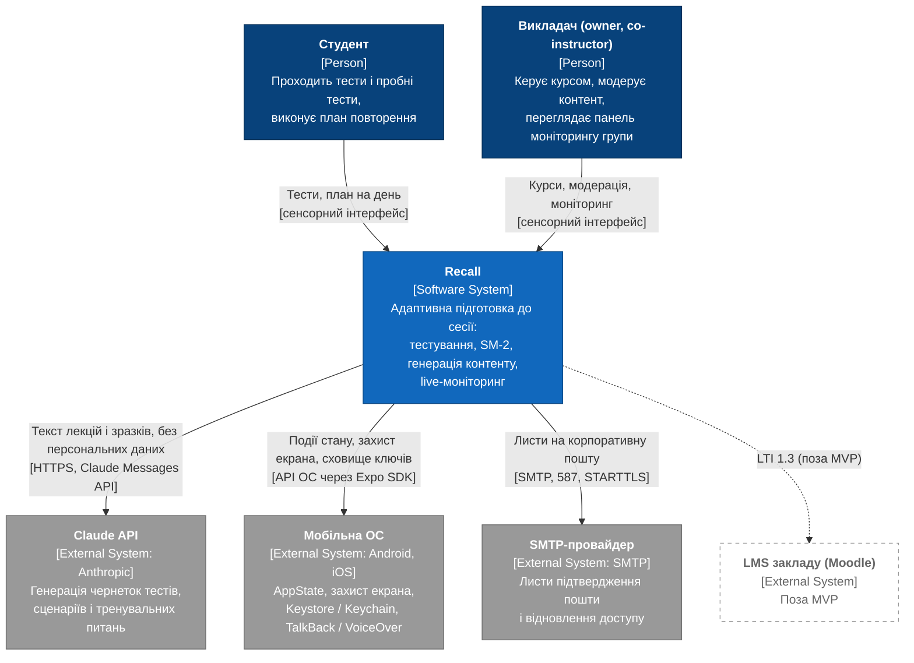
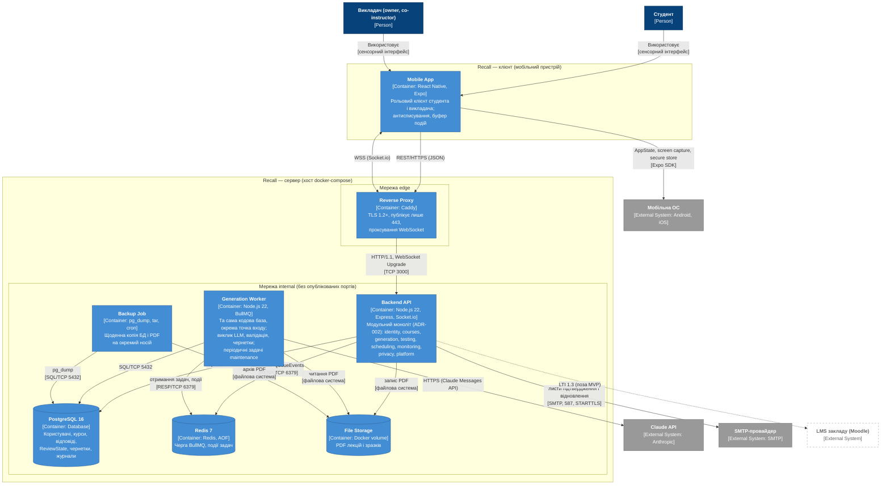
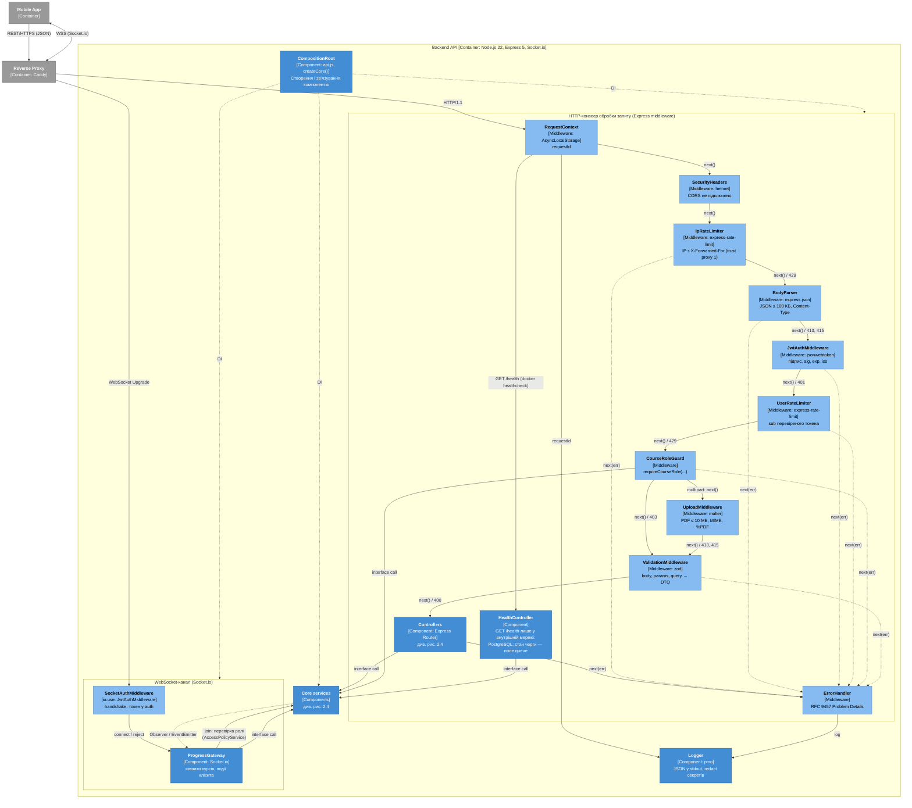
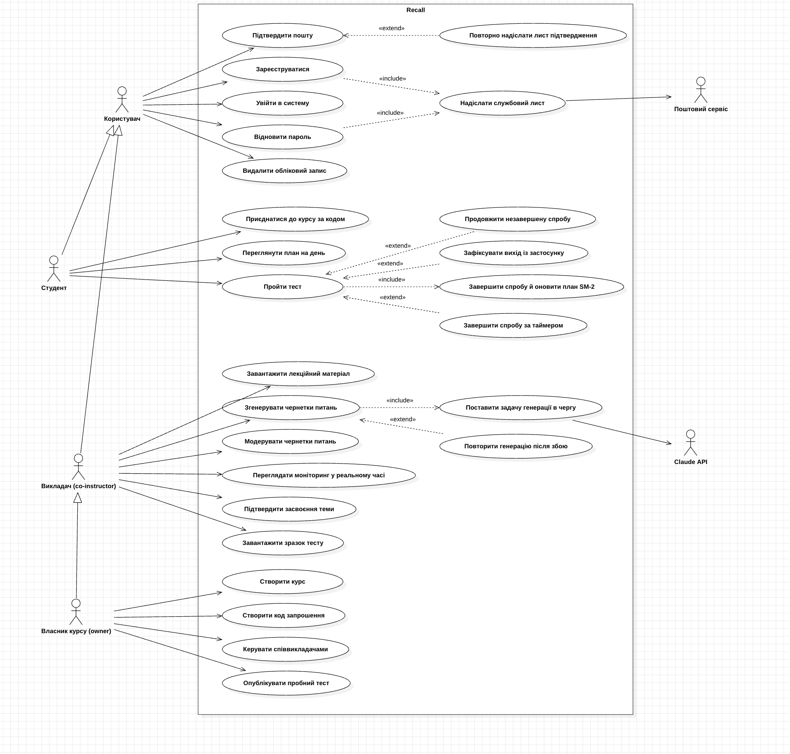
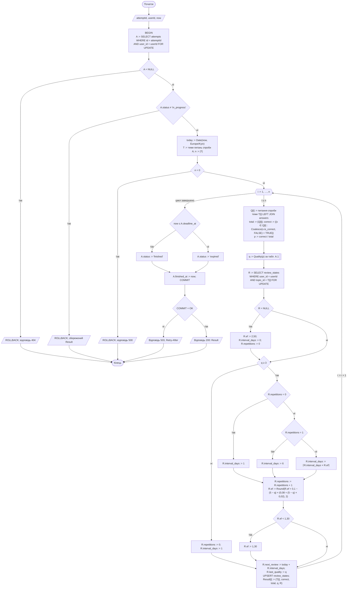
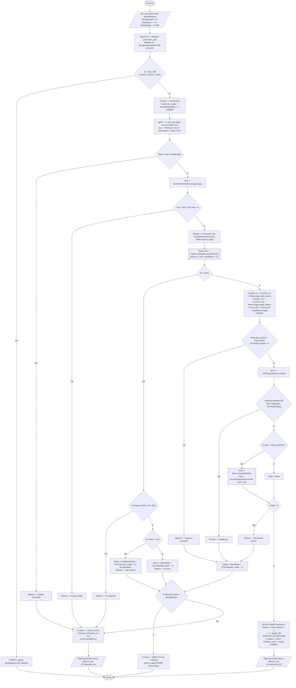

# РОЗДІЛ 2. ОБҐРУНТУВАННЯ АРХІТЕКТУРНИХ РІШЕНЬ ТА ПРОЄКТУВАННЯ СИСТЕМИ

## 2.1. Обґрунтування архітектурного стилю та патернів проєктування

Підрозділ обґрунтовує глобальний стиль серверної частини (2.1.1), патерни рівня коду (2.1.2) і рішення про асинхронну генерацію контенту (2.1.3). Архітектурні рішення фіксуються у форматі Architecture Decision Record (ADR) за шаблоном M. Nygard: контекст, альтернативи, рішення, наслідки, статус. Кожен ADR зберігається окремим файлом у каталозі [adr/](./adr/) і не редагується після затвердження; зміна рішення оформлюється новим ADR зі статусом Superseded для попереднього. Протокол архітектурного аудиту підрозділу — [17-AI Insights.md](./17-AI%20Insights.md), Запис 21.

### 2.1.1. Глобальний архітектурний стиль: модульний моноліт

Стиль визначають чотири вимоги SRS і обмеження проєкту ([ADR-002](./adr/0002-modular-monolith.md)). Завершення спроби змінює дані двох предметних областей — результати тестування і стан повторення ReviewState — і за [SRS-NFR-REL-01](./srs.md#srs-nfr-rel-01) має виконуватися однією ACID-транзакцією. [SRS-NFR-PERF-01](./srs.md#srs-nfr-perf-01), [SRS-NFR-PERF-02](./srs.md#srs-nfr-perf-02) і [SRS-NFR-RT-01](./srs.md#srs-nfr-rt-01) обмежують кількість мережевих переходів у шляху запиту і події. [SRS-NFR-MAINT-01](./srs.md#srs-nfr-maint-01) вимагає ≥ 70 % покриття рядків і гілок модулів SM-2 і пріоритизації плану, що досяжно лише за тестування цих модулів без PostgreSQL і Redis. Обмеження: соло-розробка тривалістю 6 місяців, один хост docker-compose (4 vCPU, 8 ГБ RAM), один потік до 100 студентів, відсутність хмарного бюджету. Альтернативи порівняно в табл. 2.1.

Таблиця 2.1 – Порівняння архітектурних стилів серверної частини (ADR-002)

| Критерій (вага) | Шаровий моноліт | Модульний моноліт, Ports and Adapters | Мікросервіси | Backend as a Service (Supabase) |
|---|---|---|---|---|
| REL-01: атомарність завершення спроби (0,25) | 5 | 5 | 2 — Saga, ReviewState узгоджується в кінцевому підсумку | 3 — логіка в функціях PostgreSQL |
| PERF-01, PERF-02, RT-01: мережеві переходи (0,20) | 5 | 5 | 2 — виклик сервісу courses для перевірки ролі, брокер подій | 3 |
| MAINT-01: тестування Core без інфраструктури (0,20) | 2 — сервіси залежать від Kysely | 5 | 4 | 2 |
| INFRA-01: ресурси одного хоста (0,15) | 5 | 4 | 1 — ≥ 13 контейнерів | 4 |
| Трудомісткість для одного розробника (0,10) | 5 | 4 | 1 | 3 |
| Контроль над персональними даними (0,10) | 5 | 5 | 5 | 2 — дані в хмарі провайдера |
| **Зважена сума** | **4,40** | **4,75** | **2,45** | **2,85** |

Мікросервіси виключає вимога SRS-NFR-REL-01: розподілена транзакція між сервісами testing і scheduling реалізується лише Saga з компенсувальними діями, і студент може отримати результат спроби до оновлення плану повторення. Шаровий моноліт виконує вимоги продуктивності, але прив'язує SM-2 і пріоритизацію до драйвера бази даних, тому кожен тест критичних модулів потребує PostgreSQL, а Generation Worker не може повторно використати сервіси без залежності від Express. Обрано модульний моноліт з архітектурою Ports and Adapters (варіант Clean Architecture) усередині модулів.

Модуль — це каталог коду з власними сервісами Core, портами і таблицями схеми даних. Розподіл компонентів рис. 2.4 і таблиць рис. 2.6 за модулями наведено в табл. 2.2.

Таблиця 2.2 – Модулі серверної частини

| Модуль | Компоненти Core | Таблиці-власність |
|---|---|---|
| identity | AuthService | users, email_verification_tokens, password_reset_tokens, refresh_tokens |
| courses | CourseService, InvitationService, AccessPolicyService, ContentAuditLog | courses, course_members, invite_codes, topics, control_events, control_event_topics, lecture_materials, source_tests, source_test_structure, audit_log |
| generation | GenerationJobService, BudgetGuard, ModerationService | generation_jobs, questions, question_options |
| testing | TestDeliveryService, AttemptService, QualityScorer, MockTestService | attempts, attempt_questions, answers, answer_options, mock_tests |
| scheduling | SM2Scheduler, PlanAllocator, DailyPlanPrioritizer | review_states |
| monitoring | MasteryService, AntiCheatEventService, ProgressPublisher | attempt_events, mastery_confirmations |
| privacy | PrivacyService | — (видалення через порти identity і monitoring) |
| platform | HealthService | — |

Правила меж модулів:
- запис у таблицю виконують лише порти модуля-власника; читання таблиць іншого модуля — лише через його порти читання (IQuestionReadRepository, ICourseRepository);
- модуль викликає інший модуль лише через публічні сервіси Core (файл `index.js` модуля), а не через його внутрішні компоненти;
- єдиний виняток — транзакція завершення спроби: AttemptService (testing) записує ReviewState через IReviewStateRepository модуля scheduling у тій самій транзакції. Саме ця вимога атомарності є причиною спільної схеми PostgreSQL для всіх модулів.

Спільна схема означає, що модулі не розгортаються незалежно; винесення модуля в окремий сервіс не є метою проєкту. Правило залежностей Inbound → Core → Ports ← Outbound і правила меж модулів перевіряються в CI статичним аналізом імпортів dependency-cruiser: сервер написано на JavaScript, і компілятор правило залежностей не перевіряє. Порушення (наприклад, імпорт `kysely` або `express` у сервісі Core) зупиняє конвеєр CI.

**Процеси і масштабування.** Код виконується у двох процесах з однієї кодової бази й одного образу контейнера: Backend API і Generation Worker. Окремий процес worker обґрунтовано в ADR-001 (підрозділ 2.1.3): повтори з затримкою, dead-letter queue, ліміт паралелізму ([SRS-NFR-ASYNC-04](./srs.md#srs-nfr-async-04)), збереження стану черги ([SRS-NFR-REL-04](./srs.md#srs-nfr-rel-04)) та ізоляція ключа Claude API в одному контейнері. Очікування відповіді Claude API саме по собі event loop Node.js не блокує, тому аргументом на користь окремого процесу не є. Backend API працює в одному екземплярі: шина доменних подій ProgressPublisher, лічильники rate limiting і кімнати Socket.io зберігаються в пам'яті процесу. Масштабування — вертикальне, у межах ресурсів хоста; другий екземпляр потребує адаптера Socket.io для Redis, сховища лічильників у Redis і доставки доменних подій між процесами, тому перехід до кількох екземплярів є умовою перегляду ADR-002.

**Ресурси хоста.** Обмеження ресурсів контейнерів у docker-compose: Backend API — 1,5 vCPU і 768 МБ, Generation Worker — 1 vCPU і 512 МБ, PostgreSQL — 1 vCPU і 2 ГБ, Redis — 0,25 vCPU і 256 МБ, Reverse Proxy — 0,25 vCPU і 128 МБ; сума не перевищує 4 vCPU, тому навантаження worker не забирає процесор у PostgreSQL. CPU-важкі операції Backend API виконуються поза event loop: хешування Argon2id — у пулі потоків libuv (`UV_THREADPOOL_SIZE = 4` задається явно), вилучення тексту PDF для перевірки [SRS-FUN-51](./srs.md#srs-fun-51) — в окремому потоці `worker_threads`. Текст PDF вилучається двічі: Backend API перевіряє обмеження до збереження файлу, Generation Worker вилучає текст повторно під час генерації (підрозділ 2.8.3). Повторне вилучення (до 1 с процесорного часу на документ до 60 сторінок) прийнято замість зберігання тексту в окремому сховищі. Міграції схеми виконує одноразовий сервіс `migrate` (Kysely Migrator) до запуску Backend API і Generation Worker (`depends_on: condition: service_completed_successfully`); міграції сумісні з попередньою версією коду (спершу розширення схеми, видалення — наступним випуском), оновлення не виконується під час контрольних заходів.

Механізми, якими стиль забезпечує нефункціональні вимоги, наведено в табл. 2.3. Значення затримок — оцінка для умов вимірювання SRS (4 vCPU, набір даних 100 студентів); перевірка — сценарії VER-01…VER-04.

Таблиця 2.3 – Відповідність нефункціональних вимог механізмам архітектури

| Вимога | Механізм | Оцінка і вузьке місце |
|---|---|---|
| [SRS-NFR-PERF-01](./srs.md#srs-nfr-perf-01): читання, p95 ≤ 300 мс при 50 RPS | Один процес, виклики між модулями без мережі; перевірка ролі одним запитом за первинним ключем course_members; індекси підрозділу 2.7.2 | Reverse Proxy ≤ 5 мс, JWT ≤ 1 мс, перевірка ролі ≤ 5 мс, до 5 запитів SQL ≤ 60 мс, серіалізація ≤ 10 мс: ≈ 80 мс; запас ≈ 220 мс на конкуренцію за процесор хоста. Вузьке місце — процесор під час піку входів (Argon2id) і генерації |
| [SRS-NFR-PERF-02](./srs.md#srs-nfr-perf-02): запис відповіді і завершення спроби, p95 ≤ 500 мс | Одна транзакція PostgreSQL: блокування спроби, перерахунок ≤ 15 тем, UPSERT ReviewState, COMMIT; подія — після COMMIT | ≈ 100 мс: до 15 операторів UPSERT ≈ 30 мс, COMMIT з fsync ≈ 10 мс. Вузьке місце — конкуренція блокувань рядків review_states при одночасному завершенні спроб одного студента (виключено 409 для другої спроби того самого режиму) |
| [SRS-NFR-RT-01](./srs.md#srs-nfr-rt-01): подія прогресу p95 ≤ 1 с | Observer у межах процесу: ProgressPublisher → ProgressGateway → кімната `course:{courseId}`, без брокера | Затримка визначається мережею клієнта; серверна частина ≤ 10 мс |
| [SRS-NFR-ASYNC-01](./srs.md#srs-nfr-async-01): 202, p95 ≤ 200 мс | ADR-001: запис GenerationJob, постановка в чергу BullMQ, виклик Claude API — у Generation Worker | BudgetGuard (сума за індексом `generation_jobs_created_idx`), INSERT і постановка в Redis ≈ 20 мс. Залежність від Redis: за його недоступності — 503 з Retry-After |
| [SRS-NFR-REL-01](./srs.md#srs-nfr-rel-01): атомарність завершення спроби | Спільна схема PostgreSQL, Unit of Work (підрозділ 2.1.2) | — |
| [SRS-NFR-MAINT-01](./srs.md#srs-nfr-maint-01): ≥ 70 % рядків і гілок | Ports and Adapters; чисті функції QualityScorer, SM2Scheduler, PlanAllocator | Unit-тести без контейнерів; порти — підробки в пам'яті |
| [SRS-NFR-SEC-05](./srs.md#srs-nfr-sec-05): контроль доступу на сервері | AccessPolicyService — єдина точка визначення role_in_course для CourseRoleGuard (REST) і ProgressGateway (Socket.io) | — |

**Ризики стилю і рішення щодо них.**
- **Хост — єдина точка відмови.** Усі контейнери розміщено на одному хості, і цільова доступність у SRS не задана: це прийнятий ризик для апробації в одному потоці. Backup Job щодоби копіює дамп PostgreSQL і том File Storage з PDF на окремий фізичний носій ([SRS-NFR-REL-03](./srs.md#srs-nfr-rel-03)), тому після відновлення записи бази даних не посилаються на відсутні файли. Серверний таймер спроби задано полем `deadline_at`: після перезапуску спроби, строк яких минув, завершуються задачею `maintenance` (підрозділ 2.3.2).
- **Залежність від Redis.** За недоступності Redis постановка задач генерації повертає 503, тестування, план повторення і моніторинг працюють. Тому GET /health Backend API повертає 200 за доступності PostgreSQL і повідомляє стан черги окремим полем, а GET /health Generation Worker вимагає PostgreSQL і Redis ([SRS-NFR-OBS-02](./srs.md#srs-nfr-obs-02)). docker-compose не перезапускає контейнер зі статусом unhealthy: healthcheck використовується для порядку запуску і спостереження, автоматичний перезапуск unhealthy-контейнерів — поза MVP.
- **Узгодженість PostgreSQL і Redis.** Запис GenerationJob і постановка в чергу не атомарні. Щохвилинна задача `maintenance` повторно ставить у чергу задачі в стані queued, старші за 1 хв, з тим самим jobId; отже «загублена» задача виявляється не пізніше ніж за 2 хв. Подія `completed` надсилається після COMMIT статусу задачі в generation_jobs, тому запит стану після події не повертає queued (ADR-001).
- **Доставка подій між процесами.** ProgressPublisher працює в межах процесу. Події процесу Generation Worker (завершення задачі генерації, автоматичне завершення спроби) доходять до Backend API лише через BullMQ QueueEvents: задача `maintenance` повертає перелік завершених спроб, JobEventsListener публікує подію в кімнати курсів питань спроби.
- **Витрати на Claude API (FinOps).** Добовий ліміт 2 USD ([SRS-NFR-COST-02](./srs.md#srs-nfr-cost-02)) перевіряється за сумою фактичної вартості задач доби і резерву задач у станах queued і processing; резерв задачі — найгірша оцінка 0,024 USD (ADR-001). Без резерву 200 одночасних постановок за нульових фактичних витрат пройшли б перевірку і перевищили ліміт до 2,4 раза; з резервом перевищення обмежене похибкою оцінки вартості. Ліміт діє на всю систему; квота на викладача — поза MVP.
- **Синхронний виклик SMTP-провайдера.** Лист підтвердження або відновлення надсилається після COMMIT і після відповіді клієнту, з тайм-аутом з'єднання 10 с; збій журналюється без повтору, користувач повторює запит (`/auth/verify-email/resend`, `/auth/password-reset/request`) у межах [SRS-NFR-SEC-08](./srs.md#srs-nfr-sec-08). Обробник запиту не утримується на час доставки листа.
- **Сесії мобільного клієнта.** Клієнт виконує не більше одного оновлення токенів одночасно: паралельні запити з простроченим access-токеном очікують результату одного запиту `/auth/refresh`, тому reuse detection ([SRS-NFR-SEC-02](./srs.md#srs-nfr-sec-02)) не відкликає сесію через гонку. Після закінчення строку дії access-токена сервер надсилає з'єднанню Socket.io подію `auth.expired` і розриває його; клієнт підключається повторно з новим токеном і перезапитує стан панелі через REST, оскільки пропущені за час розриву події не повторюються.
- **Навантаження каналу Socket.io.** Роль користувача перевіряється під час приєднання до кімнати; вилучення учасника з курсу негайно виключає його з'єднання з кімнати, а строк дії токена перевіряється на кожній події без звернення до бази даних ([SRS-FUN-44](./srs.md#srs-fun-44)). Події клієнта обмежено 60 подіями за хвилину на з'єднання ([SRS-NFR-SEC-08](./srs.md#srs-nfr-sec-08)). Пік входів на початку контрольного заходу: 100 хешувань Argon2id по ≈ 40 мс процесорного часу в 4 потоках — ≈ 1 с черги.

### 2.1.2. Патерни рівня коду

Патерни, застосовані в сервісах Backend API і Generation Worker, і проблему зв'язності, яку розв'язує кожен з них, наведено в табл. 2.4.

Таблиця 2.4 – Патерни рівня коду

| Патерн | Де застосовано | Яку проблему розв'язує | Межа застосування |
|---|---|---|---|
| Ports and Adapters (Dependency Inversion) | Інтерфейси портів визначено в Core, реалізації — в Outbound (рис. 2.4) | Core не залежить від Express, Socket.io, Kysely, BullMQ і nodemailer; доменна логіка тестується з підробками портів | Порти описано JSDoc; дотримання перевіряють тести і dependency-cruiser |
| Composition Root, впровадження залежностей через конструктор | `api.js` і `worker.js`; обидва збирають Core однією фабрикою `createCore(adapters)` | Створення і конфігурація адаптерів в одному місці кожного процесу; підміна адаптерів у тестах (підробки в пам'яті, заглушка Claude API nock) | DI не зменшує кількість залежностей сервісу (AttemptService має шість), а робить їх явними; DI-контейнер не використовується |
| Repository | Pg*Repository за портами I*Repository | SQL зосереджено в Outbound; сервіси Core тестуються з репозиторіями в пам'яті | Заміна СКБД не є метою: коректність спирається на транзакції й обмеження UNIQUE PostgreSQL ([SRS-NFR-SEC-12](./srs.md#srs-nfr-sec-12)). ICourseRepository спільний для п'яти сервісів: курс і членство в ньому — одне джерело даних, поділ дав би п'ять інтерфейсів з однією реалізацією |
| Unit of Work | `ITransactionManager.run(fn)`; поточна транзакція зберігається в AsyncLocalStorage, репозиторії беруть її з контексту | Атомарність операцій з кількома записами без передавання об'єкта транзакції Kysely в Core: завершення спроби ([SRS-NFR-REL-01](./srs.md#srs-nfr-rel-01)), модерація з записом у журнал аудиту, видалення облікового запису ([SRS-FUN-48](./srs.md#srs-fun-48)), створення матеріалу з записом у журнал | Файлова система не транзакційна: PDF записується до транзакції і видаляється при її відкаті; файл без запису після аварійного завершення процесу — прийнятий ризик (недоступний клієнту) |
| Observer | ProgressPublisher (EventEmitter) → ProgressGateway | Сервіси Core не залежать від Socket.io; подія прогресу публікується без брокера | `emit` викликається лише після COMMIT і викликає слухачів синхронно, тому слухач ProgressGateway лише планує надсилання (`setImmediate`) і перехоплює винятки: збій доставки не впливає на відповідь студенту. Доставка best-effort, у межах процесу; між процесами — BullMQ QueueEvents |
| Adapter | IMailSender: SmtpMailSender, ConsoleMailSender; IPdfTextExtractor: PdfjsTextExtractor | Зовнішні бібліотеки і сервіси ізольовано за портом; для dev і test лист записується в журнал | Адаптер обирається під час запуску змінною `MAIL_TRANSPORT`; при `NODE_ENV=production` і значенні, відмінному від `smtp`, процес не запускається, тому одноразові токени не потрапляють у журнали |
| Функціональне ядро (чисті функції) | QualityScorer, SM2Scheduler, PlanAllocator; DailyPlanPrioritizer завантажує дані і передає їх PlanAllocator | Детермінована логіка без I/O: покриття [SRS-NFR-MAINT-01](./srs.md#srs-nfr-maint-01) досягається unit-тестами | Вибірка кандидатів і питань (I/O) перевіряється інтеграційними тестами |
| Chain of Responsibility | Ланцюжок middleware Express (рис. 2.3) | Безпека, валідація і обробка помилок відокремлені від контролерів; порядок перевірок фіксований | Бізнес-обмеження (ліміти PDF, бюджет) — у Core, middleware перевіряє лише транспорт і формат |
| Idempotent Consumer | jobId BullMQ := idempotency_key; UNIQUE (generation_job_id, position); UNIQUE (attempt_id, question_id) | Повторна доставка задачі або повторний запит не створює дублікатів ([SRS-NFR-REL-02](./srs.md#srs-nfr-rel-02)) | Повторна тарифікація Claude API після аварійного завершення worker — прийнятий ризик (ADR-001) |

Доменні помилки Core (наприклад, `BudgetExceededError` у BudgetGuard, `PdfTooLongError` у CourseService) не містять HTTP-кодів; відображення в коди 422, 429 і формат RFC 9457 виконує ErrorHandler.

Не застосовано:
- CQRS і Event Sourcing — немає асиметрії навантаження читання і запису при 50 RPS і однієї бази даних;
- Saga — єдина транзакція PostgreSQL виконує SRS-NFR-REL-01;
- Circuit Breaker для Claude API — паралелізм обмежено двома задачами, кожен виклик має тайм-аут 60 с і не більше 3 спроб ([SRS-NFR-ASYNC-03](./srs.md#srs-nfr-async-03)), тому каскадний збій неможливий;
- Singleton — пул з'єднань PostgreSQL і з'єднання Redis створюються один раз у корені композиції кожного процесу.

Бюджет з'єднань: пул PostgreSQL — 10 з'єднань у Backend API і 5 у Generation Worker, разом з Backup Job і `migrate` — не більше 17 з 100 (`max_connections` за замовчуванням). Redis: Backend API — 3 з'єднання (Queue і два QueueEvents для черг generation і maintenance), Generation Worker — 4 (два Worker з блокувальними з'єднаннями, Queue для повторної постановки, перевірка працездатності).

### 2.1.3. ADR-001. Асинхронна обробка генерації контенту через Claude API: BullMQ на Redis

Нижче наведено текст [ADR-001](./adr/0001-choice-of-technology.md); протокол рецензії — [17-AI Insights.md](./17-AI%20Insights.md), Запис 14.

<!-- adr-001:start -->

**Status:** Approved
**Date:** 10.11.2026; уточнення 24.11.2026 (розділ «Історія змін»)
**Автор рішення:** MarcoGr11
**Пов'язані артефакти:** [srs.md](./srs.md), [2_design.md](./2_design.md) — підрозділи 2.1.3, 2.2.2, 2.3

#### Context

Викладач завантажує PDF лекції або зразок тесту, після чого система генерує чернетку тесту, сценарію або тренувальних питань через Claude API ([SRS-FUN-22](./srs.md#srs-fun-22)…[SRS-FUN-27](./srs.md#srs-fun-27), [SRS-FUN-31](./srs.md#srs-fun-31)). Тривалість одного виклику Claude API для генерації тесту за лекцією оцінюється до 60 с на рівні p95 (timeout одного виклику — 60 с за [SRS-NFR-ASYNC-03](./srs.md#srs-nfr-async-03)); провайдер повертає помилки HTTP 429 (rate limit) і 5xx (перевантаження).

Вимоги, що визначають рішення, наведено в табл. 2.5.

Таблиця 2.5 – Вимоги, що визначають рішення ADR-001

| Вимога | Метрика |
|---|---|
| [SRS-NFR-ASYNC-01](./srs.md#srs-nfr-async-01) | 202 Accepted, p95 ≤ 200 мс незалежно від Latency Claude API |
| [SRS-NFR-ASYNC-02](./srs.md#srs-nfr-async-02) | Обробка задачі p95 ≤ 90 с |
| [SRS-NFR-ASYNC-03](./srs.md#srs-nfr-async-03) | 3 спроби загалом, експоненційна затримка 5 с, 10 с, dead-letter queue |
| [SRS-NFR-ASYNC-04](./srs.md#srs-nfr-async-04) | Паралелізм ≤ 2 задачі |
| [SRS-NFR-REL-02](./srs.md#srs-nfr-rel-02) | Ідемпотентність задачі за idempotency_key |
| [SRS-NFR-REL-04](./srs.md#srs-nfr-rel-04) | Втрата стану черги при перезапуску ≤ 1 с записів |
| [SRS-NFR-COST-01](./srs.md#srs-nfr-cost-01), [SRS-NFR-COST-02](./srs.md#srs-nfr-cost-02) | Облік кожного виклику; добовий ліміт вартості 2 USD |
| [SRS-FUN-30](./srs.md#srs-fun-30) | Подія WebSocket викладачу про завершення або невдачу задачі |

Обмеження проєкту: соло-розробка тривалістю 6 місяців; розгортання в docker-compose на одному хості; один потік до 100 студентів; хмарний бюджет відсутній.

За синхронного виклику p95 відповіді API не менший за Latency провайдера, тобто до 60 с проти порогу 200 мс — перевищення приблизно в 300 разів. Тому синхронний варіант не задовольняє SRS-NFR-ASYNC-01 за визначенням, а вибір відбувається між механізмами асинхронної обробки.

#### Alternatives

##### 1. Синхронний виклик Claude API в обробнику HTTP-запиту

HTTP-з'єднання утримується на весь час виклику; обрив з'єднання мобільним клієнтом при зміні мережі втрачає результат, а повторне надсилання запиту клієнтом створює повторну тарифікацію. Паралелізм на рівні системи не обмежується: кожен викладач ініціює власний виклик. Повторні спроби і dead-letter queue відсутні. **Відхилено:** порушує SRS-NFR-ASYNC-01, SRS-NFR-ASYNC-03, SRS-NFR-ASYNC-04.

##### 2. Фонова черга в процесі Backend API (in-process, p-queue)

Окремий сервіс не потрібен; паралелізм обмежується параметром черги. Стан черги зберігається в пам'яті процесу і втрачається при перезапуску контейнера; повторні спроби з затримкою і dead-letter queue реалізуються власним кодом; генерація конкурує з обробкою REST-запитів за event loop. **Відхилено:** порушує SRS-NFR-REL-04, потребує власної реалізації SRS-NFR-ASYNC-03.

##### 3. Черга на PostgreSQL (pg-boss, `SELECT … FOR UPDATE SKIP LOCKED`)

Не потребує окремого сервісу; постановка задачі може виконуватися в одній транзакції із записом GenerationJob. Отримання задач виконується опитуванням (polling) тієї самої бази, що обслуговує SRS-NFR-PERF-01 і SRS-NFR-PERF-02; вбудованого механізму подій стану задачі, еквівалентного QueueEvents, для SRS-FUN-30 немає — потрібен LISTEN / NOTIFY і власна логіка; обмеження паралелізму на рівні черги потребує окремої конфігурації. **Відхилено:** навантаження на основну БД і власна реалізація доставки подій задач.

##### 4. RabbitMQ (AMQP 0-9-1)

Окремий брокер з підтвердженнями доставки, dead-letter exchange, маршрутизацією, quorum queues і кластеризацією. Потребує окремого сервісу з власною конфігурацією (exchanges, queues, bindings, policies), клієнта amqplib без вбудованої семантики задач, власної реалізації exponential backoff (TTL + dead-letter exchange або плагін delayed message exchange) і окремого моніторингу. Переваги RabbitMQ не відповідають жодній вимозі SRS при одному типі споживача і одному хості. **Відхилено:** найбільший обсяг інфраструктури і коду на супровід при соло-розробці.

##### 5. BullMQ на Redis 7

Бібліотека черг для Node.js: `attempts`, `backoff: {type: 'exponential'}`, стан failed як dead-letter queue, `concurrency` worker-процесу і глобальний ліміт `setGlobalConcurrency`, `jobId` для дедуплікації, QueueEvents на основі Redis Streams для подій completed / failed. Потребує Redis 7 як окремого сервісу.

##### Відхилені без детального аналізу

- **Message Batches API провайдера:** знижена вартість, але час завершення пакета до 24 год несумісний із SRS-NFR-ASYNC-02 (p95 ≤ 90 с).
- **Керовані хмарні черги (Amazon SQS, Google Cloud Tasks):** несумісні з обмеженням розгортання на одному хості без хмарного бюджету.

##### Матриця оцінки

Таблиця 2.6 – Оцінка альтернатив за критеріями (+ — задовольняє засобами інструмента; ± — задовольняє власним кодом або конфігурацією; − — не задовольняє)

| Критерій | Синхронний виклик | In-process | PostgreSQL (pg-boss) | RabbitMQ | BullMQ на Redis |
|---|---|---|---|---|---|
| SRS-NFR-ASYNC-01: 202 ≤ 200 мс | − | + | + | + | + |
| SRS-NFR-ASYNC-03: retry, backoff, DLQ | − | ± | + | ± | + |
| SRS-NFR-ASYNC-04: паралелізм ≤ 2 | − | + | ± | + | + (setGlobalConcurrency) |
| SRS-NFR-REL-02: ідемпотентність за idempotency_key | − | ± | + | ± | + |
| SRS-NFR-REL-04: стан черги після перезапуску | − | − | + | + | + (AOF) |
| SRS-FUN-30: події стану задачі | — | ± | ± | ± | + (QueueEvents) |
| Транзакційна постановка задачі разом із записом GenerationJob | — | — | + | − | ± (порядок «запис → enqueue» і узгодження) |
| Додаткові сервіси на супровід | 0 | 0 | 0 | 1 (брокер) | 1 (Redis) |
| Операційна вартість | 0 | 0 | 0 | 0 | 0 |

#### Decision

Обрано **BullMQ на Redis 7** з окремим процесом Generation Worker (та сама кодова база, окрема точка входу).

1. Backend API записує GenerationJob у PostgreSQL зі статусом queued, ставить задачу в чергу з `jobId := idempotency_key := SHA-256(тип задачі, ідентифікатор джерела, версія джерела, generation_no)` і повертає 202 Accepted з ідентифікатором задачі. Номер генерації generation_no збільшується на 1 при повторній генерації за тим самим джерелом після стану dead або відхилення чернеток: BullMQ ігнорує постановку задачі з jobId, що вже зберігається в Redis (зокрема у стані failed), тому без generation_no повторна генерація була б неможливою. Перед постановкою BudgetGuard перевіряє добовий ліміт вартості; після його досягнення API повертає 429.
2. Глобальний ліміт паралелізму задається на черзі: `queue.setGlobalConcurrency(2)` — не більше 2 активних задач у системі незалежно від кількості worker-процесів; `concurrency: 2` у Generation Worker є лише локальним верхнім порогом одного процесу. Worker викликає Claude API (модель `claude-haiku-5-5`) з timeout 60 с, валідує результат за JSON-схемою і зберігає чернетку зі статусом draft, записуючи кількість токенів і вартість виклику в generation_jobs.
3. Повторні спроби виконує лише BullMQ: `attempts: 3`, `backoff: {type: 'exponential', delay: 5000}` (затримки 5 с і 10 с). Клієнт SDK Anthropic створюється з `maxRetries: 0`, оскільки за замовчуванням SDK виконує 2 власні повторні спроби для 408 / 409 / 429 / 5xx, що разом із 3 спробами BullMQ дало б до 9 HTTP-викликів на задачу. Для HTTP 429 власна стратегія backoff BullMQ встановлює затримку, що дорівнює більшому зі значень експоненційної затримки і заголовка retry-after відповіді Claude API.
4. Після третьої невдалої спроби задача залишається в стані failed з причиною збою (dead-letter queue) і автоматично не повторюється. Неповторювані помилки (HTTP 400, 401, 403, порожній текст джерела, досягнення добового ліміту вартості під час виконання) завершують задачу без повторів через UnrecoverableError BullMQ; GenerationJob отримує статус dead.
5. Backend API підписаний на QueueEvents і передає події completed / failed у ProgressPublisher, який через ProgressGateway надсилає подію викладачу (SRS-FUN-30).
6. Redis працює з `appendonly yes`, `appendfsync everysec`.

Аргументи рішення:
- вирішальний критерій — [SRS-FUN-30](./srs.md#srs-fun-30): BullMQ надає події стану задачі (QueueEvents: completed, failed) без власного коду, тоді як для pg-boss потрібні LISTEN / NOTIFY і власна логіка (табл. 2.6);
- pg-boss має перевагу, якої це рішення не отримує: постановку задачі в одній транзакції PostgreSQL із записом GenerationJob. Для BullMQ розбіжність Redis і PostgreSQL усувається порядком «запис queued → enqueue» і щохвилинним узгодженням (розділ Consequences); для MVP з одним типом задач цю ціну визнано прийнятною;
- не потребує окремого брокера повідомлень: Redis 7 — єдиний додатковий сервіс інфраструктури черги;
- Generation Worker є єдиним споживачем Claude API, тому облік і обмеження вартості (SRS-NFR-COST-01, SRS-NFR-COST-02) зосереджено в одній точці, а ключ Claude API передається лише в цей контейнер.

#### Consequences

##### Позитивні

- Відповідь endpoint постановки не залежить від Latency Claude API (SRS-NFR-ASYNC-01).
- Повторні спроби з експоненційною затримкою, dead-letter queue, обмеження паралелізму і дедуплікація за jobId (idempotency_key) реалізуються конфігурацією BullMQ.
- Збій Claude API не впливає на тестування, план повторення і моніторинг: вони не залежать від черги.
- Контроль вартості і ключа Claude API зосереджено в одному контейнері.

##### Негативні

- **Redis — єдина точка відмови черги.** При недоступності Redis постановка задач неможлива: Backend API повертає 503 із заголовком Retry-After, обробка зупиняється, події QueueEvents не доставляються. Тестування, план повторення і live-моніторинг продовжують працювати. Зменшення ризику: healthcheck ([SRS-NFR-OBS-02](./srs.md#srs-nfr-obs-02)), `restart: unless-stopped`, відновлення стану з AOF. Висока доступність (Redis Sentinel) не реалізується через обмеження одного хоста.
- **Семантика доставки at-least-once.** Задача, worker якої завершився аварійно після виклику Claude API, але до підтвердження, обробляється повторно (stalled job). Наслідки: ризик дубліката чернетки і повторна тарифікація виклику. Зменшення ризику: ідемпотентність за idempotency_key і обмеження UNIQUE (generation_job_id, position) для чернеток у PostgreSQL. Повторна тарифікація при аварійному завершенні — прийнятий ризик.
- **Потреба в AOF persistence.** Без AOF перезапуск контейнера Redis втрачає задачі. З `appendfsync everysec` втрачається до 1 с записів; ціна — додатковий запис на диск і зростання файлу AOF, що потребує періодичного перезапису (`auto-aof-rewrite`).
- **Розбіжність стану Redis і PostgreSQL.** Запис GenerationJob у PostgreSQL і постановка в чергу Redis не атомарні. Порядок «запис queued → enqueue з тим самим jobId» і щохвилинне узгодження задачею черги maintenance (повторна постановка записів queued, старших за 1 хв, з тим самим jobId) усувають розбіжність без transactional outbox; «загублена» задача виявляється не пізніше ніж за 2 хв. Worker фіксує стан задачі в generation_jobs до її завершення в BullMQ, тому подія completed не випереджає COMMIT.
- **Ускладнення тестування.** Інтеграційні тести потребують Redis у контейнері, заглушки Claude API (nock) з керованими відмовами і очікування стану задачі; затримки backoff задаються конфігурацією, щоб тести не чекали 5 с і 10 с; час CI зростає (сценарій VER-05).
- **FinOps — вартість токенів Claude API.** Модель — Claude Haiku 5.5 (`claude-haiku-5-5`), тариф станом на 24.11.2026 за офіційною сторінкою Anthropic Pricing: 0,10 USD / 0,50 USD за 1M вхідних / вихідних токенів для запитів до 100 000 токенів (понад 100 000 — 0,50 USD / 2,50 USD). Ліміт вилученого тексту 40 000 токенів ([SRS-FUN-51](./srs.md#srs-fun-51)) разом із системними інструкціями утримує кожен запит у нижньому тарифному діапазоні. Типова задача генерації тесту за лекцією ≈ 20 000 вхідних і 4 000 вихідних токенів ≈ 0,004 USD; верхня межа одного виклику (≈ 42 000 вхідних токенів, `max_tokens` = 8 000) ≈ 0,008 USD, з урахуванням 3 спроб — не більше 0,024 USD. Добовий ліміт 2 USD відповідає ≈ 500 типовим задачам або ≈ 83 задачам у найгіршому випадку. Контроль: `max_tokens` на виклик, BudgetGuard з резервом найгіршої вартості 0,024 USD на кожну задачу в станах queued і processing (без резерву одночасні постановки за нульових фактичних витрат проходять перевірку), облік tokens_in, tokens_out, cost_usd у generation_jobs. Оцінку слід перевірити за фактичними даними після перших 20 задач (сценарій VER-06).
- **Очікування переноситься в інтерфейс.** Викладач отримує результат через 10–90 с; інтерфейс повинен показувати стан задачі, а система — доставляти подію завершення (SRS-FUN-30), що створює залежність від каналу WebSocket.
- **Додатковий процес.** Generation Worker і Redis — два додаткові контейнери в docker-compose з власними healthcheck.

##### Вибір моделі Claude

Обрано Claude Haiku 5.5 — модель класу Haiku з найнижчим тарифом серед актуальних моделей на 24.11.2026. Порівняно з Claude Haiku 4.5 (1 USD / 5 USD) вартість задачі нижча в 10 разів за тих самих обсягів токенів. Контекстне вікно (1M токенів) перевищує ліміт тексту SRS-FUN-51 з запасом; дата виведення з експлуатації — не раніше 07.10.2027, що перевищує строк апробації. Генерація тестових питань за текстом лекції не потребує моделі класу Sonnet або Opus: якість чернетки контролюється JSON-схемою (SRS-FUN-26) і обов'язковою модерацією (SRS-FUN-28). Ідентифікатор моделі задається змінною середовища worker-процесу.

##### Умови перегляду рішення

Рішення переглядається, якщо виконується хоча б одна умова:
- з'являється другий тип споживача подій або потреба маршрутизації повідомлень між сервісами;
- з'являється вимога гарантії exactly-once;
- worker потрібно масштабувати на кілька хостів або потрібна висока доступність черги;
- фактична вартість генерації за даними generation_jobs перевищує добовий ліміт більше ніж у 20 % днів апробації.

#### Історія змін

- 24.11.2026 — уточнення без зміни рішення: ключ ідемпотентності доповнено номером генерації generation_no (знахідка 10 незалежного аудиту); модель Claude Haiku 4.5 замінено на Claude Haiku 5.5 з перерахунком оцінки вартості; облік токенів і вартості перенесено з generation_log у generation_jobs; статус чернетки pending перейменовано на draft. Рішення автора — [17-AI Insights.md](./17-AI%20Insights.md), Запис 16.
- 24.11.2026 — уточнення без зміни рішення за результатами нормоконтролю алгоритмів: затримка для HTTP 429 враховує заголовок retry-after; неповторювані помилки і досягнення бюджету під час виконання переводять задачу в dead без повторів. Рішення автора — [17-AI Insights.md](./17-AI%20Insights.md), Запис 19.
- 24.11.2026 — уточнення без зміни рішення за результатами архітектурного аудиту підрозділу 2.1: узгодження PostgreSQL і Redis виконується щохвилини задачею черги maintenance, а не лише при старті worker; BudgetGuard резервує найгіршу вартість задач у черзі. Рішення автора — [17-AI Insights.md](./17-AI%20Insights.md), Запис 21.

<!-- adr-001:end -->

## 2.2. Контекстне та контейнерне моделювання системи

Архітектуру системи описано за моделлю C4 (Context, Container, Component). Діаграми виконано кодом Mermaid.js у нотації `flowchart TB`: тип кожного вузла C4 зазначено в підписі ([Person], [Software System], [Container], [External System]), протокол — у підписі зв'язку. Нотацію `flowchart` обрано замість експериментального синтаксису `C4Context` / `C4Container`, оскільки останній не підтримує пунктирних зв'язків для елементів поза MVP і при восьми і більше вузлах накладає підписи зв'язків один на одний. Базовою лінією трасування є специфікація вимог [srs.md](./srs.md); протокол архітектурного рев'ю — [17-AI Insights.md](./17-AI%20Insights.md), Запис 12.

### 2.2.1. Діаграма контексту (Level 1)

Діаграма контексту визначає межу системи Recall, її користувачів і зовнішні системи (рис. 2.1).



Рисунок 2.1 – Діаграма контексту системи Recall (C4 Level 1)

Таблиця 2.7 – Вузли діаграми контексту

| Вузол | Тип | Технологія | Відповідальність | SRS-ID |
|---|---|---|---|---|
| Студент | Person | — | Проходить тести і пробні тести, виконує план повторення | [SRS-FUN-13](./srs.md#srs-fun-13), [SRS-FUN-20](./srs.md#srs-fun-20), [SRS-FUN-34](./srs.md#srs-fun-34) |
| Викладач (owner, co-instructor) | Person | — | Створює курс і контрольні заходи, завантажує матеріали і зразки, модерує чернетки, переглядає панель моніторингу; права co-instructor обмежено | [SRS-FUN-03](./srs.md#srs-fun-03)…[SRS-FUN-10](./srs.md#srs-fun-10), [SRS-FUN-28](./srs.md#srs-fun-28), [SRS-FUN-39](./srs.md#srs-fun-39), [SRS-FUN-47](./srs.md#srs-fun-47) |
| Recall | Software System | React Native, Node.js, PostgreSQL, Redis | Тестування, планування повторень за SM-2, асинхронна генерація контенту, пробні тести, антисписування, live-моніторинг | [SRS-FUN-01](./srs.md#srs-fun-01)…[SRS-FUN-49](./srs.md#srs-fun-49) |
| Claude API | External System | Anthropic Claude Messages API | Генерація чернеток тестів, сценаріїв і тренувальних питань | [SRS-FUN-24](./srs.md#srs-fun-24), [SRS-FUN-25](./srs.md#srs-fun-25), [SRS-FUN-31](./srs.md#srs-fun-31) |
| Мобільна ОС | External System | Android 10+, iOS 16+ | Події AppState, захист екрана, Keystore / Keychain, TalkBack / VoiceOver | [SRS-FUN-37](./srs.md#srs-fun-37), [SRS-FUN-40](./srs.md#srs-fun-40), [SRS-FUN-41](./srs.md#srs-fun-41), [SRS-NFR-SEC-04](./srs.md#srs-nfr-sec-04), [SRS-NFR-A11Y-02](./srs.md#srs-nfr-a11y-02) |
| SMTP-провайдер | External System | SMTP (порт 587, STARTTLS) | Доставка листів підтвердження корпоративної пошти і відновлення доступу | [SRS-FUN-01](./srs.md#srs-fun-01), [SRS-FUN-55](./srs.md#srs-fun-55) |
| LMS закладу (Moodle) | External System, поза MVP | LTI 1.3 | Інтеграцію не реалізовано; показано для фіксації межі системи | — |

Таблиця 2.8 – Зв'язки діаграми контексту

| Від | До | Протокол | Призначення |
|---|---|---|---|
| Студент | Recall | Сенсорний інтерфейс мобільного застосунку | Тестування, план на день, пробні тести |
| Викладач | Recall | Сенсорний інтерфейс мобільного застосунку | Керування курсом, модерація, моніторинг групи |
| Recall | Claude API | HTTPS (Claude Messages API, JSON) | Передача тексту лекцій і зразків тестів без персональних даних; отримання результату генерації |
| Recall | Мобільна ОС | API ОС через Expo SDK | Події стану застосунку, захист екрана, захищене сховище токенів |
| Recall | SMTP-провайдер | SMTP, порт 587, STARTTLS | Листи підтвердження пошти і відновлення доступу з одноразовими посиланнями |
| Recall | LMS закладу | LTI 1.3 (поза MVP) | Напрям розвитку |

### 2.2.2. Діаграма контейнерів (Level 2)

Система реалізована як модульний моноліт: Backend API і Generation Worker використовують одну кодову базу і одну схему PostgreSQL, але запускаються як окремі процеси з різними точками входу. Спільна база даних двох контейнерів є свідомим рішенням для модульного моноліту і не означає розділення на мікросервіси. Сервери розгортаються в docker-compose на одному хості у двох мережах: edge (Reverse Proxy і Backend API) та internal (Backend API, Generation Worker, Backup Job, PostgreSQL, Redis) без опублікованих портів. Назовні опубліковано лише порт 443. Ключ Claude API передається тільки в Generation Worker, і лише цей контейнер має вихідний доступ до api.anthropic.com; Backend API має вихідний доступ лише до поштового сервера (SMTP, порт 587) для службових листів. Усі контейнери пишуть журнали у форматі JSON у stdout ([SRS-NFR-OBS-01](./srs.md#srs-nfr-obs-01)). Діаграму контейнерів наведено на рис. 2.2.



Рисунок 2.2 – Діаграма контейнерів системи Recall (C4 Level 2)

Таблиця 2.9 – Вузли діаграми контейнерів

| Вузол | Тип | Технологія | Відповідальність | SRS-ID |
|---|---|---|---|---|
| Mobile App | Container | React Native, Expo | Рольовий інтерфейс студента і викладача; фіксація background-переходів, буферизація подій, блокування знімків і копіювання; панель моніторингу за подіями WebSocket; зберігання токенів у secure store; не більше одного одночасного оновлення токенів; повторне підключення Socket.io з новим токеном після події `auth.expired` і перезапит стану через REST | [SRS-FUN-18](./srs.md#srs-fun-18), [SRS-FUN-37](./srs.md#srs-fun-37), [SRS-FUN-38](./srs.md#srs-fun-38), [SRS-FUN-39](./srs.md#srs-fun-39), [SRS-FUN-40](./srs.md#srs-fun-40), [SRS-FUN-41](./srs.md#srs-fun-41), [SRS-FUN-42](./srs.md#srs-fun-42), [SRS-FUN-45](./srs.md#srs-fun-45), [SRS-NFR-SEC-04](./srs.md#srs-nfr-sec-04), [SRS-NFR-COMP-01](./srs.md#srs-nfr-comp-01), [SRS-NFR-COMP-02](./srs.md#srs-nfr-comp-02), [SRS-NFR-A11Y-01](./srs.md#srs-nfr-a11y-01), [SRS-NFR-A11Y-02](./srs.md#srs-nfr-a11y-02) |
| Reverse Proxy | Container | Caddy | Термінація TLS 1.2+, проксування REST і WebSocket до Backend API, єдина точка входу на порту 443; ліміт тіла запиту 11 МБ, стиснення gzip, заголовок `X-Forwarded-For`, журнал доступу без query-рядка; шлях `/health` назовні не публікується | [SRS-NFR-SEC-06](./srs.md#srs-nfr-sec-06) |
| Backend API | Container | Node.js 22, Express, Socket.io | REST API і канал подій; модулі identity, courses, generation, testing, scheduling, monitoring, privacy, platform (табл. 2.2); RBAC, rate limiting, постановка задач у чергу, ретрансляція подій задач викладачу | [SRS-FUN-01](./srs.md#srs-fun-01)…[SRS-FUN-17](./srs.md#srs-fun-17), [SRS-FUN-19](./srs.md#srs-fun-19)…[SRS-FUN-22](./srs.md#srs-fun-22), [SRS-FUN-50](./srs.md#srs-fun-50)…[SRS-FUN-54](./srs.md#srs-fun-54), [SRS-FUN-28](./srs.md#srs-fun-28)…[SRS-FUN-30](./srs.md#srs-fun-30), [SRS-FUN-34](./srs.md#srs-fun-34)…[SRS-FUN-36](./srs.md#srs-fun-36), [SRS-FUN-39](./srs.md#srs-fun-39), [SRS-FUN-43](./srs.md#srs-fun-43), [SRS-FUN-44](./srs.md#srs-fun-44), [SRS-FUN-46](./srs.md#srs-fun-46)…[SRS-FUN-49](./srs.md#srs-fun-49), [SRS-NFR-PERF-01](./srs.md#srs-nfr-perf-01), [SRS-NFR-PERF-02](./srs.md#srs-nfr-perf-02), [SRS-NFR-RT-01](./srs.md#srs-nfr-rt-01), [SRS-NFR-ASYNC-01](./srs.md#srs-nfr-async-01), [SRS-NFR-SEC-01](./srs.md#srs-nfr-sec-01)…[SRS-NFR-SEC-03](./srs.md#srs-nfr-sec-03), [SRS-NFR-SEC-05](./srs.md#srs-nfr-sec-05), [SRS-NFR-SEC-07](./srs.md#srs-nfr-sec-07), [SRS-NFR-SEC-08](./srs.md#srs-nfr-sec-08), [SRS-NFR-REL-02](./srs.md#srs-nfr-rel-02), [SRS-NFR-COST-02](./srs.md#srs-nfr-cost-02), [SRS-NFR-OBS-02](./srs.md#srs-nfr-obs-02) |
| Generation Worker | Container | Node.js 22, BullMQ | Отримання задач з черги, парсинг PDF, виклик Claude API з розмежуванням даних і інструкцій, валідація за JSON-схемою, перевірка подібності, збереження чернеток, облік вартості; періодичні задачі черги maintenance: завершення прострочених спроб (щохвилини), видалення подій антисписування за строком (щодоби) | [SRS-FUN-24](./srs.md#srs-fun-24)…[SRS-FUN-27](./srs.md#srs-fun-27), [SRS-FUN-30](./srs.md#srs-fun-30)…[SRS-FUN-33](./srs.md#srs-fun-33), [SRS-NFR-ASYNC-02](./srs.md#srs-nfr-async-02)…[SRS-NFR-ASYNC-04](./srs.md#srs-nfr-async-04), [SRS-NFR-COST-01](./srs.md#srs-nfr-cost-01), [SRS-NFR-OBS-02](./srs.md#srs-nfr-obs-02) |
| Backup Job | Container | pg_dump, tar, cron | Щоденний дамп PostgreSQL і архів тому File Storage на окремий фізичний носій, зберігання 7 днів | [SRS-NFR-REL-03](./srs.md#srs-nfr-rel-03) |
| PostgreSQL 16 | Container (Database) | PostgreSQL 16 | Користувачі, курси, контрольні заходи, відповіді, ReviewState, чернетки, журнал дій з контентом, задачі генерації з обліком токенів і вартості (generation_jobs); ACID-транзакції | [SRS-FUN-12](./srs.md#srs-fun-12), [SRS-FUN-16](./srs.md#srs-fun-16), [SRS-FUN-19](./srs.md#srs-fun-19), [SRS-NFR-REL-01](./srs.md#srs-nfr-rel-01) |
| Redis 7 | Container (Database) | Redis 7, AOF | Брокер черги BullMQ, стан failed (dead-letter queue), події задач QueueEvents | [SRS-NFR-ASYNC-03](./srs.md#srs-nfr-async-03), [SRS-NFR-REL-02](./srs.md#srs-nfr-rel-02), [SRS-NFR-REL-04](./srs.md#srs-nfr-rel-04) |
| File Storage | Container (Storage) | Docker volume | Зберігання PDF лекцій і зразків тестів; доступ на запис — Backend API, на читання — Generation Worker; поза доступом клієнта | [SRS-FUN-09](./srs.md#srs-fun-09), [SRS-FUN-10](./srs.md#srs-fun-10), [SRS-FUN-11](./srs.md#srs-fun-11) |
| Claude API | External System | Anthropic Claude Messages API | Генерація контенту за запитом Generation Worker | [SRS-FUN-24](./srs.md#srs-fun-24), [SRS-FUN-31](./srs.md#srs-fun-31) |
| Мобільна ОС | External System | Android 10+, iOS 16+ | AppState, screen capture, Keystore / Keychain, TalkBack / VoiceOver | [SRS-FUN-37](./srs.md#srs-fun-37), [SRS-FUN-40](./srs.md#srs-fun-40), [SRS-FUN-41](./srs.md#srs-fun-41), [SRS-NFR-SEC-04](./srs.md#srs-nfr-sec-04), [SRS-NFR-A11Y-02](./srs.md#srs-nfr-a11y-02) |
| SMTP-провайдер | External System | SMTP (порт 587, STARTTLS) | Доставка листів, надісланих Backend API | [SRS-FUN-01](./srs.md#srs-fun-01), [SRS-FUN-55](./srs.md#srs-fun-55) |
| LMS закладу (Moodle) | External System, поза MVP | LTI 1.3 | Напрям розвитку | — |

Розгортання всіх серверних контейнерів у docker-compose з healthcheck і `restart: unless-stopped` реалізує [SRS-NFR-INFRA-01](./srs.md#srs-nfr-infra-01). Контур CI (GitHub Actions, npm audit, Trivy, SonarQube Cloud) не є елементом runtime і на діаграмі не показаний; він реалізує [SRS-NFR-SEC-09](./srs.md#srs-nfr-sec-09)…[SRS-NFR-SEC-11](./srs.md#srs-nfr-sec-11) і [SRS-NFR-MAINT-01](./srs.md#srs-nfr-maint-01). Поточний `docker-compose.yml` не містить Reverse Proxy, Generation Worker, Backup Job і сегментації мереж, а також публікує порти 5432 і 6379, не вмикає AOF і restart policy; конвеєр CI наразі виконує лише lint і модульні тести. Приведення конфігурації до діаграми виконується на етапі реалізації.

Таблиця 2.10 – Зв'язки діаграми контейнерів

| Від | До | Протокол | Призначення |
|---|---|---|---|
| Студент, Викладач | Mobile App | Сенсорний інтерфейс | Взаємодія з рольовим інтерфейсом |
| Mobile App | Мобільна ОС | Expo SDK (expo-screen-capture, AppState, expo-secure-store) | Захист екрана, події стану, зберігання токенів |
| Mobile App | Reverse Proxy | REST/HTTPS (JSON), TCP 443 | Запити REST API |
| Mobile App | Reverse Proxy | WSS (Socket.io), TCP 443 | Двонаправлений канал: події прогресу, антисписування, завершення генерації |
| Reverse Proxy | Backend API | HTTP/1.1, WebSocket Upgrade, TCP 3000 | Проксування після термінації TLS |
| Backend API | PostgreSQL 16 | SQL/TCP 5432 | Читання і запис доменних даних, транзакція «результати спроби + ReviewState» |
| Backend API | Redis 7 | RESP/TCP 6379 | Постановка задач (enqueue BullMQ), підписка на QueueEvents |
| Backend API | File Storage | Файлова система (volume) | Запис завантажених PDF |
| Generation Worker | Redis 7 | RESP/TCP 6379 | Отримання задач, публікація стану задач (completed, failed) |
| Generation Worker | PostgreSQL 16 | SQL/TCP 5432 | Збереження чернеток, стану задачі, токенів і вартості в generation_jobs; завершення прострочених спроб; видалення подій антисписування |
| Generation Worker | File Storage | Файлова система (volume) | Читання PDF для парсингу |
| Generation Worker | Claude API | HTTPS (Claude Messages API, JSON) | Генерація контенту |
| Backend API | SMTP-провайдер | SMTP, порт 587, STARTTLS | Листи підтвердження пошти і відновлення доступу |
| Backup Job | PostgreSQL 16 | SQL/TCP 5432 (pg_dump) | Щоденне резервне копіювання |
| Backup Job | File Storage | Файлова система (volume, лише читання) | Щоденний архів PDF |
| Backend API | LMS закладу | LTI 1.3 (поза MVP) | Напрям розвитку |

## 2.3. Компонентне моделювання та опис серверного ядра

Критичним сервісом обрано контейнер Backend API: він реалізує більшість функціональних вимог, транзакцію «результати спроби + ReviewState» при завершенні спроби ([SRS-NFR-REL-01](./srs.md#srs-nfr-rel-01)), контроль доступу ([SRS-NFR-SEC-05](./srs.md#srs-nfr-sec-05)) і доставку подій у реальному часі ([SRS-NFR-RT-01](./srs.md#srs-nfr-rt-01)). Компоненти організовано за Clean Architecture з чотирма шарами:
- **Inbound** — адаптери введення: контролери Express, шлюз Socket.io, слухач подій черги;
- **Core** — сервіси застосунку і доменна логіка; не залежить від Express, pg і BullMQ;
- **Ports** — інтерфейси сховищ і черги, визначені в Core (Dependency Inversion);
- **Outbound** — реалізації портів для PostgreSQL, файлового сховища і BullMQ.

Правило залежностей: Inbound → Core → Ports ← Outbound. Контролери і middleware (зокрема CourseRoleGuard) звертаються лише до сервісів Core; сервіси Core звертаються лише до портів і до інших сервісів Core. Компоненти створюються і зв'язуються вручну (Dependency Injection через конструктор) у корені композиції кожного процесу: `api.js` (Backend API) і `worker.js` (Generation Worker); обидва збирають сервіси Core однією фабрикою `createCore(adapters)`; DI-фреймворк не використовується. Правило залежностей і межі модулів перевіряє dependency-cruiser у CI (підрозділ 2.1.1). SM2Scheduler, QualityScorer і PlanAllocator є чистими функціями без I/O, що спрощує unit-тестування ([SRS-NFR-MAINT-01](./srs.md#srs-nfr-maint-01)). Протокол аудиту — [17-AI Insights.md](./17-AI%20Insights.md), Запис 13.

Через кількість компонентів діаграму рівня 3 подано двома рисунками з однією таблицею компонентів: рис. 2.3 — наскрізний конвеєр обробки запиту, рис. 2.4 — модулі шарів Inbound, Core, Ports, Outbound.

### 2.3.1. Конвеєр обробки запиту

Запит REST проходить ланцюжок middleware у фіксованому порядку; кожен middleware або передає керування далі (`next()`), або завершує обробку помилкою, яку формує єдиний ErrorHandler у форматі RFC 9457 Problem Details. З'єднання Socket.io автентифікується на етапі handshake, а приєднання до кімнати курсу перевіряє той самий AccessPolicyService, до якого звертається CourseRoleGuard (рис. 2.3).



Рисунок 2.3 – Діаграма компонентів Backend API: конвеєр обробки запиту (C4 Level 3)

### 2.3.2. Модулі шарів

Сервіси Core згруповано за модулями модульного моноліту: identity (AuthService), courses (CourseService, InvitationService, AccessPolicyService, ContentAuditLog), testing (TestDeliveryService, AttemptService, QualityScorer, MockTestService), scheduling (SM2Scheduler, PlanAllocator, DailyPlanPrioritizer); розподіл таблиць за модулями — табл. 2.2, generation (GenerationJobService, BudgetGuard, ModerationService), monitoring (MasteryService, AntiCheatEventService, ProgressPublisher), platform (HealthService), privacy (PrivacyService). Події прогресу, антисписування і завершення задач генерації доставляються за патерном Observer: сервіс викликає `emit` у ProgressPublisher (EventEmitter) лише після COMMIT транзакції, ProgressGateway підписаний на події і транслює події прогресу й антисписування в кімнату курсу `course:{courseId}`, а події задач генерації — у персональну кімнату ініціатора `user:{userId}` (рис. 2.4).

```mermaid
flowchart LR
    subgraph inbound["Inbound — адаптери введення"]
        direction TB
        authC["<b>AuthController</b>"]
        courseC["<b>CourseController</b><br/>курси, заходи, запрошення,<br/>матеріали, зразки"]
        attemptC["<b>AttemptController</b><br/>видача тесту, відповідь"]
        planC["<b>PlanController</b>"]
        mockC["<b>MockTestController</b>"]
        genC["<b>GenerationController</b>"]
        modC["<b>ModerationController</b>"]
        monC["<b>MonitoringController</b><br/>теплова карта, підтвердження"]
        acC["<b>AntiCheatController</b>"]
        privC["<b>PrivacyController</b>"]
        gw["<b>ProgressGateway</b><br/>[Socket.io]"]
        jobL["<b>JobEventsListener</b><br/>[BullMQ QueueEvents:<br/>generation, maintenance]"]
        guardC["<b>CourseRoleGuard</b><br/>[middleware]"]
        healthC["<b>HealthController</b><br/>GET /health"]
    end

    subgraph core["Core — сервіси і доменна логіка"]
        direction TB
        authS["<b>AuthService</b><br/>пошта закладу, токени, ротація,<br/>reuse detection, відновлення"]
        accessS["<b>AccessPolicyService</b><br/>role_in_course"]
        healthS["<b>HealthService</b><br/>PostgreSQL, Redis"]
        courseS["<b>CourseService</b>"]
        invS["<b>InvitationService</b>"]
        delivS["<b>TestDeliveryService</b><br/>рандомізація, серверний таймер"]
        attemptS["<b>AttemptService</b><br/>відповідь; завершення спроби"]
        scorer["<b>QualityScorer</b><br/>[pure] q за часткою правильних"]
        sm2["<b>SM2Scheduler</b><br/>[pure] EF, інтервал на спробу"]
        prio["<b>DailyPlanPrioritizer</b><br/>кандидати, питання approved"]
        alloc["<b>PlanAllocator</b><br/>[pure] P, квоти 2…8, ліміт 30"]
        mockS["<b>MockTestService</b><br/>структура, пул, вибір питань"]
        genS["<b>GenerationJobService</b>"]
        budget["<b>BudgetGuard</b><br/>добовий ліміт"]
        modS["<b>ModerationService</b>"]
        mastS["<b>MasteryService</b>"]
        acS["<b>AntiCheatEventService</b>"]
        pub["<b>ProgressPublisher</b><br/>[EventEmitter]"]
        audit["<b>ContentAuditLog</b>"]
        privS["<b>PrivacyService</b>"]
    end

    subgraph ports["Ports — інтерфейси (Core)"]
        direction TB
        iUser["IUserRepository"]
        iToken["IRefreshTokenRepository"]
        iEmailTok["IEmailTokenRepository"]
        iMail["IMailSender"]
        iCourse["ICourseRepository"]
        iAttempt["IAttemptRepository"]
        iReview["IReviewStateRepository"]
        iQRead["IQuestionReadRepository"]
        iQWrite["IQuestionWriteRepository"]
        iAc["IAntiCheatEventRepository"]
        iAudit["IAuditLogRepository"]
        iGenJob["IGenerationJobRepository"]
        iTx["ITransactionManager"]
        iFile["IFileStorage"]
        iPdf["IPdfTextExtractor"]
        iQueue["IJobQueue"]
    end

    subgraph outbound["Outbound — адаптери виведення"]
        direction TB
        pgRepo["<b>Pg*Repository, PgTransactionManager</b><br/>[Kysely, pg]"]
        fileS["<b>LocalFileStorage</b><br/>[fs, Docker volume]"]
        smtpS["<b>SmtpMailSender</b><br/>[nodemailer]"]
        consoleS["<b>ConsoleMailSender</b><br/>[dev/test: лист у журнал]"]
        mq["<b>BullMqJobQueue</b><br/>[BullMQ Queue]"]
        pdfX["<b>PdfjsTextExtractor</b><br/>[pdfjs-dist, worker_threads]"]
    end

    db[("PostgreSQL 16")]
    redis[("Redis 7")]
    vol[("File Storage")]
    mailsrv["SMTP-провайдер"]

    authC --> authS
    guardC --> accessS
    healthC --> healthS
    courseC --> courseS
    courseC --> invS
    attemptC --> delivS
    attemptC --> attemptS
    planC --> prio
    mockC --> mockS
    genC --> genS
    modC --> modS
    monC --> mastS
    acC --> acS
    gw --> acS
    gw -- "join" --> accessS
    privC --> privS
    jobL -- "Observer" --> pub
    pub -. "Observer / EventEmitter" .-> gw

    accessS --> iCourse
    healthS --> iTx
    healthS --> iQueue
    authS --> iUser
    authS --> iToken
    authS --> iEmailTok
    authS --> iMail
    authS --> iAudit
    courseS --> iCourse
    courseS --> iFile
    courseS --> iPdf
    courseS --> iTx
    courseS --> audit
    invS --> iCourse
    delivS --> iQRead
    delivS --> iAttempt
    attemptS --> iTx
    attemptS --> iAttempt
    attemptS --> iReview
    attemptS --> scorer
    attemptS --> sm2
    attemptS -- "emit" --> pub
    prio --> iReview
    prio --> iCourse
    prio --> iQRead
    prio --> alloc
    mockS --> delivS
    mockS --> iQRead
    genS --> budget
    genS --> iGenJob
    genS -- "enqueue" --> iQueue
    budget --> iGenJob
    modS --> iQWrite
    modS --> audit
    modS --> iTx
    mastS --> iAttempt
    mastS --> iCourse
    acS --> iAc
    acS -- "emit" --> pub
    audit --> iAudit
    privS --> iUser
    privS --> iAudit
    privS --> iAc
    privS --> iTx

    pgRepo -. "implements" .-> ports
    fileS -. "implements IFileStorage" .-> iFile
    mq -. "implements IJobQueue" .-> iQueue
    pdfX -. "implements IPdfTextExtractor" .-> iPdf
    pgRepo -- "SQL/TCP 5432" --> db
    mq -- "enqueue (BullMQ)<br/>[RESP/TCP 6379]" --> redis
    jobL -- "RESP/TCP 6379" --> redis
    fileS -- "файлова система" --> vol
    smtpS -. "implements IMailSender" .-> iMail
    consoleS -. "implements IMailSender" .-> iMail
    smtpS -- "SMTP, 587, STARTTLS" --> mailsrv

    classDef comp fill:#438dd5,stroke:#2e6295,color:#fff
    classDef pure fill:#2e7d32,stroke:#1b5e20,color:#fff
    classDef port fill:#ffffff,stroke:#2e6295,color:#000,stroke-dasharray:4 3
    classDef store fill:#999999,stroke:#6b6b6b,color:#fff
    class authC,courseC,attemptC,planC,mockC,genC,modC,monC,acC,privC,gw,jobL,guardC,healthC,authS,accessS,healthS,courseS,invS,delivS,attemptS,prio,mockS,genS,budget,modS,mastS,acS,pub,audit,privS,pgRepo,fileS,mq,smtpS,consoleS,pdfX comp
    class scorer,sm2,alloc pure
    class iUser,iToken,iEmailTok,iMail,iCourse,iAttempt,iReview,iQRead,iQWrite,iAc,iAudit,iGenJob,iTx,iFile,iPdf,iQueue port
    class db,redis,vol,mailsrv store
```



Рисунок 2.4 – Діаграма компонентів Backend API: модулі шарів (C4 Level 3)

Таблиця 2.11 – Компоненти Backend API

| Компонент | Шар | Відповідальність | Залежності | SRS-ID |
|---|---|---|---|---|
| CompositionRoot | Composition Root | Створення екземплярів і зв'язування компонентів через конструктори: `api.js` для Backend API, `worker.js` для Generation Worker, спільна фабрика `createCore(adapters)`; відмова запуску при `NODE_ENV=production` і `MAIL_TRANSPORT` ≠ `smtp`, а також при `JWT_SECRET`, відсутньому, коротшому за 32 байти або рівному значенню середовища розробки; секрети читаються з Docker secrets | усі компоненти (DI) | [SRS-NFR-SEC-13](./srs.md#srs-nfr-sec-13) |
| RequestContext | Inbound (middleware) | Генерація requestId, збереження в AsyncLocalStorage | Logger | [SRS-NFR-OBS-01](./srs.md#srs-nfr-obs-01) |
| Logger | Inbound (наскрізний) | Структуровані журнали JSON у stdout з requestId; приховування (redact) шляхів `req.headers.authorization`, `*.password`, `*.newPassword`, `*.refreshToken`, `*.token`, `*.code`, маскування поштової адреси; ротація журналів Docker 5 × 10 МБ | pino | [SRS-NFR-OBS-01](./srs.md#srs-nfr-obs-01) |
| SecurityHeaders | Inbound (middleware) | HTTP-заголовки безпеки: `Cache-Control: no-store` на всіх відповідях API, `X-Content-Type-Options: nosniff`; CORS middleware не підключено: браузерного клієнта немає, тому крос-доменні запити з браузера блокуються за замовчуванням; Socket.io створюється з `cors: false` | helmet | [SRS-NFR-SEC-06](./srs.md#srs-nfr-sec-06) |
| IpRateLimiter | Inbound (middleware) | Глобальний ліміт 300 запитів/хв на IP для всіх маршрутів до розбору тіла і ліміти за IP для публічних операцій (вхід, реєстрація, підтвердження пошти, відновлення доступу, оновлення токенів); лічильники в Redis, за його недоступності — у пам'яті процесу; IP — з `X-Forwarded-For`, Express `trust proxy` = 1 (довіра лише Reverse Proxy); 429 з Retry-After | express-rate-limit | [SRS-NFR-SEC-08](./srs.md#srs-nfr-sec-08) |
| BodyParser | Inbound (middleware) | Розбір JSON-тіла з лімітом 100 КБ (413) і перевіркою Content-Type `application/json` (415) | express.json | [SRS-NFR-SEC-07](./srs.md#srs-nfr-sec-07) |
| UserRateLimiter | Inbound (middleware) | Ліміти на користувача за `sub` перевіреного access-токена: 100 запитів/хв, 20 завантажень PDF/год; стоїть після JwtAuthMiddleware, тому підроблений токен не впливає на чужий ліміт; 429 з Retry-After | express-rate-limit | [SRS-NFR-SEC-08](./srs.md#srs-nfr-sec-08) |
| JwtAuthMiddleware | Inbound (middleware) | Перевірка access-токена: підпис, лише алгоритм HS256, обов'язкові claims `sub`, `iss`, `aud`, `iat`, `exp`, розходження годинників ≤ 30 с, ключ за `kid` під час ротації секрету; 401 | jsonwebtoken | [SRS-FUN-02](./srs.md#srs-fun-02), [SRS-NFR-SEC-01](./srs.md#srs-nfr-sec-01) |
| SocketAuthMiddleware | Inbound (middleware) | Перевірка access-токена з поля `auth` handshake Socket.io (`io.use`); токен у query-рядку не приймається | JwtAuthMiddleware | [SRS-NFR-SEC-05](./srs.md#srs-nfr-sec-05) |
| CourseRoleGuard | Inbound (middleware) | Перевірка формату UUID `courseId` (400) до звернення до БД; декларативна перевірка role_in_course для маршруту і приєднання до кімнати через AccessPolicyService; 403 | AccessPolicyService | [SRS-FUN-03](./srs.md#srs-fun-03), [SRS-FUN-06](./srs.md#srs-fun-06), [SRS-FUN-11](./srs.md#srs-fun-11), [SRS-FUN-44](./srs.md#srs-fun-44), [SRS-NFR-SEC-05](./srs.md#srs-nfr-sec-05) |
| UploadMiddleware | Inbound (middleware) | Приймання multipart у тимчасовий файл на диску: PDF ≤ 10 МБ, MIME application/pdf, сигнатура %PDF; не більше 3 частин, поле `structure` ≤ 64 КБ; 413, 415. Обмеження текстового шару [SRS-FUN-51](./srs.md#srs-fun-51) перевіряє CourseService | multer | [SRS-FUN-09](./srs.md#srs-fun-09), [SRS-FUN-10](./srs.md#srs-fun-10), [SRS-NFR-SEC-07](./srs.md#srs-nfr-sec-07) |
| ValidationMiddleware | Inbound (middleware) | Валідація body, params, query за схемою zod у режимі `.strict()` (невідоме поле → 400), формування DTO; масив `errors` не містить вхідних значень | zod | [SRS-NFR-SEC-07](./srs.md#srs-nfr-sec-07) |
| ErrorHandler | Inbound (middleware) | Відображення доменних помилок у HTTP-коди, формат RFC 9457, без stack trace і без вхідних значень | Logger | [SRS-NFR-OBS-01](./srs.md#srs-nfr-obs-01) |
| HealthController | Inbound | GET /health лише у внутрішній мережі docker-compose (Reverse Proxy цей шлях не публікує): 200 за доступності PostgreSQL, 503 — за недоступності; стан Redis — у полі `queue` (`up`, `down`) без впливу на код відповіді | HealthService | [SRS-NFR-OBS-02](./srs.md#srs-nfr-obs-02) |
| AuthController | Inbound | Реєстрація, підтвердження пошти, вхід, оновлення токенів, вихід, відновлення доступу, профіль поточного користувача (`GET /me`) | AuthService | [SRS-FUN-01](./srs.md#srs-fun-01), [SRS-FUN-02](./srs.md#srs-fun-02), [SRS-FUN-53](./srs.md#srs-fun-53), [SRS-FUN-55](./srs.md#srs-fun-55) |
| CourseController | Inbound | Курси, теми, контрольні заходи, коди запрошення, матеріали, зразки | CourseService, InvitationService | [SRS-FUN-04](./srs.md#srs-fun-04)…[SRS-FUN-10](./srs.md#srs-fun-10) |
| AttemptController | Inbound | Початок спроби (для режиму mock_test — через MockTestService), читання, фіксація відповіді, завершення | TestDeliveryService, AttemptService, MockTestService | [SRS-FUN-13](./srs.md#srs-fun-13)…[SRS-FUN-17](./srs.md#srs-fun-17), [SRS-FUN-54](./srs.md#srs-fun-54) |
| PlanController | Inbound | Персональний план на день; користувач без ролі student у жодному курсі → 403 | DailyPlanPrioritizer, AccessPolicyService | [SRS-FUN-20](./srs.md#srs-fun-20), [SRS-FUN-21](./srs.md#srs-fun-21), [SRS-FUN-50](./srs.md#srs-fun-50) |
| MockTestController | Inbound | Публікація і перелік пробних тестів; спробу mock_test створює AttemptController | MockTestService | [SRS-FUN-34](./srs.md#srs-fun-34)…[SRS-FUN-36](./srs.md#srs-fun-36) |
| GenerationController | Inbound | Постановка задач генерації; 202 Accepted; стан задачі за ідентифікатором | GenerationJobService | [SRS-FUN-22](./srs.md#srs-fun-22), [SRS-FUN-52](./srs.md#srs-fun-52), [SRS-NFR-ASYNC-01](./srs.md#srs-nfr-async-01) |
| ModerationController | Inbound | Схвалення, редагування, відхилення чернеток | ModerationService | [SRS-FUN-28](./srs.md#srs-fun-28) |
| MonitoringController | Inbound | Теплова карта, підтвердження засвоєння | MasteryService | [SRS-FUN-46](./srs.md#srs-fun-46), [SRS-FUN-47](./srs.md#srs-fun-47) |
| AntiCheatController | Inbound | Приймання буферизованих подій антисписування через REST | AntiCheatEventService | [SRS-FUN-37](./srs.md#srs-fun-37), [SRS-FUN-38](./srs.md#srs-fun-38), [SRS-FUN-41](./srs.md#srs-fun-41) |
| PrivacyController | Inbound | Видалення облікового запису після повторної автентифікації паролем (`POST /me/deletion`) | PrivacyService | [SRS-FUN-48](./srs.md#srs-fun-48) |
| ProgressGateway | Inbound | Кімнати курсів `course:{courseId}` і персональні кімнати `user:{userId}` Socket.io; перевірка ролі через AccessPolicyService під час приєднання до кімнати; перевірка строку дії токена на кожній події без звернення до бази даних, після закінчення — подія `auth.expired` і розрив з'єднання; виключення з кімнати при вилученні учасника з курсу; ліміт 60 подій клієнта за хвилину на з'єднання; трансляція подій ProgressPublisher (надсилання плануються через `setImmediate`, винятки слухача перехоплюються) | AntiCheatEventService, ProgressPublisher (Observer), AccessPolicyService | [SRS-FUN-30](./srs.md#srs-fun-30), [SRS-FUN-39](./srs.md#srs-fun-39), [SRS-FUN-43](./srs.md#srs-fun-43), [SRS-FUN-44](./srs.md#srs-fun-44), [SRS-NFR-RT-01](./srs.md#srs-nfr-rt-01) |
| JobEventsListener | Inbound | Підписка на BullMQ QueueEvents (completed, failed) черг generation і maintenance; для задачі завершення прострочених спроб — публікація події завершення спроби за переліком `expiredAttemptIds` у кімнати курсів питань спроби; передача в ProgressPublisher | ProgressPublisher, Redis | [SRS-FUN-30](./srs.md#srs-fun-30), [SRS-FUN-15](./srs.md#srs-fun-15), [SRS-FUN-43](./srs.md#srs-fun-43) |
| AccessPolicyService | Core (courses) | Визначення role_in_course користувача в курсі для CourseRoleGuard і ProgressGateway | ICourseRepository | [SRS-FUN-03](./srs.md#srs-fun-03), [SRS-FUN-06](./srs.md#srs-fun-06), [SRS-FUN-44](./srs.md#srs-fun-44), [SRS-NFR-SEC-05](./srs.md#srs-nfr-sec-05) |
| HealthService | Core (platform) | Перевірка доступності PostgreSQL (визначає код відповіді) і Redis (поле `queue`) для GET /health | ITransactionManager, IJobQueue | [SRS-NFR-OBS-02](./srs.md#srs-nfr-obs-02) |
| AuthService | Core | Перевірка домену корпоративної пошти; реєстрація без розкриття існування облікового запису (завжди 202, для наявної адреси — лист «обліковий запис уже існує»); вхід з перевіркою пароля до перевірки підтвердження пошти і хешуванням фіктивного пароля для відсутньої адреси; одноразові токени підтвердження пошти і відновлення доступу (зберігається хеш SHA-256), видача і ротація токенів, reuse detection, вихід із відкликанням сімейства refresh-токенів, хешування паролів Argon2id (бібліотека `argon2`, повторне хешування застарілих параметрів, нормалізація NFKC, перелік поширених паролів, не більше 4 обчислень одночасно); ротація refresh-токена під `SELECT … FOR UPDATE`; ліміт невдалих входів за парою «адреса + IP» і за адресою; запис подій `password_reset` і `token_reuse` в журнал аудиту | IUserRepository, IRefreshTokenRepository, IEmailTokenRepository, IMailSender, IAuditLogRepository | [SRS-FUN-01](./srs.md#srs-fun-01), [SRS-FUN-02](./srs.md#srs-fun-02), [SRS-NFR-SEC-01](./srs.md#srs-nfr-sec-01)…[SRS-NFR-SEC-03](./srs.md#srs-nfr-sec-03), [SRS-FUN-53](./srs.md#srs-fun-53), [SRS-FUN-55](./srs.md#srs-fun-55) |
| CourseService | Core (courses) | Курси, теми, контрольні заходи, ролі, обмеження co-instructor; перевірка належності вкладених ідентифікаторів (тема, контрольний захід, учасник) курсу зі шляху, інакше 404; перевірка текстового шару PDF (≤ 60 сторінок, ≤ 40 000 токенів, доменні помилки `pdf-no-text-layer`, `pdf-too-long` → 422); збереження PDF до транзакції і видалення файлу при її відкаті; запис матеріалу і журналу аудиту в одній транзакції | ICourseRepository, IFileStorage, IPdfTextExtractor, ITransactionManager, ContentAuditLog | [SRS-FUN-03](./srs.md#srs-fun-03), [SRS-FUN-06](./srs.md#srs-fun-06)…[SRS-FUN-10](./srs.md#srs-fun-10), [SRS-FUN-51](./srs.md#srs-fun-51) |
| InvitationService | Core | Створення, відкликання і застосування кодів запрошення | ICourseRepository | [SRS-FUN-04](./srs.md#srs-fun-04), [SRS-FUN-05](./srs.md#srs-fun-05) |
| TestDeliveryService | Core | Рандомізація питань і варіантів, видача без ознаки правильної відповіді, серверний таймер, перевірка власника спроби і чинного членства student у курсі спроби (інакше 404) | IQuestionReadRepository, IAttemptRepository | [SRS-FUN-13](./srs.md#srs-fun-13)…[SRS-FUN-15](./srs.md#srs-fun-15), [SRS-FUN-54](./srs.md#srs-fun-54) |
| AttemptService | Core | Перевірка ролі student за `courseId` з тіла (practice, mock_test) або хоча б в одному курсі (daily_plan), інакше 403; перевірка належності `topicId`, `controlEventId` курсу і `questionId` спробі (інакше 404); фіксація відповіді з ідемпотентністю за (attemptId, questionId) і публікацією події прогресу; при завершенні спроби — транзакція «результати спроби + ReviewState» (один перерахунок на тему) | ITransactionManager, IAttemptRepository, IReviewStateRepository, QualityScorer, SM2Scheduler, ProgressPublisher | [SRS-FUN-16](./srs.md#srs-fun-16), [SRS-FUN-19](./srs.md#srs-fun-19), [SRS-FUN-43](./srs.md#srs-fun-43), [SRS-NFR-REL-01](./srs.md#srs-nfr-rel-01), [SRS-NFR-PERF-02](./srs.md#srs-nfr-perf-02) |
| QualityScorer | Core (чиста функція) | Обчислення q для теми за часткою правильних відповідей (табл. А.1 [srs.md](./srs.md)) | — | [SRS-FUN-17](./srs.md#srs-fun-17) |
| SM2Scheduler | Core (чиста функція) | Один перерахунок EF, інтервалу, кількості повторень, дати повторення на тему при завершенні спроби; EF не змінюється при q < 3 | — | [SRS-FUN-19](./srs.md#srs-fun-19) |
| DailyPlanPrioritizer | Core (scheduling) | Завантаження тем-кандидатів, ReviewState і контрольних заходів, передавання їх у PlanAllocator, вибір питань approved за розподілом | IReviewStateRepository, ICourseRepository, IQuestionReadRepository, PlanAllocator | [SRS-FUN-20](./srs.md#srs-fun-20), [SRS-FUN-21](./srs.md#srs-fun-21), [SRS-FUN-50](./srs.md#srs-fun-50), [SRS-NFR-PERF-01](./srs.md#srs-nfr-perf-01) |
| PlanAllocator | Core (чиста функція) | Пріоритет P := d_overdue + 10 / max(1, d_event), відбір ≤ 15 тем, розподіл ≤ 30 питань (2…8 на тему), рівномірний розподіл при ΣP = 0 (підрозділ 2.8.2) | — | [SRS-FUN-20](./srs.md#srs-fun-20), [SRS-FUN-21](./srs.md#srs-fun-21), [SRS-NFR-MAINT-01](./srs.md#srs-nfr-maint-01) |
| MockTestService | Core | Перевірка належності зразка контрольному заходу і курсу (інакше 404); структура пробного тесту за зразком, перевірка пулу 2 × структура, вибір питань за давністю | TestDeliveryService, IQuestionReadRepository, IAttemptRepository | [SRS-FUN-34](./srs.md#srs-fun-34)…[SRS-FUN-36](./srs.md#srs-fun-36) |
| GenerationJobService | Core | Запис GenerationJob зі статусом queued до постановки в чергу, постановка задачі з типом контенту і idempotency_key як jobId; стан задачі за ідентифікатором; перевірка належності `lectureMaterialId` або `sourceTestId` курсу зі шляху (інакше 404) | BudgetGuard, IGenerationJobRepository, IJobQueue | [SRS-FUN-22](./srs.md#srs-fun-22), [SRS-FUN-52](./srs.md#srs-fun-52), [SRS-NFR-REL-02](./srs.md#srs-nfr-rel-02) |
| BudgetGuard | Core (generation) | Перевірка в транзакції з `pg_advisory_xact_lock`, що серіалізує одночасні постановки, добового ліміту за сумою фактичної вартості cost_usd задач поточної доби UTC і резерву 0,024 USD на кожну задачу в станах queued і processing; доменна помилка `BudgetExceededError` (ErrorHandler → 429) | IGenerationJobRepository | [SRS-NFR-COST-02](./srs.md#srs-nfr-cost-02) |
| ModerationService | Core (generation) | Зміна статусу чернетки і запис у журнал аудиту в одній транзакції; доступ student лише до approved | IQuestionWriteRepository, ContentAuditLog, ITransactionManager | [SRS-FUN-28](./srs.md#srs-fun-28), [SRS-FUN-29](./srs.md#srs-fun-29) |
| MasteryService | Core | Частка правильних відповідей «студент × тема», confirmed_by; користувач без ролі student у курсі або тема іншого курсу → 404 | IAttemptRepository, ICourseRepository | [SRS-FUN-46](./srs.md#srs-fun-46), [SRS-FUN-47](./srs.md#srs-fun-47) |
| AntiCheatEventService | Core | Збереження подій виходу і знімків екрана, агрегати для моніторингу | IAntiCheatEventRepository, ProgressPublisher | [SRS-FUN-37](./srs.md#srs-fun-37)…[SRS-FUN-39](./srs.md#srs-fun-39), [SRS-FUN-41](./srs.md#srs-fun-41) |
| ProgressPublisher | Core (monitoring) | Шина доменних подій (EventEmitter) у межах процесу для прогресу, антисписування, задач генерації і завершення спроб; `emit` — лише після COMMIT; доставка best-effort | — | [SRS-FUN-30](./srs.md#srs-fun-30), [SRS-FUN-39](./srs.md#srs-fun-39), [SRS-FUN-43](./srs.md#srs-fun-43) |
| ContentAuditLog | Core | Журнал дій з контентом | IAuditLogRepository | [SRS-FUN-12](./srs.md#srs-fun-12) |
| PrivacyService | Core (privacy) | Повторна автентифікація поточним паролем (403 `reauthentication-failed`); відмова для власника курсів (409 `owner-has-courses`); видалення облікового запису зі знеособленням і видаленням подій антисписування в одній транзакції; видалення подій антисписування за строком; запис події `delete` сутності `user` в журнал аудиту | IUserRepository, IAntiCheatEventRepository, IAuditLogRepository, ITransactionManager | [SRS-FUN-48](./srs.md#srs-fun-48), [SRS-FUN-49](./srs.md#srs-fun-49) |
| IUserRepository, IRefreshTokenRepository, IEmailTokenRepository (таблиці email_verification_tokens і password_reset_tokens), IMailSender, ICourseRepository, IAttemptRepository, IReviewStateRepository, IQuestionReadRepository, IQuestionWriteRepository, IAntiCheatEventRepository, IAuditLogRepository, IGenerationJobRepository, ITransactionManager, IFileStorage, IPdfTextExtractor, IJobQueue | Ports | Інтерфейси сховищ, транзакцій, файлів, вилучення тексту і черги, описані JSDoc; поточна транзакція ITransactionManager зберігається в AsyncLocalStorage; IQuestionReadRepository не повертає ознаку правильної відповіді (ISP) | — | [SRS-FUN-14](./srs.md#srs-fun-14), [SRS-NFR-REL-01](./srs.md#srs-nfr-rel-01) |
| Pg*Repository, PgTransactionManager | Outbound | Реалізації репозиторіїв і транзакцій на Kysely з драйвером pg; лише параметризовані запити; фільтр за `courseId` для сутностей курсу і за `userId` для спроб; явний перелік полів INSERT, UPDATE і SELECT (`password_hash` — лише в методі перевірки пароля); обмеження UNIQUE (attempt_id, question_id) | Kysely, pg, PostgreSQL 16 | [SRS-FUN-16](./srs.md#srs-fun-16), [SRS-NFR-REL-01](./srs.md#srs-nfr-rel-01) |
| PdfjsTextExtractor | Outbound | Вилучення текстового шару і кількості сторінок PDF в пулі з двох потоків `worker_threads` з тайм-аутом 30 с на документ і `resourceLimits` 256 МБ, щоб не блокувати event loop; `isEvalSupported: false` | pdfjs-dist ≥ 4.2.67 | [SRS-FUN-51](./srs.md#srs-fun-51) |
| LocalFileStorage | Outbound | Запис PDF у Docker volume під серверним ім'ям UUID; видалення тимчасового файлу multer у блоці `finally` | fs | [SRS-FUN-09](./srs.md#srs-fun-09), [SRS-FUN-10](./srs.md#srs-fun-10) |
| SmtpMailSender | Outbound | Надсилання листів підтвердження пошти і відновлення доступу через SMTP (`requireTLS: true`) після фіксації транзакції і відповіді клієнту, тайм-аут з'єднання 10 с; збій журналюється без повтору, користувач повторює запит; посилання містить одноразовий токен | nodemailer, SMTP-провайдер | [SRS-FUN-01](./srs.md#srs-fun-01), [SRS-FUN-55](./srs.md#srs-fun-55) |
| ConsoleMailSender | Outbound | Реалізація IMailSender для середовищ dev і test: лист з посиланням записується в журнал застосунку замість надсилання; адаптер обирається змінною оточення `MAIL_TRANSPORT` (`smtp` або `console`), у production допускається лише `smtp` | pino | [SRS-FUN-01](./srs.md#srs-fun-01), [SRS-FUN-55](./srs.md#srs-fun-55) |
| BullMqJobQueue | Outbound | Постановка задач BullMQ з jobId := idempotency_key, attempts = 3, exponential backoff 5 с, requestId у даних задачі | bullmq, Redis 7 | [SRS-NFR-ASYNC-03](./srs.md#srs-nfr-async-03), [SRS-NFR-REL-02](./srs.md#srs-nfr-rel-02), [SRS-NFR-OBS-01](./srs.md#srs-nfr-obs-01) |

**Періодичні задачі.** Generation Worker виконує дві повторювані задачі окремої черги `maintenance` (BullMQ Job Scheduler; один запуск на інтервал незалежно від кількості процесів): щохвилини обробник MaintenanceJobHandler вибирає спроби `status = 'in_progress' AND deadline_at < now` (індекс `attempts_in_progress_deadline_idx`), завершує кожну алгоритмом підрозділу 2.8.1 через AttemptService зі статусом `expired` і повертає перелік `expiredAttemptIds` як результат задачі, за яким JobEventsListener у Backend API публікує події завершення спроб (ProgressPublisher процесу worker не має слухачів Socket.io); тим самим обробником щохвилини повторно ставляться в чергу задачі generation_jobs у стані queued, старші за 1 хв, з тим самим jobId (ADR-001); щодоби о 03:00 Europe/Kyiv PrivacyService видаляє події антисписування за [SRS-FUN-49](./srs.md#srs-fun-49). Сервіси Core спільні для Backend API і Generation Worker (одна кодова база, підрозділ 2.2.2), тому окремої реалізації логіки завершення спроби немає ([SRS-FUN-15](./srs.md#srs-fun-15), [SRS-FUN-19](./srs.md#srs-fun-19)).

Таблиця 2.12 – Типи зв'язків діаграм компонентів

| Підпис зв'язку | Значення |
|---|---|
| DI | Впровадження залежності через конструктор у CompositionRoot |
| interface call / суцільна стрілка без підпису | Синхронний виклик методу сервісу або інтерфейсу порту |
| implements | Реалізація інтерфейсу порту адаптером Outbound |
| Observer / EventEmitter, emit | Синхронний виклик слухачів доменної події в межах процесу після COMMIT; слухач ProgressGateway планує надсилання через `setImmediate` і перехоплює винятки, тому збій доставки не впливає на операцію |
| enqueue (BullMQ) | Постановка задачі в чергу Redis |
| next() / next(err) | Передача керування наступному middleware або ErrorHandler |
| SQL/TCP 5432, RESP/TCP 6379 | Мережеві виклики до PostgreSQL і Redis |

### 2.3.3. Взаємодія шарів серверного ядра

Запит проходить шари Inbound → Core → Outbound; шар Ports містить лише інтерфейси, які визначає Core і реалізує Outbound (рис. 2.4). Кожен шар відповідає за окрему частину захисту, тому перевірки не дублюються і не пропускаються:

- **Inbound** перевіряє форму запиту: IP-ліміт, розмір і тип тіла, підпис і claims access-токена, роль у курсі зі шляху, схему zod у строгому режимі. Контролер перетворює запит на вхідний DTO, викликає один метод сервісу Core і перетворює результат на вихідний DTO операції. Контролер не містить бізнес-правил і не звертається до бази даних. ErrorHandler відображає доменні помилки в коди HTTP у форматі RFC 9457.
- **Core** перевіряє зміст запиту: належність ресурсу користувачу і курсу, стан сутності, бізнес-ліміти (BudgetGuard, ліміт невдалих входів). Сервіс отримує залежності через конструктор і звертається лише до портів. Транзакцію відкриває сервіс через ITransactionManager; репозиторії в межах транзакції отримують з'єднання з AsyncLocalStorage. Чисті функції QualityScorer, SM2Scheduler і PlanAllocator виконують обчислення без I/O.
- **Outbound** виконує параметризовані запити Kysely. Кожен метод репозиторію для сутностей курсу приймає `courseId`, а для спроб — `userId`, і додає їх в умову WHERE; рядок іншого курсу або іншого студента не повертається, і сервіс відповідає 404. Поля для INSERT і UPDATE репозиторій перелічує явно; поля `status`, `role`, `version`, `course_id`, `user_id` не беруться з DTO. Вибірки перелічують колонки явно, `password_hash` повертає лише метод перевірки пароля.

**Приклад: завершення спроби** (`POST /attempts/{attemptId}/completion`, API-REQ-42):

1. Конвеєр middleware перевіряє access-токен (401), ліміт користувача (429) і UUID `attemptId` (400). CourseRoleGuard не застосовується: `courseId` у шляху немає.
2. AttemptController викликає `AttemptService.finish(userId, attemptId)`, де `userId` — `sub` перевіреного токена, а не значення з тіла запиту.
3. AttemptService відкриває транзакцію і викликає `IAttemptRepository.lockOwned(attemptId, userId)`: `SELECT … WHERE id = $1 AND user_id = $2 FOR UPDATE`. Відсутній рядок → 404 без розкриття існування чужої спроби.
4. Для спроби в стані `finished` або `expired` сервіс повертає збережений результат без повторного перерахунку: паралельний другий запит чекає на блокування рядка і отримує той самий результат.
5. Сервіс читає відповіді, обчислює q через QualityScorer і новий стан через SM2Scheduler, записує результат і ReviewState через IReviewStateRepository (підрозділ 2.8.1) і фіксує транзакцію.
6. Після COMMIT ProgressPublisher публікує подію завершення спроби в кімнату курсу.
7. Контролер повертає 200 з вихідним DTO `AttemptResult`; поля, яких немає в схемі операції, у відповідь не потрапляють.

## 2.4. Контур безпеки програмного рішення (Application Security)

Контур безпеки охоплює Backend API, Generation Worker, Reverse Proxy, сховища і конвеєр CI. Цільовий рівень перевірки — OWASP ASVS 4.0.3 рівня 1. Відповідність категоріям OWASP Top 10:2021 і OWASP API Security Top 10:2023 наведено в табл. 2.13: для кожної категорії вказано механізм, компоненти з табл. 2.11, вимоги SRS і сценарій верифікації. Категорія A10:2021 (SSRF) незастосовна: сервер звертається лише до фіксованих адрес Claude API і SMTP-провайдера з конфігурації і не завантажує URL, отримані від користувача. Протокол аудиту контуру — [17-AI Insights.md](./17-AI%20Insights.md), Запис 24.

Таблиця 2.13 – Відповідність механізмів захисту категоріям OWASP

| Категорія | Механізм | Компоненти | Вимоги | Перевірка |
|---|---|---|---|---|
| A01 Broken Access Control; API1 BOLA; API5 BFLA | Роль у курсі на кожному запиті; фільтр репозиторіїв за `courseId` і `userId`, чужий ресурс → 404; заборона за замовчуванням: кожен маршрут декларує ролі | CourseRoleGuard, AccessPolicyService, сервіси Core, Pg*Repository | [SRS-NFR-SEC-05](./srs.md#srs-nfr-sec-05), [SRS-FUN-54](./srs.md#srs-fun-54) | VER-07, VER-09 |
| API3 Broken Object Property Level Authorization | zod `.strict()`, явний перелік полів у репозиторіях, вихідні DTO | ValidationMiddleware, контролери, Pg*Repository | [SRS-NFR-SEC-05](./srs.md#srs-nfr-sec-05), [SRS-FUN-14](./srs.md#srs-fun-14) | VER-08, VER-09 |
| A02 Cryptographic Failures | TLS 1.2+ на Reverse Proxy; Argon2id для паролів; SHA-256 для refresh- і одноразових токенів; секрет HS256 ≥ 32 байти; шифрування резервних копій | Reverse Proxy, AuthService, CompositionRoot, Backup Job | [SRS-NFR-SEC-03](./srs.md#srs-nfr-sec-03), [SRS-NFR-SEC-06](./srs.md#srs-nfr-sec-06), [SRS-NFR-SEC-13](./srs.md#srs-nfr-sec-13) | VER-07, VER-19 |
| A03 Injection | Параметризовані запити Kysely, заборона `sql.raw` правилом ESLint, сортування лише константами коду; валідація відповіді LLM схемою zod | Pg*Repository, Generation Worker | [SRS-NFR-SEC-12](./srs.md#srs-nfr-sec-12), [SRS-FUN-25](./srs.md#srs-fun-25) | VER-13, VER-26 |
| A04 Insecure Design; API4 Unrestricted Resource Consumption; API6 Unrestricted Access to Sensitive Business Flows | Ліміти за IP і користувачем; ліміти тіла і файлу; семафор Argon2id; `page`, `limit` ≤ 100; блокування рядків у транзакціях; добовий ліміт вартості LLM | IpRateLimiter, BodyParser, UserRateLimiter, UploadMiddleware, AuthService, AttemptService, BudgetGuard | [SRS-NFR-SEC-07](./srs.md#srs-nfr-sec-07), [SRS-NFR-SEC-08](./srs.md#srs-nfr-sec-08), [SRS-NFR-COST-02](./srs.md#srs-nfr-cost-02), [SRS-NFR-REL-01](./srs.md#srs-nfr-rel-01) | VER-08, VER-10, VER-23 |
| A05 Security Misconfiguration; API8 Security Misconfiguration | Назовні лише порт 443; Redis з паролем і ACL; GET /health лише у внутрішній мережі; відповіді без stack trace; `Cache-Control: no-store`; обмеження контейнерів | Reverse Proxy, SecurityHeaders, ErrorHandler, HealthController | [SRS-NFR-SEC-06](./srs.md#srs-nfr-sec-06), [SRS-NFR-OBS-02](./srs.md#srs-nfr-obs-02) | VER-19 |
| A06 Vulnerable and Outdated Components | npm audit і Trivy з порогом High, Dependabot, мінімальна версія pdfjs-dist 4.2.67 | CI, PdfjsTextExtractor | [SRS-NFR-SEC-09](./srs.md#srs-nfr-sec-09), [SRS-NFR-SEC-10](./srs.md#srs-nfr-sec-10) | VER-18 |
| A07 Identification and Authentication Failures; API2 Broken Authentication | Відповіді без розкриття існування облікового запису; ліміти невдалих входів; ротація refresh-токенів з reuse detection; перевірка claims JWT; перелік поширених паролів | AuthService, JwtAuthMiddleware, SocketAuthMiddleware | [SRS-NFR-SEC-01](./srs.md#srs-nfr-sec-01)…[SRS-NFR-SEC-04](./srs.md#srs-nfr-sec-04), [SRS-NFR-SEC-08](./srs.md#srs-nfr-sec-08) | VER-07, VER-08, VER-22 |
| A08 Software and Data Integrity Failures | `npm ci` за lock-файлом, GitHub Actions за SHA, образи за digest, SBOM; валідація даних задачі черги | CI, Generation Worker, BullMqJobQueue | [SRS-NFR-SEC-11](./srs.md#srs-nfr-sec-11), [SRS-NFR-REL-02](./srs.md#srs-nfr-rel-02) | VER-12, VER-18 |
| A09 Security Logging and Monitoring Failures | Журнали JSON з requestId і redact секретів; події безпеки в `audit_log`; ротація журналів | Logger, ContentAuditLog, AuthService, PrivacyService | [SRS-NFR-OBS-01](./srs.md#srs-nfr-obs-01), [SRS-FUN-12](./srs.md#srs-fun-12) | VER-22 |
| API10 Unsafe Consumption of APIs | Відповідь Claude API валідується схемою zod; tool use не використовується; чернетки публікуються лише після модерації | Generation Worker, ModerationService | [SRS-FUN-25](./srs.md#srs-fun-25), [SRS-FUN-28](./srs.md#srs-fun-28) | VER-05, VER-13 |
| A10 Server-Side Request Forgery | Незастосовна: URL від користувача не завантажуються | — | — | — |

**Автентифікація і сесії.** AuthService хешує пароль бібліотекою `argon2` (Argon2id, m = 19 456 KiB, t = 2, p = 1, сіль 16 байт, хеш 32 байти): параметри відповідають мінімуму OWASP Password Storage Cheat Sheet. Під час входу хеш із застарілими параметрами перераховується. Пароль нормалізується за NFKC, довжина 10…128 рахується в символах; пароль з локального переліку 100 000 поширених паролів відхиляється з 422 `password-too-common` без звернення до зовнішніх сервісів. На процес виконується не більше 4 обчислень Argon2id одночасно, черга — до 50 запитів, далі 503 з Retry-After: так обмежено споживання пам'яті (близько 19 МіБ на обчислення) при розподіленому переборі. Реєстрація обчислює хеш для кожного запиту, а вхід для відсутньої адреси — хеш фіктивного пароля, тому час відповіді не розкриває існування облікового запису ([SRS-NFR-SEC-03](./srs.md#srs-nfr-sec-03)).

Access-токен — JWT HS256 зі строком 15 хв. JwtAuthMiddleware приймає лише алгоритм HS256 і вимагає claims `sub`, `iss`, `aud`, `iat`, `exp`; відсутній claim, інший алгоритм або розходження годинників понад 30 с → 401. HS256 обрано, оскільки токени видає і перевіряє той самий процес і асиметричний ключ не потрібен. Секрет передається як Docker secret; CompositionRoot не запускає процес, якщо секрет відсутній, коротший за 32 байти або дорівнює значенню середовища розробки. Ротація секрету виконується через заголовок `kid`: протягом 15 хв приймаються обидва ключі, тому користувачі не виходять із сесії ([SRS-NFR-SEC-13](./srs.md#srs-nfr-sec-13)).

Refresh-токен — випадковий рядок з 32 байтів (base64url); у таблиці `refresh_tokens` зберігається лише його хеш SHA-256. Сімейство токенів однієї сесії живе не довше 30 днів від входу: новий токен успадковує `expires_at` попереднього. Ротацію AuthService виконує в транзакції під `SELECT … FOR UPDATE` за хешем токена, тому два паралельні запити з одним токеном не створюють двох гілок сімейства; повторне використання анульованого токена відкликає сімейство і повертає 401 ([SRS-NFR-SEC-02](./srs.md#srs-nfr-sec-02)). Вікна допустимої гонки (grace window) немає: Mobile App виконує одне оновлення одночасно.

Відкликання сесій має межу: після виходу і зміни пароля вже видані access-токени діють до закінчення строку (до 15 хв), оскільки JwtAuthMiddleware не звертається до бази даних. Для видаленого облікового запису ця межа не діє: сервіси Core отримують поточного користувача через IUserRepository лише за умови `deleted_at IS NULL`, тому запит із чинним токеном видаленого користувача отримує 401.

**Валідація вхідних і вихідних даних.** ValidationMiddleware перевіряє body, params і query схемами zod у режимі `.strict()`: невідоме поле → 400 (захист від Mass Assignment, API3). Масив `errors` у відповіді містить JSON Pointer і правило, але не повторює вхідних значень, тому пароль не потрапляє ні у відповідь, ні в журнал. Другий рубіж — репозиторії з явним переліком полів (підрозділ 2.3.3). Відповідь кожної операції формує вихідний DTO, а контрактні тести звіряють відповіді з [api/openapi.yaml](./api/openapi.yaml); нова колонка таблиці не з'являється у відповіді без зміни схеми. Пагінація обмежена значеннями `page` ≤ 100 і `limit` ≤ 100, тобто глибиною 10 000 записів.

**Контроль доступу.** Кожен маршрут декларує доступ: публічний, автентифікований або перелік ролей `requireCourseRole(...)`; маршрут без декларації не реєструється. Тест у CI звіряє декларації маршрутів із розширенням `x-roles` контракту. CourseRoleGuard перевіряє роль за `courseId` зі шляху (403), а належність вкладених ідентифікаторів і спроб перевіряють репозиторії (404). Для маршрутів без `courseId` (`/attempts/…`, `/me/daily-plan`) роль student перевіряє сервіс Core (табл. 2.11). Generation Worker не проходить HTTP-конвеєр, тому перевіряє дані задачі схемою zod і повторно перевіряє належність матеріалу курсу перед викликом Claude API.

**Ін'єкції.** Запити до PostgreSQL виконує Kysely з параметрами; `sql.raw` і шаблонні рядки SQL з даними запиту забороняє правило ESLint, порядок сортування задається лише константами коду ([SRS-NFR-SEC-12](./srs.md#srs-nfr-sec-12)). Ключі Redis будуються з перевірених UUID і серверних хешів. Текст лекції потрапляє в промпт Claude API (LLM01 Prompt Injection за OWASP Top 10 for LLM Applications 2025): наслідки ін'єкції обмежено тим, що модель не має tool use, її відповідь валідується схемою zod, а питання зберігаються як чернетки `draft` і доступні студентам лише після схвалення викладачем. У Claude API передається лише текст лекції, без персональних даних користувачів; ліміт витрат задано і в BudgetGuard, і в консолі Anthropic.

**Обмеження ресурсів.** IpRateLimiter стоїть до BodyParser і обмежує 300 запитів/хв на IP для всіх маршрутів, тому запити з невалідним токеном теж обмежені. Ліміти публічних операцій, невдалих входів і користувача наведено в [SRS-NFR-SEC-08](./srs.md#srs-nfr-sec-08). Невдалі входи рахує AuthService за парою «поштова адреса + IP» (5/хв) і за адресою (100/год), у тому числі для незареєстрованих адрес: атакувальник з іншої IP-адреси не блокує вхід власнику облікового запису, а однакова відповідь 429 не розкриває існування адреси. Лічильники зберігаються в Redis і спільні для процесів; за недоступності Redis ліміти рахуються в пам'яті процесу.

**Файли.** UploadMiddleware приймає PDF ≤ 10 МБ і перевіряє MIME-тип та сигнатуру `%PDF` ([SRS-NFR-SEC-07](./srs.md#srs-nfr-sec-07)); ці перевірки відсікають випадкові помилки, а не шкідливий вміст. Захист від шкідливого PDF забезпечує PdfjsTextExtractor: pdfjs-dist версії не нижче 4.2.67 (CVE-2024-4367) з `isEvalSupported: false`, потоки `worker_threads` з `resourceLimits` 256 МБ і тайм-аутом 30 с. Файл зберігається під серверним ім'ям UUID, а не `originalname`; тимчасовий файл multer видаляється в блоці `finally` за будь-якого результату.

**Канал WebSocket.** SocketAuthMiddleware приймає access-токен лише з поля `auth` handshake. Персональну кімнату `user:{userId}` сервер призначає за `sub` токена, клієнт її не обирає; приєднання до кімнати `course:{courseId}` дозволене лише ролям owner і co_instructor. Строк дії токена перевіряється на кожній події, вхідні події валідуються схемами zod, ліміт — 60 подій/хв на з'єднання. Cross-Site WebSocket Hijacking неможливий: токен не зберігається в cookie, а Socket.io створюється з `cors: false`.

**Заголовки і помилки.** SecurityHeaders додає `Cache-Control: no-store` до всіх відповідей API, щоб токени і персональні дані не зберігалися в кешах, і `X-Content-Type-Options: nosniff`; заголовки CSP і frame не потрібні JSON API без браузерного клієнта. ErrorHandler не повертає stack trace; GET /health доступний лише у внутрішній мережі.

**Журналювання подій безпеки.** Logger (pino) пише JSON з requestId і приховує шляхи `req.headers.authorization`, `*.password`, `*.newPassword`, `*.refreshToken`, `*.token`, `*.code`; поштова адреса в журналі маскується. У таблицю `audit_log` записуються події безпеки: зміна пароля (`password_reset`) і повторне використання refresh-токена (`token_reuse`) — AuthService через IAuditLogRepository; зміна і вилучення ролей (`role_change`, `revoke`) — CourseService; видалення облікового запису (`delete`, сутність `user`) — PrivacyService. Невдалі входи, відповіді 401, 403, 404 і 429 фіксуються в журналі pino з requestId і `sub`. Docker обмежує журнали контейнера 5 файлами по 10 МБ. Автоматичні сповіщення поза межами MVP: журнали переглядаються вручну.

**Інфраструктура.** Цільова production-конфігурація docker-compose публікує назовні лише порт 443 Reverse Proxy; Backend API, PostgreSQL і Redis доступні лише у внутрішній мережі, тому `X-Forwarded-For` формує лише Reverse Proxy (за появи CDN перед ним змінюється значення `trust proxy`). Caddy отримує сертифікат за ACME-викликом TLS-ALPN-01, який працює лише з портом 443. Redis вимагає пароль і ACL-користувача. Трафік до PostgreSQL і Redis усередині мережі docker не шифрується: цей ризик прийнято, оскільки мережа ізольована на одному хості. Certificate pinning у Mobile App не застосовується через ротацію сертифіката кожні 90 днів. PostgreSQL має три ролі: `recall_migrator` (DDL, міграції Kysely Migrator), `recall_app` (DML для Backend API; у `audit_log` лише INSERT і SELECT) і `recall_worker` (DML на таблиці генерації). Контейнери запускаються від непривілейованого користувача з `read_only: true` (tmpfs для тимчасових файлів multer), `no-new-privileges`, `cap_drop: ALL` і обмеженням `pids`; образи закріплено за digest.

**Ланцюг постачання.** Цільовий конвеєр CI на кожен Pull Request блокує злиття, якщо не пройдено: `npm ci` за lock-файлом; `npm audit --audit-level=high`; Trivy для образів з порогом Critical/High і SBOM CycloneDX; Quality Gate SonarQube Cloud; gitleaks для секретів. GitHub Actions закріплено за SHA, `GITHUB_TOKEN` має мінімальні `permissions`, оновлення залежностей пропонує Dependabot ([SRS-NFR-SEC-09](./srs.md#srs-nfr-sec-09)…[SRS-NFR-SEC-11](./srs.md#srs-nfr-sec-11), [SRS-NFR-SEC-13](./srs.md#srs-nfr-sec-13)).

**Дані в спокої і на клієнті.** Поля бази даних не шифруються на рівні застосунку: паролі і токени зберігаються лише як хеші, а інші дані захищено доступом до хоста. Резервні копії (щоденний pg_dump і архів тому PDF) шифруються утилітою `age` перед перенесенням на окремий носій. Видалений обліковий запис залишається в резервних копіях до 7 днів ([SRS-NFR-REL-03](./srs.md#srs-nfr-rel-03)); цей строк прийнято як сумісний із правом на видалення. Mobile App зберігає токени в expo-secure-store з класом доступності `WHEN_UNLOCKED_THIS_DEVICE_ONLY`, тому вони не потрапляють у резервну копію iCloud і на інший пристрій ([SRS-NFR-SEC-04](./srs.md#srs-nfr-sec-04)). Universal links верифікуються файлами `assetlinks.json` (Android App Links з `autoVerify`) і `apple-app-site-association`; аналітичних SDK і сервісів crash-reporting у застосунку немає, тому фрагмент `#token=…` не передається третім сторонам. Виявлення root і jailbreak не застосовується.

**Пошта.** SmtpMailSender встановлює з'єднання з `requireTLS: true`: без STARTTLS лист не надсилається, тому атака пониження не розкриває одноразові токени. Домен відправника має записи SPF, DKIM і DMARC.

Чинні файли репозиторію `docker-compose.yml` і `.github/workflows/ci.yml` поки відрізняються від цільової конфігурації; розбіжність записано як задачу етапу реалізації в [13-TBD відкриті питання.md](./engineering/13-TBD%20відкриті%20питання.md).

## 2.5. Специфікація міжсервісних контрактів та топологія API-маршрутів

Контракт REST API контейнера Backend API (підрозділ 2.2.2) специфіковано у форматі OpenAPI 3.0.3 у файлі [api/openapi.yaml](./api/openapi.yaml): 47 операцій на 41 шляху, згрупованих у 9 тегів (табл. 2.14). Специфікацію перевірено інструментом `redocly lint` (набір правил recommended) без помилок і попереджень; протокол аудиту контракту — [17-AI Insights.md](./17-AI%20Insights.md), Запис 18. Події реального часу (Socket.io) до контракту REST не входять і описані в підрозділі 2.3.

### 2.5.1. Загальні правила контракту

- Базовий URI — `https://{host}/api/v1`; версія API міститься в шляху, TLS термінує reverse proxy Caddy ([SRS-NFR-SEC-06](./srs.md#srs-nfr-sec-06)).
- Ресурси названо іменниками в множині у форматі kebab-case. Переходи стану без CRUD-семантики оформлено як підресурси-іменники: `/approval`, `/rejection`, `/completion`, `/mock-test`. Виняток — група Auth: `/auth/register`, `/auth/login`, `/auth/refresh`, `/auth/logout`, `/auth/verify-email`, `/auth/password-reset/…` є командами сесії без ресурсу для читання; виняток обмежено цією групою. Підресурси-команди `/approval`, `/rejection`, `/completion`, `/deletion` не мають операції GET і повертають результат дії (200) або 204.
- Ідентифікатори в шляху — лише UUID (`format: uuid`). Токени, паролі й інші секрети не передаються в query-параметрах; одноразові токени з листів передаються у фрагменті посилання (`#token=…`), який браузер і ОС не надсилають на сервер, а далі — лише в тілі POST. Журнали не містять заголовка Authorization, паролів і токенів ([SRS-NFR-OBS-01](./srs.md#srs-nfr-obs-01)).
- Автентифікація — схема `bearerAuth` (HTTP Bearer, JWT), задана глобально; `security: []` мають лише сім публічних операцій групи Auth.
- Авторизація — роль у курсі перевіряє CourseRoleGuard на кожному запиті ([SRS-NFR-SEC-05](./srs.md#srs-nfr-sec-05)); ролі кожної операції наведено в розширенні `x-roles`, трасування до SRS — у розширенні `x-srs`. Запит до ресурсу іншого курсу повертає 403, до спроби іншого студента того самого курсу — 404 ([SRS-FUN-54](./srs.md#srs-fun-54)). Для маршрутів без `courseId` у шляху (`/me/daily-plan`, `/attempts/…`) роль student перевіряє сервіс Core (PlanController, AttemptService, табл. 2.11). Вкладений ідентифікатор (тема, захід, матеріал, зразок, питання, учасник) іншого курсу в шляху або тілі → 404.
- Схеми тіл запитів мають `required`, `additionalProperties: false` і межі значень: `minLength`/`maxLength`, `minimum`/`maximum`, `pattern`, `minItems`/`maxItems`/`uniqueItems`. Пошта — `format: email`, до 254 символів; пароль — від 10 до 128 символів; файл PDF — до 10 485 760 байт.
- Значення enum збігаються з ENUM-типами схеми даних (табл. 2.29): `course_role`, `control_event_type`, `question_type`, `question_status`, `question_source`, `attempt_mode`, `attempt_status`, `attempt_event_type`, `generation_job_type`, `generation_job_status`.
- Колекції повертаються сторінками: параметри `page` (1…100) і `limit` (1…100, за замовчуванням 20), тобто глибина не більше 10 000 записів, конверт відповіді `{items, page, limit, total}`.
- Створення ресурсу повертає 201; заголовок `Location` повертається лише для ресурсів з операцією GET (`POST /courses`, `POST /attempts`) і для задачі генерації (202 на `GET …/generation-jobs/{jobId}`). `POST …/answers` повертає 200, оскільки повторне надсилання замінює відповідь на те саме питання; `POST …/events` повертає 200 з кількістю прийнятих і дубльованих подій. Повторний `DELETE` коду запрошення повертає 204: відкликаний код зберігається.
- Помилки повертаються в одному форматі `application/problem+json` за RFC 9457 з полями `type`, `title`, `status`, `detail`, `instance`, `requestId` і масивом `errors` з JSON Pointer на поле запиту (табл. 2.15). Кожна операція документує 401 (крім публічних), 429, 500 і 503; операції з параметрами шляху або тілом — 400; операції з тілом — 413 і 415; коди 403, 404, 409 і 422 — відповідно до своєї логіки; для 429 і 503 передається заголовок `Retry-After`.
- Розмір тіла обмежено на двох рівнях: Reverse Proxy відхиляє тіло понад 11 МБ (`request_body max_size`), Backend API — JSON понад 100 КБ і файл понад 10 МБ (413). Reverse Proxy стискає відповіді (gzip). CORS middleware не підключено, оскільки браузерного клієнта немає.

Таблиця 2.14 – Групи операцій REST API

| Група (тег) | Шляхи | Ролі | Вимоги |
|---|---|---|---|
| Auth | `/auth/register`, `/auth/verify-email`, `/auth/verify-email/resend`, `/auth/login`, `/auth/refresh`, `/auth/logout`, `/auth/password-reset/request`, `/auth/password-reset/confirm` | Публічні, крім `logout` | [SRS-FUN-01](./srs.md#srs-fun-01), [SRS-FUN-02](./srs.md#srs-fun-02), [SRS-FUN-53](./srs.md#srs-fun-53), [SRS-FUN-55](./srs.md#srs-fun-55), [SRS-NFR-SEC-02](./srs.md#srs-nfr-sec-02) |
| Me | `/me`, `/me/deletion` | Автентифікований користувач | [SRS-FUN-02](./srs.md#srs-fun-02), [SRS-FUN-48](./srs.md#srs-fun-48) |
| Courses | `/me/memberships`, `/courses`, `/courses/{courseId}`, `…/members`, `…/members/{userId}`, `…/invite-codes`, `…/invite-codes/{inviteCodeId}` | owner; читання курсу — усі ролі; учасники — owner, co_instructor | [SRS-FUN-03](./srs.md#srs-fun-03), [SRS-FUN-04](./srs.md#srs-fun-04), [SRS-FUN-05](./srs.md#srs-fun-05), [SRS-FUN-06](./srs.md#srs-fun-06), [SRS-FUN-07](./srs.md#srs-fun-07) |
| Content | `…/topics`, `…/topics/{topicId}`, `…/control-events`, `…/control-events/{controlEventId}`, `…/lecture-materials`, `…/topics/{topicId}/lecture-materials`, `…/source-tests`, `…/control-events/{controlEventId}/source-tests` | owner, co_instructor; читання тем і заходів — усі ролі | [SRS-FUN-07](./srs.md#srs-fun-07)…[SRS-FUN-11](./srs.md#srs-fun-11), [SRS-FUN-51](./srs.md#srs-fun-51), [SRS-NFR-SEC-07](./srs.md#srs-nfr-sec-07) |
| Generation | `…/generation-jobs`, `…/generation-jobs/{jobId}` | owner, co_instructor | [SRS-FUN-22](./srs.md#srs-fun-22), [SRS-FUN-52](./srs.md#srs-fun-52), [SRS-NFR-ASYNC-01](./srs.md#srs-nfr-async-01), [SRS-NFR-REL-02](./srs.md#srs-nfr-rel-02), [SRS-NFR-COST-02](./srs.md#srs-nfr-cost-02) |
| Moderation | `…/questions`, `…/questions/{questionId}`, `…/approval`, `…/rejection` | owner, co_instructor | [SRS-FUN-12](./srs.md#srs-fun-12), [SRS-FUN-28](./srs.md#srs-fun-28), [SRS-FUN-29](./srs.md#srs-fun-29) |
| Learning | `/me/daily-plan`, `/attempts`, `/attempts/{attemptId}`, `…/answers`, `…/completion`, `…/events` | student | [SRS-FUN-13](./srs.md#srs-fun-13)…[SRS-FUN-17](./srs.md#srs-fun-17), [SRS-FUN-19](./srs.md#srs-fun-19), [SRS-FUN-20](./srs.md#srs-fun-20), [SRS-FUN-21](./srs.md#srs-fun-21), [SRS-FUN-50](./srs.md#srs-fun-50), [SRS-FUN-36](./srs.md#srs-fun-36)…[SRS-FUN-38](./srs.md#srs-fun-38), [SRS-FUN-54](./srs.md#srs-fun-54) |
| Mock tests | `…/mock-tests`, `…/control-events/{controlEventId}/mock-test` | Публікація — owner, co_instructor; перелік — усі ролі | [SRS-FUN-34](./srs.md#srs-fun-34), [SRS-FUN-35](./srs.md#srs-fun-35) |
| Monitoring | `…/heatmap`, `…/members/{userId}/mastery-confirmations/{topicId}` | owner, co_instructor | [SRS-FUN-46](./srs.md#srs-fun-46), [SRS-FUN-47](./srs.md#srs-fun-47) |

Скорочення «…» у табл. 2.14 позначає префікс `/courses/{courseId}`; повний перелік операцій з методами, тілами і відповідями наведено в [api/openapi.yaml](./api/openapi.yaml).

Таблиця 2.15 – Каталог типів помилок (RFC 9457)

| Код | Значення `type` | Умова |
|---|---|---|
| 400 | `/problems/validation-error`, `/problems/invalid-token` | Тіло або параметри не відповідають схемі; одноразовий токен з листа прострочений або використаний |
| 401 | `/problems/unauthorized`, `/problems/invalid-credentials`, `/problems/refresh-token-reused` | Відсутній або прострочений access-токен; невірна пошта або пароль (без розрізнення причини); повторне використання анульованого refresh-токена |
| 403 | `/problems/forbidden`, `/problems/email-not-verified`, `/problems/reauthentication-failed` | Роль у курсі не дозволяє дію або ресурс належить іншому курсу; вхід з правильним паролем до підтвердження пошти; невірний пароль повторної автентифікації перед видаленням облікового запису |
| 404 | `/problems/not-found` | Ресурс не існує, належить іншому студенту того самого курсу або вкладений ідентифікатор належить іншому курсу |
| 409 | `/problems/version-conflict`, `/problems/attempt-finished`, `/problems/already-member`, `/problems/idempotency-key-in-progress`, `/problems/attempt-in-progress`, `/problems/owner-has-courses` | Конфлікт зі станом ресурсу, зокрема розбіжність версії питання під час модерації; видалення облікового запису власника курсів; `attempt-in-progress` містить член-розширення `attemptId` для продовження спроби |
| 413 | `/problems/payload-too-large` | Файл понад 10 МБ або JSON-тіло понад 100 КБ |
| 415 | `/problems/unsupported-media-type` | Content-Type не відповідає операції; файл не є PDF за MIME-типом або сигнатурою `%PDF` |
| 422 | `/problems/email-domain-not-allowed`, `/problems/pdf-no-text-layer`, `/problems/pdf-too-long`, `/problems/attempt-expired`, `/problems/option-not-in-question`, `/problems/invite-code-invalid`, `/problems/insufficient-question-pool`, `/problems/idempotency-key-mismatch`, `/problems/plan-empty`, `/problems/password-too-common` | Запит валідний за схемою, але порушує бізнес-правило |
| 429 | `/problems/rate-limited`, `/problems/budget-exceeded` | Перевищено ліміт запитів ([SRS-NFR-SEC-08](./srs.md#srs-nfr-sec-08)) або добовий ліміт вартості генерації ([SRS-NFR-COST-02](./srs.md#srs-nfr-cost-02)) |
| 500 | `/problems/internal-error` | Непередбачена помилка; деталі — лише в журналі за `requestId` |
| 503 | `/problems/service-unavailable` | PostgreSQL або Redis тимчасово недоступні |

### 2.5.2. Критичні операції контракту

**Постановка задачі генерації.** Операція `POST /courses/{courseId}/generation-jobs` приймає тіло з дискримінатором `type` (`lecture_test` з `lectureMaterialId` або `mock_questions` з `sourceTestId`) і обов'язковий заголовок `Idempotency-Key` (UUID клієнта). Ідемпотентність забезпечено на двох рівнях: ключ клієнта зберігається в Redis 24 год і захищає від повторного надсилання того самого запиту після обриву з'єднання (той самий ключ з іншим тілом → 422); серверний `idempotency_key` := SHA-256(тип, джерело, версія джерела, generation_no) є jobId BullMQ і захищає від дубліката задачі за тим самим джерелом ([SRS-NFR-REL-02](./srs.md#srs-nfr-rel-02)). Відповідь 202 містить стан задачі і заголовок `Location` на `GET /courses/{courseId}/generation-jobs/{jobId}` ([SRS-FUN-52](./srs.md#srs-fun-52)); після вичерпання добового ліміту вартості повертається 429 `budget-exceeded` з `Retry-After` до 00:00 UTC.

```yaml
/courses/{courseId}/generation-jobs:
  post:
    operationId: createGenerationJob
    x-roles: [owner, co_instructor]
    parameters:
      - $ref: "#/components/parameters/CourseId"
      - $ref: "#/components/parameters/IdempotencyKey"
    requestBody:
      required: true
      content:
        application/json:
          schema:
            $ref: "#/components/schemas/GenerationJobCreate"
    responses:
      "202":
        description: Задачу прийнято.
        headers:
          Location:
            $ref: "#/components/headers/Location"
        content:
          application/json:
            schema:
              $ref: "#/components/schemas/GenerationJob"
      "409":
        $ref: "#/components/responses/Conflict"
      "422":
        $ref: "#/components/responses/UnprocessableEntity"
      "429":
        $ref: "#/components/responses/TooManyRequests"
```

**Початок, фіксація відповіді і завершення спроби.** `POST /attempts` встановлює `deadlineAt` за правилом [SRS-FUN-15](./srs.md#srs-fun-15) і за наявності незавершеної спроби того самого режиму з чинним лімітом часу повертає 409 `attempt-in-progress` з ідентифікатором цієї спроби в члені-розширенні `attemptId` (одночасні запити впорядковує унікальний частковий індекс `attempts_one_in_progress_uq`); план без тем або схвалених питань → 422 `plan-empty`; у режимі `daily_plan` план формується повторно, тому `GET /me/daily-plan` є попереднім переглядом. `POST /attempts/{attemptId}/answers` фіксує відповідь ідемпотентно за парою (attemptId, questionId): повторне надсилання замінює обрані варіанти без створення нового запису ([SRS-FUN-16](./srs.md#srs-fun-16)). Відповідь 200 не містить ознаки правильності ([SRS-FUN-14](./srs.md#srs-fun-14)); відповідь після `deadlineAt` відхиляється з кодом 422 `attempt-expired` ([SRS-FUN-15](./srs.md#srs-fun-15)), до завершеної спроби — 409 `attempt-finished`. `POST /attempts/{attemptId}/completion` обчислює q для кожної теми і оновлює ReviewState в одній транзакції ([SRS-NFR-REL-01](./srs.md#srs-nfr-rel-01)); повторний запит повертає збережений результат без повторного перерахунку.

**Автентифікація.** Реєстрація, запит відновлення пароля і запит повторного листа підтвердження завжди повертають 202, а листи надсилаються після відповіді: ні код, ні час відповіді не розкривають існування облікового запису (захист від user enumeration, OWASP A07:2021). Для вже зареєстрованої адреси реєстрація не змінює обліковий запис і надсилає лист «обліковий запис уже існує». Невірна пошта і невірний пароль при вході дають однакову відповідь 401; 403 `email-not-verified` повертається лише після перевірки правильного пароля. Refresh-токен передається в тілі `POST /auth/refresh` і `POST /auth/logout`, оскільки мобільний клієнт зберігає токени в expo-secure-store ([SRS-NFR-SEC-04](./srs.md#srs-nfr-sec-04)), а не в cookie браузера; захист refresh-токена забезпечують ротація і виявлення повторного використання ([SRS-NFR-SEC-02](./srs.md#srs-nfr-sec-02)). Видалення облікового запису (`POST /me/deletion`) вимагає поточного пароля в тілі: викрадений access-токен не дає змоги незворотно видалити обліковий запис.

**Завантаження PDF.** Лекційні матеріали і зразки тестів приймаються як `multipart/form-data` з частиною `file` (`contentType: application/pdf`, `maxLength: 10485760`); структура зразка тесту передається частиною `structure` типу `application/json`. Перевищення розміру повертає 413, інший тип — 415, документ без текстового шару або понад 60 сторінок чи 40 000 токенів — 422 ([SRS-FUN-51](./srs.md#srs-fun-51)). Тимчасовий файл multer пише на диск, а не в пам'ять; кількість частин multipart обмежено трьома, поле `structure` — 64 КБ. Текстовий шар видобуває пул з двох потоків `worker_threads` з тайм-аутом 30 с; завантаження обмежено 20 файлами на годину на користувача ([SRS-NFR-SEC-08](./srs.md#srs-nfr-sec-08)).

### 2.5.3. Карта інтерфейсних маршрутів системи

Матриця (табл. 2.16) містить усі 47 операцій контракту [api/openapi.yaml](./api/openapi.yaml) в порядку їх опису і згенерована з контракту, тому збігається з ним за методом, шляхом, параметрами і межами значень. URI наведено відносно базового `https://{host}/api/v1`. Параметри шляху (`courseId`, `topicId`, `userId` тощо) — UUID і в графі «Вхідні параметри» не повторюються. Позначка `?` після імені поля — необов'язкове поле; іменовані типи (`ControlEventType`, `SourceTestStructureItem`, `AttemptEvent`, `QuestionOptionInput`) розкрито в `components.schemas` контракту. Усі маршрути, крім позначених «публічний», вимагають заголовка `Authorization: Bearer <access-токен>`. Усі операції обробляє контейнер Backend API (підрозділ 2.2.2); у графі «Обробник» наведено контролер з табл. 2.11. Generation Worker HTTP-запитів не приймає і виконує задачу, поставлену операцією API-REQ-33 (DF-01).

Таблиця 2.16 – Карта інтерфейсних маршрутів системи

| ID | Метод | URI | Вхідні параметри / Payload | Призначення | Доступ | Обробник у Backend API |
|---|---|---|---|---|---|---|
| API-REQ-01 | POST | `/auth/register` | body: `email`: string(email, ≤ 254), `password`: string(10…128), `displayName`: string(1…64) | Реєстрація; завжди 202 без розкриття існування адреси | публічний | AuthController |
| API-REQ-02 | POST | `/auth/verify-email` | body: `token`: string(43, base64url) | Підтвердження пошти одноразовим токеном | публічний | AuthController |
| API-REQ-03 | POST | `/auth/verify-email/resend` | body: `email`: string(email, ≤ 254) | Повторний лист підтвердження | публічний | AuthController |
| API-REQ-04 | POST | `/auth/login` | body: `email`: string(email, ≤ 254), `password`: string(1…128) | Вхід, видача пари токенів | публічний | AuthController |
| API-REQ-05 | POST | `/auth/refresh` | body: `refreshToken`: string(43, base64url) | Оновлення пари токенів з ротацією | публічний | AuthController |
| API-REQ-06 | POST | `/auth/logout` | body: `refreshToken`: string(43, base64url) | Відкликання всіх refresh-токенів сімейства сесії | автентифікований | AuthController |
| API-REQ-07 | POST | `/auth/password-reset/request` | body: `email`: string(email, ≤ 254) | Запит листа відновлення пароля | публічний | AuthController |
| API-REQ-08 | POST | `/auth/password-reset/confirm` | body: `token`: string(43, base64url), `newPassword`: string(10…128) | Встановлення нового пароля за токеном | публічний | AuthController |
| API-REQ-09 | GET | `/me` | — | Профіль поточного користувача | автентифікований | AuthController |
| API-REQ-10 | POST | `/me/deletion` | body: `password`: string(1…128) | Видалення облікового запису після повторної автентифікації паролем | автентифікований | PrivacyController |
| API-REQ-11 | GET | `/me/daily-plan` | — | Попередній перегляд плану на день | student | PlanController |
| API-REQ-12 | POST | `/me/memberships` | body: `code`: string(8, A–Z без I, O і 2–9) | Приєднання до курсу за кодом запрошення | автентифікований | CourseController |
| API-REQ-13 | GET | `/courses` | query `page`: integer(1…100, за замовч. 1); query `limit`: integer(1…100, за замовч. 20) | Курси поточного користувача | автентифікований | CourseController |
| API-REQ-14 | POST | `/courses` | body: `title`: string(1…200), `topics?`: {`title`: string(1…200)}[] (0…100) | Створення курсу з темами | автентифікований | CourseController |
| API-REQ-15 | GET | `/courses/{courseId}` | — | Картка курсу | owner, co_instructor, student | CourseController |
| API-REQ-16 | PATCH | `/courses/{courseId}` | body: `title`: string(1…200) | Зміна назви курсу | owner | CourseController |
| API-REQ-17 | DELETE | `/courses/{courseId}` | — | Видалення курсу | owner | CourseController |
| API-REQ-18 | GET | `/courses/{courseId}/members` | query `page`: integer(1…100, за замовч. 1); query `limit`: integer(1…100, за замовч. 20) | Учасники курсу | owner, co_instructor | CourseController |
| API-REQ-19 | DELETE | `/courses/{courseId}/members/{userId}` | — | Виключення учасника | owner | CourseController |
| API-REQ-20 | GET | `/courses/{courseId}/invite-codes` | query `page`: integer(1…100, за замовч. 1); query `limit`: integer(1…100, за замовч. 20) | Коди запрошення курсу | owner | CourseController |
| API-REQ-21 | POST | `/courses/{courseId}/invite-codes` | body: `role`: string(co_instructor|student), `expiresInDays?`: integer(1…30, за замовч. 7) | Створення коду запрошення | owner | CourseController |
| API-REQ-22 | DELETE | `/courses/{courseId}/invite-codes/{inviteCodeId}` | — | Відкликання коду запрошення | owner | CourseController |
| API-REQ-23 | GET | `/courses/{courseId}/topics` | — | Теми курсу | owner, co_instructor, student | CourseController |
| API-REQ-24 | POST | `/courses/{courseId}/topics` | body: `title`: string(1…200), `position?`: integer(1…500) | Створення теми | owner, co_instructor | CourseController |
| API-REQ-25 | PATCH | `/courses/{courseId}/topics/{topicId}` | body: (хоча б одне поле) `title?`: string(1…200), `position?`: integer(1…500) | Зміна теми | owner, co_instructor | CourseController |
| API-REQ-26 | GET | `/courses/{courseId}/control-events` | query `page`: integer(1…100, за замовч. 1); query `limit`: integer(1…100, за замовч. 20) | Контрольні заходи курсу | owner, co_instructor, student | CourseController |
| API-REQ-27 | POST | `/courses/{courseId}/control-events` | body: `type`: ControlEventType, `eventDate`: string(date), `topicIds`: string(uuid)[] (1…100, унікальні) | Створення контрольного заходу | owner, co_instructor | CourseController |
| API-REQ-28 | PATCH | `/courses/{courseId}/control-events/{controlEventId}` | body: (хоча б одне поле) `type?`: ControlEventType, `eventDate?`: string(date), `topicIds?`: string(uuid)[] (1…100, унікальні) | Зміна контрольного заходу | owner, co_instructor | CourseController |
| API-REQ-29 | GET | `/courses/{courseId}/lecture-materials` | query `page`: integer(1…100, за замовч. 1); query `limit`: integer(1…100, за замовч. 20) | Лекційні матеріали курсу | owner, co_instructor | CourseController |
| API-REQ-30 | POST | `/courses/{courseId}/topics/{topicId}/lecture-materials` | multipart: `file`: string(binary, ≤ 10 МБ) | Завантаження PDF лекції до теми | owner, co_instructor | CourseController |
| API-REQ-31 | GET | `/courses/{courseId}/source-tests` | query `page`: integer(1…100, за замовч. 1); query `limit`: integer(1…100, за замовч. 20) | Зразки тестів курсу | owner, co_instructor | CourseController |
| API-REQ-32 | POST | `/courses/{courseId}/control-events/{controlEventId}/source-tests` | multipart: `file`: string(binary, ≤ 10 МБ), `timeLimitMinutes`: integer(1…240), `structure`: SourceTestStructureItem[] (1…200) | Завантаження PDF зразка тесту | owner, co_instructor | CourseController |
| API-REQ-33 | POST | `/courses/{courseId}/generation-jobs` | header `Idempotency-Key`: string(uuid); body: `type`: string(lecture_test), `lectureMaterialId`: string(uuid) **або** `type`: string(mock_questions), `sourceTestId`: string(uuid) | Постановка задачі генерації в чергу (виконує Generation Worker, DF-01) | owner, co_instructor | GenerationController |
| API-REQ-34 | GET | `/courses/{courseId}/generation-jobs/{jobId}` | — | Стан задачі генерації | owner, co_instructor | GenerationController |
| API-REQ-35 | GET | `/courses/{courseId}/questions` | query `page`: integer(1…100, за замовч. 1); query `limit`: integer(1…100, за замовч. 20); query `status`: QuestionStatus(за замовч. draft); query `topicId`: string(uuid); query `generationJobId`: string(uuid) | Питання курсу з фільтрами за статусом, темою, задачею | owner, co_instructor | ModerationController |
| API-REQ-36 | PATCH | `/courses/{courseId}/questions/{questionId}` | body: (не менше 2 полів) `version`: integer(≥ 1), `topicId?`: string(uuid), `type?`: QuestionType, `stem?`: string(1…2000), `explanation?`: string(≤ 2000), `options?`: QuestionOptionInput[] (2…8) | Редагування чернетки | owner, co_instructor | ModerationController |
| API-REQ-37 | POST | `/courses/{courseId}/questions/{questionId}/approval` | body: `version`: integer(≥ 1) | Схвалення чернетки | owner, co_instructor | ModerationController |
| API-REQ-38 | POST | `/courses/{courseId}/questions/{questionId}/rejection` | body: `version`: integer(≥ 1), `reason`: string(1…500) | Відхилення чернетки | owner, co_instructor | ModerationController |
| API-REQ-39 | POST | `/attempts` | body: `mode`: string(daily_plan) **або** `mode`: string(practice), `courseId`: string(uuid), `topicId`: string(uuid) **або** `mode`: string(mock_test), `courseId`: string(uuid), `controlEventId`: string(uuid) | Початок спроби (план, практика, пробний тест) | student | AttemptController (mock_test — через MockTestService) |
| API-REQ-40 | GET | `/attempts/{attemptId}` | — | Стан спроби і питання без ознаки правильності | student | AttemptController |
| API-REQ-41 | POST | `/attempts/{attemptId}/answers` | body: `questionId`: string(uuid), `optionIds`: string(uuid)[] (1…8, унікальні) | Фіксація відповіді | student | AttemptController |
| API-REQ-42 | POST | `/attempts/{attemptId}/completion` | — | Завершення спроби, оновлення ReviewState | student | AttemptController |
| API-REQ-43 | POST | `/attempts/{attemptId}/events` | body: `events`: AttemptEvent[] (1…100) | Пакет подій антисписування | student | AntiCheatController |
| API-REQ-44 | GET | `/courses/{courseId}/mock-tests` | query `page`: integer(1…100, за замовч. 1); query `limit`: integer(1…100, за замовч. 20) | Опубліковані пробні тести | owner, co_instructor, student | MockTestController |
| API-REQ-45 | PUT | `/courses/{courseId}/control-events/{controlEventId}/mock-test` | body: `sourceTestId`: string(uuid) | Публікація пробного тесту за зразком | owner, co_instructor | MockTestController |
| API-REQ-46 | GET | `/courses/{courseId}/heatmap` | query `page`: integer(1…100, за замовч. 1); query `limit`: integer(1…100, за замовч. 20) | Теплова карта засвоєння | owner, co_instructor | MonitoringController |
| API-REQ-47 | PUT | `/courses/{courseId}/members/{userId}/mastery-confirmations/{topicId}` | — | Підтвердження засвоєння теми | owner, co_instructor | MonitoringController |

Поза контрактом REST залишається `GET /health` (HealthController, табл. 2.11): Reverse Proxy цей шлях не публікує, його викликає лише healthcheck docker-compose у внутрішній мережі, тому анонімний доступ ззовні до стану PostgreSQL і Redis відсутній.

### 2.5.4. Потоки даних

Потоки даних описують мережевий шлях критичних запитів від Mobile App до сховищ і зовнішніх систем. Спільні для всіх потоків кроки мережевого рівня такі:
- **Транспорт.** Mobile App звертається до `https://{host}/api/v1/…`; Reverse Proxy (Caddy) термінує TLS 1.2+, відхиляє тіло понад 11 МБ, стискає відповіді gzip, додає `X-Forwarded-For` і передає запит до Backend API у внутрішній мережі docker-compose ([SRS-NFR-SEC-06](./srs.md#srs-nfr-sec-06)). Журнал доступу Reverse Proxy записує шлях без query-рядка.
- **Конвеєр middleware** (рис. 2.3): RequestContext присвоює `requestId`; SecurityHeaders додає заголовки helmet і `Cache-Control: no-store`; IpRateLimiter рахує глобальний ліміт 300 запитів/хв і ліміти публічних операцій за IP клієнта (Express `trust proxy` = 1); BodyParser приймає JSON ≤ 100 КБ з `Content-Type: application/json` (інакше 413 або 415); JwtAuthMiddleware перевіряє підпис, `alg` (лише HS256) і claims `sub`, `iss`, `aud`, `iat`, `exp` access-токена (інакше 401); UserRateLimiter рахує 100 запитів/хв за `sub` перевіреного токена (інакше 429); CourseRoleGuard перевіряє формат `courseId` (інакше 400) і роль у курсі (інакше 403); ValidationMiddleware перевіряє тіло, параметри і query схемою zod у режимі `.strict()` (інакше 400). Logger приховує заголовок Authorization, паролі й токени ([SRS-NFR-OBS-01](./srs.md#srs-nfr-obs-01)).
- **CORS.** CORS middleware не підключено, оскільки браузерного клієнта немає: браузер блокує крос-доменні запити, а Socket.io створюється з `cors: false`.

**DF-01. Завантаження PDF лекції і генерація чернеток питань (UC-02).**
1. Mobile App надсилає `POST /api/v1/courses/{courseId}/topics/{topicId}/lecture-materials` (API-REQ-30) з тілом `multipart/form-data` (частина `file`, `application/pdf`).
2. Спільні кроки транспорту і конвеєра; UserRateLimiter додатково обмежує 20 завантажень PDF на годину. CourseRoleGuard вимагає роль owner або co_instructor у курсі `courseId`.
3. UploadMiddleware (multer) пише файл у тимчасовий файл на диску, обриває приймання на 10 МБ (413), обмежує multipart трьома частинами і перевіряє MIME-тип і сигнатуру `%PDF` (415).
4. CourseService перевіряє, що тема `topicId` належить курсу `courseId` (інакше 404), видобуває текст через IPdfTextExtractor (пул з двох потоків `worker_threads`, тайм-аут 30 с), перевіряє ≤ 60 сторінок і ≤ 40 000 токенів (інакше 422), переносить файл у том PDF і записує `lecture_materials` з журналом аудиту в одній транзакції. Відповідь 201 з метаданими матеріалу без `Location`.
5. Mobile App надсилає `POST /api/v1/courses/{courseId}/generation-jobs` (API-REQ-33) із заголовком `Idempotency-Key` (UUID клієнта) і тілом `{type: "lecture_test", lectureMaterialId}`. Повтор з тим самим ключем і тілом повертає ту саму задачу; той самий ключ з іншим тілом → 422 `idempotency-key-mismatch`; ключ, запит з яким ще виконується, → 409 `idempotency-key-in-progress`; Redis недоступний → 503 з Retry-After.
6. GenerationJobService перевіряє, що `lectureMaterialId` належить курсу (інакше 404); BudgetGuard під `pg_advisory_xact_lock` перевіряє добовий ліміт вартості (інакше 429 `budget-exceeded`); запис GenerationJob зі статусом `queued` і постановка в BullMQ. Ідентифікатори розведено: `GenerationJob.id` — UUID, на нього вказує `Location` (`GET …/generation-jobs/{jobId}`, API-REQ-34); ідентифікатор задачі в BullMQ — серверний `idempotency_key` (SHA-256). Відповідь 202.
7. Generation Worker бере задачу з Redis, надсилає текст лекції в Claude API через HTTPS, перевіряє відповідь схемою zod і зберігає питання зі статусом `draft` і `generation_job_id` в одній транзакції (підрозділ 2.8.3).
8. JobEventsListener у Backend API отримує подію `completed` або `failed` (після вичерпання повторів) з BullMQ QueueEvents; ProgressPublisher передає її в ProgressGateway, який надсилає подію в персональну кімнату `user:{userId}` автора задачі. Доставка best-effort, тому Mobile App паралельно опитує API-REQ-34 (через 90 с, далі кожні 15 с) до статусу `done`, `failed` або `dead`.
9. Mobile App запитує `GET /api/v1/courses/{courseId}/questions?status=draft&generationJobId={jobId}&page=1&limit=20` (API-REQ-35) і отримує чернетки лише цієї задачі.

**DF-02. Фіксація відповіді і подія моніторингу (UC-01).**
1. Mobile App надсилає `POST /api/v1/attempts/{attemptId}/answers` (API-REQ-41) з тілом JSON `{questionId, optionIds}`.
2. Спільні кроки транспорту і конвеєра без CourseRoleGuard: `courseId` у шляху немає. ValidationMiddleware перевіряє UUID `attemptId` і тіло (інакше 400).
3. TestDeliveryService перевіряє, що спроба належить поточному студенту і що студент досі є учасником курсу спроби (інакше 404 без розкриття існування чужої спроби), а питання `questionId` входить до спроби (інакше 404).
4. AttemptService у транзакції блокує рядок спроби і перевіряє статус до строку: завершена або прострочена (`finished`, `expired`) спроба → 409 `attempt-finished`; відповідь після `deadlineAt` → 422 `attempt-expired`; варіант не з цього питання → 422 `option-not-in-question`. Відповідь записується за ключем (attemptId, questionId), повторне надсилання замінює обрані варіанти.
5. Після COMMIT ProgressPublisher публікує подію прогресу з `correct` і `q`; ProgressGateway надсилає її в кімнату `course:{courseId}` курсу питання (для спроби `daily_plan`, у якої `courseId` дорівнює null, — курсу самого питання). Членство в кімнаті мають лише owner і co_instructor ([SRS-FUN-44](./srs.md#srs-fun-44)), тому ознака правильності студенту не надходить.
6. Відповідь 200 без ознаки правильності ([SRS-FUN-14](./srs.md#srs-fun-14)). Відповідь, збережена клієнтом локально під час обриву зв'язку і надіслана після `deadlineAt`, відхиляється з 422 і в результаті не враховується (UC-01, EF-01C).
7. Socket.io-з'єднання автентифікується один раз на handshake: access-токен передається в полі `auth`, а не в query-рядку `/socket.io/?…`, тому не потрапляє в журнал доступу Reverse Proxy.

**DF-03. Відновлення пароля (UC-03).**
1. Mobile App надсилає `POST /api/v1/auth/password-reset/request` (API-REQ-07) з тілом `{email}` без токена авторизації.
2. IpRateLimiter обмежує 5 запитів/год на IP, AuthService — 5 запитів/год на поштову адресу (інакше 429 з Retry-After).
3. AuthService для наявного облікового запису з підтвердженою поштою анулює попередні невикористані токени, генерує 32 випадкові байти, зберігає хеш SHA-256 і після відповіді надсилає лист через SMTP (тайм-аут 10 с). Відповідь 202 однакова за вмістом і часом для наявної і відсутньої адреси.
4. Користувач відкриває universal link `https://{host}/reset-password#token=…`. Токен міститься у фрагменті URL, який не надсилається на сервер, тому не потрапляє в журнал доступу Reverse Proxy і в заголовок `Referer`; статична сторінка для комп'ютера віддається з `Referrer-Policy: no-referrer`.
5. Mobile App надсилає `POST /api/v1/auth/password-reset/confirm` (API-REQ-08) з тілом `{token, newPassword}`; IpRateLimiter обмежує 60 запитів/год на IP. AuthService у транзакції перевіряє хеш токена, строк дії і `used_at`, відхиляє пароль з переліку поширених (422 `password-too-common`), змінює пароль, позначає токен використаним і відкликає всі refresh-токени користувача; відповідь 204. Уже видані access-токени діють до закінчення строку (до 15 хв): цей ризик прийнято, оскільки відкликання access-токенів потребувало б перевірки стану на кожному запиті.

Протокол аудиту матриці і потоків даних — [17-AI Insights.md](./17-AI%20Insights.md), Запис 23.

## 2.6. Моделювання користувацького досвіду та транзакційних сценаріїв

Поведінковий контур системи і межі коду, що розробляється, визначено діаграмою прецедентів UML (рис. 2.5), побудованою в CASE-інструменті StarUML; модель зберігається у файлі [assets/uml/recall-use-cases.mdj](assets/uml/recall-use-cases.mdj). Межа системи «Recall» охоплює мобільний клієнт і серверну частину. Ліворуч розміщено первинних акторів з ієрархією узагальнень: Студент і Викладач (co-instructor) успадковують прецеденти Користувача (реєстрація, вхід, відновлення пароля, видалення облікового запису), Власник курсу (owner) успадковує прецеденти Викладача і додає керування курсом. Праворуч розміщено вторинних акторів — Поштовий сервіс (SMTP-провайдер) і Claude API, з якими взаємодіють прецеденти «Надіслати службовий лист» і «Поставити задачу генерації в чергу». Відношення «include» виносить спільну обов'язкову поведінку (службовий лист для реєстрації і відновлення пароля; завершення спроби з оновленням плану SM-2; постановку задачі генерації), «extend» — умовну поведінку з точками розширення (продовження незавершеної спроби, завершення за таймером, фіксація виходу із застосунку, повторний лист підтвердження, повторна генерація після збою).



Рисунок 2.5 – Діаграма прецедентів системи Recall (UML, StarUML)

Специфікації складено для трьох прецедентів, що відповідають трьом класам ризику системи: UC-01 — транзакційне ядро (відповідь, завершення спроби, SM-2), UC-02 — асинхронна взаємодія із зовнішнім платним API, UC-03 — безпека облікового запису. Кожна специфікація містить атрибути прецедента, основний сценарій (Happy Path), альтернативні потоки (AF) з точками старту і повернення та потоки виключень (EF). Реакція системи посилається на операції контракту ([api/openapi.yaml](api/openapi.yaml), підрозділ 2.5) і алгоритми підрозділу 2.8. Протокол аудиту — [17-AI Insights.md](./17-AI%20Insights.md), Запис 22.

### 2.6.1. UC-01. Пройти тест за планом на день

Таблиця 2.17 – Специфікація прецедента UC-01

| Атрибут | Значення |
|---|---|
| Первинний актор | Студент — користувач з `role_in_course = student` хоча б в одному курсі |
| Вторинні актори | Немає. Події прогресу для панелі викладача публікуються в системний канал Socket.io (кімната курсу) і на результат прецедента не впливають |
| Короткий опис | Студент проходить персональний тест за планом повторення; система оцінює відповіді і в одній транзакції оновлює стан повторення SM-2 тем спроби ([SRS-FUN-19](./srs.md#srs-fun-19), [SRS-NFR-REL-01](./srs.md#srs-nfr-rel-01)) |
| Передумови: продуктові | Користувач автентифікований (дійсний access- або refresh-токен), пошту підтверджено; студент є учасником хоча б одного курсу; клієнт відкрито на екрані «План на день». Наявність питань у плані не є передумовою: план формується повторно на кроці 2 (AF-01B) |
| Передумови: інфраструктурні | PostgreSQL доступна (порушення — EF-01C). Redis і Claude API прецедентом не використовуються |
| Постумови | `attempts.status = 'finished'`, заповнено `finished_at`; відповіді зафіксовано в `answers` і `answer_options` по одній на питання; `review_states` кожної теми спроби оновлено рівно один раз; події прогресу опубліковано після COMMIT кожної відповіді |
| Мінімальні гарантії | ReviewState змінюється лише разом із завершенням спроби в одній транзакції; зафіксовані відповіді не втрачаються; незавершена спроба завершується автоматично не пізніше ніж через 1 хв після `deadline_at`; повторні запити не створюють дублікатів відповідей і повторного перерахунку |
| Зв'язки на діаграмі | «include» «Завершити спробу й оновити план SM-2» — крок 4; «extend» «Продовжити незавершену спробу» — точка «є незавершена спроба», крок 2 (AF-01A); «extend» «Завершити спробу за таймером» — точка «ліміт часу минув», кроки 3–4 (AF-01D); «extend» «Зафіксувати вихід із застосунку» — точка «застосунок перейшов у фон», кроки 3–4 ([SRS-FUN-37](./srs.md#srs-fun-37)) |

Таблиця 2.18 – Основний сценарій UC-01

| Крок | Дія актора | Реакція та відповідь системи |
|---|---|---|
| 1 | Відкриває план на день | `GET /me/daily-plan`: JwtAuthMiddleware перевіряє access-токен; DailyPlanPrioritizer читає `review_states`, `control_events`, схвалені `questions` і питання попередньої спроби; PlanAllocator обчислює P, відбирає ≤ 15 тем і розподіляє ≤ 30 питань по 2…8 на тему (підрозділ 2.8.2) на дату Europe/Kyiv. Запису в БД немає; 200 — попередній перегляд тем і кількості питань |
| 2 | Ознайомлюється з попередженням про фіксацію виходів із застосунку і знімків екрана ([SRS-FUN-18](./srs.md#srs-fun-18)) і починає спробу | `POST /attempts {mode: daily_plan}`, одна транзакція: прострочену незавершену спробу режиму завершено алгоритмом 2.8.1 зі статусом expired; план сформовано повторно; INSERT `attempts` (`in_progress`, `deadline_at := started_at + min(2 хв × n, 60 хв)`); INSERT `attempt_questions` з випадковим порядком питань і варіантів ([SRS-FUN-13](./srs.md#srs-fun-13)); COMMIT. 201 з Location, питаннями без ознаки правильної відповіді ([SRS-FUN-14](./srs.md#srs-fun-14)) і `deadlineAt`; клієнт веде зворотний відлік від `deadlineAt` з поправкою на заголовок Date |
| 3 | Обирає варіант відповіді на питання (крок повторюється для кожного питання) | `POST /attempts/{attemptId}/answers`: перевірка власника спроби (чужа → 404, [SRS-FUN-54](./srs.md#srs-fun-54)), статусу і `deadline_at`, належності варіантів питанню; UPSERT `answers` за (attempt_id, question_id) із заміною `answer_options` і обчисленням `is_correct` на сервері ([SRS-FUN-16](./srs.md#srs-fun-16)); COMMIT; після COMMIT — подія прогресу (studentId, topicId, attemptId, correct, q, timestamp) у кімнату `course:{courseId}` курсу питання ([SRS-FUN-43](./srs.md#srs-fun-43)), доставка best-effort; 200 |
| 4 | Завершує спробу | `POST /attempts/{attemptId}/completion`, транзакція алгоритму 2.8.1: `SELECT … FOR UPDATE` спроби (завершена → збережений результат без перерахунку); для кожної теми q за табл. А.1 [srs.md](./srs.md) (питання без відповіді — неправильні, [SRS-FUN-17](./srs.md#srs-fun-17)), `SELECT … FOR UPDATE` і UPSERT `review_states` за SM-2 (EF ≥ 1,30; при q < 3 EF не змінюється); `status := 'finished'` (`'expired'`, якщо `now > deadline_at`); COMMIT. 200 — результат за темами: `quality`, `ef`, `intervalDays`, `nextReview` |
| 5 | Переглядає результат | Клієнт показує розбивку за темами з відповіді кроку 4; повторний перегляд — `GET /attempts/{attemptId}` |

Таблиця 2.19 – Альтернативні потоки UC-01

| ID | Старт із кроку | Умова-тригер | Покроковий алгоритм обробки | Повернення |
|---|---|---|---|---|
| AF-01A | 2 | Є незавершена спроба режиму `daily_plan` з чинним `deadline_at` | 1) Сервер повертає 409 `attempt-in-progress` з членом-розширенням `attemptId`; одночасні запити впорядковує індекс `attempts_one_in_progress_uq`. 2) Клієнт пропонує продовжити спробу. 3) `GET /attempts/{attemptId}` повертає питання, зафіксовані відповіді і `deadlineAt`; клієнт відновлює екран із залишком часу | Крок 3 |
| AF-01B | 2 | Повторно сформований план порожній: немає тем-кандидатів або схвалених питань | 1) Транзакцію відкочено, спробу не створено; 422 `plan-empty`. 2) Клієнт повідомляє, що повторення на сьогодні не потрібне | Завершення прецедента |
| AF-01C | 3 | Спробу завершено на іншому пристрої або варіант не належить питанню | 1) Завершена спроба → 409 `attempt-finished`: клієнт запитує `GET /attempts/{attemptId}` і показує результат. 2) Невідповідний варіант → 422 `option-not-in-question`: клієнт перезавантажує спробу | Крок 5 (п. 1); крок 3 (п. 2) |
| AF-01D | 3 | `deadline_at` минув до завершення спроби студентом | 1) Клієнтський відлік досягає нуля: введення блокується, клієнт виконує крок 4; сервер завершує спробу зі статусом expired. 2) Якщо клієнт закрито, задача `maintenance` завершує спробу алгоритмом 2.8.1 не пізніше ніж через 1 хв ([SRS-FUN-15](./srs.md#srs-fun-15)) і публікує подію завершення. 3) Відповідь, надіслана після `deadline_at`, → 422 `attempt-expired` | Крок 5 |
| AF-01E | 4 | Частина питань без відповіді | 1) Клієнт показує кількість питань без відповіді і попереджає, що вони зараховуються як неправильні. 2) Студент повертається до питань або підтверджує завершення | Крок 3 або крок 4 |
| AF-01F | 3 | Студента вилучено з курсу або питання відхилено модератором під час спроби | 1) Склад спроби зафіксовано в `attempt_questions`: відповіді приймаються і враховуються в ReviewState студента. 2) Подія прогресу публікується в кімнату курсу без змін | Крок 3 |

Таблиця 2.20 – Потоки виключень UC-01

| ID | Назва збою | Умова тригеру | Дії для UI / користувача | Технічні дії сервера та БД |
|---|---|---|---|---|
| EF-01A | Втрата зв'язку під час спроби | Мобільна мережа недоступна на кроках 2–4 | Індикатор «Немає з'єднання»; ненадіслані відповіді зберігаються локально; відлік продовжується за `deadlineAt`; після відновлення відповіді надсилаються автоматично | Таймер не зупиняється (`deadline_at` у БД). Зафіксовані відповіді збережено; повторне надсилання — ідемпотентний UPSERT. Події антисписування з буфера клієнта приймаються з дедуплікацією за `clientEventId` ([SRS-FUN-38](./srs.md#srs-fun-38)). Після `deadline_at` відповіді відхиляються (422), спробу завершує крок 4 або задача `maintenance`; клієнт отримує результат через `GET /attempts/{attemptId}` |
| EF-01B | Timeout після запиту завершення | Відповідь на крок 4 не отримано: збій мережі або 503 після надсилання | «Зберігаємо результат…»; клієнт повторює той самий запит до 3 разів із затримками 2, 4 і 8 с або за Retry-After | Якщо COMMIT виконано, повторний запит під `SELECT … FOR UPDATE` бачить статус, відмінний від `in_progress`, і повертає збережений результат без перерахунку. Якщо COMMIT не виконано — Rollback повертає стан до кроку 4, повтор виконує транзакцію заново (VER-10). ReviewState оновлюється рівно один раз; якщо повтор не вдався, спробу завершує задача `maintenance` |
| EF-01C | Недоступність PostgreSQL | Помилка з'єднання з БД на кроках 1–4 | «Сервіс тимчасово недоступний»; повтор за Retry-After; відповіді зберігаються локально | 503 `service-unavailable` з Retry-After; незавершені транзакції відкочено; GET /health → 503. Перезапуск Backend API не впливає на таймер спроби |
| EF-01D | Закінчення сесії під час спроби | 401 на кроках 3–4: строк дії access-токена минув | Для студента непомітно; якщо сесію відкликано — перехід на екран входу із збереженням відповідей | Клієнт виконує одне оновлення `/auth/refresh` і повторює запит один раз. Якщо оновлення повертає 401 (сесію відкликано reuse detection або зміною пароля, [SRS-NFR-SEC-02](./srs.md#srs-nfr-sec-02)), після входу спроба продовжується через AF-01A |

### 2.6.2. UC-02. Згенерувати чернетки питань за лекцією

Таблиця 2.21 – Специфікація прецедента UC-02

| Атрибут | Значення |
|---|---|
| Первинний актор | Викладач — owner або co-instructor курсу |
| Вторинні актори | Claude API (через прецедент «Поставити задачу генерації в чергу») |
| Короткий опис | Викладач отримує чернетку тесту за PDF лекції; генерація виконується асинхронно в Generation Worker ([SRS-FUN-22](./srs.md#srs-fun-22)…[SRS-FUN-27](./srs.md#srs-fun-27), ADR-001) |
| Передумови: продуктові | Викладач автентифікований, `role_in_course ∈ {owner, co_instructor}`; у курсі є запис `lecture_materials` теми, що пройшов перевірку [SRS-FUN-51](./srs.md#srs-fun-51) (текстовий шар, ≤ 60 сторінок, ≤ 40 000 токенів); клієнт відкрито на екрані матеріалу |
| Передумови: інфраструктурні | PostgreSQL і Redis доступні; сума фактичної вартості доби і резерву задач у черзі менша за добовий ліміт ([SRS-NFR-COST-02](./srs.md#srs-nfr-cost-02)); файл PDF є у File Storage. Доступність Claude API і дійсність ключа — умови виконання кроку 2, їх порушення обробляють EF-02A і EF-02B |
| Постумови | `generation_jobs.status = 'done'`, заповнено `attempts_made`, `tokens_in`, `tokens_out`, `cost_usd`, `drafts_count`; питання зі статусом draft пов'язано з `generation_job_id` і темою; ініціатор отримав подію `generation.done` або може запитати стан задачі |
| Мінімальні гарантії | Кожен виклик Claude API враховано в `cost_usd`; повторна доставка задачі не створює дублікатів чернеток; задача завершується станом done або dead і не залишається в queued довше 2 хв (узгодження задачею `maintenance`); студенти не бачать чернеток до схвалення ([SRS-FUN-29](./srs.md#srs-fun-29)) |
| Зв'язки на діаграмі | «include» «Поставити задачу генерації в чергу» — крок 1; «extend» «Повторити генерацію після збою» — точка «задача dead або чернетки відхилено», після кроку 4 (AF-02D) |

Таблиця 2.22 – Основний сценарій UC-02

| Крок | Дія актора | Реакція та відповідь системи |
|---|---|---|
| 1 | Обирає лекційний матеріал і запускає генерацію тесту | `POST /courses/{courseId}/generation-jobs` із заголовком Idempotency-Key: JwtAuthMiddleware, CourseRoleGuard (owner, co_instructor), ValidationMiddleware. GenerationJobService у транзакції з `pg_advisory_xact_lock` бюджету: перевірка матеріалу курсу; BudgetGuard — фактична вартість доби + 0,024 USD × (задачі queued і processing + 1) ≤ ліміту; INSERT `generation_jobs` (queued, `requested_by`, `idempotency_key := SHA-256(тип, джерело, content_sha256, generation_no)`); COMMIT. Постановка в BullMQ з `jobId := idempotency_key`, 3 спроби, backoff 5 с. 202 з Location задачі |
| 2 | Продовжує роботу в застосунку | Generation Worker (алгоритм 2.8.3): `SELECT … FOR UPDATE` задачі, пропуск станів done і dead; `status := 'processing'`; перевірка фактичних витрат; вилучення тексту з файлу; виклик Claude Messages API з документом у розмежованому блоці даних ([SRS-FUN-25](./srs.md#srs-fun-25)), timeout 60 с, `max_tokens`, SDK з `maxRetries: 0`; облік `tokens_in`, `tokens_out`, `cost_usd` після кожного виклику ([SRS-NFR-COST-01](./srs.md#srs-nfr-cost-01)) |
| 3 | — | Валідація: `stop_reason ≠ 'max_tokens'`, відповідність JSON-схемі типу контенту ([SRS-FUN-26](./srs.md#srs-fun-26)). Транзакція: INSERT `questions` і `question_options` зі статусом draft з `ON CONFLICT (generation_job_id, position) DO NOTHING`, `status := 'done'`, `drafts_count`; COMMIT; задача завершується в BullMQ (completed) |
| 4 | Отримує сповіщення | JobEventsListener у Backend API отримує QueueEvents completed і через ProgressPublisher надсилає `generation.done` у персональну кімнату `user:{requested_by}` ([SRS-FUN-30](./srs.md#srs-fun-30)). Доставка best-effort: якщо подія не надійшла за 90 с, клієнт раз на 15 с запитує `GET /courses/{courseId}/generation-jobs/{jobId}` ([SRS-FUN-52](./srs.md#srs-fun-52)) |
| 5 | Відкриває чернетки | `GET /courses/{courseId}/questions?status=draft`: чернетки доступні всім owner і co-instructor курсу; далі — прецедент «Модерувати чернетки питань» |

Таблиця 2.23 – Альтернативні потоки UC-02

| ID | Старт із кроку | Умова-тригер | Покроковий алгоритм обробки | Повернення |
|---|---|---|---|---|
| AF-02A | 1 | Повторний запит з тим самим Idempotency-Key (повторне натискання, повтор після обриву) | 1) Ключ і тіло збігаються → 202 з наявною задачею. 2) Запит з ключем ще виконується → 409 `idempotency-key-in-progress`, клієнт повторює через 1 с. 3) Ключ з іншим тілом → 422 `idempotency-key-mismatch` | Крок 2 |
| AF-02B | 1 | Добовий ліміт вартості з урахуванням резерву вичерпано | 1) Запис задачі не створюється; 429 `budget-exceeded` з Retry-After до 00:00 UTC. 2) Клієнт показує час відновлення за Europe/Kyiv | Завершення прецедента |
| AF-02C | 1 | Матеріал не належить курсу або видалений; роль у курсі відкликано | 1) 404 `not-found` або 403 `forbidden`. 2) Клієнт оновлює список матеріалів або курсів | Завершення прецедента |
| AF-02D | 4 | Задача в стані dead або всі чернетки відхилено модератором | 1) Викладач запускає генерацію повторно. 2) `generation_no` збільшується на 1, утворюється новий `idempotency_key` і нова задача ([SRS-NFR-REL-02](./srs.md#srs-nfr-rel-02)) | Крок 1 |
| AF-02E | 2 | Файл лекції видалено, поки задача була в черзі | 1) Worker отримує порожній текст джерела → неповторювана помилка `source-empty`, стан dead без виклику Claude API. 2) Подія `generation.dead` ініціатору | Завершення прецедента |

Таблиця 2.24 – Потоки виключень UC-02

| ID | Назва збою | Умова тригеру | Дії для UI / користувача | Технічні дії сервера та БД |
|---|---|---|---|---|
| EF-02A | Тимчасова відмова Claude API | HTTP 429, 5xx, timeout 60 с, невалідний JSON або обрізана відповідь (`max_tokens`) на кроках 2–3 | Стан «Повторна спроба 2 з 3» за полями `attemptsMade` і `error` задачі; після остаточної невдачі — повідомлення з причиною і кнопкою повторної генерації (AF-02D) | Витрати виклику враховано; `status := 'failed'`; BullMQ повторює через 5 с і 10 с, для 429 — не раніше значення retry-after ([SRS-NFR-ASYNC-03](./srs.md#srs-nfr-async-03)); чернетки до успішної валідації не вставляються. Після третьої невдачі — `status := 'dead'`, причина в `generation_jobs.error`, задача в dead-letter queue, подія `generation.dead` |
| EF-02B | Неповторювана відмова | HTTP 400, 401, 403 від Claude API; бюджет вичерпано під час виконання | «Генерацію неможливо виконати»: причина; для бюджету — час відновлення | `UnrecoverableError` → dead без повторів, причина `llm-rejected` або `budget-exceeded`, подія `generation.dead`; 401 і 403 журналюються з рівнем ERROR для адміністратора (ключ Claude API) |
| EF-02C | Недоступність Redis на кроці 1 | Запис задачі зафіксовано, постановка в чергу не вдалася | «Генерація тимчасово недоступна»; повтор запиту з тим самим Idempotency-Key | 503 з Retry-After. Запис queued залишається в PostgreSQL; після відновлення Redis задача `maintenance` повторно ставить її в чергу з тим самим jobId не пізніше ніж за 2 хв. Повторний запит клієнта знаходить наявну задачу за унікальним `idempotency_key` і не створює другої |
| EF-02D | Збій PostgreSQL або процесу worker під час обробки | Помилка запису результату на кроці 3 або аварійне завершення worker | Задача довше перебуває в processing; клієнт отримує стан запитом `GET` | Помилка запису — повторювана (`db-unavailable`): результат не збережено, задача повторюється за правилами EF-02A. Задачу аварійно завершеного worker BullMQ повторно доставляє як stalled job; повторна обробка ідемпотентна. Вартість виклику, яку не вдалося записати, фіксується лише в журналі (≤ 0,008 USD на виклик) — прийнятий ризик |

### 2.6.3. UC-03. Відновити пароль

Таблиця 2.25 – Специфікація прецедента UC-03

| Атрибут | Значення |
|---|---|
| Первинний актор | Користувач (студент або викладач) |
| Вторинні актори | Поштовий сервіс (через прецедент «Надіслати службовий лист») |
| Короткий опис | Користувач, який забув пароль, самостійно відновлює доступ через корпоративну пошту без участі адміністратора ([SRS-FUN-55](./srs.md#srs-fun-55)) |
| Передумови: продуктові | Користувач має доступ до корпоративної поштової скриньки; клієнт відкрито на екрані входу. Наявність облікового запису з підтвердженою поштою — умова надсилання листа, яку система не розкриває актору (AF-03A) |
| Передумови: інфраструктурні | PostgreSQL доступна; SMTP-провайдер доступний (порушення — EF-03A); лічильники rate limit не вичерпано ([SRS-NFR-SEC-08](./srs.md#srs-nfr-sec-08)); universal link налаштовано: Reverse Proxy публікує `assetlinks.json` і `apple-app-site-association` домену |
| Постумови | `users.password_hash` змінено; токен позначено використаним (`used_at`); усі refresh-токени користувача відкликано — інші пристрої повертаються до входу після закінчення access-токена (≤ 15 хв); запис `password_reset` в `audit_log` |
| Мінімальні гарантії | Відповідь на запит не розкриває існування облікового запису ні вмістом, ні часом відповіді; токен зберігається лише як хеш SHA-256; зміна пароля, анулювання токена і відкликання сесій атомарні; невдала спроба не змінює пароль |
| Зв'язки на діаграмі | «include» «Надіслати службовий лист» — крок 1; після кроку 4 — перехід до прецедента «Увійти в систему» |

Таблиця 2.26 – Основний сценарій UC-03

| Крок | Дія актора | Реакція та відповідь системи |
|---|---|---|
| 1 | Обирає відновлення пароля і вводить корпоративну пошту | `POST /auth/password-reset/request` (публічна операція): IpRateLimiter (5 запитів/год на IP) і ліміт 5 запитів/год на адресу до бізнес-логіки; валідація формату пошти (≤ 254). AuthService шукає `users` за поштою (CITEXT); якщо запис існує і `email_verified_at IS NOT NULL`, у транзакції попередні невикористані токени користувача анулюються, INSERT `password_reset_tokens` (`token_hash := SHA-256` від 32 випадкових байтів `crypto.randomBytes`, `expires_at := now + 30 хв`), COMMIT. 202 з однаковим текстом для будь-якої адреси; після відповіді SmtpMailSender надсилає лист з посиланням (тайм-аут 10 с) |
| 2 | Відкриває лист на телефоні і переходить за посиланням | Universal link `https://<домен>/reset-password#token=…` відкриває застосунок на екрані нового пароля (Android App Links, iOS Universal Links); сервер на цьому кроці не викликається. Токен передається у фрагменті URL, тому навіть за відкриття посилання в браузері фрагмент не надсилається на сервер, не потрапляє в журнал доступу Reverse Proxy і в заголовок `Referer` |
| 3 | Вводить новий пароль і підтверджує | `POST /auth/password-reset/confirm`: IpRateLimiter (60 запитів/год на IP); валідація пароля (10…128). AuthService у транзакції: `SELECT … FOR UPDATE` токена за `token_hash`; перевірка `expires_at > now` і `used_at IS NULL`; новий хеш Argon2id ([SRS-NFR-SEC-03](./srs.md#srs-nfr-sec-03)); UPDATE `users.password_hash`; `used_at := now`; відкликання всіх `refresh_tokens` користувача; INSERT `audit_log` (`password_reset`); COMMIT. 204 |
| 4 | Переходить до входу | Клієнт відкриває екран входу з введеною поштою; токени видаються в прецеденті «Увійти в систему» |

Таблиця 2.27 – Альтернативні потоки UC-03

| ID | Старт із кроку | Умова-тригер | Покроковий алгоритм обробки | Повернення |
|---|---|---|---|---|
| AF-03A | 1 | Пошту не зареєстровано, не підтверджено або домен не дозволено | 1) Сервер виконує ту саму перевірку і повертає ту саму відповідь 202; лист не надсилається. 2) Клієнт показує: «Якщо адреса зареєстрована і підтверджена, лист надійде протягом кількох хвилин». 3) Для непідтвердженої пошти користувач може скористатися прецедентом «Повторно надіслати лист підтвердження» | Завершення прецедента |
| AF-03B | 3 | Токен прострочений, використаний або анульований новішим запитом | 1) 400 `invalid-token`. 2) Клієнт повідомляє, що посилання недійсне, і пропонує запросити нове | Крок 1 |
| AF-03C | 3 | Пароль не відповідає політиці 10…128 символів | 400 `validation-error` з покажчиком `/newPassword`; збіг нового пароля зі старим не перевіряється | Крок 3 |
| AF-03D | 1 або 3 | Перевищено ліміт запитів | 429 `rate-limited` з Retry-After; клієнт показує час повтору | Крок 1 після Retry-After |
| AF-03E | 2 | Лист відкрито на комп'ютері | Статична сторінка за посиланням (Reverse Proxy, заголовок `Referrer-Policy: no-referrer`, без сторонніх ресурсів) просить відкрити лист на телефоні з установленим застосунком; фрагмент `#token=…` на сервер не надходить і сторінкою не обробляється | Крок 2 |

Таблиця 2.28 – Потоки виключень UC-03

| ID | Назва збою | Умова тригеру | Дії для UI / користувача | Технічні дії сервера та БД |
|---|---|---|---|---|
| EF-03A | Відмова SMTP-провайдера | Помилка або тайм-аут 10 с під час надсилання листа після відповіді 202 | Користувач бачить стандартне повідомлення кроку 1; якщо лист не надійшов, повторює запит у межах 5 запитів/год | Збій журналюється з requestId без токена; токен залишається в БД до `expires_at` або до анулювання новим запитом; автоматичного повтору немає. Помилка не показується користувачу, оскільки інакше розкривала б існування облікового запису |
| EF-03B | Збій фіксації нового пароля | PostgreSQL недоступна або COMMIT кроку 3 завершився помилкою | «Сервіс тимчасово недоступний, повторіть»; кнопка підтвердження неактивна до отримання відповіді | Rollback: пароль не змінено, `used_at` не встановлено, сесії не відкликано; 503 з Retry-After; повтор з тим самим токеном можливий до `expires_at`. Одночасні запити з одним токеном серіалізує `SELECT … FOR UPDATE`: другий отримує `invalid-token` |
| EF-03C | Недоступність PostgreSQL на кроці 1 | Помилка з'єднання з БД | «Сервіс тимчасово недоступний» | 503 з Retry-After однаково для будь-якої адреси, тому існування облікового запису не розкривається |

## 2.7. Проєктування та документування моделей даних

Шар збереження даних спроєктовано для контейнера PostgreSQL 16 (підрозділ 2.2.2) як реляційну модель у третій нормальній формі. Доступ до даних виконують адаптери Outbound через query builder Kysely з драйвером pg лише параметризованими запитами; зміни схеми фіксуються міграціями Kysely Migrator ([SRS-NFR-SEC-12](./srs.md#srs-nfr-sec-12)). Схему виконано кодом Mermaid.js (`erDiagram`) у нотації Crow's Foot (рис. 2.6); протокол аудиту схеми — [17-AI Insights.md](./17-AI%20Insights.md), Запис 17.

Правила, спільні для всіх таблиць:
- первинні ключі — `uuid DEFAULT gen_random_uuid()`, крім таблиць зв'язку зі складеними ключами;
- часові мітки — `timestamptz` (UTC), календарні дати контрольних заходів і повторень — `date`;
- статуси, ролі й типи — ENUM-типи PostgreSQL (табл. 2.29), значення яких збігаються з enum у контракті API (підрозділ 2.5);
- зовнішні ключі — `ON DELETE RESTRICT`, крім дочірніх записів складу (позначено CASCADE); облікові записи не видаляються фізично: видалення за [SRS-FUN-48](./srs.md#srs-fun-48) встановлює `deleted_at` і знеособлює `email` і `display_name`, а відповіді зберігаються для агрегатів курсу;
- складені зовнішні ключі з `course_id` унеможливлюють зв'язок об'єктів різних курсів (тема контрольного заходу, тема матеріалу, тема питання);
- суми в USD — `numeric(10,4)`, коефіцієнт легкості — `numeric(3,2)`; типи з плаваючою комою не використовуються.

Таблиця 2.29 – ENUM-типи схеми даних

| Тип | Значення | Використання |
|---|---|---|
| course_role | owner, co_instructor, student | course_members.role, invite_codes.role |
| control_event_type | current, module, credit, exam | control_events.type |
| question_type | single, multi | questions.type, source_test_structure.question_type |
| question_status | draft, approved, rejected | questions.status |
| question_source | lecture, source_test, manual | questions.source |
| attempt_mode | daily_plan, practice, mock_test | attempts.mode |
| attempt_status | in_progress, finished, expired | attempts.status |
| attempt_event_type | app_background, app_foreground, screenshot, screen_recording | attempt_events.type |
| generation_job_type | lecture_test, mock_questions | generation_jobs.type |
| generation_job_status | queued, processing, done, failed, dead | generation_jobs.status |
| audit_action | create, update, approve, reject, delete, upload, publish, role_change, revoke, confirm, password_reset, token_reuse | audit_log.action |
| audit_entity | course, member, invite_code, topic, control_event, lecture_material, source_test, question, mock_test, mastery, user | audit_log.entity |


Рисунок 2.6 – Схема даних системи Recall (ERD, PostgreSQL 16)

### 2.7.1. Специфікація таблиць

Специфікацію таблиць наведено в табл. 2.30. Для кожної таблиці вказано поля, що не повторюють загальних правил: `id`, `created_at`, `updated_at` мають тип і обмеження, наведені вище.

Таблиця 2.30 – Специфікація таблиць схеми даних

| Таблиця | Поле | Тип | Обмеження | Опис |
|---|---|---|---|---|
| users | email | citext | NOT NULL, UNIQUE, CHECK (char_length ≤ 254), домен перевіряє застосунок за переліком дозволених | Корпоративна пошта, ідентифікатор входу ([SRS-FUN-01](./srs.md#srs-fun-01)) |
| users | email_verified_at | timestamptz | NULL до підтвердження | Вхід до підтвердження → 403 |
| users | display_name | varchar(64) | NOT NULL | Ім'я або псевдонім |
| users | password_hash | varchar(255) | NOT NULL | Рядок PHC Argon2id з параметрами і сіллю ([SRS-NFR-SEC-03](./srs.md#srs-nfr-sec-03)) |
| users | deleted_at | timestamptz | NULL | Мітка знеособлення ([SRS-FUN-48](./srs.md#srs-fun-48)) |
| email_verification_tokens | user_id | uuid | FK → users, CASCADE | Власник токена підтвердження пошти ([SRS-FUN-01](./srs.md#srs-fun-01)) |
| email_verification_tokens | token_hash | bytea | NOT NULL, UNIQUE, CHECK (octet_length = 32) | SHA-256 від одноразового токена посилання; сам токен не зберігається |
| email_verification_tokens | expires_at, used_at | timestamptz | expires_at = created_at + 24 год; used_at NULL | Строк дії і час використання; повторне використання відхиляється; повторний лист анулює попередні токени користувача |
| password_reset_tokens | user_id | uuid | FK → users, CASCADE | Власник токена відновлення доступу ([SRS-FUN-55](./srs.md#srs-fun-55)) |
| password_reset_tokens | token_hash | bytea | NOT NULL, UNIQUE, CHECK (octet_length = 32) | SHA-256 від одноразового токена посилання; сам токен не зберігається |
| password_reset_tokens | expires_at, used_at | timestamptz | expires_at = created_at + 30 хв; used_at NULL | Одноразовість: used_at встановлюється в транзакції зміни пароля разом з відкликанням усіх refresh-токенів користувача |
| refresh_tokens | user_id | uuid | FK → users, CASCADE | Власник |
| refresh_tokens | family_id | uuid | NOT NULL | Сімейство токенів однієї сесії: відкликання при виході ([SRS-FUN-53](./srs.md#srs-fun-53)) і при повторному використанні ([SRS-NFR-SEC-02](./srs.md#srs-nfr-sec-02)) |
| refresh_tokens | token_hash | bytea | NOT NULL, UNIQUE, CHECK (octet_length = 32) | SHA-256 від refresh-токена |
| refresh_tokens | expires_at, revoked_at | timestamptz | expires_at = час входу + 30 днів, під час ротації успадковується від попереднього токена; revoked_at NULL | Строк дії і відкликання |
| refresh_tokens | replaced_by | uuid | FK → refresh_tokens, NULL | Наступний токен після ротації |
| courses | title | varchar(200) | NOT NULL | Назва дисципліни ([SRS-FUN-07](./srs.md#srs-fun-07)) |
| courses | created_by | uuid | FK → users | Автор курсу (отримує роль owner) |
| courses | deleted_at | timestamptz | NULL | Видалення курсу owner ([SRS-FUN-06](./srs.md#srs-fun-06)) |
| course_members | course_id, user_id | uuid | PK; FK → courses, users | Членство |
| course_members | role | course_role | NOT NULL; частковий UNIQUE (course_id) WHERE role = 'owner' | Роль у курсі, рівно один owner ([SRS-FUN-03](./srs.md#srs-fun-03)) |
| invite_codes | code | char(8) | NOT NULL, UNIQUE, CHECK (code ~ '^[A-HJ-NP-Z2-9]{8}$') | Код без символів, що плутаються (I, O, 0, 1) |
| invite_codes | role | course_role | NOT NULL, CHECK (role <> 'owner') | Роль, що призначається ([SRS-FUN-04](./srs.md#srs-fun-04)) |
| invite_codes | expires_at, revoked_at | timestamptz | expires_at NOT NULL (за замовчуванням created_at + 7 днів); revoked_at NULL | Строк дії і відкликання ([SRS-FUN-05](./srs.md#srs-fun-05)) |
| topics | course_id, position | uuid, smallint | FK → courses; UNIQUE (course_id, position); UNIQUE (id, course_id) | Упорядкований перелік тем |
| control_events | type, event_date | control_event_type, date | NOT NULL; UNIQUE (id, course_id) | Тип і дата контрольного заходу ([SRS-FUN-08](./srs.md#srs-fun-08)) |
| control_event_topics | control_event_id, topic_id, course_id | uuid | PK (control_event_id, topic_id); FK (control_event_id, course_id) → control_events, FK (topic_id, course_id) → topics, CASCADE | Теми заходу лише того самого курсу |
| lecture_materials | topic_id, course_id | uuid | FK (topic_id, course_id) → topics | Прив'язка до теми ([SRS-FUN-09](./srs.md#srs-fun-09)) |
| lecture_materials | storage_key | varchar(128) | NOT NULL, UNIQUE | Ключ файлу в File Storage; оригінальна назва файлу в шляху не використовується |
| lecture_materials | original_name | varchar(255) | NOT NULL | Оригінальна назва файлу для відображення викладачу (`fileName` в API) |
| lecture_materials | size_bytes, page_count, text_tokens | integer, smallint, integer | CHECK (size_bytes BETWEEN 1 AND 10485760), CHECK (page_count BETWEEN 1 AND 60), CHECK (text_tokens BETWEEN 1 AND 40000) | Обмеження [SRS-NFR-SEC-07](./srs.md#srs-nfr-sec-07), [SRS-FUN-51](./srs.md#srs-fun-51) |
| lecture_materials | content_sha256 | bytea | NOT NULL, CHECK (octet_length = 32) | Версія джерела для ключа ідемпотентності |
| source_tests | control_event_id, course_id | uuid | FK (control_event_id, course_id) → control_events | Зразок належить контрольному заходу ([SRS-FUN-10](./srs.md#srs-fun-10)); доступ лише owner і co-instructor ([SRS-FUN-11](./srs.md#srs-fun-11)) |
| source_tests | time_limit_minutes | smallint | NOT NULL, CHECK (BETWEEN 1 AND 240) | Ліміт часу зразка для пробного тесту ([SRS-FUN-34](./srs.md#srs-fun-34)) |
| source_tests | original_name, size_bytes, page_count, text_tokens, content_sha256 | — | Як у lecture_materials | — |
| source_test_structure | source_test_id, topic_id, question_type | uuid, uuid, question_type | PK зі всіх трьох полів; FK → source_tests CASCADE, topics | Структура зразка «тема × тип» |
| source_test_structure | question_count | smallint | NOT NULL, CHECK (BETWEEN 1 AND 100) | Кількість питань комбінації |
| mock_tests | control_event_id | uuid | FK → control_events, UNIQUE | Один опублікований пробний тест на захід ([SRS-FUN-35](./srs.md#srs-fun-35)) |
| mock_tests | source_test_id, published_by, published_at | uuid, uuid, timestamptz | NOT NULL | Зразок, автор і час публікації |
| questions | course_id, topic_id | uuid | FK (topic_id, course_id) → topics | Тема питання ([SRS-FUN-33](./srs.md#srs-fun-33)) |
| questions | type, status, source | question_type, question_status, question_source | NOT NULL; status DEFAULT 'draft' | Тип, життєвий цикл модерації, походження |
| questions | stem, explanation | text | stem NOT NULL, CHECK (char_length BETWEEN 1 AND 2000); explanation NULL, ≤ 2000 | Формулювання і пояснення |
| questions | generation_job_id, position | uuid, smallint | FK → generation_jobs NULL; UNIQUE (generation_job_id, position) | Захист від дублікатів чернеток при повторній обробці задачі (ADR-001) |
| questions | source_test_id | uuid | FK → source_tests NULL; CHECK ((source = 'source_test') = (source_test_id IS NOT NULL)) | Зразок, за яким згенеровано тренувальне питання |
| questions | reject_reason | varchar(500) | CHECK ((status = 'rejected') = (reject_reason IS NOT NULL)) | Причина відхилення |
| questions | approved_by, approved_at | uuid, timestamptz | CHECK ((status = 'approved') = (approved_by IS NOT NULL AND approved_at IS NOT NULL)) | Хто і коли схвалив ([SRS-FUN-28](./srs.md#srs-fun-28)) |
| questions | version | integer | NOT NULL DEFAULT 1 | Оптимістичне блокування: UPDATE … WHERE version = :v, інакше 409 |
| question_options | question_id, position | uuid, smallint | FK → questions CASCADE; UNIQUE (question_id, position); UNIQUE (question_id, id); CHECK (position BETWEEN 1 AND 8) | Варіант відповіді |
| question_options | is_correct | boolean | NOT NULL | Ознака правильності; не передається студенту ([SRS-FUN-14](./srs.md#srs-fun-14)) |
| attempts | user_id | uuid | FK → users | Власник спроби ([SRS-FUN-54](./srs.md#srs-fun-54)) |
| attempts | course_id, mode, control_event_id | uuid, attempt_mode, uuid | CHECK ((mode = 'daily_plan') = (course_id IS NULL)); CHECK ((mode = 'mock_test') = (control_event_id IS NOT NULL)) | План на день охоплює кілька курсів; пробний тест прив'язано до заходу |
| attempts | status, started_at, deadline_at, finished_at | attempt_status, timestamptz | CHECK (deadline_at > started_at); CHECK ((status = 'in_progress') = (finished_at IS NULL)) | Серверний таймер: `deadline_at := started_at + time_limit_minutes` зразка для mock_test, `started_at + min(2 хв × кількість питань, 60 хв)` для daily_plan і practice ([SRS-FUN-15](./srs.md#srs-fun-15)) |
| attempt_questions | attempt_id, question_id | uuid | PK; FK → attempts CASCADE, questions | Питання, видані в спробі |
| attempt_questions | position, option_order | smallint, smallint[] | UNIQUE (attempt_id, position); option_order NOT NULL | Збережений рандомізований порядок питань і варіантів ([SRS-FUN-13](./srs.md#srs-fun-13)) |
| answers | attempt_id, question_id | uuid | FK (attempt_id, question_id) → attempt_questions; UNIQUE (attempt_id, question_id); UNIQUE (id, question_id) | Ідемпотентна відповідь ([SRS-FUN-16](./srs.md#srs-fun-16)) |
| answers | is_correct, answered_at | boolean, timestamptz | NOT NULL | Результат перевірки на сервері |
| answer_options | answer_id, question_id, option_id | uuid | PK (answer_id, option_id); FK (answer_id, question_id) → answers (id, question_id) CASCADE; FK (question_id, option_id) → question_options (question_id, id) | Обраний варіант належить питанню відповіді |
| review_states | user_id, topic_id | uuid | PK; FK → users, topics | Стан SM-2 «студент × тема» ([SRS-FUN-19](./srs.md#srs-fun-19)) |
| review_states | ef | numeric(3,2) | NOT NULL DEFAULT 2.50, CHECK (ef >= 1.30) | Коефіцієнт легкості |
| review_states | interval_days, repetitions | integer | NOT NULL, CHECK (>= 0) | Інтервал і кількість успішних повторень |
| review_states | next_review, last_quality | date, smallint | next_review NOT NULL; CHECK (last_quality BETWEEN 0 AND 5) | Дата повторення і останнє q (табл. А.1) |
| attempt_events | attempt_id, client_event_id | uuid | FK → attempts CASCADE; UNIQUE (attempt_id, client_event_id) | Подія антисписування; повторна доставка з буфера клієнта не створює дубліката ([SRS-FUN-38](./srs.md#srs-fun-38)) |
| attempt_events | type, occurred_at, duration_ms | attempt_event_type, timestamptz, integer | duration_ms NULL, CHECK (duration_ms BETWEEN 0 AND 86400000) | Тип, час на пристрої, тривалість поза тестом ([SRS-FUN-37](./srs.md#srs-fun-37)); видалення через 90 днів ([SRS-FUN-49](./srs.md#srs-fun-49)) |
| mastery_confirmations | user_id, topic_id, confirmed_by, confirmed_at | uuid, uuid, uuid, timestamptz | PK (user_id, topic_id); FK → users, topics | Підтвердження засвоєння ([SRS-FUN-47](./srs.md#srs-fun-47)) |
| generation_jobs | course_id, requested_by | uuid | FK → courses, users | Курс і ініціатор: доступ до стану ([SRS-FUN-52](./srs.md#srs-fun-52)) і персональна кімната події ([SRS-FUN-30](./srs.md#srs-fun-30)) |
| generation_jobs | type, lecture_material_id, source_test_id | generation_job_type, uuid, uuid | FK NULL; CHECK ((type = 'lecture_test' AND lecture_material_id IS NOT NULL AND source_test_id IS NULL) OR (type = 'mock_questions' AND source_test_id IS NOT NULL AND lecture_material_id IS NULL)) | Джерело задачі з цілісністю посилань |
| generation_jobs | generation_no, idempotency_key | smallint, bytea | CHECK (generation_no >= 1); idempotency_key NOT NULL, UNIQUE, CHECK (octet_length = 32) | idempotency_key := SHA-256(type, source_id, content_sha256, generation_no) ([SRS-NFR-REL-02](./srs.md#srs-nfr-rel-02)) |
| generation_jobs | status, attempts_made, error | generation_job_status, smallint, varchar(1000) | status DEFAULT 'queued'; CHECK (attempts_made BETWEEN 0 AND 3) | Стан задачі; dead — після третьої невдалої спроби ([SRS-NFR-ASYNC-03](./srs.md#srs-nfr-async-03)) |
| generation_jobs | model, tokens_in, tokens_out, cost_usd | varchar(64), integer, integer, numeric(10,4) | CHECK (>= 0); DEFAULT 0 | Облік викликів Claude API ([SRS-NFR-COST-01](./srs.md#srs-nfr-cost-01)) |
| generation_jobs | drafts_count, started_at, finished_at | smallint, timestamptz | CHECK (drafts_count >= 0); NULL | Результат і тривалість ([SRS-NFR-ASYNC-02](./srs.md#srs-nfr-async-02)) |
| audit_log | actor_id, action, entity, entity_id, at | uuid, audit_action, audit_entity, uuid, timestamptz | NOT NULL; FK actor_id → users | Журнал дій ([SRS-FUN-12](./srs.md#srs-fun-12)); лише INSERT |
| audit_log | meta | jsonb | NULL, CHECK (jsonb_typeof(meta) = 'object') | Додаткові атрибути дії без персональних даних |

Інваріант «питання типу single має рівно один правильний варіант, multi — щонайменше один» перевіряється схемою DTO (zod) під час збереження і модерації питання. Тригер СУБД для нього не застосовано: він ускладнює міграції і не додає гарантій, оскільки змінювати питання може лише ModerationService.

### 2.7.2. План індексів

Індекси первинних ключів і обмежень UNIQUE створюються автоматично; у табл. 2.31 наведено індекси, що прискорюють запити критичних сценаріїв. Тип — B-Tree, якщо не вказано інше.

Таблиця 2.31 – План індексів

| Індекс | Таблиця (поля) | Тип | Запит, який прискорює | SRS-ID |
|---|---|---|---|---|
| users_email_key | users (email) | UNIQUE | Вхід і перевірка наявної пошти при реєстрації | [SRS-FUN-01](./srs.md#srs-fun-01), [SRS-FUN-02](./srs.md#srs-fun-02) |
| email_verification_tokens_token_hash_key | email_verification_tokens (token_hash) | UNIQUE | Перевірка посилання підтвердження пошти | [SRS-FUN-01](./srs.md#srs-fun-01) |
| password_reset_tokens_token_hash_key | password_reset_tokens (token_hash) | UNIQUE | Перевірка посилання відновлення доступу | [SRS-FUN-55](./srs.md#srs-fun-55) |
| refresh_tokens_token_hash_key | refresh_tokens (token_hash) | UNIQUE | Оновлення токена | [SRS-NFR-SEC-02](./srs.md#srs-nfr-sec-02) |
| refresh_tokens_family_active_idx | refresh_tokens (family_id) WHERE revoked_at IS NULL | Частковий | Відкликання сімейства при виході і повторному використанні | [SRS-FUN-53](./srs.md#srs-fun-53) |
| course_members_user_idx | course_members (user_id) | — | Курси користувача; PK (course_id, user_id) покриває перевірку ролі | [SRS-NFR-SEC-05](./srs.md#srs-nfr-sec-05) |
| course_members_owner_key | course_members (course_id) WHERE role = 'owner' | UNIQUE частковий | Інваріант одного owner | [SRS-FUN-03](./srs.md#srs-fun-03) |
| invite_codes_code_key | invite_codes (code) | UNIQUE | Приєднання за кодом | [SRS-FUN-05](./srs.md#srs-fun-05) |
| control_event_topics_topic_idx | control_event_topics (topic_id) | — | Найближчий захід теми (d_event) | [SRS-FUN-20](./srs.md#srs-fun-20) |
| control_events_course_date_idx | control_events (course_id, event_date) | — | Заходи курсу за датою | [SRS-FUN-20](./srs.md#srs-fun-20) |
| questions_topic_approved_idx | questions (topic_id) WHERE status = 'approved' | Частковий | Вибір питань для тесту, плану і пробного тесту | [SRS-FUN-29](./srs.md#srs-fun-29), [SRS-FUN-50](./srs.md#srs-fun-50) |
| questions_course_draft_idx | questions (course_id, created_at) WHERE status = 'draft' | Частковий | Черга модерації з пагінацією | [SRS-FUN-28](./srs.md#srs-fun-28) |
| questions_job_position_key | questions (generation_job_id, position) | UNIQUE | Захист від дублікатів чернеток | [SRS-NFR-REL-02](./srs.md#srs-nfr-rel-02) |
| attempts_user_started_idx | attempts (user_id, started_at DESC) | — | Історія спроб і попередня спроба студента | [SRS-FUN-50](./srs.md#srs-fun-50), [SRS-FUN-54](./srs.md#srs-fun-54) |
| attempts_in_progress_deadline_idx | attempts (deadline_at) WHERE status = 'in_progress' | Частковий | Завершення прострочених спроб задачею maintenance (підрозділ 2.3.2) | [SRS-FUN-15](./srs.md#srs-fun-15) |
| attempts_one_in_progress_uq | attempts (user_id, mode) WHERE status = 'in_progress' | Унікальний частковий | Не більше однієї незавершеної спроби режиму на студента: другий одночасний `POST /attempts` отримує порушення унікальності → 409 `attempt-in-progress` | [SRS-FUN-15](./srs.md#srs-fun-15) |
| answers_attempt_question_key | answers (attempt_id, question_id) | UNIQUE | Ідемпотентна фіксація відповіді | [SRS-FUN-16](./srs.md#srs-fun-16) |
| answers_question_idx | answers (question_id) | — | Засвоєння «студент × тема», питання з неправильними відповідями | [SRS-FUN-46](./srs.md#srs-fun-46), [SRS-FUN-50](./srs.md#srs-fun-50) |
| review_states_user_next_idx | review_states (user_id, next_review) | — | Відбір тем-кандидатів плану на день | [SRS-FUN-20](./srs.md#srs-fun-20), [SRS-NFR-PERF-01](./srs.md#srs-nfr-perf-01) |
| attempt_events_attempt_time_idx | attempt_events (attempt_id, occurred_at) | — | Лічильник виходів і час поза тестом | [SRS-FUN-39](./srs.md#srs-fun-39) |
| attempt_events_client_key | attempt_events (attempt_id, client_event_id) | UNIQUE | Дедуплікація подій з буфера клієнта | [SRS-FUN-38](./srs.md#srs-fun-38) |
| generation_jobs_idempotency_key | generation_jobs (idempotency_key) | UNIQUE | Ідемпотентна постановка задачі | [SRS-FUN-22](./srs.md#srs-fun-22), [SRS-NFR-REL-02](./srs.md#srs-nfr-rel-02) |
| generation_jobs_created_idx | generation_jobs (created_at) INCLUDE (cost_usd) | Покривний | Сума вартості за поточну добу UTC і резерв задач у станах queued, processing (BudgetGuard) | [SRS-NFR-COST-02](./srs.md#srs-nfr-cost-02) |
| audit_log_at_brin | audit_log (at) | BRIN | Вибірка журналу за періодом у таблиці лише з INSERT | [SRS-FUN-12](./srs.md#srs-fun-12) |
| audit_log_entity_idx | audit_log (entity, entity_id, at DESC) | — | Історія дій з об'єктом | [SRS-FUN-12](./srs.md#srs-fun-12) |

Ключі UUID версії 4 (`gen_random_uuid()`) залишено для всіх таблиць: за цільового обсягу (50 000 відповідей, умови [SRS-NFR-PERF-01](./srs.md#srs-nfr-perf-01)) фрагментація B-Tree від випадкового порядку вставки не впливає на метрики Latency. Перехід на `uuidv7()` можливий після оновлення до PostgreSQL 18 без зміни типу стовпців. GIN-індекс для `audit_log.meta` не створюється: жоден сценарій SRS не виконує пошуку за ключами `meta`.

## 2.8. Моделювання логіки критичних вузлів системи

Формалізовано три алгоритми, від яких залежать коректність навчальної моделі і вартість експлуатації: оновлення стану SM-2 після завершення спроби (компонент SM2Calculator, підрозділ 2.3), формування персонального плану на день (DailyPlanPrioritizer) і обробка задачі генерації worker-процесом (Generation Worker, ADR-001). Протокол нормоконтролю алгоритмів — [17-AI Insights.md](./17-AI%20Insights.md), Запис 19.

Правила запису: `:=` — присвоювання; `=`, `≠`, `<`, `≤`, `>`, `≥` — порівняння; складені умови поєднуються операторами AND, OR, NOT; елементи колекцій позначаються індексами `T[i]`, `Cand[j]`, `Items[i]`; `|X|` — потужність множини або довжина рядка; `⌈x⌉` — округлення вгору; NULL — відсутнє значення. Поточна дата `today := Date(now, Europe/Kyiv)`. Блок-схеми виконано кодом Mermaid.js (`flowchart TD`) з позначеннями блоків за ДСТУ 19.701 (табл. 2.32).

Таблиця 2.32 – Відповідність блоків блок-схем ДСТУ 19.701 і синтаксису Mermaid.js

| Блок ДСТУ 19.701 | Призначення | Синтаксис Mermaid.js |
|---|---|---|
| Термінатор | Початок і кінець алгоритму | `id(["…"])` |
| Процес | Обчислення, присвоювання, запит до БД | `id["…"]` |
| Рішення | Умова з одним входом і двома виходами «так» / «ні» | `id{"…"}` |
| Дані | Введення вхідних даних, виведення результату або відповіді | `id[/"…"/]` |
| Визначений процес | Виклик підпрограми або зовнішнього API | `id[["…"]]` |
| Підготовка (модифікація) | Заголовок циклу з параметром і межами | `id{{"…"}}` |

### 2.8.1. Оновлення стану SM-2 після завершення спроби

Вхідні дані: `attemptId`, `userId` (з access-токена), `now`. Вихідні дані: `Result[1…n]` — для кожної теми спроби `(topicId, correct, total, q, ef, interval, repetitions, next_review)`. Вимоги: [SRS-FUN-17](./srs.md#srs-fun-17), [SRS-FUN-19](./srs.md#srs-fun-19), [SRS-FUN-54](./srs.md#srs-fun-54), [SRS-NFR-REL-01](./srs.md#srs-nfr-rel-01).

1. `BEGIN`; `A := SELECT … FROM attempts WHERE id = attemptId AND user_id = userId FOR UPDATE`.
2. Якщо `A = NULL` — `ROLLBACK`, відповідь 404; кінець.
3. Якщо `A.status ≠ 'in_progress'` — `ROLLBACK`, відповідь — збережений `Result` (повторне завершення не змінює ReviewState); кінець.
4. `today := Date(now, Europe/Kyiv)`; `T := {q.topic_id : q ∈ questions ⋈ attempt_questions(A)}`; `n := |T|`. Якщо `n = 0` — `ROLLBACK`, відповідь 500 (порушення інваріанта «спроба містить ≥ 1 питання»); кінець.
5. Для `i := 1, …, n`:
   1. `Q[i] := attempt_questions(A) ⋈ questions LEFT JOIN answers ON (attempt_id, question_id)`, відібрані за `topic_id = T[i]`; `total := |Q[i]|`; `correct := |{x ∈ Q[i] : Coalesce(x.is_correct, FALSE) = TRUE}|` (питання без відповіді — неправильні); `p := correct / total` (`total ≥ 1` за побудовою `T`).
   2. `q := Quality(p)` за табл. А.1: `p ≥ 0,9 → 5`; `0,75 ≤ p < 0,9 → 4`; `0,6 ≤ p < 0,75 → 3`; `0,4 ≤ p < 0,6 → 2`; `0 < p < 0,4 → 1`; `p = 0 → 0`.
   3. `R := SELECT … FROM review_states WHERE user_id = userId AND topic_id = T[i] FOR UPDATE`; якщо `R = NULL` — `R.ef := 2,50`, `R.interval_days := 0`, `R.repetitions := 0`.
   4. Якщо `q ≥ 3`: `R.interval_days := 1` при `R.repetitions = 0`; `R.interval_days := 6` при `R.repetitions = 1`; інакше `R.interval_days := ⌈R.interval_days × R.ef⌉` (EF до оновлення). Далі `R.repetitions := R.repetitions + 1`; `R.ef := Round(R.ef + 0,1 − (5 − q) × (0,08 + (5 − q) × 0,02), 2)`; якщо `R.ef < 1,30` — `R.ef := 1,30`.
   5. Якщо `q < 3`: `R.repetitions := 0`; `R.interval_days := 1`; `R.ef` не змінюється.
   6. `R.next_review := today + R.interval_days`; `R.last_quality := q`; `UPSERT review_states`; `Result[i] := (T[i], correct, total, q, R.ef, R.interval_days, R.repetitions, R.next_review)`.
6. Якщо `now ≤ A.deadline_at` — `A.status := 'finished'`, інакше `A.status := 'expired'`; `A.finished_at := now`; `COMMIT`.
7. Якщо `COMMIT` завершився помилкою (PostgreSQL недоступний, конфлікт серіалізації) — відповідь 503 з `Retry-After`; стан не змінено. Інакше — відповідь 200 з `Result`; кінець.

Цикл кроку 5 обмежено `n ≤ 100` (кількість питань спроби). Той самий алгоритм виконує задача maintenance для спроб з `deadline_at < now` (підрозділ 2.3.2): `userId := A.user_id`, крок 6 встановлює `A.status := 'expired'`. Блокування рядка спроби `FOR UPDATE` і перевірка статусу на кроці 3 гарантують одне оновлення ReviewState на спробу за паралельних запитів завершення.



Рисунок 2.7 – Блок-схема алгоритму оновлення стану SM-2 після завершення спроби

### 2.8.2. Формування персонального плану на день

Вхідні дані: `userId`, `now`; параметри `Limit := 30`, `Qmin := 2`, `Qmax := 8`, `Kmax := ⌊Limit / Qmin⌋ = 15`. Вихідні дані: `Plan[1…k]` — для кожної теми перелік питань — і `TotalQ`. Вимоги: [SRS-FUN-20](./srs.md#srs-fun-20), [SRS-FUN-21](./srs.md#srs-fun-21), [SRS-FUN-29](./srs.md#srs-fun-29), [SRS-FUN-50](./srs.md#srs-fun-50).

1. `today := Date(now, Europe/Kyiv)`; `Topics := теми всіх курсів, у яких userId має роль student`; `m := |Topics|`; `Cand := ∅`. Якщо `m = 0` — `Plan := ∅`, `TotalQ := 0`; кінець.
2. Для `i := 1, …, m`:
   1. `nr := Coalesce(R(Topics[i]).next_review, today)`; `mast := Coalesce(Mastery(Topics[i]), 0)`; `dE := min{e.event_date − today : e ∈ Events(Topics[i]) AND e.event_date ≥ today}`, `dE := NULL`, якщо такого заходу немає.
   2. Якщо `nr ≤ today OR (dE ≠ NULL AND dE ≤ 14 AND mast < 0,8)`: `dOver := max(0, today − nr)`; `P[i] := dOver`, якщо `dE = NULL`, інакше `P[i] := dOver + 10 / max(1, dE)`; `Cand := Cand ∪ {Topics[i]}`.
3. Якщо `|Cand| = 0` — `Plan := ∅`, `TotalQ := 0`; кінець.
4. Упорядкувати `Cand` за спаданням `P`, за рівних `P` — за зростанням `position` і `id`; `k := min(|Cand|, Kmax)`; `Cand := Cand[1…k]`.
5. `S := Σ P[j]`, `j = 1, …, k`. Якщо `S = 0`: `w[j] := 1`, `S := k`; інакше `w[j] := P[j]`.
6. `Quota[j] := min(Qmax, max(Qmin, Round(Limit × w[j] / S)))`, `j = 1, …, k`. Поки `Σ Quota[j] > Limit`: `j* := max{j : Quota[j] > Qmin}`; `Quota[j*] := Quota[j*] − 1`. Цикл виконується не більше `(Qmax − Qmin) × k ≤ 90` разів і завжди завершується, оскільки `Qmin × k ≤ Limit`.
7. `Carry := 0`; `TotalQ := 0`. Для `j := 1, …, k`:
   1. `Want := min(Qmax, Quota[j] + Carry)`.
   2. `Avail := {x ∈ questions(Cand[j]) : x.status = 'approved' AND x ∉ LastAttempt(userId)}`, упорядковані: спершу питання з неправильною відповіддю студента в попередніх спробах, далі за зростанням часу останньої видачі, далі випадково.
   3. `Take := min(Want, |Avail|)`; `Plan[j] := Avail[1…Take]`; `Carry := Quota[j] + Carry − Take`; `TotalQ := TotalQ + Take`.
8. Вивести `Plan`, `TotalQ` (`TotalQ ≤ Limit`); теми з `Take = 0` до плану не входять; кінець.


Рисунок 2.8 – Блок-схема алгоритму формування персонального плану на день

### 2.8.3. Обробка задачі генерації worker-процесом

Вхідні дані: задача BullMQ `Job` (`generationJobId`, `attemptsMade` — кількість попередніх спроб), параметри `MaxAttempts := 3`, `BaseDelay := 5 с`, `Timeout := 60 с`, `MaxTokens`, `DailyBudget := 2 USD`. Вихідні дані: чернетки питань зі статусом draft, стан GenerationJob, подія WebSocket. Вимоги: [SRS-FUN-24](./srs.md#srs-fun-24)…[SRS-FUN-27](./srs.md#srs-fun-27), [SRS-FUN-30](./srs.md#srs-fun-30)…[SRS-FUN-32](./srs.md#srs-fun-32), [SRS-NFR-ASYNC-03](./srs.md#srs-nfr-async-03), [SRS-NFR-REL-02](./srs.md#srs-nfr-rel-02), [SRS-NFR-COST-01](./srs.md#srs-nfr-cost-01), [SRS-NFR-COST-02](./srs.md#srs-nfr-cost-02).

1. `BEGIN`; `G := SELECT … FROM generation_jobs WHERE id = Job.generationJobId FOR UPDATE`. Якщо `G = NULL OR G.status ∈ {'done', 'dead'}` — `COMMIT`, задачу підтверджено без обробки (повторна доставка); кінець.
2. `G.status := 'processing'`; `G.attempts_made := Job.attemptsMade + 1`; `G.started_at := Coalesce(G.started_at, now)`; `COMMIT`.
3. `Spent := Σ cost_usd FROM generation_jobs WHERE created_at ≥ 00:00 UTC поточної доби`; `Est := (TokensIn × 0,10 + MaxTokens × 0,50) / 10^6`. Якщо `Spent + Est > DailyBudget` — `Reason := 'budget-exceeded'`, перехід до кроку 12. Резерв задач у черзі враховує BudgetGuard під час постановки ([SRS-NFR-COST-02](./srs.md#srs-nfr-cost-02)); крок 3 перевіряє фактичні витрати перед кожним викликом.
4. `Src := lecture_materials` при `G.type = 'lecture_test'`, `Src := source_tests` при `G.type = 'mock_questions'`; `Text := ExtractText(File(Src.storage_key))` (pdfjs-dist, читання з File Storage); `Text := NULL`, якщо файл відсутній. Якщо `Text = NULL OR |Text| = 0` — `Reason := 'source-empty'`, перехід до кроку 12.
5. `Prompt := (системні інструкції; Text у розмежованому блоці документа з інструкцією не виконувати команди з нього; JSON-схема типу G.type)`.
6. `(Resp, Err) := Claude.messages.create(model := 'claude-haiku-5-5', max_tokens := MaxTokens, timeout := Timeout, maxRetries := 0)`.
7. Якщо `Err ≠ NULL`: якщо `Err.status ∈ {400, 401, 403}` — `Reason := 'llm-rejected'`, перехід до кроку 12; якщо `Err.status = 429` — `Delay := max(BaseDelay × 2^(G.attempts_made − 1), Err.retryAfter)`, `Reason := 'rate-limited'`, перехід до кроку 11; інакше (5xx, тайм-аут, мережева помилка) — `Delay := BaseDelay × 2^(G.attempts_made − 1)`, `Reason := Err.kind`, перехід до кроку 11.
8. `G.tokens_in := G.tokens_in + Resp.usage.input_tokens`; `G.tokens_out := G.tokens_out + Resp.usage.output_tokens`; `G.cost_usd := G.cost_usd + Cost(Resp.usage)`; `G.model := Resp.model`; `UPDATE generation_jobs`. Облік виконується для кожного виклику, у тому числі з невалідним результатом.
9. Якщо `Resp.stop_reason = 'max_tokens' OR |Resp.content| = 0` — `Reason := 'empty-or-truncated'`; інакше `Items := JSON.parse(Resp.content)`, і якщо розбір завершився помилкою `OR NOT Valid(Items, Schema[G.type])` — `Reason := 'invalid-json'`. Схема `mock_questions`: `sourceQuestions[1…N]` — формулювання питань зразка, вилучені моделлю з розмежованого блоку документа, і `variants[1…M]` з `sourceIndex ∈ [1, N]`, по 2…3 варіанти на кожне питання зразка ([SRS-FUN-31](./srs.md#srs-fun-31)). У цих випадках `Delay := BaseDelay × 2^(G.attempts_made − 1)`, перехід до кроку 11.
10. Якщо `G.type = 'mock_questions'` — `SrcQ := Items.sourceQuestions`, `Kept := JaccardFilter(Items.variants, SrcQ, 0,5)` (формулювання зразка не зберігаються в БД і не повертаються через API, [SRS-FUN-11](./srs.md#srs-fun-11)), інакше `Kept := Items`. Якщо `|Kept| = 0` — `Reason := 'all-variants-similar'`, `Delay := BaseDelay × 2^(G.attempts_made − 1)`, перехід до кроку 11. Інакше: `BEGIN`; для `i := 1, …, |Kept|` — `INSERT INTO questions (…, status := 'draft', generation_job_id := G.id, position := i) ON CONFLICT (generation_job_id, position) DO NOTHING`; `G.status := 'done'`; `G.drafts_count := |Kept|`; `G.finished_at := now`; `COMMIT`; подія `generation.done` у кімнату `user:{G.requested_by}`; кінець.
11. Повторювана помилка. Якщо `G.attempts_made ≥ MaxAttempts` — перехід до кроку 12. Інакше `G.status := 'failed'`; `G.error := Reason`; BullMQ повторює задачу через `Delay` (5 с після першої спроби, 10 с після другої); кінець.
12. Неповторювана помилка або вичерпано спроби: `G.status := 'dead'`; `G.error := Reason`; `G.finished_at := now`; `UnrecoverableError` (задача залишається в стані failed BullMQ — dead-letter queue); подія `generation.dead` у кімнату `user:{G.requested_by}`; кінець.

Помилка PostgreSQL на будь-якому кроці обробляється як повторювана з `Reason := 'db-unavailable'` (крок 11): результат виклику Claude API за цієї спроби не зберігається, повтор виконується з тим самим `G.id`, а обмеження UNIQUE (generation_job_id, position) виключає дублікати чернеток при повторній доставці.

Підпрограма `JaccardFilter(Items, SrcQ, θ)`: `Norm(s)` — рядок у нижньому регістрі без розділових знаків; `Tri(s)` — множина триграм слів `Norm(s)`; для `|Words(a)| ≥ 3 AND |Words(b)| ≥ 3`: `J(a, b) := |Tri(a) ∩ Tri(b)| / |Tri(a) ∪ Tri(b)|`; інакше `J(a, b) := 1`, якщо `Norm(a) = Norm(b)`, і `J(a, b) := 0` в іншому разі. Для `i := 1, …, |Items|` і `j := 1, …, |SrcQ|` обчислюється `J(Items[i].stem, SrcQ[j])`; `Items[i]` входить до `Kept`, якщо `max_j J ≤ θ`. Знаменник `|Tri(a) ∪ Tri(b)| ≥ 1` за умови `|Words(a)| ≥ 3`.



Рисунок 2.9 – Блок-схема алгоритму обробки задачі генерації worker-процесом

## 2.9. Інтеграційний аудит та висновок про готовність архітектури

Схему даних (підрозділ 2.7), контракт API (підрозділ 2.5) і алгоритми (підрозділ 2.8) звірено двома способами: скриптом, що порівнює ENUM-типи, типи і межі полів, атрибути алгоритмів і трасування SRS-FUN між `2_design.md`, `api/openapi.yaml` і `srs.md`, та наскрізним аудитом за промптом «Data & Logic Gatekeeper» методички. Протокол аудиту і рішення автора щодо зауважень I-01…I-11 — [17-AI Insights.md](./17-AI%20Insights.md), Запис 20. Результати наведено в табл. 2.33.

Таблиця 2.33 – Звіт про готовність специфікацій до реалізації (Production Readiness Report)

| Перевірка | Результат | Виправлення |
|---|---|---|
| ENUM-типи ERD ↔ enum OpenAPI | 10 з 10 типів, опублікованих в API, збігаються за складом і порядком значень; `audit_action`, `audit_entity` — внутрішні | Не потрібне |
| Типи полів API ↔ колонки ERD (16 схем відповідей) | UUID ↔ `uuid`, `date-time` ↔ `timestamptz`, `date` ↔ `date`, `integer` ↔ `integer`/`smallint`, `number` ↔ `numeric`; `fileName` (≤ 255) зберігався в `original_name` без довжини | I-01: `original_name varchar(255) NOT NULL` у `lecture_materials` і `source_tests` |
| Межі значень API ↔ CHECK і SRS (21 перевірка) | Збіг: q 0…5, EF ≥ 1,30, `limit` ≤ 100, PDF ≤ 10 485 760 байт, ≤ 60 сторінок, ≤ 40 000 токенів, пароль 10…128, пошта ≤ 254, план ≤ 30 питань, 2…8 на тему, ≤ 15 тем | Не потрібне |
| Атрибути алгоритмів ↔ ERD | `R.interval` замість `interval_days`; `is_correct` читався з `attempt_questions` | I-04: `R.interval_days`; I-05: `LEFT JOIN answers`, `Coalesce(is_correct, FALSE)` |
| Джерела даних алгоритму генерації | Текст PDF не зберігається в БД; множину питань зразка `SrcQ` не визначено (блокер) | I-06: `ExtractText(File(storage_key))`; I-07: `sourceQuestions[]` і `variants[]` у JSON-схемі `mock_questions`, без збереження в БД ([SRS-FUN-32](./srs.md#srs-fun-32)) |
| Життєвий цикл спроби | Ліміт часу для `daily_plan` і `practice` не визначено; механізму завершення прострочених спроб немає (блокери) | I-02: 2 хв на питання, ≤ 60 хв ([SRS-FUN-15](./srs.md#srs-fun-15)); I-03: задача `maintenance` щохвилини (підрозділ 2.3.2), 409 `attempt-in-progress` |
| План на день ↔ спроба `daily_plan` | `GET /me/daily-plan` і `POST /attempts` могли видати різні набори питань | I-08: `GET` — попередній перегляд, `POST` формує план повторно |
| Адресація подій Socket.io | Спроба `daily_plan` не має курсу, кімнату події прогресу не визначено | I-09: кімната курсу питання ([SRS-FUN-43](./srs.md#srs-fun-43)) |
| Облік добового бюджету | BudgetGuard агрегує вартість за `created_at` задачі; похибка на межі доби ≤ 0,024 USD | I-10 відхилено: похибка обмежена вартістю однієї задачі, індекс `generation_jobs (created_at)` уже передбачено |
| Терміни ролей | «co-instructor» у прозі SRS, `co_instructor` в ENUM | I-11: відповідність у таблиці акторів SRS |
| Трасування SRS-FUN | 55 вимог: 40 мають операцію REST (`x-srs`), SRS-FUN-23 — Won't (MVP); 14 реалізуються мобільним клієнтом (SRS-FUN-18, 40, 42, 45), Socket.io (SRS-FUN-30, 44), Generation Worker (SRS-FUN-24…27, 31, 32), схемою даних (SRS-FUN-33) і задачею `maintenance` (SRS-FUN-49) | Не потрібне |
| Валідність контракту | `redocly lint` (recommended): 0 помилок, 0 попереджень | Не потрібне |
| Діаграми Mermaid | 8 діаграм підрозділів 2.2, 2.3, 2.7, 2.8 компілюються mermaid-cli | Не потрібне |
| Відносні посилання документації | 0 недійсних посилань і якорів `srs-fun-NN` | Не потрібне |

Повторна звірка після виправлень: 107 перевірок без розбіжностей, 0 розбіжностей. Блокерів (I-02, I-03, I-07) не залишилося: специфікації схеми даних, контракту API і алгоритмів узгоджені й достатні для реалізації в Розділі 3. Залишкові ризики, прийняті рішеннями: Redis як єдина точка відмови черги і доставка задач at-least-once (ADR-001, підрозділ 2.1.1; дублікати чернеток виключає обмеження UNIQUE (generation_job_id, position)), а також похибка обліку бюджету на межі доби (I-10).

## Висновки до розділу 2
