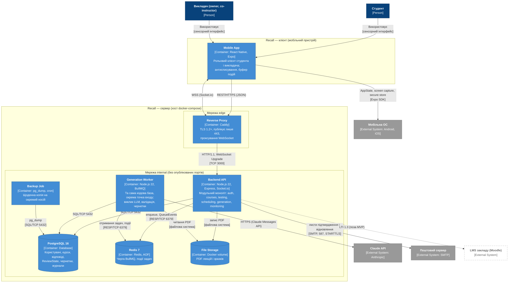
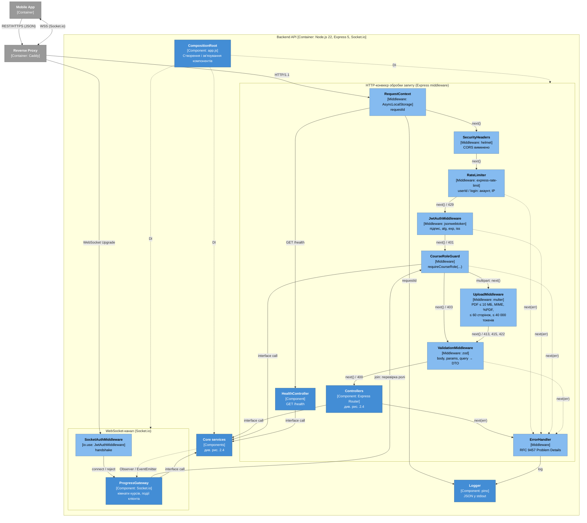

# РОЗДІЛ 2. ОБҐРУНТУВАННЯ АРХІТЕКТУРНИХ РІШЕНЬ ТА ПРОЄКТУВАННЯ СИСТЕМИ

## 2.1. Обґрунтування архітектурного стилю та патернів проєктування

### 2.1.1. ADR-001. Асинхронна обробка генерації контенту через Claude API: BullMQ на Redis

Архітектурні рішення фіксуються у форматі Architecture Decision Record (ADR) за шаблоном M. Nygard: контекст, альтернативи, рішення, наслідки, статус. Кожен ADR зберігається окремим файлом у каталозі [adr/](./adr/) і не редагується після затвердження; зміна рішення оформлюється новим ADR зі статусом Superseded для попереднього. Нижче наведено текст [ADR-001](./adr/0001-choice-of-technology.md); протокол рецензії — [17-AI Insights.md](./17-AI%20Insights.md), Запис 14.

<!-- adr-001:start -->

**Status:** Approved
**Date:** 10.11.2026; уточнення 24.11.2026 (розділ «Історія змін»)
**Автор рішення:** MarcoGr11
**Пов'язані артефакти:** [srs.md](./srs.md), підрозділи 2.2.2, 2.3

#### Context

Викладач завантажує PDF лекції або зразок тесту, після чого система генерує чернетку тесту, сценарію або тренувальних питань через Claude API ([SRS-FUN-22](./srs.md#srs-fun-22)…[SRS-FUN-27](./srs.md#srs-fun-27), [SRS-FUN-31](./srs.md#srs-fun-31)). Тривалість одного виклику Claude API для генерації тесту за лекцією оцінюється до 60 с на рівні p95 (timeout одного виклику — 60 с за [SRS-NFR-ASYNC-03](./srs.md#srs-nfr-async-03)); провайдер повертає помилки HTTP 429 (rate limit) і 5xx (перевантаження).

Вимоги, що визначають рішення, наведено в табл. 2.1.

Таблиця 2.1 – Вимоги, що визначають рішення ADR-001

| Вимога | Метрика |
|---|---|
| [SRS-NFR-ASYNC-01](./srs.md#srs-nfr-async-01) | 202 Accepted, p95 ≤ 200 мс незалежно від Latency Claude API |
| [SRS-NFR-ASYNC-02](./srs.md#srs-nfr-async-02) | Обробка задачі p95 ≤ 90 с |
| [SRS-NFR-ASYNC-03](./srs.md#srs-nfr-async-03) | 3 спроби загалом, експоненційна затримка 5 с, 10 с, dead-letter queue |
| [SRS-NFR-ASYNC-04](./srs.md#srs-nfr-async-04) | Паралелізм ≤ 2 задачі |
| [SRS-NFR-REL-02](./srs.md#srs-nfr-rel-02) | Ідемпотентність задачі за idempotency_key |
| [SRS-NFR-REL-04](./srs.md#srs-nfr-rel-04) | Втрата стану черги при перезапуску ≤ 1 с записів |
| [SRS-NFR-COST-01](./srs.md#srs-nfr-cost-01), [SRS-NFR-COST-02](./srs.md#srs-nfr-cost-02) | Облік кожного виклику; добовий ліміт вартості 2 USD |
| [SRS-FUN-30](./srs.md#srs-fun-30) | Подія WebSocket викладачу про завершення або невдачу задачі |

Обмеження проєкту: соло-розробка тривалістю 6 місяців; розгортання в docker-compose на одному хості; один потік до 100 студентів; хмарний бюджет відсутній.

За синхронного виклику p95 відповіді API не менший за Latency провайдера, тобто до 60 с проти порогу 200 мс — перевищення приблизно в 300 разів. Тому синхронний варіант не задовольняє SRS-NFR-ASYNC-01 за визначенням, а вибір відбувається між механізмами асинхронної обробки.

#### Alternatives

##### 1. Синхронний виклик Claude API в обробнику HTTP-запиту

HTTP-з'єднання утримується на весь час виклику; обрив з'єднання мобільним клієнтом при зміні мережі втрачає результат, а повторне надсилання запиту клієнтом створює повторну тарифікацію. Паралелізм на рівні системи не обмежується: кожен викладач ініціює власний виклик. Повторні спроби і dead-letter queue відсутні. **Відхилено:** порушує SRS-NFR-ASYNC-01, SRS-NFR-ASYNC-03, SRS-NFR-ASYNC-04.

##### 2. Фонова черга в процесі Backend API (in-process, p-queue)

Окремий сервіс не потрібен; паралелізм обмежується параметром черги. Стан черги зберігається в пам'яті процесу і втрачається при перезапуску контейнера; повторні спроби з затримкою і dead-letter queue реалізуються власним кодом; генерація конкурує з обробкою REST-запитів за event loop. **Відхилено:** порушує SRS-NFR-REL-04, потребує власної реалізації SRS-NFR-ASYNC-03.

##### 3. Черга на PostgreSQL (pg-boss, `SELECT … FOR UPDATE SKIP LOCKED`)

Не потребує окремого сервісу; постановка задачі може виконуватися в одній транзакції із записом GenerationJob. Отримання задач виконується опитуванням (polling) тієї самої бази, що обслуговує SRS-NFR-PERF-01 і SRS-NFR-PERF-02; вбудованого механізму подій стану задачі, еквівалентного QueueEvents, для SRS-FUN-30 немає — потрібен LISTEN / NOTIFY і власна логіка; обмеження паралелізму на рівні черги потребує окремої конфігурації. **Відхилено:** навантаження на основну БД і власна реалізація доставки подій задач.

##### 4. RabbitMQ (AMQP 0-9-1)

Окремий брокер з підтвердженнями доставки, dead-letter exchange, маршрутизацією, quorum queues і кластеризацією. Потребує окремого сервісу з власною конфігурацією (exchanges, queues, bindings, policies), клієнта amqplib без вбудованої семантики задач, власної реалізації exponential backoff (TTL + dead-letter exchange або плагін delayed message exchange) і окремого моніторингу. Переваги RabbitMQ не відповідають жодній вимозі SRS при одному типі споживача і одному хості. **Відхилено:** найбільший обсяг інфраструктури і коду на супровід при соло-розробці.

##### 5. BullMQ на Redis 7

Бібліотека черг для Node.js: `attempts`, `backoff: {type: 'exponential'}`, стан failed як dead-letter queue, `concurrency` worker-процесу і глобальний ліміт `setGlobalConcurrency`, `jobId` для дедуплікації, QueueEvents на основі Redis Streams для подій completed / failed. Потребує Redis 7 як окремого сервісу.

##### Відхилені без детального аналізу

- **Message Batches API провайдера:** знижена вартість, але час завершення пакета до 24 год несумісний із SRS-NFR-ASYNC-02 (p95 ≤ 90 с).
- **Керовані хмарні черги (Amazon SQS, Google Cloud Tasks):** несумісні з обмеженням розгортання на одному хості без хмарного бюджету.

##### Матриця оцінки

Таблиця 2.2 – Оцінка альтернатив за критеріями (+ — задовольняє засобами інструмента; ± — задовольняє власним кодом або конфігурацією; − — не задовольняє)

| Критерій | Синхронний виклик | In-process | PostgreSQL (pg-boss) | RabbitMQ | BullMQ на Redis |
|---|---|---|---|---|---|
| SRS-NFR-ASYNC-01: 202 ≤ 200 мс | − | + | + | + | + |
| SRS-NFR-ASYNC-03: retry, backoff, DLQ | − | ± | + | ± | + |
| SRS-NFR-ASYNC-04: паралелізм ≤ 2 | − | + | ± | + | + (setGlobalConcurrency) |
| SRS-NFR-REL-02: ідемпотентність за idempotency_key | − | ± | + | ± | + |
| SRS-NFR-REL-04: стан черги після перезапуску | − | − | + | + | + (AOF) |
| SRS-FUN-30: події стану задачі | — | ± | ± | ± | + (QueueEvents) |
| Транзакційна постановка задачі разом із записом GenerationJob | — | — | + | − | ± (порядок «запис → enqueue» і узгодження) |
| Додаткові сервіси на супровід | 0 | 0 | 0 | 1 (брокер) | 1 (Redis) |
| Операційна вартість | 0 | 0 | 0 | 0 | 0 |

#### Decision

Обрано **BullMQ на Redis 7** з окремим процесом Generation Worker (та сама кодова база, окрема точка входу).

1. Backend API записує GenerationJob у PostgreSQL зі статусом queued, ставить задачу в чергу з `jobId := idempotency_key := SHA-256(тип задачі, ідентифікатор джерела, версія джерела, generation_no)` і повертає 202 Accepted з ідентифікатором задачі. Номер генерації generation_no збільшується на 1 при повторній генерації за тим самим джерелом після стану dead або відхилення чернеток: BullMQ ігнорує постановку задачі з jobId, що вже зберігається в Redis (зокрема у стані failed), тому без generation_no повторна генерація була б неможливою. Перед постановкою BudgetGuard перевіряє добовий ліміт вартості; після його досягнення API повертає 429.
2. Глобальний ліміт паралелізму задається на черзі: `queue.setGlobalConcurrency(2)` — не більше 2 активних задач у системі незалежно від кількості worker-процесів; `concurrency: 2` у Generation Worker є лише локальним верхнім порогом одного процесу. Worker викликає Claude API (модель `claude-haiku-5-5`) з timeout 60 с, валідує результат за JSON-схемою і зберігає чернетку зі статусом draft, записуючи кількість токенів і вартість виклику в generation_jobs.
3. Повторні спроби виконує лише BullMQ: `attempts: 3`, `backoff: {type: 'exponential', delay: 5000}` (затримки 5 с і 10 с). Клієнт SDK Anthropic створюється з `maxRetries: 0`, оскільки за замовчуванням SDK виконує 2 власні повторні спроби для 408 / 409 / 429 / 5xx, що разом із 3 спробами BullMQ дало б до 9 HTTP-викликів на задачу.
4. Після третьої невдалої спроби задача залишається в стані failed з причиною збою (dead-letter queue) і автоматично не повторюється.
5. Backend API підписаний на QueueEvents і передає події completed / failed у ProgressPublisher, який через ProgressGateway надсилає подію викладачу (SRS-FUN-30).
6. Redis працює з `appendonly yes`, `appendfsync everysec`.

Аргументи рішення:
- вирішальний критерій — [SRS-FUN-30](./srs.md#srs-fun-30): BullMQ надає події стану задачі (QueueEvents: completed, failed) без власного коду, тоді як для pg-boss потрібні LISTEN / NOTIFY і власна логіка (табл. 2.2);
- pg-boss має перевагу, якої це рішення не отримує: постановку задачі в одній транзакції PostgreSQL із записом GenerationJob. Для BullMQ розбіжність Redis і PostgreSQL усувається порядком «запис queued → enqueue» і узгодженням при старті worker (розділ Consequences); для MVP з одним типом задач цю ціну визнано прийнятною;
- не потребує окремого брокера повідомлень: Redis 7 — єдиний додатковий сервіс інфраструктури черги;
- Generation Worker є єдиним споживачем Claude API, тому облік і обмеження вартості (SRS-NFR-COST-01, SRS-NFR-COST-02) зосереджено в одній точці, а ключ Claude API передається лише в цей контейнер.

#### Consequences

##### Позитивні

- Відповідь endpoint постановки не залежить від Latency Claude API (SRS-NFR-ASYNC-01).
- Повторні спроби з експоненційною затримкою, dead-letter queue, обмеження паралелізму і дедуплікація за jobId (idempotency_key) реалізуються конфігурацією BullMQ.
- Збій Claude API не впливає на тестування, план повторення і моніторинг: вони не залежать від черги.
- Контроль вартості і ключа Claude API зосереджено в одному контейнері.

##### Негативні

- **Redis — єдина точка відмови черги.** При недоступності Redis постановка задач неможлива: Backend API повертає 503 із заголовком Retry-After, обробка зупиняється, події QueueEvents не доставляються. Тестування, план повторення і live-моніторинг продовжують працювати. Зменшення ризику: healthcheck ([SRS-NFR-OBS-02](./srs.md#srs-nfr-obs-02)), `restart: unless-stopped`, відновлення стану з AOF. Висока доступність (Redis Sentinel) не реалізується через обмеження одного хоста.
- **Семантика доставки at-least-once.** Задача, worker якої завершився аварійно після виклику Claude API, але до підтвердження, обробляється повторно (stalled job). Наслідки: ризик дубліката чернетки і повторна тарифікація виклику. Зменшення ризику: ідемпотентність за idempotency_key і обмеження UNIQUE (generation_job_id, position) для чернеток у PostgreSQL. Повторна тарифікація при аварійному завершенні — прийнятий ризик.
- **Потреба в AOF persistence.** Без AOF перезапуск контейнера Redis втрачає задачі. З `appendfsync everysec` втрачається до 1 с записів; ціна — додатковий запис на диск і зростання файлу AOF, що потребує періодичного перезапису (`auto-aof-rewrite`).
- **Розбіжність стану Redis і PostgreSQL.** Запис GenerationJob у PostgreSQL і постановка в чергу Redis не атомарні. Порядок «запис queued → enqueue з тим самим jobId» і узгодження при старті worker (повторна постановка записів queued без задачі в Redis) усувають розбіжність без transactional outbox.
- **Ускладнення тестування.** Інтеграційні тести потребують Redis у контейнері, заглушки Claude API (nock) з керованими відмовами і очікування стану задачі; затримки backoff задаються конфігурацією, щоб тести не чекали 5 с і 10 с; час CI зростає (сценарій VER-05).
- **FinOps — вартість токенів Claude API.** Модель — Claude Haiku 5.5 (`claude-haiku-5-5`), тариф станом на 24.11.2026 за офіційною сторінкою Anthropic Pricing: 0,10 USD / 0,50 USD за 1M вхідних / вихідних токенів для запитів до 100 000 токенів (понад 100 000 — 0,50 USD / 2,50 USD). Ліміт вилученого тексту 40 000 токенів ([SRS-FUN-51](./srs.md#srs-fun-51)) разом із системними інструкціями утримує кожен запит у нижньому тарифному діапазоні. Типова задача генерації тесту за лекцією ≈ 20 000 вхідних і 4 000 вихідних токенів ≈ 0,004 USD; верхня межа одного виклику (≈ 42 000 вхідних токенів, `max_tokens` = 8 000) ≈ 0,008 USD, з урахуванням 3 спроб — не більше 0,024 USD. Добовий ліміт 2 USD відповідає ≈ 500 типовим задачам або ≈ 83 задачам у найгіршому випадку. Контроль: `max_tokens` на виклик, BudgetGuard, облік tokens_in, tokens_out, cost_usd у generation_jobs. Оцінку слід перевірити за фактичними даними після перших 20 задач (сценарій VER-06).
- **Очікування переноситься в інтерфейс.** Викладач отримує результат через 10–90 с; інтерфейс повинен показувати стан задачі, а система — доставляти подію завершення (SRS-FUN-30), що створює залежність від каналу WebSocket.
- **Додатковий процес.** Generation Worker і Redis — два додаткові контейнери в docker-compose з власними healthcheck.

##### Вибір моделі Claude

Обрано Claude Haiku 5.5 — модель класу Haiku з найнижчим тарифом серед актуальних моделей на 24.11.2026. Порівняно з Claude Haiku 4.5 (1 USD / 5 USD) вартість задачі нижча в 10 разів за тих самих обсягів токенів. Контекстне вікно (1M токенів) перевищує ліміт тексту SRS-FUN-51 з запасом; дата виведення з експлуатації — не раніше 07.10.2027, що перевищує строк апробації. Генерація тестових питань за текстом лекції не потребує моделі класу Sonnet або Opus: якість чернетки контролюється JSON-схемою (SRS-FUN-26) і обов'язковою модерацією (SRS-FUN-28). Ідентифікатор моделі задається змінною середовища worker-процесу.

##### Умови перегляду рішення

Рішення переглядається, якщо виконується хоча б одна умова:
- з'являється другий тип споживача подій або потреба маршрутизації повідомлень між сервісами;
- з'являється вимога гарантії exactly-once;
- worker потрібно масштабувати на кілька хостів або потрібна висока доступність черги;
- фактична вартість генерації за даними generation_jobs перевищує добовий ліміт більше ніж у 20 % днів апробації.

#### Історія змін

- 24.11.2026 — уточнення без зміни рішення: ключ ідемпотентності доповнено номером генерації generation_no (знахідка 10 незалежного аудиту); модель Claude Haiku 4.5 замінено на Claude Haiku 5.5 з перерахунком оцінки вартості; облік токенів і вартості перенесено з generation_log у generation_jobs; статус чернетки pending перейменовано на draft. Рішення автора — [17-AI Insights.md](./17-AI%20Insights.md), Запис 16.

<!-- adr-001:end -->

## 2.2. Контекстне та контейнерне моделювання системи

Архітектуру системи описано за моделлю C4 (Context, Container, Component). Діаграми виконано кодом Mermaid.js у нотації `flowchart TB`: тип кожного вузла C4 зазначено в підписі ([Person], [Software System], [Container], [External System]), протокол — у підписі зв'язку. Нотацію `flowchart` обрано замість експериментального синтаксису `C4Context` / `C4Container`, оскільки останній не підтримує пунктирних зв'язків для елементів поза MVP і при восьми і більше вузлах накладає підписи зв'язків один на одний. Базовою лінією трасування є специфікація вимог [srs.md](./srs.md); протокол архітектурного рев'ю — [17-AI Insights.md](./17-AI%20Insights.md), Запис 12.

### 2.2.1. Діаграма контексту (Level 1)

Діаграма контексту визначає межу системи Recall, її користувачів і зовнішні системи (рис. 2.1).

```mermaid
flowchart TB
    student["<b>Студент</b><br/>[Person]<br/>Проходить тести і пробні тести,<br/>виконує план повторення"]
    teacher["<b>Викладач (owner, co-instructor)</b><br/>[Person]<br/>Керує курсом, модерує контент,<br/>переглядає панель моніторингу групи"]
    recall["<b>Recall</b><br/>[Software System]<br/>Адаптивна підготовка до сесії:<br/>тестування, SM-2, генерація контенту,<br/>live-моніторинг"]
    claude["<b>Claude API</b><br/>[External System: Anthropic]<br/>Генерація чернеток тестів,<br/>сценаріїв і тренувальних питань"]
    os["<b>Мобільна ОС</b><br/>[External System: Android, iOS]<br/>AppState, захист екрана,<br/>Keystore / Keychain, TalkBack / VoiceOver"]
    smtp["<b>Поштовий сервер</b><br/>[External System: SMTP]<br/>Листи підтвердження пошти<br/>і відновлення доступу"]
    lms["<b>LMS закладу (Moodle)</b><br/>[External System]<br/>Поза MVP"]

    student -- "Тести, план на день<br/>[сенсорний інтерфейс]" --> recall
    teacher -- "Курси, модерація, моніторинг<br/>[сенсорний інтерфейс]" --> recall
    recall -- "Текст лекцій і зразків, без персональних даних<br/>[HTTPS, Claude Messages API]" --> claude
    recall -- "Події стану, захист екрана, сховище ключів<br/>[API ОС через Expo SDK]" --> os
    recall -- "Листи на корпоративну пошту<br/>[SMTP, 587, STARTTLS]" --> smtp
    recall -. "LTI 1.3 (поза MVP)" .-> lms

    classDef person fill:#08427b,stroke:#052e56,color:#fff
    classDef system fill:#1168bd,stroke:#0b4884,color:#fff
    classDef ext fill:#999999,stroke:#6b6b6b,color:#fff
    classDef future fill:#ffffff,stroke:#999999,color:#666666,stroke-dasharray:5 5
    class student,teacher person
    class recall system
    class claude,os,smtp ext
    class lms future
```

Рисунок 2.1 – Діаграма контексту системи Recall (C4 Level 1)

Таблиця 2.3 – Вузли діаграми контексту

| Вузол | Тип | Технологія | Відповідальність | SRS-ID |
|---|---|---|---|---|
| Студент | Person | — | Проходить тести і пробні тести, виконує план повторення | [SRS-FUN-13](./srs.md#srs-fun-13), [SRS-FUN-20](./srs.md#srs-fun-20), [SRS-FUN-34](./srs.md#srs-fun-34) |
| Викладач (owner, co-instructor) | Person | — | Створює курс і контрольні заходи, завантажує матеріали і зразки, модерує чернетки, переглядає панель моніторингу; права co-instructor обмежено | [SRS-FUN-03](./srs.md#srs-fun-03)…[SRS-FUN-10](./srs.md#srs-fun-10), [SRS-FUN-28](./srs.md#srs-fun-28), [SRS-FUN-39](./srs.md#srs-fun-39), [SRS-FUN-47](./srs.md#srs-fun-47) |
| Recall | Software System | React Native, Node.js, PostgreSQL, Redis | Тестування, планування повторень за SM-2, асинхронна генерація контенту, пробні тести, антисписування, live-моніторинг | [SRS-FUN-01](./srs.md#srs-fun-01)…[SRS-FUN-49](./srs.md#srs-fun-49) |
| Claude API | External System | Anthropic Claude Messages API | Генерація чернеток тестів, сценаріїв і тренувальних питань | [SRS-FUN-24](./srs.md#srs-fun-24), [SRS-FUN-25](./srs.md#srs-fun-25), [SRS-FUN-31](./srs.md#srs-fun-31) |
| Мобільна ОС | External System | Android 10+, iOS 16+ | Події AppState, захист екрана, Keystore / Keychain, TalkBack / VoiceOver | [SRS-FUN-37](./srs.md#srs-fun-37), [SRS-FUN-40](./srs.md#srs-fun-40), [SRS-FUN-41](./srs.md#srs-fun-41), [SRS-NFR-SEC-04](./srs.md#srs-nfr-sec-04), [SRS-NFR-A11Y-02](./srs.md#srs-nfr-a11y-02) |
| Поштовий сервер | External System | SMTP (порт 587, STARTTLS) | Доставка листів підтвердження корпоративної пошти і відновлення доступу | [SRS-FUN-01](./srs.md#srs-fun-01), [SRS-FUN-55](./srs.md#srs-fun-55) |
| LMS закладу (Moodle) | External System, поза MVP | LTI 1.3 | Інтеграцію не реалізовано; показано для фіксації межі системи | — |

Таблиця 2.4 – Зв'язки діаграми контексту

| Від | До | Протокол | Призначення |
|---|---|---|---|
| Студент | Recall | Сенсорний інтерфейс мобільного застосунку | Тестування, план на день, пробні тести |
| Викладач | Recall | Сенсорний інтерфейс мобільного застосунку | Керування курсом, модерація, моніторинг групи |
| Recall | Claude API | HTTPS (Claude Messages API, JSON) | Передача тексту лекцій і зразків тестів без персональних даних; отримання результату генерації |
| Recall | Мобільна ОС | API ОС через Expo SDK | Події стану застосунку, захист екрана, захищене сховище токенів |
| Recall | Поштовий сервер | SMTP, порт 587, STARTTLS | Листи підтвердження пошти і відновлення доступу з одноразовими посиланнями |
| Recall | LMS закладу | LTI 1.3 (поза MVP) | Напрям розвитку |

### 2.2.2. Діаграма контейнерів (Level 2)

Система реалізована як модульний моноліт: Backend API і Generation Worker використовують одну кодову базу і одну схему PostgreSQL, але запускаються як окремі процеси з різними точками входу. Спільна база даних двох контейнерів є свідомим рішенням для модульного моноліту і не означає розділення на мікросервіси. Сервери розгортаються в docker-compose на одному хості у двох мережах: edge (Reverse Proxy і Backend API) та internal (Backend API, Generation Worker, Backup Job, PostgreSQL, Redis) без опублікованих портів. Назовні опубліковано лише порт 443. Ключ Claude API передається тільки в Generation Worker, і лише цей контейнер має вихідний доступ до api.anthropic.com; Backend API має вихідний доступ лише до поштового сервера (SMTP, порт 587) для службових листів. Усі контейнери пишуть журнали у форматі JSON у stdout ([SRS-NFR-OBS-01](./srs.md#srs-nfr-obs-01)). Діаграму контейнерів наведено на рис. 2.2.

Рисунок 2.2 – Діаграма контейнерів системи Recall (C4 Level 2)

Таблиця 2.5 – Вузли діаграми контейнерів

| Вузол | Тип | Технологія | Відповідальність | SRS-ID |
|---|---|---|---|---|
| Mobile App | Container | React Native, Expo | Рольовий інтерфейс студента і викладача; фіксація background-переходів, буферизація подій, блокування знімків і копіювання; панель моніторингу за подіями WebSocket; зберігання токенів у secure store | [SRS-FUN-18](./srs.md#srs-fun-18), [SRS-FUN-37](./srs.md#srs-fun-37), [SRS-FUN-38](./srs.md#srs-fun-38), [SRS-FUN-39](./srs.md#srs-fun-39), [SRS-FUN-40](./srs.md#srs-fun-40), [SRS-FUN-41](./srs.md#srs-fun-41), [SRS-FUN-42](./srs.md#srs-fun-42), [SRS-FUN-45](./srs.md#srs-fun-45), [SRS-NFR-SEC-04](./srs.md#srs-nfr-sec-04), [SRS-NFR-COMP-01](./srs.md#srs-nfr-comp-01), [SRS-NFR-COMP-02](./srs.md#srs-nfr-comp-02), [SRS-NFR-A11Y-01](./srs.md#srs-nfr-a11y-01), [SRS-NFR-A11Y-02](./srs.md#srs-nfr-a11y-02) |
| Reverse Proxy | Container | Caddy | Термінація TLS 1.2+, проксування REST і WebSocket до Backend API, єдина точка входу на порту 443 | [SRS-NFR-SEC-06](./srs.md#srs-nfr-sec-06) |
| Backend API | Container | Node.js 22, Express, Socket.io | REST API і канал подій; модулі auth, courses, testing, scheduling, generation, monitoring; RBAC, rate limiting, постановка задач у чергу, ретрансляція подій задач викладачу | [SRS-FUN-01](./srs.md#srs-fun-01)…[SRS-FUN-17](./srs.md#srs-fun-17), [SRS-FUN-19](./srs.md#srs-fun-19)…[SRS-FUN-22](./srs.md#srs-fun-22), [SRS-FUN-50](./srs.md#srs-fun-50)…[SRS-FUN-54](./srs.md#srs-fun-54), [SRS-FUN-28](./srs.md#srs-fun-28)…[SRS-FUN-30](./srs.md#srs-fun-30), [SRS-FUN-34](./srs.md#srs-fun-34)…[SRS-FUN-36](./srs.md#srs-fun-36), [SRS-FUN-39](./srs.md#srs-fun-39), [SRS-FUN-43](./srs.md#srs-fun-43), [SRS-FUN-44](./srs.md#srs-fun-44), [SRS-FUN-46](./srs.md#srs-fun-46)…[SRS-FUN-49](./srs.md#srs-fun-49), [SRS-NFR-PERF-01](./srs.md#srs-nfr-perf-01), [SRS-NFR-PERF-02](./srs.md#srs-nfr-perf-02), [SRS-NFR-RT-01](./srs.md#srs-nfr-rt-01), [SRS-NFR-ASYNC-01](./srs.md#srs-nfr-async-01), [SRS-NFR-SEC-01](./srs.md#srs-nfr-sec-01)…[SRS-NFR-SEC-03](./srs.md#srs-nfr-sec-03), [SRS-NFR-SEC-05](./srs.md#srs-nfr-sec-05), [SRS-NFR-SEC-07](./srs.md#srs-nfr-sec-07), [SRS-NFR-SEC-08](./srs.md#srs-nfr-sec-08), [SRS-NFR-REL-02](./srs.md#srs-nfr-rel-02), [SRS-NFR-COST-02](./srs.md#srs-nfr-cost-02), [SRS-NFR-OBS-02](./srs.md#srs-nfr-obs-02) |
| Generation Worker | Container | Node.js 22, BullMQ | Отримання задач з черги, парсинг PDF, виклик Claude API з розмежуванням даних і інструкцій, валідація за JSON-схемою, перевірка подібності, збереження чернеток, облік вартості | [SRS-FUN-24](./srs.md#srs-fun-24)…[SRS-FUN-27](./srs.md#srs-fun-27), [SRS-FUN-30](./srs.md#srs-fun-30)…[SRS-FUN-33](./srs.md#srs-fun-33), [SRS-NFR-ASYNC-02](./srs.md#srs-nfr-async-02)…[SRS-NFR-ASYNC-04](./srs.md#srs-nfr-async-04), [SRS-NFR-COST-01](./srs.md#srs-nfr-cost-01), [SRS-NFR-OBS-02](./srs.md#srs-nfr-obs-02) |
| Backup Job | Container | pg_dump, cron | Щоденний дамп PostgreSQL на окремий фізичний носій, зберігання 7 днів | [SRS-NFR-REL-03](./srs.md#srs-nfr-rel-03) |
| PostgreSQL 16 | Container (Database) | PostgreSQL 16 | Користувачі, курси, контрольні заходи, відповіді, ReviewState, чернетки, журнал дій з контентом, задачі генерації з обліком токенів і вартості (generation_jobs); ACID-транзакції | [SRS-FUN-12](./srs.md#srs-fun-12), [SRS-FUN-16](./srs.md#srs-fun-16), [SRS-FUN-19](./srs.md#srs-fun-19), [SRS-NFR-REL-01](./srs.md#srs-nfr-rel-01) |
| Redis 7 | Container (Database) | Redis 7, AOF | Брокер черги BullMQ, стан failed (dead-letter queue), події задач QueueEvents | [SRS-NFR-ASYNC-03](./srs.md#srs-nfr-async-03), [SRS-NFR-REL-02](./srs.md#srs-nfr-rel-02), [SRS-NFR-REL-04](./srs.md#srs-nfr-rel-04) |
| File Storage | Container (Storage) | Docker volume | Зберігання PDF лекцій і зразків тестів; доступ на запис — Backend API, на читання — Generation Worker; поза доступом клієнта | [SRS-FUN-09](./srs.md#srs-fun-09), [SRS-FUN-10](./srs.md#srs-fun-10), [SRS-FUN-11](./srs.md#srs-fun-11) |
| Claude API | External System | Anthropic Claude Messages API | Генерація контенту за запитом Generation Worker | [SRS-FUN-24](./srs.md#srs-fun-24), [SRS-FUN-31](./srs.md#srs-fun-31) |
| Мобільна ОС | External System | Android 10+, iOS 16+ | AppState, screen capture, Keystore / Keychain, TalkBack / VoiceOver | [SRS-FUN-37](./srs.md#srs-fun-37), [SRS-FUN-40](./srs.md#srs-fun-40), [SRS-FUN-41](./srs.md#srs-fun-41), [SRS-NFR-SEC-04](./srs.md#srs-nfr-sec-04), [SRS-NFR-A11Y-02](./srs.md#srs-nfr-a11y-02) |
| Поштовий сервер | External System | SMTP (порт 587, STARTTLS) | Доставка листів, надісланих Backend API | [SRS-FUN-01](./srs.md#srs-fun-01), [SRS-FUN-55](./srs.md#srs-fun-55) |
| LMS закладу (Moodle) | External System, поза MVP | LTI 1.3 | Напрям розвитку | — |

Розгортання всіх серверних контейнерів у docker-compose з healthcheck і `restart: unless-stopped` реалізує [SRS-NFR-INFRA-01](./srs.md#srs-nfr-infra-01). Контур CI (GitHub Actions, npm audit, Trivy, SonarQube Cloud) не є елементом runtime і на діаграмі не показаний; він реалізує [SRS-NFR-SEC-09](./srs.md#srs-nfr-sec-09)…[SRS-NFR-SEC-11](./srs.md#srs-nfr-sec-11) і [SRS-NFR-MAINT-01](./srs.md#srs-nfr-maint-01). Поточний `docker-compose.yml` не містить Reverse Proxy, Generation Worker, Backup Job і сегментації мереж, а також публікує порти 5432 і 6379, не вмикає AOF і restart policy; конвеєр CI наразі виконує лише lint і модульні тести. Приведення конфігурації до діаграми виконується на етапі реалізації.

Таблиця 2.6 – Зв'язки діаграми контейнерів

| Від | До | Протокол | Призначення |
|---|---|---|---|
| Студент, Викладач | Mobile App | Сенсорний інтерфейс | Взаємодія з рольовим інтерфейсом |
| Mobile App | Мобільна ОС | Expo SDK (expo-screen-capture, AppState, expo-secure-store) | Захист екрана, події стану, зберігання токенів |
| Mobile App | Reverse Proxy | REST/HTTPS (JSON), TCP 443 | Запити REST API |
| Mobile App | Reverse Proxy | WSS (Socket.io), TCP 443 | Двонаправлений канал: події прогресу, антисписування, завершення генерації |
| Reverse Proxy | Backend API | HTTP/1.1, WebSocket Upgrade, TCP 3000 | Проксування після термінації TLS |
| Backend API | PostgreSQL 16 | SQL/TCP 5432 | Читання і запис доменних даних, транзакція «результати спроби + ReviewState» |
| Backend API | Redis 7 | RESP/TCP 6379 | Постановка задач (enqueue BullMQ), підписка на QueueEvents |
| Backend API | File Storage | Файлова система (volume) | Запис завантажених PDF |
| Generation Worker | Redis 7 | RESP/TCP 6379 | Отримання задач, публікація стану задач (completed, failed) |
| Generation Worker | PostgreSQL 16 | SQL/TCP 5432 | Збереження чернеток, стану задачі, токенів і вартості в generation_jobs |
| Generation Worker | File Storage | Файлова система (volume) | Читання PDF для парсингу |
| Generation Worker | Claude API | HTTPS (Claude Messages API, JSON) | Генерація контенту |
| Backend API | Поштовий сервер | SMTP, порт 587, STARTTLS | Листи підтвердження пошти і відновлення доступу |
| Backup Job | PostgreSQL 16 | SQL/TCP 5432 (pg_dump) | Щоденне резервне копіювання |
| Backend API | LMS закладу | LTI 1.3 (поза MVP) | Напрям розвитку |

## 2.3. Компонентне моделювання та опис серверного ядра

Критичним сервісом обрано контейнер Backend API: він реалізує більшість функціональних вимог, транзакцію «результати спроби + ReviewState» при завершенні спроби ([SRS-NFR-REL-01](./srs.md#srs-nfr-rel-01)), контроль доступу ([SRS-NFR-SEC-05](./srs.md#srs-nfr-sec-05)) і доставку подій у реальному часі ([SRS-NFR-RT-01](./srs.md#srs-nfr-rt-01)). Компоненти організовано за Clean Architecture з чотирма шарами:
- **Inbound** — адаптери введення: контролери Express, шлюз Socket.io, слухач подій черги;
- **Core** — сервіси застосунку і доменна логіка; не залежить від Express, pg і BullMQ;
- **Ports** — інтерфейси сховищ і черги, визначені в Core (Dependency Inversion);
- **Outbound** — реалізації портів для PostgreSQL, файлового сховища і BullMQ.

Правило залежностей: Inbound → Core → Ports ← Outbound. Контролери і middleware (зокрема CourseRoleGuard) звертаються лише до сервісів Core; сервіси Core звертаються лише до портів і до інших сервісів Core. Компоненти створюються і зв'язуються вручну (Dependency Injection через конструктор) в одному місці — CompositionRoot; DI-фреймворк не використовується. SM2Scheduler і QualityScorer є чистими функціями без I/O, що спрощує unit-тестування ([SRS-NFR-MAINT-01](./srs.md#srs-nfr-maint-01)). Протокол аудиту — [17-AI Insights.md](./17-AI%20Insights.md), Запис 13.

Через кількість компонентів діаграму рівня 3 подано двома рисунками з однією таблицею компонентів: рис. 2.3 — наскрізний конвеєр обробки запиту, рис. 2.4 — модулі шарів Inbound, Core, Ports, Outbound.

### 2.3.1. Конвеєр обробки запиту

Запит REST проходить ланцюжок middleware у фіксованому порядку; кожен middleware або передає керування далі (`next()`), або завершує обробку помилкою, яку формує єдиний ErrorHandler у форматі RFC 9457 Problem Details. З'єднання Socket.io автентифікується на етапі handshake, а приєднання до кімнати курсу перевіряє той самий CourseRoleGuard (рис. 2.3).

Рисунок 2.3 – Діаграма компонентів Backend API: конвеєр обробки запиту (C4 Level 3)

### 2.3.2. Модулі шарів

Сервіси Core згруповано за модулями модульного моноліту: identity (AuthService, AccessPolicyService), courses (CourseService, InvitationService, ContentAuditLog), testing (TestDeliveryService, AttemptService, QualityScorer, MockTestService), scheduling (SM2Scheduler, DailyPlanPrioritizer), generation (GenerationJobService, BudgetGuard, ModerationService), monitoring (MasteryService, AntiCheatEventService, ProgressPublisher), platform (HealthService), privacy (PrivacyService). Події прогресу, антисписування і завершення задач генерації доставляються за патерном Observer: сервіс викликає `emit` у ProgressPublisher (EventEmitter), ProgressGateway підписаний на події і транслює події прогресу й антисписування в кімнату курсу `course:{courseId}`, а події задач генерації — у персональну кімнату ініціатора `user:{userId}` (рис. 2.4).

```mermaid
flowchart LR
    subgraph inbound["Inbound — адаптери введення"]
        direction TB
        authC["<b>AuthController</b>"]
        courseC["<b>CourseController</b><br/>курси, заходи, запрошення,<br/>матеріали, зразки"]
        attemptC["<b>AttemptController</b><br/>видача тесту, відповідь"]
        planC["<b>PlanController</b>"]
        mockC["<b>MockTestController</b>"]
        genC["<b>GenerationController</b>"]
        modC["<b>ModerationController</b>"]
        monC["<b>MonitoringController</b><br/>теплова карта, підтвердження"]
        acC["<b>AntiCheatController</b>"]
        privC["<b>PrivacyController</b>"]
        gw["<b>ProgressGateway</b><br/>[Socket.io]"]
        jobL["<b>JobEventsListener</b><br/>[BullMQ QueueEvents]"]
        guardC["<b>CourseRoleGuard</b><br/>[middleware]"]
        healthC["<b>HealthController</b><br/>GET /health"]
    end

    subgraph core["Core — сервіси і доменна логіка"]
        direction TB
        authS["<b>AuthService</b><br/>пошта закладу, токени, ротація,<br/>reuse detection, відновлення"]
        accessS["<b>AccessPolicyService</b><br/>role_in_course"]
        healthS["<b>HealthService</b><br/>PostgreSQL, Redis"]
        courseS["<b>CourseService</b>"]
        invS["<b>InvitationService</b>"]
        delivS["<b>TestDeliveryService</b><br/>рандомізація, серверний таймер"]
        attemptS["<b>AttemptService</b><br/>відповідь; завершення спроби"]
        scorer["<b>QualityScorer</b><br/>[pure] q за часткою правильних"]
        sm2["<b>SM2Scheduler</b><br/>[pure] EF, інтервал на спробу"]
        prio["<b>DailyPlanPrioritizer</b><br/>P, ліміт 30"]
        mockS["<b>MockTestService</b><br/>структура, пул, вибір питань"]
        genS["<b>GenerationJobService</b>"]
        budget["<b>BudgetGuard</b><br/>добовий ліміт"]
        modS["<b>ModerationService</b>"]
        mastS["<b>MasteryService</b>"]
        acS["<b>AntiCheatEventService</b>"]
        pub["<b>ProgressPublisher</b><br/>[EventEmitter]"]
        audit["<b>ContentAuditLog</b>"]
        privS["<b>PrivacyService</b>"]
    end

    subgraph ports["Ports — інтерфейси (Core)"]
        direction TB
        iUser["IUserRepository"]
        iToken["IRefreshTokenRepository"]
        iEmailTok["IEmailTokenRepository"]
        iMail["IMailSender"]
        iCourse["ICourseRepository"]
        iAttempt["IAttemptRepository"]
        iReview["IReviewStateRepository"]
        iQRead["IQuestionReadRepository"]
        iQWrite["IQuestionWriteRepository"]
        iAc["IAntiCheatEventRepository"]
        iAudit["IAuditLogRepository"]
        iGenJob["IGenerationJobRepository"]
        iTx["ITransactionManager"]
        iFile["IFileStorage"]
        iQueue["IJobQueue"]
    end

    subgraph outbound["Outbound — адаптери виведення"]
        direction TB
        pgRepo["<b>Pg*Repository, PgTransactionManager</b><br/>[Kysely, pg]"]
        fileS["<b>LocalFileStorage</b><br/>[fs, Docker volume]"]
        smtpS["<b>SmtpMailSender</b><br/>[nodemailer]"]
        mq["<b>BullMqJobQueue</b><br/>[BullMQ Queue]"]
    end

    db[("PostgreSQL 16")]
    redis[("Redis 7")]
    vol[("File Storage")]
    mailsrv["Поштовий сервер"]

    authC --> authS
    guardC --> accessS
    healthC --> healthS
    courseC --> courseS
    courseC --> invS
    attemptC --> delivS
    attemptC --> attemptS
    planC --> prio
    mockC --> mockS
    genC --> genS
    modC --> modS
    monC --> mastS
    acC --> acS
    gw --> acS
    privC --> privS
    jobL -- "Observer" --> pub
    pub -. "Observer / EventEmitter" .-> gw

    accessS --> iCourse
    healthS --> iTx
    healthS --> iQueue
    authS --> iUser
    authS --> iToken
    authS --> iEmailTok
    authS --> iMail
    courseS --> iCourse
    courseS --> iFile
    courseS --> audit
    invS --> iCourse
    delivS --> iQRead
    delivS --> iAttempt
    attemptS --> iTx
    attemptS --> iAttempt
    attemptS --> iReview
    attemptS --> scorer
    attemptS --> sm2
    attemptS -- "emit" --> pub
    prio --> iReview
    prio --> iCourse
    mockS --> delivS
    mockS --> iQRead
    genS --> budget
    genS --> iGenJob
    genS -- "enqueue" --> iQueue
    budget --> iGenJob
    modS --> iQWrite
    modS --> audit
    mastS --> iAttempt
    mastS --> iCourse
    acS --> iAc
    acS -- "emit" --> pub
    audit --> iAudit
    privS --> iUser
    privS --> iAc

    pgRepo -. "implements" .-> ports
    fileS -. "implements IFileStorage" .-> iFile
    mq -. "implements IJobQueue" .-> iQueue
    pgRepo -- "SQL/TCP 5432" --> db
    mq -- "enqueue (BullMQ)<br/>[RESP/TCP 6379]" --> redis
    jobL -- "RESP/TCP 6379" --> redis
    fileS -- "файлова система" --> vol
    smtpS -. "implements IMailSender" .-> iMail
    smtpS -- "SMTP, 587, STARTTLS" --> mailsrv

    classDef comp fill:#438dd5,stroke:#2e6295,color:#fff
    classDef pure fill:#2e7d32,stroke:#1b5e20,color:#fff
    classDef port fill:#ffffff,stroke:#2e6295,color:#000,stroke-dasharray:4 3
    classDef store fill:#999999,stroke:#6b6b6b,color:#fff
    class authC,courseC,attemptC,planC,mockC,genC,modC,monC,acC,privC,gw,jobL,guardC,healthC,authS,accessS,healthS,courseS,invS,delivS,attemptS,prio,mockS,genS,budget,modS,mastS,acS,pub,audit,privS,pgRepo,fileS,mq,smtpS comp
    class scorer,sm2 pure
    class iUser,iToken,iEmailTok,iMail,iCourse,iAttempt,iReview,iQRead,iQWrite,iAc,iAudit,iGenJob,iTx,iFile,iQueue port
    class db,redis,vol,mailsrv store
```

Рисунок 2.4 – Діаграма компонентів Backend API: модулі шарів (C4 Level 3)

Таблиця 2.7 – Компоненти Backend API

| Компонент | Шар | Відповідальність | Залежності | SRS-ID |
|---|---|---|---|---|
| CompositionRoot | Composition Root | Створення екземплярів і зв'язування компонентів через конструктори | усі компоненти (DI) | — |
| RequestContext | Inbound (middleware) | Генерація requestId, збереження в AsyncLocalStorage | Logger | [SRS-NFR-OBS-01](./srs.md#srs-nfr-obs-01) |
| Logger | Inbound (наскрізний) | Структуровані журнали JSON у stdout з requestId | pino | [SRS-NFR-OBS-01](./srs.md#srs-nfr-obs-01) |
| SecurityHeaders | Inbound (middleware) | HTTP-заголовки безпеки; CORS вимкнено | helmet | [SRS-NFR-SEC-06](./srs.md#srs-nfr-sec-06) |
| RateLimiter | Inbound (middleware) | Ліміти запитів на користувача і на вхід; 429 з Retry-After | express-rate-limit | [SRS-NFR-SEC-08](./srs.md#srs-nfr-sec-08) |
| JwtAuthMiddleware | Inbound (middleware) | Перевірка access-токена: підпис, allowlist алгоритмів, exp, iss; 401 | jsonwebtoken | [SRS-FUN-02](./srs.md#srs-fun-02), [SRS-NFR-SEC-01](./srs.md#srs-nfr-sec-01) |
| SocketAuthMiddleware | Inbound (middleware) | Перевірка access-токена на handshake Socket.io (`io.use`) | JwtAuthMiddleware | [SRS-NFR-SEC-05](./srs.md#srs-nfr-sec-05) |
| CourseRoleGuard | Inbound (middleware) | Декларативна перевірка role_in_course для маршруту і приєднання до кімнати через AccessPolicyService; 403 | AccessPolicyService | [SRS-FUN-03](./srs.md#srs-fun-03), [SRS-FUN-06](./srs.md#srs-fun-06), [SRS-FUN-11](./srs.md#srs-fun-11), [SRS-FUN-44](./srs.md#srs-fun-44), [SRS-NFR-SEC-05](./srs.md#srs-nfr-sec-05) |
| UploadMiddleware | Inbound (middleware) | Приймання multipart: PDF ≤ 10 МБ, MIME application/pdf, сигнатура %PDF; вилучення текстового шару, ≤ 60 сторінок, ≤ 40 000 токенів; 413, 415, 422 | multer, pdfjs-dist | [SRS-FUN-09](./srs.md#srs-fun-09), [SRS-FUN-10](./srs.md#srs-fun-10), [SRS-NFR-SEC-07](./srs.md#srs-nfr-sec-07) |
| ValidationMiddleware | Inbound (middleware) | Валідація body, params, query за схемою zod, формування DTO; 400 | zod | [SRS-NFR-SEC-07](./srs.md#srs-nfr-sec-07) |
| ErrorHandler | Inbound (middleware) | Відображення доменних помилок у HTTP-коди, формат RFC 9457, без stack trace | Logger | [SRS-NFR-OBS-01](./srs.md#srs-nfr-obs-01) |
| HealthController | Inbound | GET /health: 200 за доступності PostgreSQL і Redis | HealthService | [SRS-NFR-OBS-02](./srs.md#srs-nfr-obs-02) |
| AuthController | Inbound | Реєстрація, підтвердження пошти, вхід, оновлення токенів, вихід, відновлення доступу | AuthService | [SRS-FUN-01](./srs.md#srs-fun-01), [SRS-FUN-02](./srs.md#srs-fun-02), [SRS-FUN-53](./srs.md#srs-fun-53), [SRS-FUN-55](./srs.md#srs-fun-55) |
| CourseController | Inbound | Курси, теми, контрольні заходи, коди запрошення, матеріали, зразки | CourseService, InvitationService | [SRS-FUN-04](./srs.md#srs-fun-04)…[SRS-FUN-10](./srs.md#srs-fun-10) |
| AttemptController | Inbound | Видача тесту, фіксація відповіді | TestDeliveryService, AttemptService | [SRS-FUN-13](./srs.md#srs-fun-13)…[SRS-FUN-17](./srs.md#srs-fun-17), [SRS-FUN-54](./srs.md#srs-fun-54) |
| PlanController | Inbound | Персональний план на день | DailyPlanPrioritizer | [SRS-FUN-20](./srs.md#srs-fun-20), [SRS-FUN-21](./srs.md#srs-fun-21), [SRS-FUN-50](./srs.md#srs-fun-50) |
| MockTestController | Inbound | Публікація і проходження пробного тесту | MockTestService | [SRS-FUN-34](./srs.md#srs-fun-34)…[SRS-FUN-36](./srs.md#srs-fun-36) |
| GenerationController | Inbound | Постановка задач генерації; 202 Accepted; стан задачі за ідентифікатором | GenerationJobService | [SRS-FUN-22](./srs.md#srs-fun-22), [SRS-FUN-52](./srs.md#srs-fun-52), [SRS-NFR-ASYNC-01](./srs.md#srs-nfr-async-01) |
| ModerationController | Inbound | Схвалення, редагування, відхилення чернеток | ModerationService | [SRS-FUN-28](./srs.md#srs-fun-28) |
| MonitoringController | Inbound | Теплова карта, підтвердження засвоєння | MasteryService | [SRS-FUN-46](./srs.md#srs-fun-46), [SRS-FUN-47](./srs.md#srs-fun-47) |
| AntiCheatController | Inbound | Приймання буферизованих подій антисписування через REST | AntiCheatEventService | [SRS-FUN-37](./srs.md#srs-fun-37), [SRS-FUN-38](./srs.md#srs-fun-38), [SRS-FUN-41](./srs.md#srs-fun-41) |
| PrivacyController | Inbound | Видалення облікового запису | PrivacyService | [SRS-FUN-48](./srs.md#srs-fun-48) |
| ProgressGateway | Inbound | Кімнати курсів `course:{courseId}` і персональні кімнати `user:{userId}` Socket.io; перевірка ролі і строку дії токена на кожній події кімнати; приймання подій клієнта; трансляція подій ProgressPublisher | AntiCheatEventService, ProgressPublisher (Observer), CourseRoleGuard | [SRS-FUN-30](./srs.md#srs-fun-30), [SRS-FUN-39](./srs.md#srs-fun-39), [SRS-FUN-43](./srs.md#srs-fun-43), [SRS-FUN-44](./srs.md#srs-fun-44), [SRS-NFR-RT-01](./srs.md#srs-nfr-rt-01) |
| JobEventsListener | Inbound | Підписка на BullMQ QueueEvents (completed, failed), передача в ProgressPublisher | ProgressPublisher, Redis | [SRS-FUN-30](./srs.md#srs-fun-30) |
| AccessPolicyService | Core | Визначення role_in_course користувача в курсі для CourseRoleGuard | ICourseRepository | [SRS-FUN-03](./srs.md#srs-fun-03), [SRS-FUN-06](./srs.md#srs-fun-06), [SRS-FUN-44](./srs.md#srs-fun-44), [SRS-NFR-SEC-05](./srs.md#srs-nfr-sec-05) |
| HealthService | Core | Перевірка доступності PostgreSQL і Redis для GET /health | ITransactionManager, IJobQueue | [SRS-NFR-OBS-02](./srs.md#srs-nfr-obs-02) |
| AuthService | Core | Перевірка домену корпоративної пошти, одноразові токени підтвердження пошти і відновлення доступу (зберігається хеш SHA-256), видача і ротація токенів, reuse detection, вихід із відкликанням сімейства refresh-токенів, хешування паролів Argon2id | IUserRepository, IRefreshTokenRepository, IEmailTokenRepository, IMailSender | [SRS-FUN-01](./srs.md#srs-fun-01), [SRS-FUN-02](./srs.md#srs-fun-02), [SRS-NFR-SEC-01](./srs.md#srs-nfr-sec-01)…[SRS-NFR-SEC-03](./srs.md#srs-nfr-sec-03), [SRS-FUN-53](./srs.md#srs-fun-53), [SRS-FUN-55](./srs.md#srs-fun-55) |
| CourseService | Core | Курси, теми, контрольні заходи, ролі, збереження PDF, обмеження co-instructor | ICourseRepository, IFileStorage, ContentAuditLog | [SRS-FUN-03](./srs.md#srs-fun-03), [SRS-FUN-06](./srs.md#srs-fun-06)…[SRS-FUN-10](./srs.md#srs-fun-10) |
| InvitationService | Core | Створення, відкликання і застосування кодів запрошення | ICourseRepository | [SRS-FUN-04](./srs.md#srs-fun-04), [SRS-FUN-05](./srs.md#srs-fun-05) |
| TestDeliveryService | Core | Рандомізація питань і варіантів, видача без ознаки правильної відповіді, серверний таймер, перевірка власника спроби | IQuestionReadRepository, IAttemptRepository | [SRS-FUN-13](./srs.md#srs-fun-13)…[SRS-FUN-15](./srs.md#srs-fun-15), [SRS-FUN-54](./srs.md#srs-fun-54) |
| AttemptService | Core | Фіксація відповіді з ідемпотентністю за (attemptId, questionId) і публікацією події прогресу; при завершенні спроби — транзакція «результати спроби + ReviewState» (один перерахунок на тему) | ITransactionManager, IAttemptRepository, IReviewStateRepository, QualityScorer, SM2Scheduler, ProgressPublisher | [SRS-FUN-16](./srs.md#srs-fun-16), [SRS-FUN-19](./srs.md#srs-fun-19), [SRS-FUN-43](./srs.md#srs-fun-43), [SRS-NFR-REL-01](./srs.md#srs-nfr-rel-01), [SRS-NFR-PERF-02](./srs.md#srs-nfr-perf-02) |
| QualityScorer | Core (чиста функція) | Обчислення q для теми за часткою правильних відповідей (табл. А.1 [srs.md](./srs.md)) | — | [SRS-FUN-17](./srs.md#srs-fun-17) |
| SM2Scheduler | Core (чиста функція) | Один перерахунок EF, інтервалу, кількості повторень, дати повторення на тему при завершенні спроби; EF не змінюється при q < 3 | — | [SRS-FUN-19](./srs.md#srs-fun-19) |
| DailyPlanPrioritizer | Core | Відбір тем-кандидатів, пріоритет P за найближчим контрольним заходом, розподіл 30 питань (2…8 на тему), вибір питань approved | IReviewStateRepository, ICourseRepository, IQuestionReadRepository | [SRS-FUN-20](./srs.md#srs-fun-20), [SRS-FUN-21](./srs.md#srs-fun-21), [SRS-FUN-50](./srs.md#srs-fun-50), [SRS-NFR-PERF-01](./srs.md#srs-nfr-perf-01) |
| MockTestService | Core | Структура пробного тесту за зразком, перевірка пулу 2 × структура, вибір питань за давністю | TestDeliveryService, IQuestionReadRepository, IAttemptRepository | [SRS-FUN-34](./srs.md#srs-fun-34)…[SRS-FUN-36](./srs.md#srs-fun-36) |
| GenerationJobService | Core | Запис GenerationJob зі статусом queued до постановки в чергу, постановка задачі з типом контенту і idempotency_key як jobId; стан задачі за ідентифікатором | BudgetGuard, IGenerationJobRepository, IJobQueue | [SRS-FUN-22](./srs.md#srs-fun-22), [SRS-FUN-52](./srs.md#srs-fun-52), [SRS-NFR-REL-02](./srs.md#srs-nfr-rel-02) |
| BudgetGuard | Core | Перевірка добового ліміту вартості за сумою cost_usd задач поточної доби UTC; 429 | IGenerationJobRepository | [SRS-NFR-COST-02](./srs.md#srs-nfr-cost-02) |
| ModerationService | Core | Зміна статусу чернетки, доступ student лише до approved | IQuestionWriteRepository, ContentAuditLog | [SRS-FUN-28](./srs.md#srs-fun-28), [SRS-FUN-29](./srs.md#srs-fun-29) |
| MasteryService | Core | Частка правильних відповідей «студент × тема», confirmed_by | IAttemptRepository, ICourseRepository | [SRS-FUN-46](./srs.md#srs-fun-46), [SRS-FUN-47](./srs.md#srs-fun-47) |
| AntiCheatEventService | Core | Збереження подій виходу і знімків екрана, агрегати для моніторингу | IAntiCheatEventRepository, ProgressPublisher | [SRS-FUN-37](./srs.md#srs-fun-37)…[SRS-FUN-39](./srs.md#srs-fun-39), [SRS-FUN-41](./srs.md#srs-fun-41) |
| ProgressPublisher | Core | Шина доменних подій (EventEmitter) для прогресу, антисписування і задач генерації | — | [SRS-FUN-30](./srs.md#srs-fun-30), [SRS-FUN-39](./srs.md#srs-fun-39), [SRS-FUN-43](./srs.md#srs-fun-43) |
| ContentAuditLog | Core | Журнал дій з контентом | IAuditLogRepository | [SRS-FUN-12](./srs.md#srs-fun-12) |
| PrivacyService | Core | Видалення облікового запису зі знеособленням, видалення подій антисписування за строком | IUserRepository, IAntiCheatEventRepository | [SRS-FUN-48](./srs.md#srs-fun-48), [SRS-FUN-49](./srs.md#srs-fun-49) |
| IUserRepository, IRefreshTokenRepository, IEmailTokenRepository, IMailSender, ICourseRepository, IAttemptRepository, IReviewStateRepository, IQuestionReadRepository, IQuestionWriteRepository, IAntiCheatEventRepository, IAuditLogRepository, IGenerationJobRepository, ITransactionManager, IFileStorage, IJobQueue | Ports | Інтерфейси сховищ, транзакцій, файлів і черги; IQuestionReadRepository не повертає ознаку правильної відповіді (ISP) | — | [SRS-FUN-14](./srs.md#srs-fun-14), [SRS-NFR-REL-01](./srs.md#srs-nfr-rel-01) |
| Pg*Repository, PgTransactionManager | Outbound | Реалізації репозиторіїв і транзакцій на Kysely з драйвером pg; лише параметризовані запити; обмеження UNIQUE (attempt_id, question_id) | Kysely, pg, PostgreSQL 16 | [SRS-FUN-16](./srs.md#srs-fun-16), [SRS-NFR-REL-01](./srs.md#srs-nfr-rel-01) |
| LocalFileStorage | Outbound | Запис PDF у Docker volume | fs | [SRS-FUN-09](./srs.md#srs-fun-09), [SRS-FUN-10](./srs.md#srs-fun-10) |
| SmtpMailSender | Outbound | Надсилання листів підтвердження пошти і відновлення доступу через SMTP після фіксації транзакції; посилання містить одноразовий токен | nodemailer, поштовий сервер | [SRS-FUN-01](./srs.md#srs-fun-01), [SRS-FUN-55](./srs.md#srs-fun-55) |
| BullMqJobQueue | Outbound | Постановка задач BullMQ з jobId := idempotency_key, attempts = 3, exponential backoff 5 с, requestId у даних задачі | bullmq, Redis 7 | [SRS-NFR-ASYNC-03](./srs.md#srs-nfr-async-03), [SRS-NFR-REL-02](./srs.md#srs-nfr-rel-02), [SRS-NFR-OBS-01](./srs.md#srs-nfr-obs-01) |

Таблиця 2.8 – Типи зв'язків діаграм компонентів

| Підпис зв'язку | Значення |
|---|---|
| DI | Впровадження залежності через конструктор у CompositionRoot |
| interface call / суцільна стрілка без підпису | Синхронний виклик методу сервісу або інтерфейсу порту |
| implements | Реалізація інтерфейсу порту адаптером Outbound |
| Observer / EventEmitter, emit | Асинхронна доставка доменної події підписникам у межах процесу |
| enqueue (BullMQ) | Постановка задачі в чергу Redis |
| next() / next(err) | Передача керування наступному middleware або ErrorHandler |
| SQL/TCP 5432, RESP/TCP 6379 | Мережеві виклики до PostgreSQL і Redis |

## 2.4. Контур безпеки програмного рішення (Application Security)

## 2.5. Специфікація міжсервісних контрактів та топологія API-маршрутів

## 2.6. Моделювання користувацького досвіду та транзакційних сценаріїв

## 2.7. Проєктування та документування моделей даних

## 2.8. Моделювання логіки критичних вузлів системи

## 2.9. Інтеграційний аудит та висновок про готовність архітектури

## Висновки до розділу 2
