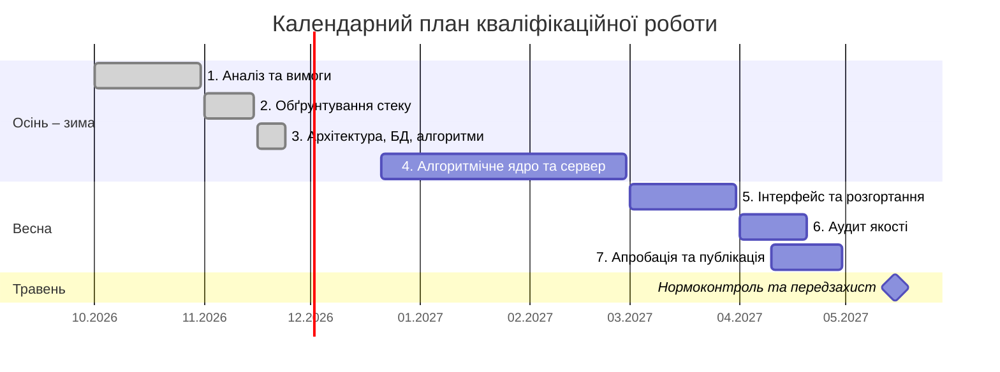

# Recall — документація кваліфікаційної роботи

Пояснювальна записка ведеться за принципом Documentation as Code.

## Структура

| Файл | Розділ |
| --- | --- |
| [0_intro.md](0_intro.md) | Вступ, науковий апарат |
| [1_analysis.md](1_analysis.md) | Розділ 1. Аналіз предметної області та постановка задачі |
| [2_design.md](2_design.md) | Розділ 2. Обґрунтування архітектурних рішень та проєктування системи: архітектурний стиль і ADR (2.1), C4 Level 1–2 (2.2), C4 Level 3 і взаємодія шарів (2.3), контур безпеки (2.4), контракт і карта маршрутів API (2.5), сценарії використання (2.6), ERD (2.7), алгоритми (2.8), інтеграційний аудит (2.9) |
| [srs.md](srs.md) | Додаток А. Software Requirements Specification за ISO/IEC/IEEE 29148 (SRS-FUN, SRS-NFR, сценарії верифікації) |
| [adr/](adr/) | Architecture Decision Records: [ADR-001](adr/0001-choice-of-technology.md) — асинхронна генерація контенту, BullMQ на Redis; [ADR-002](adr/0002-modular-monolith.md) — модульний моноліт за Ports and Adapters |
| [api/openapi.yaml](api/openapi.yaml) | Контракт REST API в OpenAPI 3.0.3: 47 операцій, JWT Bearer, помилки RFC 9457 |
| [3_implementation.md](3_implementation.md) | Розділ 3. Програмна реалізація та тестування |
| [4_conclusions.md](4_conclusions.md) | Висновки |
| [5_references.md](5_references.md) | Список використаних джерел (ДСТУ 8302:2015, за послідовністю посилань) |
| [engineering/](engineering/README.md) | Інженерні нотатки 00–14 і 23 (джерела, не артефакти лабораторних робіт) |

## Відповідність лабораторних робіт підрозділам

| Лабораторна | Підрозділ | Файл |
| --- | --- | --- |
| ЛР5 | 2.2. C4 Level 1–2; 2.3. C4 Level 3; Додаток А (SRS); ADR-001 | [2_design.md](2_design.md), [srs.md](srs.md), [adr/](adr/) |
| ЛР6 | 2.5. Контракт API; 2.7. Модель даних (ERD); 2.8. Алгоритми; 2.9. Інтеграційний аудит | [2_design.md](2_design.md), [api/openapi.yaml](api/openapi.yaml) |
| ЛР7 | 2.1. Архітектурні рішення; 2.3. Ядро системи; 2.4. Безпека (AppSec); 2.5. Карта маршрутів; 2.6. Сценарії використання; висновки до розділу 2; Docs Quality Gate (markdownlint, Vale) | [2_design.md](2_design.md), [5_references.md](5_references.md), `.github/workflows/docs-linter.yml` |

## Розділи 1–2 — робочий документ

Зведений документ Розділів 1–2 (Google Docs, доступ «Can comment» для викладача та наукового керівника): [F2_Diploma_Chapters1-2_Бабин](https://docs.google.com/document/d/1cggdDRN1Fyxuz36UEJYFpk_HaHJx-QDhXFZh2BcgLK8/edit?tab=t.0)

Markdown-версії розділів — [1_analysis.md](1_analysis.md) і [2_design.md](2_design.md), Додаток А — [srs.md](srs.md); джерело підрозділів 1.4–1.5 — [22-Аналіз предметної області.md](22-Аналіз%20предметної%20області.md).

## Матриця нефункціональних вимог (зведення)

Таблиця – Ключові NFRs системи (повна матриця — таблиця 1.4 у [1_analysis.md](1_analysis.md))

| ID | Категорія | Метрика | Перевірка |
| --- | --- | --- | --- |
| NFR-01 | Продуктивність | REST API, читання: p95 ≤ 300 мс при 50 RPS, помилки < 1 % | k6 |
| NFR-02 | Продуктивність | REST API, запис + перерахунок SM-2: p95 ≤ 500 мс при 50 RPS | k6 |
| NFR-03 | Real-time | Доставка події WebSocket: p95 ≤ 1 с при 100 з'єднаннях | k6 |
| NFR-04/05 | Асинхронність | Постановка задачі: 202 Accepted ≤ 200 мс; обробка ≤ 90 с, 3 спроби, dead-letter queue | k6, журнал BullMQ |
| NFR-06/07 | Безпека | JWT (access 15 хв, refresh 30 днів з ротацією), Argon2id (m = 19 456 KiB, t = 2, p = 1), RBAC за role_in_course → 403 | інтеграційні тести |
| NFR-09 | Безпека | 0 Critical/High у npm audit і Trivy; Quality Gate SonarQube Cloud passed | GitHub Actions |
| NFR-10/11 | Надійність | ACID-транзакція «відповідь + ReviewState»; pg_dump і архів PDF щодня, RPO ≤ 24 год, RTO ≤ 1 год | тести, тестове відновлення |
| NFR-12 | Інфраструктура | backend, worker, PostgreSQL, Redis у docker-compose з healthcheck | `docker compose up` |

## Контроль якості документації

На кожен Pull Request у `main` workflow [docs-linter.yml](../.github/workflows/docs-linter.yml) перевіряє `docs/` і кореневий README:

- markdownlint ([.markdownlint.jsonc](../.markdownlint.jsonc)) — ієрархія заголовків, списки, таблиці, блоки коду;
- Vale ([.vale.ini](../.vale.ini), стиль `Recall`) — кирилична транслітерація ІТ-термінів і розмовний сленг (помилка), оцінні слова (попередження).

Протоколи [17-AI Insights.md](17-AI%20Insights.md) і [18-Supervisor Feedback.md](18-Supervisor%20Feedback.md) з перевірки виключено: вони містять дослівні промпти і звіти, які не редагуються.

Останній успішний запуск: [Docs Quality Gate #45504494237](https://github.com/MarcoGr11/Recall/actions/runs/45504494237). Локальна версія markdownlint-cli2 — 0.24.2, як у GitHub Action.

## Календарний план

| № з/п | Назва етапу кваліфікаційної роботи | Термін виконання | Статус |
| --- | --- | --- | --- |
| 1 | Аналіз предметної області та програмних аналогів, формування вимог | Жовтень 2026 | Done |
| 2 | Обґрунтування архітектурного підходу та технологічного стеку | Листопад 2026 | Done |
| 3 | Проєктування архітектури, баз даних та алгоритмів | Листопад 2026 | Done |
| 4 | Розробка алгоритмічного ядра та серверної частини системи | Грудень 2026 – Лютий 2027 | To Do |
| 5 | Розробка інтерфейсу мобільного застосунку та налаштування розгортання | Березень 2027 | To Do |
| 6 | Інструментальний аудит якості програмного забезпечення | Квітень 2027 | To Do |
| 7 | Апробація системи та підготовка наукової публікації | Квітень 2027 | To Do |

Травень 2027 — нормоконтроль пояснювальної записки та передзахист.

