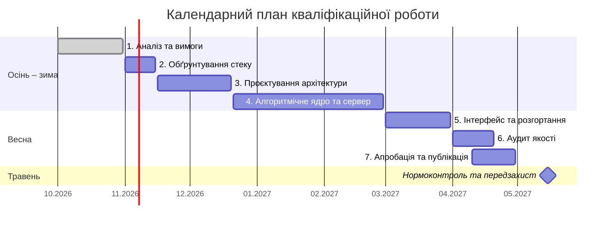

# Recall — документація кваліфікаційної роботи

Пояснювальна записка ведеться за принципом Documentation as Code.

## Структура

| Файл | Розділ |
|---|---|
| [0_intro.md](0_intro.md) | Вступ, науковий апарат |
| [1_analysis.md](1_analysis.md) | Розділ 1. Аналіз предметної області та постановка задачі |
| [2_design.md](2_design.md) | Розділ 2. Проєктування програмної системи |
| [3_implementation.md](3_implementation.md) | Розділ 3. Програмна реалізація та тестування |
| [4_conclusions.md](4_conclusions.md) | Висновки |
| [5_references.md](5_references.md) | Список використаних джерел (ДСТУ 8302:2015, за послідовністю посилань) |
| [engineering/](engineering/README.md) | Інженерні нотатки 00–14 (джерела, не артефакти лабораторних робіт) |

## Розділ 1 — робочий документ

Зведений документ Розділу 1 (Google Docs, доступ «Can comment» для викладача та наукового керівника): [F2_Diploma_Chapter1_Бабин](GOOGLE_DOCS_LINK)

Markdown-версія розділу — [1_analysis.md](1_analysis.md); джерело підрозділів 1.4–1.5 — [22-Аналіз предметної області.md](22-Аналіз%20предметної%20області.md).

## Матриця нефункціональних вимог (зведення)

Таблиця – Ключові NFRs системи (повна матриця — таблиця 1.4 у [1_analysis.md](1_analysis.md))

| ID | Категорія | Метрика | Перевірка |
|---|---|---|---|
| NFR-01 | Продуктивність | REST API, читання: p95 ≤ 300 мс при 50 RPS, помилки < 1 % | k6 |
| NFR-02 | Продуктивність | REST API, запис + перерахунок SM-2: p95 ≤ 500 мс при 50 RPS | k6 |
| NFR-03 | Real-time | Доставка події WebSocket: p95 ≤ 1 с при 100 з'єднаннях | k6 |
| NFR-04/05 | Асинхронність | Постановка задачі: 202 Accepted ≤ 200 мс; обробка ≤ 90 с, 3 спроби, dead-letter queue | k6, журнал BullMQ |
| NFR-06/07 | Безпека | JWT (access 15 хв, refresh 30 днів з ротацією), bcrypt cost ≥ 12, RBAC за role_in_course → 403 | інтеграційні тести |
| NFR-09 | Безпека | 0 Critical/High у npm audit і Trivy; Quality Gate SonarQube Cloud passed | GitHub Actions |
| NFR-10/11 | Надійність | ACID-транзакція «відповідь + ReviewState»; pg_dump щодня, RPO ≤ 24 год, RTO ≤ 1 год | тести, тестове відновлення |
| NFR-12 | Інфраструктура | backend, worker, PostgreSQL, Redis у docker-compose з healthcheck | `docker compose up` |

## Календарний план

| № з/п | Назва етапу кваліфікаційної роботи | Термін виконання | Статус |
|---|---|---|---|
| 1 | Аналіз предметної області та програмних аналогів, формування вимог | Жовтень 2026 | Done |
| 2 | Обґрунтування архітектурного підходу та технологічного стеку | Листопад 2026 | To Do |
| 3 | Проєктування архітектури (C4, UML) та моделі даних | Листопад – Грудень 2026 | To Do |
| 4 | Розробка алгоритмічного ядра та серверної частини системи | Грудень 2026 – Лютий 2027 | To Do |
| 5 | Розробка інтерфейсу мобільного застосунку та налаштування розгортання | Березень 2027 | To Do |
| 6 | Інструментальний аудит якості програмного забезпечення | Квітень 2027 | To Do |
| 7 | Апробація системи та підготовка наукової публікації | Квітень 2027 | To Do |

Травень 2027 — нормоконтроль пояснювальної записки та передзахист.

